# Week 18 — Supply Chain Security

> **Thesis: this is the month that makes you beat other juniors.** Almost no candidate at this level
> can talk credibly about supply chain security, and it is exactly what hiring managers have been
> told to care about since Log4Shell and the build-system compromises that followed it.

| | |
|---|---|
| **Hours** | 35–45 (incl. ~4h job search) |
| **⚑ Bravo** | Supply chain controls complete, with **evidence** |
| **Break/Fix** | BF-51, BF-53 |
| **Exit check** | Your pipeline **demonstrably blocks** a real CVE and refuses an unsigned image |

## The week in one figure

**Figure 18.1 — The pipeline that refuses.** Supply chain security is what makes you beat other juniors. The blue path is the pipeline; the orange boxes are where it says no, with evidence. Every gate hard-fails, cheapest first. Badges are numbered in the order to walk them; the blue path is the one to follow first.

```mermaid
%%{init: {'theme':'base','themeVariables':{'fontFamily':'Helvetica, Arial, sans-serif','fontSize':'13px','primaryColor':'#ffffff','primaryTextColor':'#2d3436','primaryBorderColor':'#9aa3ab','lineColor':'#9aa3ab','textColor':'#2d3436','clusterBkg':'#fbfcfd','clusterBorder':'#d4dae0','edgeLabelBackground':'#ffffff','tertiaryColor':'#eef4fb'},'flowchart':{'curve':'basis','padding':14,'nodeSpacing':42,'rankSpacing':58}}}%%
flowchart LR
  classDef default fill:#ffffff,stroke:#9aa3ab,stroke-width:1.3px,color:#2d3436
  classDef n    fill:#ffffff,stroke:#9aa3ab,stroke-width:1.3px,color:#2d3436
  classDef crit fill:#eef4fb,stroke:#2f6fb8,stroke-width:1.8px,color:#1b3a5c
  classDef data fill:#f4f7fa,stroke:#9aa3ab,stroke-width:1.3px,color:#2d3436
  classDef mut  fill:#ffffff,stroke:#cfd6dc,stroke-width:1.1px,color:#7a8288
  classDef warn fill:#fdf0ec,stroke:#c0522d,stroke-width:1.6px,color:#8a3a1e

  C["① commit<br/><small>the PR</small>"]:::crit
  GL["② gitleaks<br/><small>secrets · full history</small>"]:::warn
  SG["③ Semgrep<br/><small>SAST · your own rule: no hardcoded DB URL</small>"]:::warn
  TF["④ Trivy fs<br/><small>SCA · fails on fixable HIGH and CRITICAL</small>"]:::warn
  BLD["⑤ build<br/><small>distroless · non-root · read-only · before/after size and CVE count recorded</small>"]:::crit
  TI["⑥ Trivy image<br/><small>the shipped layers, not the source</small>"]:::warn
  SB["⑦ syft SBOM<br/><small>SPDX · attached to the image as an attestation</small>"]:::data
  CS["⑧ cosign sign<br/><small>keyless · signs the DIGEST, not the tag · Fulcio cert · Rekor log</small>"]:::crit
  ECR["⑨ registry<br/><small>image + signature + SBOM, by digest</small>"]:::data
  ADM["⑩ admission verify<br/><small>Kyverno verifyImages · unsigned image refused</small>"]:::warn
  EV["⑪ evidence/<br/><small>screenshot: the CVE blocked · screenshot: the unsigned refusal</small>"]:::n
  SL["⑫ SLSA<br/><small>provenance levels · which control would have caught each real attack</small>"]:::mut
  C ==> GL ==> SG ==> TF ==> BLD ==> TI ==> SB ==> CS ==> ECR ==> ADM
  TF -.-> EV
  ADM -.-> EV
  CS -.-> SL
  linkStyle 0,1,2,3,4,5,6,7,8 stroke:#2f6fb8,stroke-width:2px
```

**What to say, badge by badge** · about four minutes at a normal pace. Point at each badge as you say its line.

- **Open.** “Almost no candidate at this level can talk credibly about supply chain security, and hiring managers have been told to care since Log4Shell. This is a pipeline that refuses, and the two refusals come with screenshots. Follow the line; stop at every orange box.”
- **① commit.** “A pull request opens. Everything to the right runs before a human looks at it, and the cheapest checks run first so a leaked key fails in seconds, not after a ten-minute build.”
- **② gitleaks.** “Secrets, scanned across the full history, because a key deleted in the next commit is still in the repository. The same binary, the same version, runs in the pre-commit hook and in CI.”
- **③ Semgrep.** “Static analysis on the source. You write one rule yourself, no hardcoded database URL, so you understand that a scanner is a pattern someone chose, not an oracle.”
- **④ Trivy on the filesystem.** “Dependency scanning against the lockfiles. The gate fails on fixable HIGH and CRITICAL. Fixable is the key word: an unfixable finding goes to an exception with an expiry and an owner, which is the week-19 control narrative.”
- **⑤ build.** “Distroless base, non-root user, read-only filesystem. Measure the image size and CVE count before and after and write both numbers down. No shell in the image means no `kubectl exec sh`, for you and for an attacker.”
- **⑥ Trivy on the image.** “Scan what ships, not what you compiled from. Base image CVEs live here, and they are most of the count.”
- **⑦ syft SBOM.** “A software bill of materials in SPDX, attached to the image as an attestation. When the next Log4Shell lands, this is how you answer 'are we affected' in minutes instead of days.”
- **⑧ cosign sign.** “Keyless: the workflow's OIDC identity gets a short-lived certificate from Fulcio, the signature is recorded in the Rekor transparency log, and what is signed is the digest. A tag can be moved; a digest cannot.”
- **⑨ registry.** “The image, its signature, and its SBOM, all addressed by digest. Pulling by tag is convenience; verifying by digest is the control.”
- **⑩ admission verify.** “Kyverno's verifyImages checks the signature at admission against the expected identity. An unsigned image, or one signed by the wrong workflow, is refused before it runs. Push one on purpose and capture the refusal.”
- **⑪ evidence.** “Two screenshots in the repository: a deliberately introduced critical CVE blocking the build, and an unsigned image refused at admission. Evidence is what separates a control from a claim, and Gate 5 asks for it live.”
- **⑫ SLSA.** “The provenance levels give you vocabulary: who built it, from what, on what builder, with what guarantees. Thursday's case studies ask one question of each real attack: which of these boxes would have caught it.”
- **Close.** “Scan the source, harden the build, scan the image, describe it, sign the digest, verify at the door. Then prove it twice with a screenshot. That is the month that beats other juniors.”

---

## Day plan
| Day | Focus | Lab |
|---|---|---|
| Mon | SAST, SCA, secret scanning — wire the gates | Lab 1 |
| Tue | Image hardening: distroless, non-root, read-only, measured | Lab 2 |
| Wed | **SBOM + signing + verification** | Lab 3 |
| Thu | SLSA, provenance, and the real attack case studies | Lab 4 |
| Fri | Break/Fix + ⚑ Bravo evidence capture | Lab 5 |
| Sat | ⚑ Bravo pipeline end to end; 15 applications | — |
| Sun | Review; plan week 19 | — |

## Reading map
- `_reference/devsecops/content-module-06-security-scanning.md`
- `_reference/devsecops/content-module-03-container-security.md`
- `_reference/devsecops/content-module-10-vulnerability-management.md`
- `_reference/devsecops/content-module-12-devsecops-practices.md`
- `_reference/devsecops/implementation/02-security-pipeline-architecture.md`
- `_reference/devsecops/implementation/02-security-pipeline-best-practices.md`
- `_reference/devsecops/implementation/cross-cutting-vulnerability-sinks.md`
- `_reference/devsecops/implementation/cross-cutting-sarif-integration.md`
- `_reference/devsecops/threat-modeling/content-06-advanced-supply-chain.md`
- **Case studies (anonymized):** `_reference/devsecops/threat-modeling/case-studies-orionsoft.md`,
  `-log4shell.md`, `-moveit.md`

## Labs
[labs/LABS.md](labs/LABS.md) · [solutions/SOLUTIONS.md](solutions/SOLUTIONS.md)

## Exit criteria
- [ ] Semgrep, Trivy, and gitleaks running in CI as **hard gates**
- [ ] A deliberately-introduced critical CVE **blocks the build** — screenshot in `evidence/`
- [ ] Image hardened: **record the before/after size and CVE count**
- [ ] SBOM generated with syft and attached to the image
- [ ] Image signed with cosign (keyless); verification enforced
- [ ] An **unsigned image is refused** — screenshot in `evidence/`
- [ ] You can explain a real supply-chain attack and which control would have caught it
