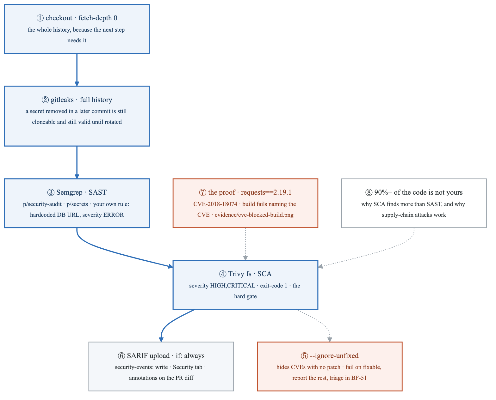
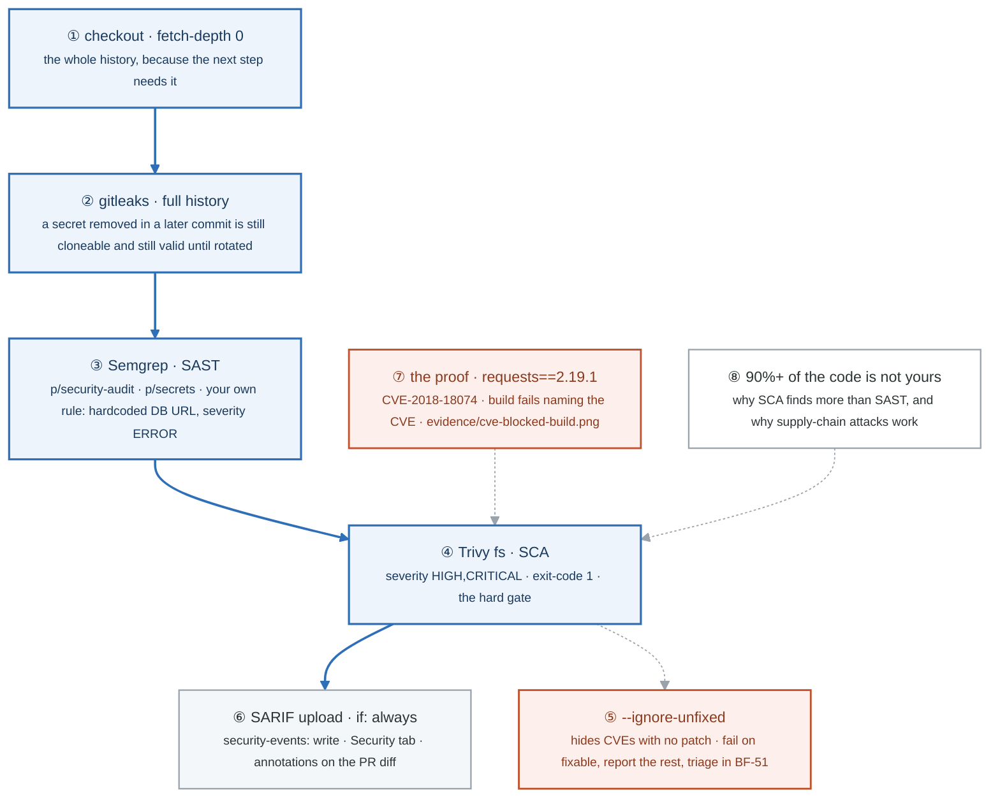
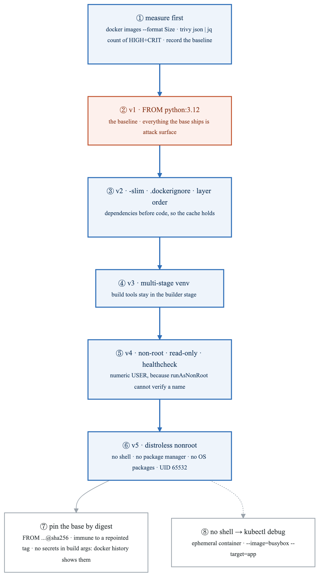
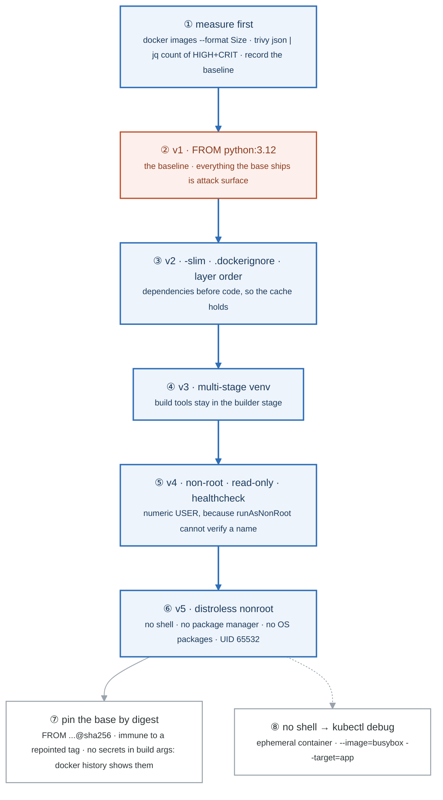
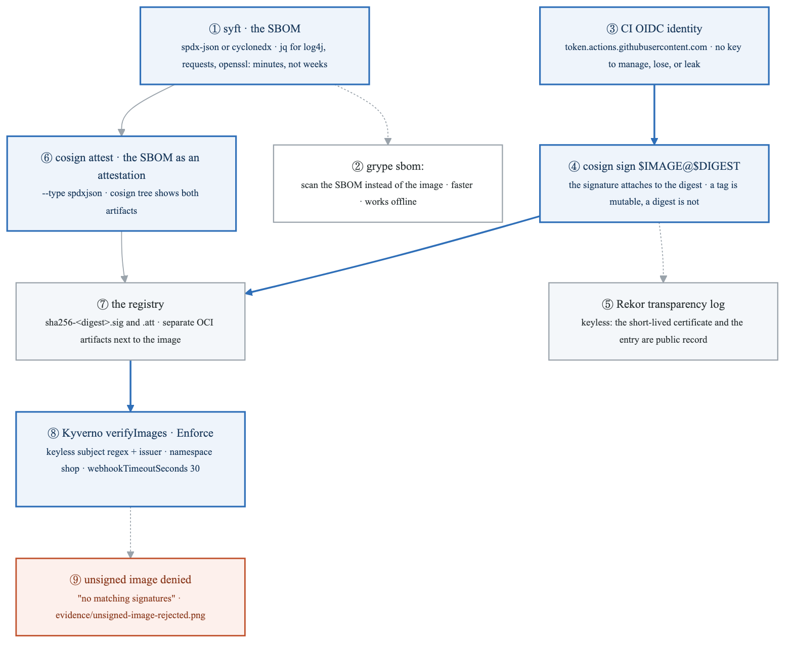
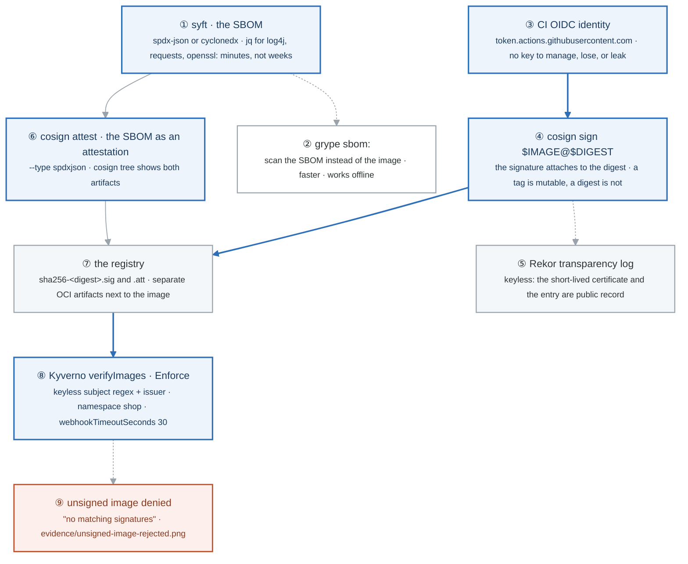
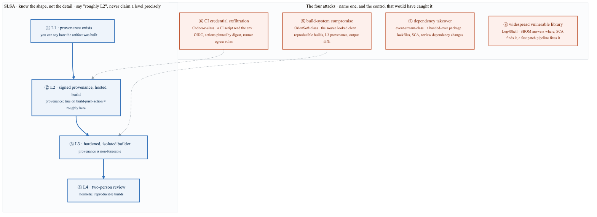
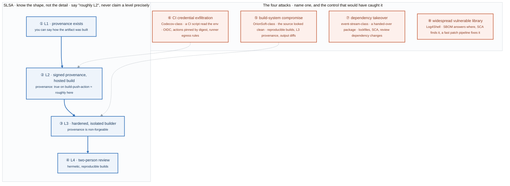
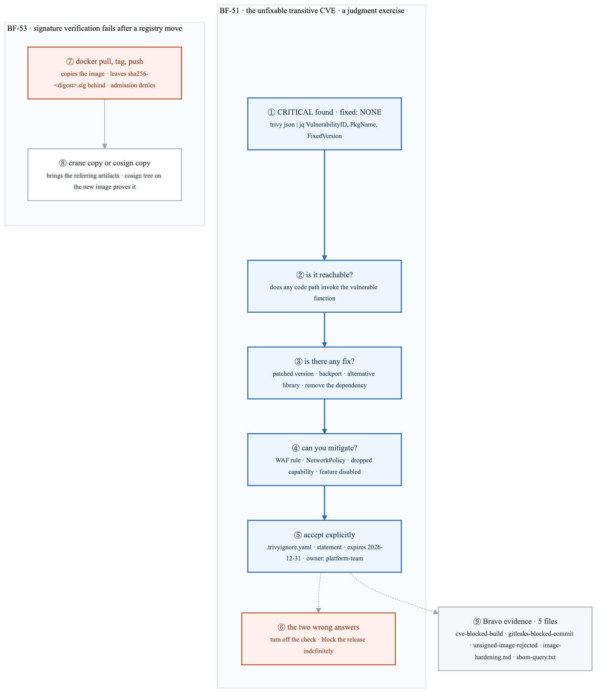
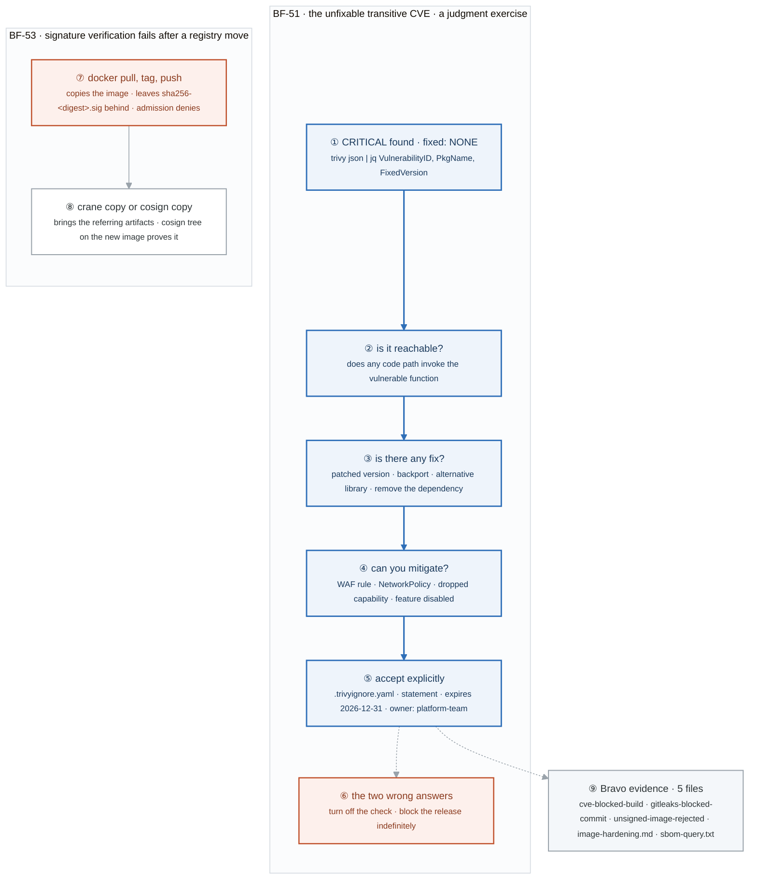

# Week 18 — Lab figures

> One figure per lab, numbered 18.2 to 18.6. Figure 18.1 is the week figure in
> [`../content/FIGURE.md`](../content/FIGURE.md); these five go one level down, to the mechanism each
> lab makes you touch. Same language: gray is structure, **blue is the path to follow first**,
> orange-red is where something refuses, washed boxes are stores. Each badge line is a thirty-second
> interview answer; each whole script is under three minutes.

**The protocol per figure**

1. **Before the lab:** read the figure, say the badges out loud once. You now know what you are about to prove.
2. **During the lab:** every badge has a **Prove it** command. Run it and watch the badge happen. A badge you cannot see happen is one you are taking on faith.
3. **After the lab:** close the file, redraw the figure, say the script. Check against the file. The badge where the order slipped goes in the *Figures redrawn* column of `progress.md`.
4. **Own the numbers.** The *Numbers to own* table is what separates "I scan images" from "fail on fixable HIGH and CRITICAL, report the unfixable ones, and triage each with an owner and an expiry."
5. **Answer the question.** Each figure ends with the question a senior interviewer asks about it. Answer it cold, in under a minute, before the gate.

---

## Figure 18.2 — Lab 1: three scanners, one hard gate, and the proof that it refuses

> Lab 1 · badges ① to ⑧ · about three minutes. Reads top-down.

<!-- figure: generated from the Mermaid below by _shared/diagrams/embed-figures.py — do not edit the image -->


<details>
<summary>Diagram source (Mermaid)</summary>



</details>

### Say it, badge by badge

- **Open.** "Three scanners look at three different things: your source, your dependencies, and your history. One of them is wired as a hard gate, and the lab ends with a screenshot of that gate refusing a real CVE. Follow the blue path down the job."
- **① checkout with fetch-depth 0.** "The default checkout is one commit deep. gitleaks needs every commit, because the secret you are looking for was deleted three commits ago."
- **② gitleaks on the full history.** "A credential removed from the working tree is still in the clone. It is still valid unless someone rotated it. The scan runs with `--log-opts=--all`, and the pre-commit form, `gitleaks protect --staged`, stops the next one before it lands."
- **③ Semgrep.** "Static analysis of your own code: injection, traversal, unsafe deserialization. The lab makes you write one rule, a database URL with embedded credentials, because writing a rule is the difference between running a tool and understanding it."
- **④ Trivy filesystem scan.** "Dependencies, secrets, and misconfiguration in one pass. Severity HIGH and CRITICAL, exit code 1. This is the step that fails the build; the other two report."
- **⑤ --ignore-unfixed.** "It hides every CVE with no available patch. That stops the build failing on things you cannot fix, and it also hides real risk. The defensible position: fail on fixable, report the unfixable, and triage each one explicitly. Lab 5 is that triage."
- **⑥ SARIF upload.** "`if: always`, so findings land even when the step fails. They appear in the Security tab and as annotations on the PR diff instead of a wall of log text. Small, and it is the detail that makes developers read the output."
- **⑦ the proof.** "Add `requests==2.19.1`, push, watch the job fail naming CVE-2018-18074. Screenshot it into `evidence/`. A gate you have never seen refuse is a gate you are assuming."
- **⑧ ninety percent is not yours.** "A typical application is ninety percent third-party by line count. That is why SCA matters more than SAST for most teams, and why attacking a dependency is cheaper than attacking you."
- **Close.** "History, source, dependencies. Report, report, refuse. Then prove the refusal with a known CVE and keep the screenshot."

### Numbers to own

| Number | Where it comes from | Why it matters |
|---|---|---|
| `fetch-depth: 0` | the checkout step | full history; without it gitleaks scans one commit |
| `exit-code: '1'` on HIGH,CRITICAL | the Trivy step | the only hard gate in the job; the others report |
| `security-events: write` | the job permissions | the one extra permission SARIF upload needs |
| `requests==2.19.1` → CVE-2018-18074 | the proof task | a known, fixable CVE that any SCA tool catches; the screenshot is an acceptance criterion |
| 90%+ third-party | the lab | the reason SCA outranks SAST for most teams |
| 3 scanner categories, plus DAST out of scope | the lab's table | SAST on source · SCA on dependencies · secrets on files and history · DAST on a running app |

### Prove it

```bash
gitleaks detect --source . --log-opts="--all"                          # ② the whole history
semgrep --config=.semgrep/no-hardcoded-db-url.yml app/                 # ③ your own rule fires
trivy fs --scanners vuln,secret,misconfig --severity HIGH,CRITICAL --exit-code 1 .   # ④ the gate
trivy image --ignore-unfixed myapp:latest                              # ⑤ compare the count with and without
echo "requests==2.19.1" >> app/requirements.txt && git commit -am "test: introduce a known CVE" && git push   # ⑦
```

### The question a senior interviewer asks

*"Why does SCA matter more than SAST for most teams, and what does `--ignore-unfixed` trade away?"*
Badges ⑧ then ⑤. Most of the code is not yours, so most of the vulnerabilities are not in your source. Ignoring unfixed CVEs keeps the build green and hides risk; the answer is fail on fixable, report unfixable, triage with an owner and an expiry.

---

## Figure 18.3 — Lab 2: five images, measured at every step

> Lab 2 · badges ① to ⑧ · about three minutes. Reads top-down; the numbers in the table are yours to fill.

<!-- figure: generated from the Mermaid below by _shared/diagrams/embed-figures.py — do not edit the image -->


<details>
<summary>Diagram source (Mermaid)</summary>



</details>

### Say it, badge by badge

- **Open.** "Image hardening is a progression with a number at every step. The lab's rule is measure before you change anything, so that by the end you can say what each step bought. Follow the blue path from the baseline to distroless."
- **① measure first.** "Size from `docker images`, HIGH and CRITICAL count from Trivy's JSON through jq. Write both down for v1 before touching the Dockerfile. Without the baseline there is no story."
- **② v1, the full base.** "`FROM python:3.12` ships a complete Debian userland. Every package in it is a CVE source you did not ask for."
- **③ v2, slim and ordered.** "The slim tag drops most of that. `.dockerignore` keeps `.git` and test data out of the context. Requirements copied before code means a code change does not reinstall dependencies: week 4's cache lesson, applied."
- **④ v3, multi-stage.** "Build in one stage, copy the virtualenv into a clean runtime stage. Compilers and headers never reach the final image."
- **⑤ v4, non-root, read-only, healthcheck.** "A numeric `USER`, because Kubernetes `runAsNonRoot` verifies a UID, not a name. Read-only root means an attacker with code execution cannot write a payload to disk. The healthcheck is what the orchestrator will ask."
- **⑥ v5, distroless.** "No shell, no package manager, no OS packages. The CVE surface is close to zero and the image runs as UID 65532 by default. This is where the measured count drops the most."
- **⑦ pin by digest.** "`FROM python:3.12-slim@sha256:...` is reproducible and immune to someone repointing the tag. And nothing secret in build args, because `docker history` prints them."
- **⑧ no shell means kubectl debug.** "You cannot exec into distroless. The answer is an ephemeral debug container targeting the app's process namespace. Saying this unprompted shows you have thought past the recommendation to its operational cost."
- **Close.** "Measure, slim, stage, drop privileges, remove the OS. Five numbers in a table, and a sentence like 'from 1.02 GB to 155 MB and 45 to 8 HIGH and CRITICAL' that an interviewer remembers."

### Numbers to own

| Number | Where it comes from | Why it matters |
|---|---|---|
| 5 image versions | the progression table | v1 full · v2 slim · v3 multi-stage · v4 non-root and read-only · v5 distroless; each measured |
| 2 measurements per version | the lab | size in MB and HIGH+CRITICAL count; both go in the README |
| 1.02 GB → 155 MB, 45 → 8 | the lab's example sentence, not a measurement; yours replace it | the shape of the interview answer |
| UID `65532` | distroless `nonroot` images (well-known default) | what `runAsNonRoot` can verify; a username cannot be |
| 7 checklist controls | the lab's table | minimal base · numeric USER · read-only root · drop ALL · no-new-privileges · digest pin · no secrets in build args |
| 1 debug path | `kubectl debug` | the operational cost of no shell, and its answer |

### Prove it

```bash
docker images app:v1 --format '{{.Size}}'                                                # ① size
trivy image --severity HIGH,CRITICAL --format json app:v1 | jq '[.Results[].Vulnerabilities // [] | length] | add'   # ① count
for v in v1 v2 v3 v4 v5; do docker build -q -t app:$v -f Dockerfile.$v . ; done          # ② to ⑥ the progression
docker history app:v1 | head                                                             # ⑦ what build args leak
kubectl debug -it POD --image=busybox --target=app                                        # ⑧ into a shell-less pod
```

### The question a senior interviewer asks

*"Distroless has no shell. How do you debug it in production?"*
Badge ⑧, then the reason you accepted that cost, badge ⑥. An ephemeral debug container shares the target's process namespace without changing the image. If you answer "I would add a shell back," you have undone the control.

---

## Figure 18.4 — Lab 3: SBOM, a signature on the digest, and the admission check that enforces it

> Lab 3 · badges ① to ⑨ · about three and a half minutes. Reads top-down.

<!-- figure: generated from the Mermaid below by _shared/diagrams/embed-figures.py — do not edit the image -->


<details>
<summary>Diagram source (Mermaid)</summary>



</details>

### Say it, badge by badge

- **Open.** "Three things happen to an image before it is allowed to run: an inventory is written, a signature is attached to its digest, and a cluster policy refuses anything without one. The blue path is the signature from identity to admission."
- **① syft, the SBOM.** "A machine-readable list of every package in the image. The question it answers is 'are we affected, and where?' When Log4Shell dropped, teams with SBOMs ran a query; teams without spent weeks grepping. That is the whole value, and it beats 'compliance requires it'."
- **② grype against the SBOM.** "Scan the inventory instead of the image. Faster, and it works with no registry access."
- **③ CI OIDC identity.** "Keyless signing uses the workflow's OIDC token as its identity. There is no signing key to store in a secret, rotate, or leak. Week 12's token, doing a second job."
- **④ cosign sign on the digest.** "`$IMAGE@$DIGEST`, never `$IMAGE:tag`. A tag can be repointed tomorrow; the digest is the content. Sign the content."
- **⑤ Rekor.** "Keyless signing issues a short-lived certificate for the identity and records the signing event in a public transparency log. Verification checks the log, not a key you hold."
- **⑥ cosign attest.** "The SBOM is attached as a signed attestation of the same digest. `cosign tree` lists the signature and the attestation side by side."
- **⑦ the registry.** "Signatures and attestations are separate OCI artifacts, tagged `sha256-<digest>.sig` and `.att`, sitting next to the image. That storage detail is what Lab 5's BF-53 is about."
- **⑧ Kyverno verifyImages.** "An admission policy in Enforce mode for the shop namespace: the image must carry a signature whose certificate subject matches your repository and whose issuer is GitHub's OIDC. Thirty-second webhook timeout, because verification calls out."
- **⑨ unsigned image denied.** "Push a retagged `nginx:alpine`, try to run it: 'no matching signatures'. Screenshot it into evidence. The gate exists only once you have watched it refuse."
- **Close.** "Inventory, sign the digest, log it, attest the inventory, refuse at the door. Build-time trust that the cluster enforces at run time."

### Numbers to own

| Number | Where it comes from | Why it matters |
|---|---|---|
| 2 SBOM formats | `-o spdx-json`, `-o cyclonedx-json` | the two standard formats; either answers "do we ship X?" |
| 1 signing key | none; keyless via OIDC | nothing to manage, nothing to leak |
| `@$DIGEST`, not `:tag` | the CI step | a signature on a tag would travel with whatever the tag points at next |
| 2 artifacts per image | `cosign tree` | `.sig` and `.att`, stored next to the image by digest |
| `webhookTimeoutSeconds: 30` | the Kyverno policy | verification is a network call; the default is shorter |
| minutes vs days or weeks | the Log4Shell comparison in the lab | the SBOM's value, stated as time |

### Prove it

```bash
syft myapp:latest -o spdx-json > sbom.spdx.json && jq -r '.packages[] | select(.name | test("requests")) | "\(.name) \(.versionInfo)"' sbom.spdx.json   # ①
grype sbom:./sbom.spdx.json                                                                   # ②
cosign sign --yes "$IMAGE@$DIGEST"                                                            # ③ ④ ⑤
cosign attest --yes --predicate sbom.spdx.json --type spdxjson "$IMAGE@$DIGEST" && cosign tree "$IMAGE@$DIGEST"   # ⑥ ⑦
kubectl -n shop run test --image=$REGISTRY/unsigned-test:latest                                # ⑨ denied
```

### The question a senior interviewer asks

*"Why do signatures attach to the digest, and what does keyless signing put in Rekor instead of a key?"*
Badges ④ and ⑤. A tag is a pointer that can move; the digest is the bytes. Keyless replaces a long-lived key with a short-lived certificate bound to the OIDC identity, and the public log is the record that the signing happened. Then badge ⑧: the verifier checks subject and issuer, not a key.

---

## Figure 18.5 — Lab 4: the SLSA ladder, and the four attacks it answers

> Lab 4 · badges ① to ⑧ · about two and a half minutes. Reads top-down: the ladder on top, the attacks underneath pointing at the rung that would have caught them.

<!-- figure: generated from the Mermaid below by _shared/diagrams/embed-figures.py — do not edit the image -->


<details>
<summary>Diagram source (Mermaid)</summary>



</details>

### Say it, badge by badge

- **Open.** "SLSA is a ladder of how much you can trust the story of how an artifact was built. The four cases underneath are real attack classes, anonymized, and each maps to a control you have already built. Controls that come from a threat model beat controls that come from a vendor list."
- **① L1.** "Provenance exists. You can state, from a record, how the artifact was built. Most teams are not here."
- **② L2.** "The provenance is signed and produced by a hosted build service. `provenance: true` on the build action gets you roughly here for free. Say roughly; overclaiming a level is worse than not mentioning it."
- **③ L3.** "The build runs on hardened, isolated infrastructure and the provenance cannot be forged by the build itself. This is the rung that answers a compromised build system."
- **④ L4.** "Two-person review and hermetic, reproducible builds. Know it exists; do not claim it."
- **⑤ build-system compromise.** "Malicious code injected into the build, so the source looked clean. Reproducible builds and non-forgeable provenance from a hardened builder would have shown that the output did not match the input."
- **⑥ CI credential exfiltration.** "A modified CI script read environment variables out of thousands of pipelines. OIDC instead of static secrets means there is nothing long-lived to steal; pinning actions by digest means the script cannot change under you; egress rules on runners stop the upload."
- **⑦ dependency takeover.** "A maintainer handed a popular package to someone who added a malicious dependency. Lockfiles pin what you install, SCA sees the new package, and reviewing dependency changes, not just additions, catches the handover."
- **⑧ widespread vulnerable library.** "A critical RCE in a logging library everyone ships. The SBOM says where you are affected in minutes; SCA finds it; the patch pipeline is how fast you can act."
- **Close.** "Four rungs, four attacks. Pick one attack and name the control: that is the interview answer, because it shows the control came from a threat."

### Numbers to own

| Number | Where it comes from | Why it matters |
|---|---|---|
| 4 SLSA levels | the lab's table | provenance exists · signed and hosted · hardened and non-forgeable · two-person and hermetic |
| "roughly L2" | `provenance: true` on `docker/build-push-action` | the honest claim; precision here is overclaiming |
| 4 attack classes | the lab's table | build-system · CI credentials · dependency takeover · ubiquitous library |
| 3 controls per attack | the lab's third column | the shape of the answer: name the attack, name the controls |

### Prove it

```bash
docker buildx imagetools inspect "$IMAGE" --format '{{json .Provenance}}' | head -c 400   # ② provenance attached by the build
grep -n 'uses:.*@[0-9a-f]\{40\}' .github/workflows/*.yml | head                           # ⑥ actions pinned by digest
git diff HEAD~1 -- package-lock.json requirements.txt | head                              # ⑦ review dependency changes
jq -r '.packages[] | select(.name | test("log4j")) | .versionInfo' sbom.spdx.json        # ⑧ the SBOM query
```

### The question a senior interviewer asks

*"Pick the Codecov-class attack. Which three controls would have stopped it?"*
Badge ⑥: OIDC so there is no static secret in the environment worth exfiltrating, actions pinned by digest so the script cannot be swapped, and egress restrictions on runners so the upload fails. Then badge ②: that is also roughly what L2 provenance assumes about the builder.

---

## Figure 18.6 — Lab 5: the CVE you cannot fix, and the signature that did not move

> Lab 5 · badges ① to ⑨ · about three minutes. Reads top-down. The Break/Fix method itself is
> [Figure BF.0](../../_shared/breakfix/FIGURE.md); this figure is the two decisions specific to this week.

<!-- figure: generated from the Mermaid below by _shared/diagrams/embed-figures.py — do not edit the image -->


<details>
<summary>Diagram source (Mermaid)</summary>



</details>

### Say it, badge by badge

- **Open.** "Two Friday failures, and one of them is not technical at all. The first is the question interviewers love: a CRITICAL with no fix. The second is a signature that stayed behind when the image moved."
- **① CRITICAL found, no fix.** "Trivy's JSON, filtered to CRITICAL, printed with the fixed version. `fixed: NONE` is the case. Blocking the build on it forever is not a plan."
- **② is it reachable?** "Does your code ever call the vulnerable function? In the lab's example the parser only runs on a SAML login path that is disabled. Unreachable is a real answer, but it has to be written down with the reason."
- **③ is there any fix?** "A patched version, a backport, an alternative library, or removing the dependency. Check all four before saying no."
- **④ can you mitigate?** "A WAF rule, a NetworkPolicy that denies the egress the exploit needs, a dropped capability, the feature turned off. A compensating control changes the risk even when the code does not."
- **⑤ accept explicitly.** "A `.trivyignore.yaml` entry with the path, a statement of why, an expiry, and an owner. The expiry is the mechanism: it forces the decision back onto the board instead of letting it rot."
- **⑥ the two wrong answers.** "Turn off the scanner, or block the release indefinitely. Both are common, both are what a junior says. The winning sentence is: I document a time-boxed, owned exception with a compensating control."
- **⑦ the registry move.** "Pull, retag, push copies the image manifest and layers. The signature is a separate artifact tagged by the digest, and it stays in the old registry. Admission in the new cluster says no matching signatures, and it is right."
- **⑧ crane copy or cosign copy.** "Both copy the image and the artifacts that refer to it. `cosign tree` on the new reference shows the signature arrived."
- **⑨ the evidence.** "Five files this week: the blocked CVE build, the refused secret commit, the denied unsigned image, the hardening table, and an SBOM query. Each is a screenshot or a file, not a sentence."
- **Close.** "Reachable, fixable, mitigable, accepted with an expiry. And when an image moves, move its signature with it."

### Numbers to own

| Number | Where it comes from | Why it matters |
|---|---|---|
| 4 triage questions, in order | the lab | reachable · fixable · mitigable · accept explicitly |
| 4 fields on an exception | the `.trivyignore.yaml` example | path · statement · expires · owner; the expiry is what makes it time-boxed |
| `expires: 2026-12-31` | the lab's example | the date the decision comes back |
| 2 wrong answers | the lab | disable the check · block forever |
| `sha256-<digest>.sig` | how cosign stores signatures | a separate OCI artifact; pull/push does not carry it |
| 5 evidence files | the Bravo checklist | the week's acceptance criteria |

### Prove it

```bash
trivy image --severity CRITICAL --format json $IMAGE | jq -r '.Results[].Vulnerabilities[] | "\(.VulnerabilityID) \(.PkgName) \(.InstalledVersion) fixed:\(.FixedVersion // "NONE")"'   # ①
trivy image --severity CRITICAL --ignorefile .trivyignore.yaml $IMAGE                          # ⑤ the exception applies
docker pull $OLD_IMAGE && docker tag $OLD_IMAGE $NEW_IMAGE && docker push $NEW_IMAGE && cosign tree $NEW_IMAGE   # ⑦ nothing listed
crane copy $OLD_IMAGE $NEW_IMAGE && cosign tree $NEW_IMAGE                                      # ⑧ the signature is there
ls evidence/                                                                                    # ⑨ five files
```

### The question a senior interviewer asks

*"A CRITICAL CVE has no fix. Do you ship?"*
Badges ② to ⑤ in order, out loud, ending with the sentence from badge ⑥: a time-boxed, owned exception with a compensating control. The follow-up is "what if it is reachable and you cannot mitigate?" Then you do not ship, and the expiry is irrelevant because the block is the decision.

---

## Redraw schedule

Same cadence as the week figure, see [`../../FIGURES.md`](../../FIGURES.md): Friday of this week after break/fix, Sunday of week 20, and cold on the Gate 5 Sunday in week 21. Lab figures are redrawn **after** the week figure, one at a time, and only the badge order has to be right; the captions are the check, not the test.
