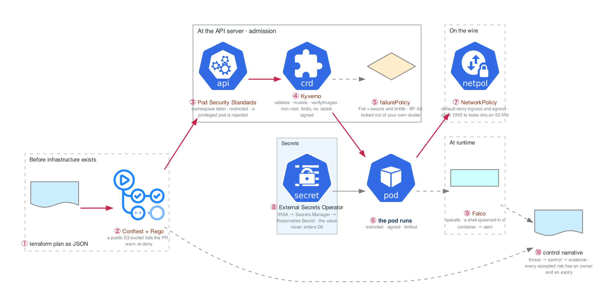

# Week 19 — Policy, Runtime Security, and Secrets

> **Thesis:** scanning finds problems; **policy prevents them**. The shift from "we detect insecure
> deployments" to "insecure deployments cannot happen" is the whole point of DevSecOps, and admission
> control is where it happens.

| | |
|---|---|
| **Hours** | 35–45 (incl. ~4h job search) |
| **Deliverable** | Blog post #10 — "I wrote an admission policy that locked me out of my own cluster" |
| **⚑ Bravo** | Policy and runtime layers complete |
| **Break/Fix** | BF-52, BF-54, BF-55 |

> **EKS week again.** `bash ../_setup/03-teardown.sh` every night. Most of this works on kind — use
> kind for policy work and EKS only for the IRSA/External Secrets parts.

## The week in one figure

**Figure 19.1 — Where each control sits: before the plan, at the door, on the wire, at runtime.** Scanning finds problems; policy prevents them. The figure places every control on the path a workload takes, so you can say where each one would have stopped a given attack.

**Say it, badge by badge:** [`content/FIGURE.md`](content/FIGURE.md) — the spoken script for each of the 10 badges, about four minutes; [`content/figure-19.1-numbered-spoken.pdf`](content/figure-19.1-numbered-spoken.pdf) is the printable two-page version. Read the figure before the day plan; say the script on Friday.

---

## Day plan
| Day | Focus | Lab |
|---|---|---|
| Mon | Policy as code: OPA/Conftest for Terraform | Lab 1 |
| Tue | Kyverno admission control + Pod Security Standards | Lab 2 |
| Wed | NetworkPolicies and default-deny | Lab 3 |
| Thu | Secrets management + runtime detection (Falco) | Lab 4 |
| Fri | Break/Fix + compliance mapping | Lab 5 |
| Sat | ⚑ Bravo: policy layer complete + evidence; 15 applications | — |
| Sun | Blog post #10; plan week 20 | — |

## Reading map
- `_reference/devsecops/content-module-04-kubernetes-security.md`
- `_reference/devsecops/content-module-05-secrets-management.md`
- `_reference/devsecops/content-module-08-compliance-frameworks.md`
- `_reference/devsecops/content-module-11-network-security.md`
- `_reference/devsecops/implementation/05-runtime-security-architecture.md`
- `_reference/devsecops/implementation/06-compliance-as-code-architecture.md`
- `_reference/kubernetes/03-production/02-security-rbac-exercises-02-pod-security.md`
- `_reference/kubernetes/03-production/02-security-rbac-exercises-04-opa-gatekeeper.md`
- `_reference/kubernetes/02-core-ops/01-networking-deep-dive-exercises-01-network-policies.md`
- `_reference/devsecops/threat-modeling/templates-compliance-mapping-template.md`

## Labs
[labs/LABS.md](labs/LABS.md) · [labs/FIGURES.md](labs/FIGURES.md) (figures 19.2 to 19.6, one per lab) · [solutions/SOLUTIONS.md](solutions/SOLUTIONS.md)

## Exit criteria
- [ ] Conftest policy failing a Terraform plan with a public S3 bucket
- [ ] Kyverno enforcing: non-root, resource limits, no `:latest`, signed images
- [ ] Pod Security Standard `restricted` enforced; a privileged pod rejected
- [ ] Default-deny NetworkPolicy **with DNS allowed**; a blocked flow demonstrated
- [ ] External Secrets syncing from AWS Secrets Manager
- [ ] Falco alerting on a shell spawned in a container
- [ ] STRIDE threat model written up for Bravo
- [ ] Control narrative table mapping threat → control → **evidence**
