# Week 19 — Policy, Runtime Security, and Secrets

> **Thesis:** scanning finds problems; **policy prevents them**. The shift from "we detect insecure
> deployments" to "insecure deployments cannot happen" is the whole point of DevSecOps, and admission
> control is where it happens.

| | |
|---|---|
| **Hours** | 35–45 (incl. ~4h job search) |
| **Deliverable** | Blog post #10 — "I wrote an admission policy that locked me out of my own cluster" |
| **⚑ Bravo** | Policy and runtime layers complete |
| **Break/Fix** | BF-52, BF-54, BF-55 |

> **EKS week again.** `bash ../_setup/03-teardown.sh` every night. Most of this works on kind — use
> kind for policy work and EKS only for the IRSA/External Secrets parts.

## The week in one figure

**Figure 19.1 — Where each control sits: before the plan, at the door, on the wire, at runtime.** Scanning finds problems; policy prevents them. The figure places every control on the path a workload takes, so you can say where each one would have stopped a given attack. Badges are numbered in the order to walk them; the blue path is the one to follow first.

```mermaid
%%{init: {'theme':'base','themeVariables':{'fontFamily':'Helvetica, Arial, sans-serif','fontSize':'13px','primaryColor':'#ffffff','primaryTextColor':'#2d3436','primaryBorderColor':'#9aa3ab','lineColor':'#9aa3ab','textColor':'#2d3436','clusterBkg':'#fbfcfd','clusterBorder':'#d4dae0','edgeLabelBackground':'#ffffff','tertiaryColor':'#eef4fb'},'flowchart':{'curve':'basis','padding':14,'nodeSpacing':42,'rankSpacing':58}}}%%
flowchart LR
  classDef default fill:#ffffff,stroke:#9aa3ab,stroke-width:1.3px,color:#2d3436
  classDef n    fill:#ffffff,stroke:#9aa3ab,stroke-width:1.3px,color:#2d3436
  classDef crit fill:#eef4fb,stroke:#2f6fb8,stroke-width:1.8px,color:#1b3a5c
  classDef data fill:#f4f7fa,stroke:#9aa3ab,stroke-width:1.3px,color:#2d3436
  classDef mut  fill:#ffffff,stroke:#cfd6dc,stroke-width:1.1px,color:#7a8288
  classDef warn fill:#fdf0ec,stroke:#c0522d,stroke-width:1.6px,color:#8a3a1e

  subgraph TFP["Before infrastructure exists"]
    direction LR
    PL["① terraform plan as JSON"]:::n
    CT["② Conftest + Rego<br/><small>a public S3 bucket fails the PR · warn vs deny</small>"]:::warn
  end
  subgraph ADM["At the API server · admission"]
    direction LR
    PSS["③ Pod Security Standards<br/><small>namespace label · restricted · a privileged pod is rejected</small>"]:::warn
    KYV["④ Kyverno<br/><small>validate · mutate · verifyImages · non-root, limits, no :latest, signed</small>"]:::warn
    FP["⑤ failurePolicy<br/><small>Fail = secure and brittle · BF-52: locked out of your own cluster</small>"]:::warn
  end
  POD["⑥ the pod runs<br/><small>restricted · signed · limited</small>"]:::crit
  subgraph NET["On the wire"]
    direction LR
    NP["⑦ NetworkPolicy<br/><small>default-deny ingress and egress · allow DNS to kube-dns on 53 first</small>"]:::warn
  end
  subgraph SEC["Secrets"]
    direction LR
    ESO["⑧ External Secrets Operator<br/><small>IRSA → Secrets Manager → Kubernetes Secret · the value never enters Git</small>"]:::data
  end
  subgraph RT["At runtime"]
    direction LR
    FAL["⑨ Falco<br/><small>syscalls · a shell spawned in a container → alert</small>"]:::warn
  end
  CN["⑩ control narrative<br/><small>threat → control → evidence · every accepted risk has an owner and an expiry</small>"]:::n
  PL ==> CT ==> PSS ==> KYV ==> POD
  KYV -.-> FP
  POD ==> NP
  ESO --> POD
  POD -.-> FAL
  CT -.-> CN
  FAL -.-> CN
  linkStyle 0,1,2,3,5 stroke:#2f6fb8,stroke-width:2px
```

**What to say, badge by badge** · about four minutes at a normal pace. Point at each badge as you say its line.

- **Open.** “The shift this week is from 'we detect insecure deployments' to 'insecure deployments cannot happen'. This figure is a map of where the word cannot gets enforced: before the plan, at the API server, on the wire, and at runtime. Walk it left to right.”
- **① terraform plan as JSON.** “The plan is data. `terraform show -json` turns it into something a policy engine can read before anything is created.”
- **② Conftest and Rego.** “A Rego rule reads the plan and denies a public S3 bucket. The PR fails before apply. Deny fails the build; warn only shows, which is how you introduce a rule without breaking everyone on day one. Compare it with checkov: Conftest is your rules, checkov is theirs.”
- **③ Pod Security Standards.** “Built in. Label a namespace `restricted` and the API server rejects a privileged pod, a root user, a host path. No controller to install. Start here, then add Kyverno for what PSS cannot express.”
- **④ Kyverno.** “Policies as Kubernetes objects. Validate rejects pods without limits or with the `:latest` tag. Mutate adds defaults. verifyImages is the week-18 signature check at the door. Four rules, and all four are exit criteria.”
- **⑤ failurePolicy.** “When the webhook is down, Fail means nothing gets admitted, Ignore means everything does. Fail is secure and brittle. BF-52 is you writing a policy that locks you out of your own cluster, then recovering by editing the webhook configuration. That is blog post 10.”
- **⑥ the pod runs.** “Only now. It is non-root, limited, signed, in a restricted namespace. Everything above was decided before a single byte of it executed.”
- **⑦ NetworkPolicy.** “Default-deny for ingress and egress in the namespace, then allow what the app needs. The trap every first attempt hits: without an explicit allow to kube-dns on port 53, nothing can resolve a name and everything looks broken. Demonstrate one blocked flow.”
- **⑧ External Secrets Operator.** “The operator uses IRSA to read Secrets Manager and writes a Kubernetes Secret. The value never enters Git, never enters a CI log, and rotates when the source rotates. Bravo's secrets all arrive this way.”
- **⑨ Falco.** “Watches syscalls on the node. A shell spawned inside a container, a write to /etc, an outbound connection from a process that never makes one: each becomes an alert. Prevention above, detection here, because prevention is never complete.”
- **⑩ control narrative.** “A table: the threat from the STRIDE model, the control that addresses it, and the evidence that proves the control works. Accepted risks get an owner and an expiry. This is the document a security reviewer actually reads, and it is a Bravo deliverable.”
- **Close.** “Deny in the plan, refuse at the door, drop on the wire, alert at runtime, and a table that maps each one to a threat. Prevent where you can; detect where you cannot; write both down.”

---

## Day plan
| Day | Focus | Lab |
|---|---|---|
| Mon | Policy as code: OPA/Conftest for Terraform | Lab 1 |
| Tue | Kyverno admission control + Pod Security Standards | Lab 2 |
| Wed | NetworkPolicies and default-deny | Lab 3 |
| Thu | Secrets management + runtime detection (Falco) | Lab 4 |
| Fri | Break/Fix + compliance mapping | Lab 5 |
| Sat | ⚑ Bravo: policy layer complete + evidence; 15 applications | — |
| Sun | Blog post #10; plan week 20 | — |

## Reading map
- `_reference/devsecops/content-module-04-kubernetes-security.md`
- `_reference/devsecops/content-module-05-secrets-management.md`
- `_reference/devsecops/content-module-08-compliance-frameworks.md`
- `_reference/devsecops/content-module-11-network-security.md`
- `_reference/devsecops/implementation/05-runtime-security-architecture.md`
- `_reference/devsecops/implementation/06-compliance-as-code-architecture.md`
- `_reference/kubernetes/03-production/02-security-rbac-exercises-02-pod-security.md`
- `_reference/kubernetes/03-production/02-security-rbac-exercises-04-opa-gatekeeper.md`
- `_reference/kubernetes/02-core-ops/01-networking-deep-dive-exercises-01-network-policies.md`
- `_reference/devsecops/threat-modeling/templates-compliance-mapping-template.md`

## Labs
[labs/LABS.md](labs/LABS.md) · [solutions/SOLUTIONS.md](solutions/SOLUTIONS.md)

## Exit criteria
- [ ] Conftest policy failing a Terraform plan with a public S3 bucket
- [ ] Kyverno enforcing: non-root, resource limits, no `:latest`, signed images
- [ ] Pod Security Standard `restricted` enforced; a privileged pod rejected
- [ ] Default-deny NetworkPolicy **with DNS allowed**; a blocked flow demonstrated
- [ ] External Secrets syncing from AWS Secrets Manager
- [ ] Falco alerting on a shell spawned in a container
- [ ] STRIDE threat model written up for Bravo
- [ ] Control narrative table mapping threat → control → **evidence**
