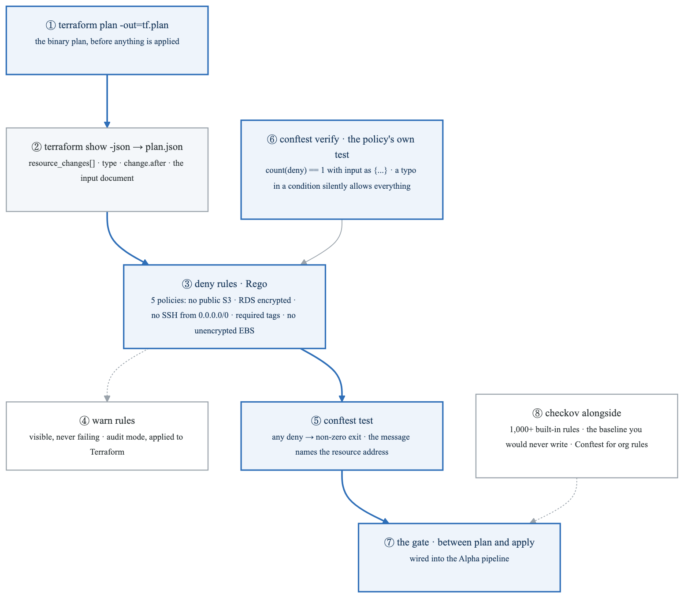
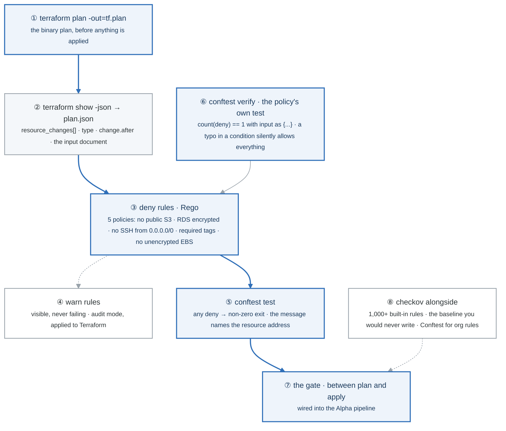
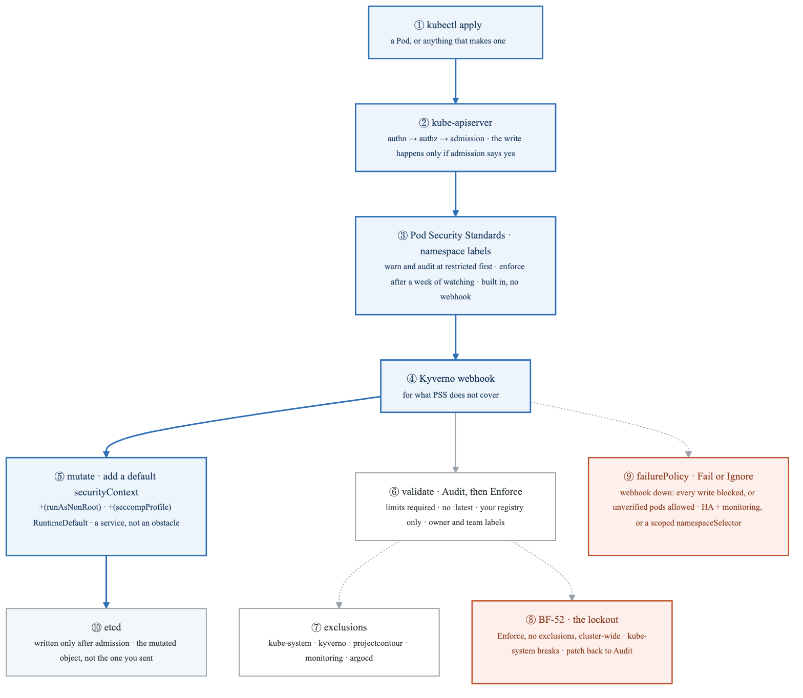
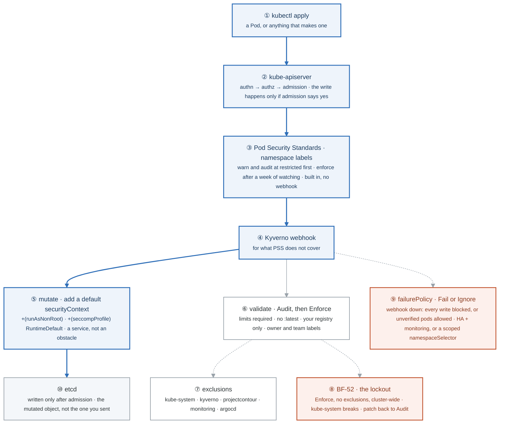
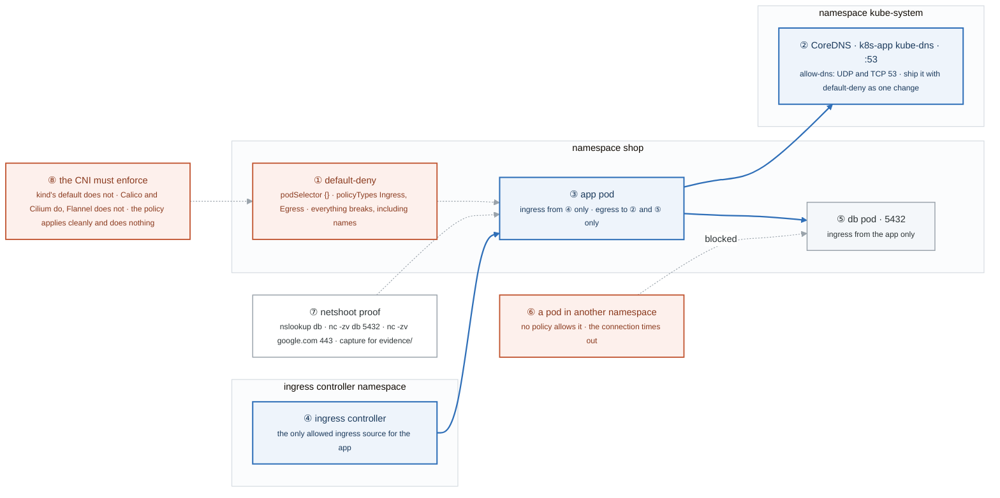
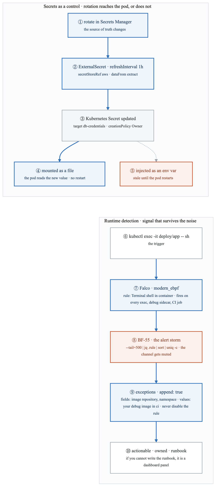
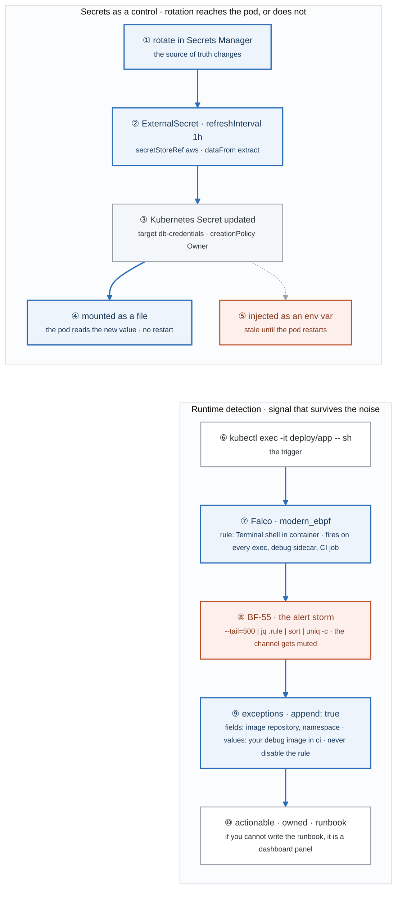
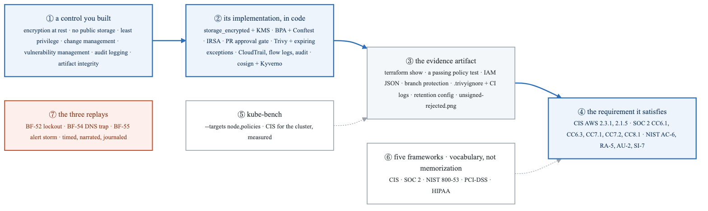
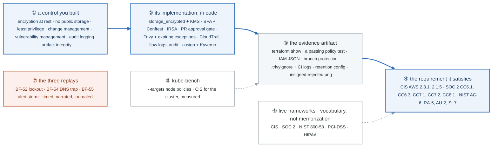

# Week 19 — Lab figures

> One figure per lab, numbered 19.2 to 19.6. Figure 19.1 is the week figure in
> [`../content/FIGURE.md`](../content/FIGURE.md); these five go one level down, to the mechanism each
> lab makes you touch. Same language: gray is structure, **blue is the path to follow first**,
> orange-red is where something refuses, washed boxes are stores. Each badge line is a thirty-second
> interview answer; each whole script is under three minutes.

**The protocol per figure**

1. **Before the lab:** read the figure, say the badges out loud once. You now know what you are about to prove.
2. **During the lab:** every badge has a **Prove it** command. Run it and watch the badge happen. A badge you cannot see happen is one you are taking on faith.
3. **After the lab:** close the file, redraw the figure, say the script. Check against the file. The badge where the order slipped goes in the *Figures redrawn* column of `progress.md`.
4. **Own the numbers.** The *Numbers to own* table is what separates "I use admission control" from "warn and audit at restricted for a week, then enforce, with system namespaces excluded and failurePolicy chosen on purpose."
5. **Answer the question.** Each figure ends with the question a senior interviewer asks about it. Answer it cold, in under a minute, before the gate.

---

## Figure 19.2 — Lab 1: a plan becomes JSON, and a Rego rule refuses it

> Lab 1 · badges ① to ⑧ · about three minutes. Reads top-down.

<!-- figure: generated from the Mermaid below by _shared/diagrams/embed-figures.py — do not edit the image -->


<details>
<summary>Diagram source (Mermaid)</summary>



</details>

### Say it, badge by badge

- **Open.** "A plan is a document. Turn it into JSON and a policy engine can read it, and refuse it, before apply ever runs. The blue path is plan to gate; the box most people skip is the test of the policy itself."
- **① terraform plan -out.** "Save the plan to a file. Nothing has changed yet; this is the proposal."
- **② show -json.** "The same plan as JSON. `resource_changes` is a list, each entry has a type and a `change.after`, and that is the entire input to every rule."
- **③ deny rules.** "Rego, package main, `deny contains msg if`. Walk the resource changes, match a type, test a field, produce a message with the address. Five of them in the lab: public S3, unencrypted RDS, SSH from anywhere, missing tags, unencrypted EBS."
- **④ warn rules.** "Same shape, different verb. A warn prints and never fails the build. It is how you make a rule visible before you are ready to enforce it, the audit-mode idea from Lab 2, applied to infrastructure."
- **⑤ conftest test.** "Runs the policies against the JSON. Any deny means a non-zero exit, and the message tells the author which resource and why."
- **⑥ conftest verify.** "The policy's own unit test: feed it a fake plan with a public bucket and assert exactly one deny. A policy with a typo in its condition matches nothing and allows everything, silently. Same lesson as `expect_failures` in week 11."
- **⑦ the gate.** "Between plan and apply in the Alpha pipeline. A plan the policy refuses never reaches the approval step."
- **⑧ checkov alongside.** "Over a thousand built-in rules for the industry baseline you would never write yourself. Conftest is for your organization's rules. Use both; that is the real-world answer."
- **Close.** "Plan, JSON, deny, test, gate. And test the test, because a policy that cannot fail is a policy that does nothing."

### Numbers to own

| Number | Where it comes from | Why it matters |
|---|---|---|
| 5 policies | the task list | public S3 · RDS encryption · SSH from 0.0.0.0/0 on 22 · required tags · EBS encryption |
| port `22` from `0.0.0.0/0` | the Rego example | the three-condition rule: ingress, the CIDR, the port |
| `count(deny) == 1` | the unit test | one fake violation must produce exactly one deny |
| 1,000+ built-in rules | checkov | the baseline Conftest does not give you |
| 2 verbs | `deny`, `warn` | fail versus show; enforce versus audit |

### Prove it

```bash
terraform plan -out=tf.plan && terraform show -json tf.plan > plan.json      # ① ②
jq '.resource_changes[] | {address, type}' plan.json | head                   # ② what the rules read
conftest test --policy ../../policies/conftest plan.json                      # ③ ⑤
conftest verify --policy policies/conftest                                    # ⑥ the policy's own test
```

### The question a senior interviewer asks

*"Why do you unit-test your policies, and why run both Conftest and checkov?"*
Badge ⑥ first: a broken policy fails open, and nothing tells you. Then badge ⑧: checkov is the baseline nobody should hand-write, Conftest is the rules only your organization has. One answer about failure modes, one about coverage.

---

## Figure 19.3 — Lab 2: the admission path, and the two ways it locks you out

> Lab 2 · badges ① to ⑩ · about three and a half minutes. Reads top-down.

<!-- figure: generated from the Mermaid below by _shared/diagrams/embed-figures.py — do not edit the image -->


<details>
<summary>Diagram source (Mermaid)</summary>



</details>

### Say it, badge by badge

- **Open.** "Admission is the last gate before a write reaches etcd. Two things sit in it this week: the built-in Pod Security Standards, and Kyverno for everything else. The blue path is the request; the orange boxes are the two ways a security control takes the cluster down."
- **① kubectl apply.** "A Pod, or a Deployment that will make one. Admission runs on the Pod, so a Deployment that violates policy creates a ReplicaSet whose pods never appear."
- **② kube-apiserver.** "Authentication, authorization, then admission. Mutating webhooks run first and may change the object; validating webhooks run after and may reject it. Nothing is written until both say yes."
- **③ Pod Security Standards.** "Three labels on the namespace: enforce, warn, audit. Three profiles: privileged blocks nothing, baseline blocks the obviously dangerous, restricted requires non-root, dropped capabilities, seccomp, no privilege escalation. The rollout pattern is warn and audit at restricted for a week, then enforce, so you learn what will break before it breaks."
- **④ Kyverno.** "A webhook for what the standards do not express: resource limits, image tags, registries, labels. Policies are Kubernetes objects; `validationFailureAction: Audit` is where every one of them starts."
- **⑤ mutate.** "The `+()` anchors add `runAsNonRoot` and a seccomp profile only when they are missing. Rejecting a deployment makes the platform an obstacle; applying a safe default makes it a service. That sentence is week 22 in miniature."
- **⑥ validate.** "Four rules in the lab: limits required, no `:latest`, your registry only, owner and team labels. Audit first, read the PolicyViolation events, then Enforce."
- **⑦ exclusions.** "kube-system, kyverno itself, the ingress controller, monitoring, ArgoCD. A policy that applies to the components that run the cluster is the next box."
- **⑧ BF-52.** "Do it on purpose: Enforce, no exclusions, cluster-wide. kube-system pods stop admitting. Recovery is one patch back to Audit. It becomes blog post ten and a STAR story, because it is self-inflicted and the lesson transfers."
- **⑨ failurePolicy.** "If the webhook is unreachable, Fail blocks every API write in the cluster; Ignore silently admits unverified pods. Neither is obviously right. In practice: Ignore with a highly available Kyverno and an alert on the webhook, or Fail with a namespaceSelector so the blast radius is bounded."
- **⑩ etcd.** "What gets stored is the object after mutation, not the one you sent. `kubectl get -o yaml` shows the security context you never wrote."
- **Close.** "Standards by label, policies by webhook, mutate before you reject, audit before you enforce, exclude the cluster's own namespaces, and choose the failure mode on purpose."

### Numbers to own

| Number | Where it comes from | Why it matters |
|---|---|---|
| 3 PSS profiles | the lab's table | privileged · baseline · restricted |
| 3 PSS modes | the namespace labels | enforce · warn · audit, set independently |
| 1 week | the rollout pattern | warn and audit at restricted before enforcing |
| 5 Kyverno policies | the task list | limits · no :latest · registry · labels · the mutation |
| 5 excluded namespaces | the policy example | kube-system · kyverno · projectcontour · monitoring · argocd |
| 1 patch to recover | BF-52 | `validationFailureAction` back to Audit |
| 2 failure policies | the webhook spec | Fail blocks all writes when down; Ignore admits unverified |

### Prove it

```bash
kubectl label ns shop pod-security.kubernetes.io/warn=restricted --overwrite && kubectl apply -f a-privileged-pod.yaml   # ③ warning, created
kubectl label ns shop pod-security.kubernetes.io/enforce=restricted --overwrite && kubectl apply -f a-privileged-pod.yaml   # ③ rejected
kubectl get pod -n shop app-xxxx -o jsonpath='{.spec.securityContext}'       # ⑤ ⑩ the mutation you did not write
kubectl get events -A --field-selector reason=PolicyViolation                   # ⑥ ⑧ what Audit would have caught
kubectl patch clusterpolicy require-resource-limits --type merge -p '{"spec":{"validationFailureAction":"Audit"}}'   # ⑧ recover
```

### The question a senior interviewer asks

*"Your admission webhook is down. Defend `failurePolicy: Fail` versus `Ignore`, and say how you bound the blast radius either way."*
Badge ⑨, both sides, then the two practical shapes: Ignore with HA and monitoring, or Fail scoped by namespaceSelector. Picking one and asserting it is the junior answer; articulating the trade is the senior one.

---

## Figure 19.4 — Lab 3: default deny, the DNS trap, and the CNI that must enforce it

> Lab 3 · badges ① to ⑧ · about three minutes. Blue edges are the only flows a policy allows.

<!-- figure: generated from the Mermaid below by _shared/diagrams/embed-figures.py — do not edit the image -->


<details>
<summary>Diagram source (Mermaid)</summary>



</details>

### Say it, badge by badge

- **Open.** "NetworkPolicies are additive allow-lists: there is no deny rule, you deny by not allowing. So the first policy is deny everything, and the first thing that breaks is the one nobody expects. Blue edges are the only flows left."
- **① default-deny.** "An empty podSelector matches every pod in the namespace, and both policy types means no ingress and no egress. Apply it and everything breaks, including things that look nothing like network: every name lookup fails, so every connection fails, and the symptom reads as 'the network is broken' rather than 'I wrote a policy'."
- **② CoreDNS.** "Lives in kube-system on port 53, UDP and TCP. The allow-dns policy selects it by namespace label and pod label. Ship it with default-deny as one change, always; a default-deny on its own is the DNS trap, BF-54."
- **③ the app.** "Ingress from the ingress controller's namespace only, egress to DNS and the database only. Every arrow is a policy you wrote; everything not drawn is denied."
- **④ the ingress controller.** "Selected by its namespace, so the rule survives the controller's pods being replaced. Nothing else reaches the app."
- **⑤ the database.** "Ingress from the app on 5432, nothing else. Port and peer both named."
- **⑥ another namespace.** "No policy mentions it, so its connection to the database times out. Task six is to prove that, and timing out rather than refusing is the signature of a policy, not a closed port."
- **⑦ netshoot.** "One pod, three commands: resolve the name, connect to the database, connect to the internet. The expected result changes as you add each policy, and the blocked one is the evidence."
- **⑧ the CNI.** "kind's default network plugin does not enforce NetworkPolicy. The objects apply cleanly, `kubectl get networkpolicy` lists them, and nothing is blocked. Calico and Cilium enforce; Flannel does not. That silent no-op is the second half of BF-54 and a real-world trap."
- **Close.** "Deny all, then allow names, then allow each flow by peer and port. Prove the blocked flow, and prove the plugin enforces, because a policy that is not enforced looks exactly like one that is."

### Numbers to own

| Number | Where it comes from | Why it matters |
|---|---|---|
| port `53`, UDP and TCP | the allow-dns policy | both protocols, or large responses fail over TCP |
| port `5432` | the egress rule | the only destination the app needs besides DNS |
| 2 policies that ship together | default-deny + allow-dns | one change, never two |
| 6 tasks | the lab | break · restore DNS · ingress from the controller · egress to db · prove a block · prove cross-namespace denial |
| 0 deny rules | NetworkPolicy semantics | additive allow-lists only |
| 2 CNIs that enforce, 1 that does not | the lab | Calico and Cilium yes, Flannel no, kind default no |

### Prove it

```bash
kubectl -n shop apply -f default-deny.yaml && kubectl -n shop run netshoot --rm -it --image=nicolaka/netshoot -- nslookup db   # ① names fail
kubectl -n shop apply -f allow-dns.yaml && kubectl -n shop run netshoot --rm -it --image=nicolaka/netshoot -- sh -c 'nslookup db; nc -zv db 5432'   # ② names work, 5432 still blocked
kubectl -n shop run netshoot --rm -it --image=nicolaka/netshoot -- sh -c 'nslookup db; nc -zv db 5432; nc -zv google.com 443'   # ⑦ after the allows
kubectl -n default run probe --rm -it --image=nicolaka/netshoot -- nc -zv -w 3 db.shop 5432   # ⑥ times out
kubectl get pods -n kube-system -l k8s-app=calico-node -o name | head -1                      # ⑧ an enforcing CNI is actually installed
```

### The question a senior interviewer asks

*"You applied default-deny and the team says the network is broken. Walk through why, and why the same policy could also apply cleanly and do nothing."*
Badges ① and ② for the DNS trap, badge ⑧ for the CNI. Two opposite failures from one object: it blocks more than you meant, or it blocks nothing at all. Both are BF-54.

---

## Figure 19.5 — Lab 4: a rotated secret reaching a file, and a detection rule tuned instead of silenced

> Lab 4 · badges ① to ⑩ · about three minutes. Two chains, read top-down.

<!-- figure: generated from the Mermaid below by _shared/diagrams/embed-figures.py — do not edit the image -->


<details>
<summary>Diagram source (Mermaid)</summary>



</details>

### Say it, badge by badge

- **Open.** "Two controls that only count if they keep working under real conditions: a secret that rotates without anyone redeploying, and a detection that still means something after the first week. Two chains; the orange boxes are where each one quietly fails."
- **① rotate in Secrets Manager.** "The value changes upstream, where it should. Nothing in the cluster was asked."
- **② ExternalSecret.** "Every hour, the operator reads the store through its IRSA identity from week 16 and writes what it finds. The refresh interval is the maximum lag between rotation and the cluster knowing."
- **③ the Kubernetes Secret.** "Owned by the operator, so a hand edit is overwritten on the next sync. The source of truth is outside the cluster; etcd holds a copy."
- **④ mounted as a file.** "The kubelet updates the projected file when the Secret changes. The pod reads the new value on its next open. No restart, no redeploy, no outage."
- **⑤ injected as an env var.** "The environment is set once, at process start. The pod keeps the old password until something restarts it, and the first symptom is authentication failures after a rotation nobody connected to it. Week 14's argument, now with a rotation to prove it."
- **⑥ the trigger.** "A shell into a running container. Legitimate when you do it; exactly what an attacker does too."
- **⑦ Falco.** "Kernel-level syscall visibility through eBPF. The default rule 'Terminal shell in container' fires on your exec, and on every debug sidecar and CI job as well."
- **⑧ the storm.** "Tail five hundred lines, count by rule. One rule dominates. Signal drowns, the channel is muted, and then the real alert is ignored with everything else. BF-55."
- **⑨ exceptions, appended.** "Keep the rule, add an exception keyed on image repository and namespace: your debug image, in the ci namespace. Coverage stays; the known noise leaves."
- **⑩ actionable, owned, runbook.** "Every alert needs an action, an owner, and a runbook. An alert nobody acts on is worse than none, because it trains the team to ignore the channel. If you cannot write the runbook, it is a dashboard panel. Same lesson as BF-57 next week."
- **Close.** "Rotate upstream, sync down, read from a file. Detect in the kernel, tune by exception, and only page on what someone will act on."

### Numbers to own

| Number | Where it comes from | Why it matters |
|---|---|---|
| `refreshInterval: 1h` | the ExternalSecret | the maximum lag between rotation and the cluster; tune it to the rotation policy |
| 0 restarts for a file, 1 for an env var | the task | the operational reason to mount |
| `--tail=500` | the storm command | enough lines to see which rule dominates |
| 2 exception fields | `container.image.repository`, `k8s.ns.name` | scope an exception to an image in a namespace, not to the whole rule |
| 3 properties of an alert | actionable · owned · runbook | the test before anything pages |
| `driver.kind=modern_ebpf` | the Helm install | kernel visibility without a kernel module |

### Prove it

```bash
aws secretsmanager rotate-secret --secret-id 'rds!db-abc123'                                     # ①
kubectl -n shop get secret db-credentials -o jsonpath='{.metadata.annotations}' | head -c 300     # ③ the operator's sync annotations
kubectl -n shop exec deploy/app-file -- cat /etc/db/password                                       # ④ new value, no restart
kubectl -n shop exec deploy/app-env -- sh -c 'echo $DB_PASSWORD'                                   # ⑤ old value until restart
kubectl -n shop exec -it deploy/app -- sh                                                          # ⑥ trigger
kubectl -n falco logs -l app.kubernetes.io/name=falco --tail=500 | jq -r '.rule' | sort | uniq -c | sort -rn | head   # ⑧ the storm
```

### The question a senior interviewer asks

*"Why does a rotated secret reach a file-mounted pod but not an env-var pod, and how do you tune a noisy detection rule without losing coverage?"*
Badges ④ and ⑤: the kubelet refreshes mounted files, the environment is fixed at process start. Then badge ⑨: append an exception scoped by image and namespace; the rule stays on for everything else.

---

## Figure 19.6 — Lab 5: a control in code, traced to the requirement an auditor will ask about

> Lab 5 · badges ① to ⑦ · about two minutes. The Break/Fix replays, BF-52, BF-54 and BF-55, follow
> [Figure BF.0](../../_shared/breakfix/FIGURE.md) and are drawn in figures 19.3, 19.4 and 19.5.

<!-- figure: generated from the Mermaid below by _shared/diagrams/embed-figures.py — do not edit the image -->


<details>
<summary>Diagram source (Mermaid)</summary>



</details>

### Say it, badge by badge

- **Open.** "You do not need to memorize a framework. You need to take a control you built, point at its implementation and its evidence, and name the requirement it satisfies. That table takes someone weeks to assemble by hand; from controls that live in code it is a query. The blue path is one row of it."
- **① a control you built.** "Seven of them this month: encryption at rest, no public storage, least privilege, change management, vulnerability management, audit logging, artifact integrity. Every one exists already, as code."
- **② its implementation.** "The Terraform attribute, the policy, the pipeline gate. `storage_encrypted` with a KMS key. Block Public Access plus the Conftest rule. IRSA per workload. The PR approval gate. Trivy with owned exceptions. CloudTrail and flow logs. cosign and Kyverno."
- **③ the evidence.** "What an auditor accepts: a `terraform show`, a passing policy test, the IAM JSON, the branch protection screen, the ignore file with CI logs, a retention setting, the admission-denied screenshot. Evidence is an artifact, not a sentence."
- **④ the requirement.** "CIS AWS benchmark items, SOC 2 common criteria, NIST 800-53 control IDs. The same control often maps to two frameworks; the table shows both."
- **⑤ kube-bench.** "Runs the CIS Kubernetes benchmark against the node and the policies. A measured score, not a claim."
- **⑥ the five frameworks.** "CIS is prescriptive hardening per technology. SOC 2 is an audited report across trust criteria. NIST 800-53 is the federal catalog. PCI-DSS is card data. HIPAA is health data. Enough to not look blank, and to know which one the interviewer's company lives under."
- **⑦ the replays.** "BF-52, BF-54, BF-55 again, under the timer, narrated, logged. The method is figure BF.0; the failures are figures 19.3 to 19.5."
- **Close.** "Control, implementation, evidence, requirement. Connecting technical controls to business requirements is what very few junior candidates do, and it is worth real money."

### Numbers to own

| Number | Where it comes from | Why it matters |
|---|---|---|
| 7 controls | the mapping table | the rows you can already fill from this month's work |
| 4 columns | the table | control · implementation · evidence · maps to |
| 5 frameworks | the lab's table | CIS · SOC 2 · NIST 800-53 · PCI-DSS · HIPAA |
| CIS AWS 2.3.1, 2.1.5 | the table | encryption at rest; no public storage |
| SOC 2 CC6.1, CC6.3, CC7.1, CC7.2, CC8.1 | the table | logical access · least privilege · vulnerability · monitoring · change management |
| NIST AC-6, RA-5, AU-2, SI-7 | the table | least privilege · vulnerability scanning · audit events · integrity |
| 3 BF replays | the lab | BF-52 · BF-54 · BF-55 |

### Prove it

```bash
terraform show -no-color | grep -n 'storage_encrypted\|kms_key_id'          # ② ③ encryption at rest, as evidence
conftest verify --policy policies/conftest                                   # ③ the policy test passing
gh api repos/:owner/:repo/branches/main/protection | jq '.required_pull_request_reviews'   # ③ change management
kube-bench run --targets node,policies | tail -20                            # ⑤ the CIS score
```

### The question a senior interviewer asks

*"Take one control you built and trace it to a SOC 2 or NIST requirement, including the evidence an auditor would accept."*
One row of badges ① to ④, out loud: cosign signing plus Kyverno verification, evidenced by the admission-denied screenshot, satisfying NIST SI-7 on artifact integrity. Pick the row with a screenshot; evidence you can show beats evidence you describe.

---

## Redraw schedule

Same cadence as the week figure, see [`../../FIGURES.md`](../../FIGURES.md): Friday of this week after break/fix, then Sunday of week 21, which is also the Gate 5 Sunday, so that day covers these cold along with everything since Gate 4. Lab figures are redrawn **after** the week figure, one at a time, and only the badge order has to be right; the captions are the check, not the test.
