# Week 20 — Observability

> **Thesis:** most dashboards are decoration. The test of a good one is whether someone can tell
> **users are having a bad time** within five seconds of looking at it. Almost none pass.

| | |
|---|---|
| **Hours** | 35–45 (incl. ~4h job search) |
| **Deliverable** | Blog post #11 — "Your dashboard is lying to you: cause-based vs symptom-based alerting" |
| **Break/Fix** | BF-56, BF-57, BF-58 |
| **Exit check** | Write 10 PromQL queries from scratch and define a valid SLO with burn-rate alerts |

## The week in one figure

**Figure 20.1 — From a request to an alert that means users are hurting.** Most dashboards are decoration. This path runs from instrumentation to a burn-rate alert, and the test of every box is whether it helps answer one question: are users having a bad time right now? Badges are numbered in the order to walk them; the blue path is the one to follow first.

```mermaid
%%{init: {'theme':'base','themeVariables':{'fontFamily':'Helvetica, Arial, sans-serif','fontSize':'13px','primaryColor':'#ffffff','primaryTextColor':'#2d3436','primaryBorderColor':'#9aa3ab','lineColor':'#9aa3ab','textColor':'#2d3436','clusterBkg':'#fbfcfd','clusterBorder':'#d4dae0','edgeLabelBackground':'#ffffff','tertiaryColor':'#eef4fb'},'flowchart':{'curve':'basis','padding':14,'nodeSpacing':42,'rankSpacing':58}}}%%
flowchart LR
  classDef default fill:#ffffff,stroke:#9aa3ab,stroke-width:1.3px,color:#2d3436
  classDef n    fill:#ffffff,stroke:#9aa3ab,stroke-width:1.3px,color:#2d3436
  classDef crit fill:#eef4fb,stroke:#2f6fb8,stroke-width:1.8px,color:#1b3a5c
  classDef data fill:#f4f7fa,stroke:#9aa3ab,stroke-width:1.3px,color:#2d3436
  classDef mut  fill:#ffffff,stroke:#cfd6dc,stroke-width:1.1px,color:#7a8288
  classDef warn fill:#fdf0ec,stroke:#c0522d,stroke-width:1.6px,color:#8a3a1e

  APP["① instrumented app<br/><small>counter · histogram · gauge · /metrics</small>"]:::crit
  SM["② ServiceMonitor → Prometheus<br/><small>scrape every 15 s · pull, not push · TSDB</small>"]:::crit
  PQ["③ PromQL<br/><small>rate(x[5m]) · histogram_quantile(0.99, sum by (le)) · never average percentiles</small>"]:::crit
  RR["④ recording rules<br/><small>precompute the expensive ratios</small>"]:::data
  SLI["⑤ SLI<br/><small>good requests / total · latency under 300 ms</small>"]:::crit
  SLO["⑥ SLO 99.9 %<br/><small>error budget = 0.1 % · 43.8 min per 30 days</small>"]:::crit
  BR["⑦ burn-rate alerts<br/><small>14.4× over 1 h and 5 m → page · 6× over 6 h and 30 m → ticket</small>"]:::warn
  AM["⑧ Alertmanager<br/><small>group · inhibit · route · silence</small>"]:::n
  PG["⑨ the page<br/><small>symptom-based: users are hurting · never cause-based: CPU is high</small>"]:::crit
  GF["⑩ Grafana<br/><small>one dashboard · answers the question in 5 seconds</small>"]:::n
  OT["⑪ OpenTelemetry traces<br/><small>app → database · the slow span · logs with trace IDs</small>"]:::data
  CARD["⑫ cardinality explosion<br/><small>a user ID as a label · series count × 10,000 · reproduce it, then fix it</small>"]:::warn
  APP ==> SM ==> PQ ==> SLI ==> SLO ==> BR ==> PG
  PQ --> RR --> SLI
  BR --> AM --> PG
  PQ -.-> GF
  APP -.-> OT
  SM -.-> CARD
  linkStyle 0,1,2,3,4,5 stroke:#2f6fb8,stroke-width:2px
```

**What to say, badge by badge** · about four minutes at a normal pace. Point at each badge as you say its line.

- **Open.** “A dashboard passes one test: can someone tell users are having a bad time within five seconds of looking at it. This figure is the path from a line of instrumentation to a page that fires only when that is true. Follow the blue line; the numbers in badges 6 and 7 are the ones to memorize.”
- **① instrumented app.** “Three metric types cover almost everything. A counter for requests and errors, a histogram for latency with buckets you chose deliberately, a gauge for things that go up and down. Exposed at /metrics in the format you previewed in week 4.”
- **② ServiceMonitor and Prometheus.** “Prometheus pulls. A ServiceMonitor tells it which Services to scrape, every 15 seconds by default. Samples land in a time-series database keyed by metric name and labels. Pull means the app does not need to know where Prometheus is.”
- **③ PromQL.** “`rate` over a window turns a counter into a per-second rate. For percentiles, sum the histogram buckets keeping `le`, then `histogram_quantile`. Averaging 99th percentiles across instances is wrong and the most common mistake in the drill. Ten queries from scratch, no copy-paste.”
- **④ recording rules.** “Precompute the ratios that dashboards and alerts both need. One rule evaluated every 30 seconds beats fifty dashboards computing the same thing.”
- **⑤ SLI.** “A service level indicator is a ratio: good events over total. Requests under 300 milliseconds over all requests. Pick the one that tracks user experience, not the one that is easy to measure.”
- **⑥ SLO.** “The target: 99.9 percent of requests good, over 30 days. The error budget is the other 0.1 percent, which is 43.8 minutes a month. Compute it by hand once. The budget is what makes risk a number you can spend.”
- **⑦ burn-rate alerts.** “Burn rate is how fast you are spending the budget. A rate of 14.4 over the last hour, confirmed by the last 5 minutes, means the whole month's budget goes in two days: page. A rate of 6 over 6 hours, confirmed by 30 minutes: open a ticket. Two windows each, so a blip does not page and a slow burn is not missed.”
- **⑧ Alertmanager.** “Groups related alerts into one notification, inhibits the noisy ones when a parent fires, routes by severity, and lets you silence during maintenance. Alert design is here as much as in PromQL.”
- **⑨ the page.** “Symptom-based: the error rate or latency users see. Never cause-based: CPU high, disk at 80 percent. Causes go on the dashboard for the person who was paged, not on the pager.”
- **⑩ Grafana.** “One dashboard, top row answers the question. Error rate, latency percentiles, traffic, saturation. If the five-second test fails, remove panels until it passes.”
- **⑪ OpenTelemetry traces.** “A trace follows one request across services. The span that is slow is the one you fix. Logs carry the trace ID so you can jump from a log line to its trace.”
- **⑫ cardinality explosion.** “Put a user ID in a label and every user becomes a new series. Ten thousand users, ten thousand times the memory. Reproduce it, watch Prometheus suffer, then fix it by moving the ID to the trace or the log where it belongs.”
- **Close.** “Instrument, scrape, query, define good, set a budget, alert on the burn. The page means users are hurting; everything else is on the dashboard for the person who answers it.”

---

## Day plan
| Day | Focus | Lab |
|---|---|---|
| Mon | The three signals; Prometheus architecture; instrumentation | Lab 1 |
| Tue | **PromQL by hand** — no copy-paste | Lab 2 |
| Wed | Grafana, Alertmanager, alert design | Lab 3 |
| Thu | OpenTelemetry, tracing, structured logging | Lab 4 |
| Fri | **SLIs, SLOs, error budgets, burn-rate alerts** + Break/Fix | Lab 5 |
| Sat | ⚑ Bravo observability; 15 applications | — |
| Sun | Blog post #11; plan week 21 | — |

## Reading map
- `_reference/observability-sre/content-01-observability-fundamentals.md`
- `_reference/observability-sre/content-02-prometheus-architecture.md`
- `_reference/observability-sre/content-03-grafana-visualization.md`
- `_reference/observability-sre/content-04-alertmanager-alerting.md`
- `_reference/observability-sre/content-06-distributed-tracing.md`
- `_reference/observability-sre/content-07-opentelemetry.md`
- `_reference/observability-sre/content-08-sre-practices.md`
- `_reference/kubernetes/03-production/01-observability-stack-exercises-06-slo-error-budgets.md`
- `_reference/kubernetes/03-production/01-observability-stack-exercises-05-alerting-strategies.md`
- **Drill:** `_shared/drills/promql.md` — the whole file, daily

**Free primary source:** the Google SRE Book and SRE Workbook are online for free. Read the SLO
chapter and the "Alerting on SLOs" chapter — they are the source for everything in Lab 5.

## Labs
[labs/LABS.md](labs/LABS.md) · [solutions/SOLUTIONS.md](solutions/SOLUTIONS.md)

## Exit criteria
- [ ] App instrumented with a counter, a histogram, and a gauge
- [ ] **10 PromQL queries written from scratch**, no copy-paste
- [ ] One dashboard that answers "are users having a bad time?" in 5 seconds
- [ ] An SLO defined with its error budget computed by hand
- [ ] Multi-window burn-rate alerts configured
- [ ] Distributed trace across app → database; slow span identified
- [ ] Reproduce a cardinality explosion and fix it
