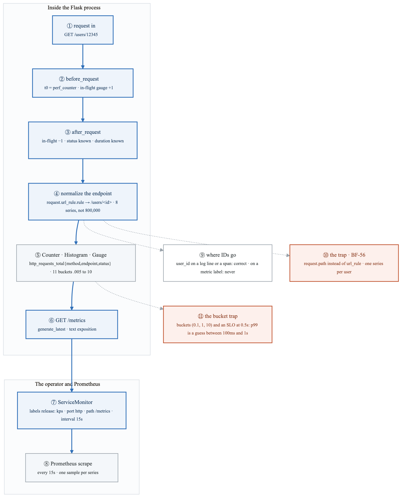
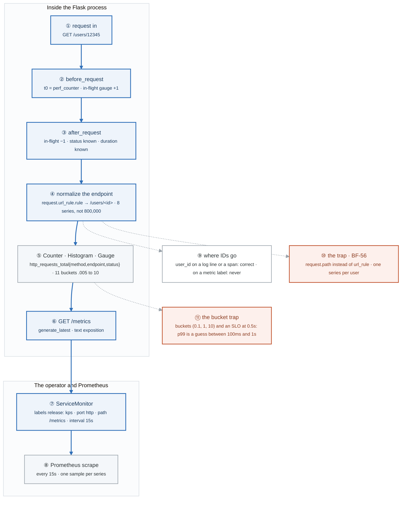
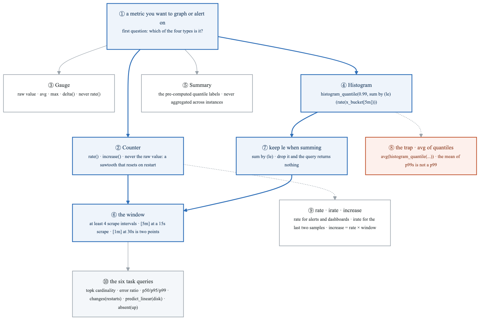
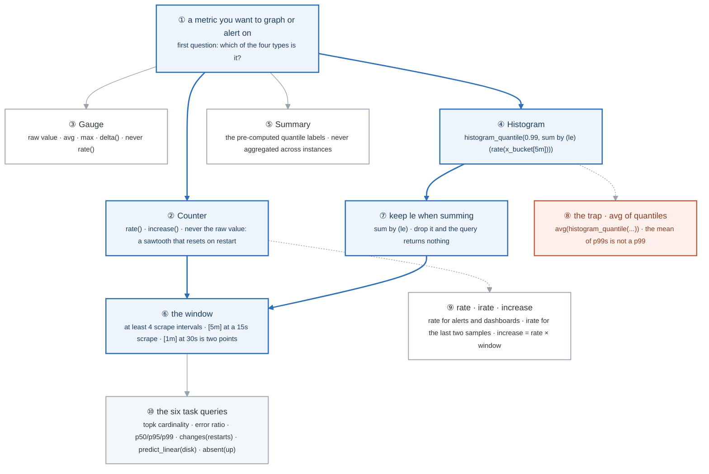
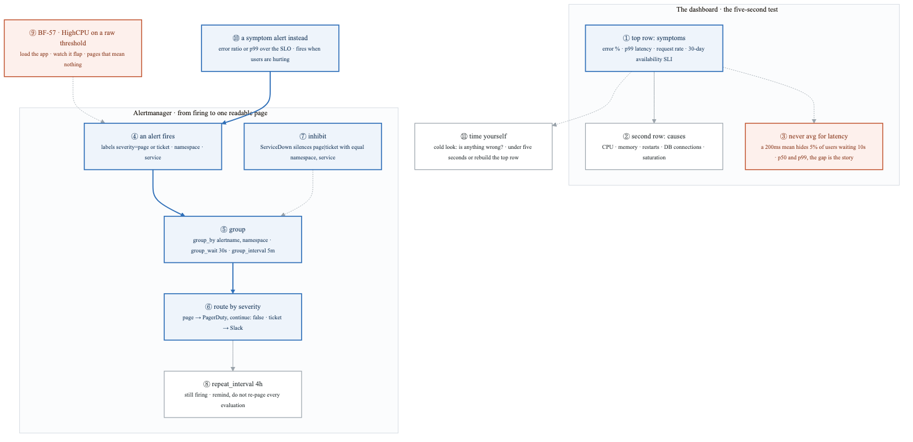
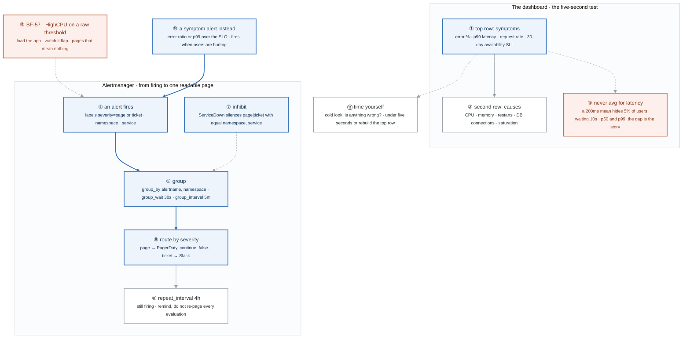
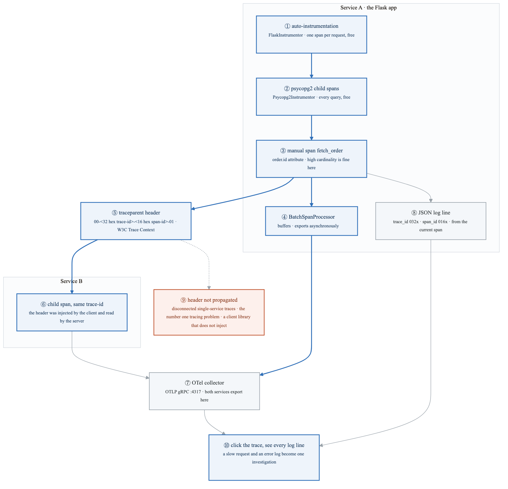
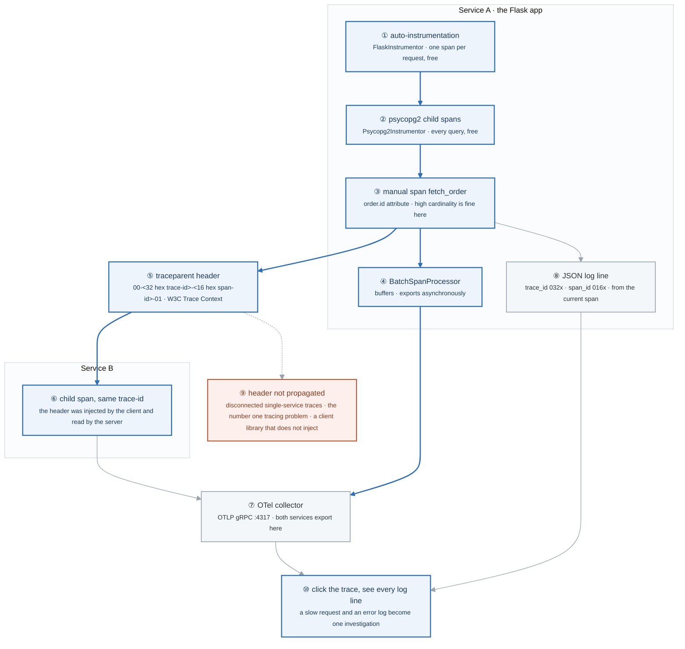
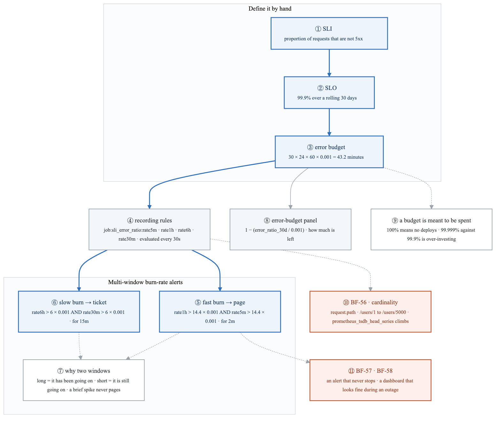
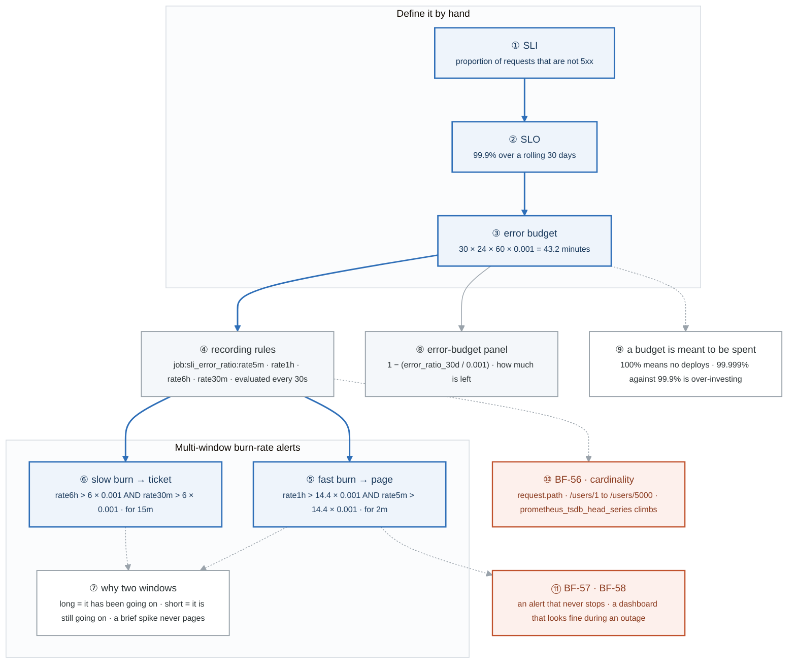

# Week 20 — Lab figures

> One figure per lab, numbered 20.2 to 20.6. Figure 20.1 is the week figure in
> [`../content/FIGURE.md`](../content/FIGURE.md); these five go one level down, to the mechanism each
> lab makes you touch. Same language: gray is structure, **blue is the path to follow first**,
> orange-red is where something refuses, washed boxes are stores. Each badge line is a thirty-second
> interview answer; each whole script is under three minutes.

**The protocol per figure**

1. **Before the lab:** read the figure, say the badges out loud once. You now know what you are about to prove.
2. **During the lab:** every badge has a **Prove it** command. Run it and watch the badge happen. A badge you cannot see happen is one you are taking on faith.
3. **After the lab:** close the file, redraw the figure, say the script. Check against the file. The badge where the order slipped goes in the *Figures redrawn* column of `progress.md`.
4. **Own the numbers.** The *Numbers to own* table is what separates "I know observability" from "99.9 percent over thirty days is 43 minutes of budget, and 14.4 times burn is two percent of it per hour."
5. **Answer the question.** Each figure ends with the question a senior interviewer asks about it. Answer it cold, in under a minute, before the gate.

---

## Figure 20.2 — Lab 1: a request becomes three signals, and the one line that keeps metrics small

> Lab 1 · badges ① to ⑪ · about three and a half minutes.

<!-- figure: generated from the Mermaid below by _shared/diagrams/embed-figures.py — do not edit the image -->


<details>
<summary>Diagram source (Mermaid)</summary>



</details>

### Say it, badge by badge

- **Open.** "Three signals, three jobs. Metrics answer 'is it broken and how much', and they must stay small. Logs and traces answer 'what happened to this request', and they are allowed to be big. Follow one request through the process and out to Prometheus, and watch for the one line that decides which of those two worlds the metric lives in."
- **① request in.** "A real path with a real ID in it. Everything downstream has to decide what to remember about it, and what to forget."
- **② before_request.** "Take the clock, increment the in-flight gauge. A gauge goes up and down; it is the only one of the three types that can."
- **③ after_request.** "Decrement the gauge; now you know the status code and the duration. This is where every metric is recorded, which is why the hook pattern beats instrumenting each handler."
- **④ normalize the endpoint.** "`request.url_rule.rule` gives `/users/<id>`, not `/users/12345`. That one line is the difference between eight time series and eight hundred thousand. It is the most important line in the file."
- **⑤ Counter, Histogram, Gauge.** "The counter has three labels, all bounded: method, endpoint, status. The histogram has eleven buckets from five milliseconds to ten seconds. Both are labelled only with things that have a small, known set of values."
- **⑥ /metrics.** "The exposition endpoint: plain text, one line per series, pulled, not pushed. Prometheus comes to you."
- **⑦ ServiceMonitor.** "The operator's contract. It selects your Service by label, names the port and path, and sets the interval. The `release: kps` label is what the operator's selector matches; when a ServiceMonitor does nothing, it is almost always that label."
- **⑧ Prometheus scrape.** "Every fifteen seconds, one sample per series. Four scrapes is the minimum a `rate()` needs, which is why the next lab's windows are five minutes, not one."
- **⑨ where IDs go.** "A `user_id` field on a log line is correct. A `user_id` attribute on a span is correct. A `user_id` label on a metric is a cardinality explosion. Same data, three places, one rule."
- **⑩ the trap.** "Use `request.path` instead and every user is a new series. The lab makes you do it on purpose in Lab 5 and watch `prometheus_tsdb_head_series` climb. BF-56."
- **⑪ the bucket trap.** "`histogram_quantile` interpolates inside a bucket. With buckets at 0.1, 1 and 10 and an SLO at half a second, your p99 is a guess between 100 milliseconds and one second. Put bucket edges at the thresholds you care about, before the SLO report is wrong."
- **Close.** "Hook, normalize, record, expose, select, scrape. One line keeps metrics low-cardinality; the IDs go to logs and traces. Get the buckets right now, because Lab 5's SLO is only as accurate as they are."

### Numbers to own

| Number | Where it comes from | Why it matters |
|---|---|---|
| 8 vs 800,000 series | the lab, on `url_rule.rule` vs `request.path` | the whole argument for normalizing labels, in two numbers |
| 3 labels on the counter | `method`, `endpoint`, `status` | every one bounded; series count is the product of their value counts |
| 11 bucket edges, .005 to 10 s | the `LATENCY` histogram | p99 accuracy is bounded by the nearest edges; the SLO threshold needs an edge beside it |
| `(0.1, 1, 10)` | the lab's bad example | a p99 "between 100ms and 1s" is not a p99 |
| `15s` | the ServiceMonitor interval | the scrape cadence every `rate()` window is measured in |
| `release: kps` | the ServiceMonitor label | the operator's `serviceMonitorSelector`; the first thing to check when nothing is scraped |
| 3 signals, 1 rule | the lab's table | metrics low-cardinality and cheap; logs and traces high-cardinality and expensive |

### Prove it

```bash
curl -s localhost:8080/metrics | grep -c '^http_request_duration_seconds_bucket'   # ⑤ 11 buckets × endpoints × methods
curl -s localhost:8080/metrics | grep http_requests_total                            # ④ /users/<id>, never /users/12345
kubectl -n monitoring get servicemonitor -A -o jsonpath='{.items[*].metadata.labels.release}'   # ⑦ kps, or nothing is scraped
curl -s localhost:9090/api/v1/targets | jq '.data.activeTargets[] | {job: .labels.job, health}'  # ⑧ the target is up
```

### The question a senior interviewer asks

*"Why is `request.url_rule.rule` the most important line in that file, and what happens to Prometheus if you use `request.path` instead?"*
Badges ④ and ⑩: series count is the product of label cardinalities, and an unbounded label makes it unbounded. Then the follow-up most people miss, badge ⑪: "your p99 is wrong and you do not know it" is a bucket-edge problem, not a query problem.

---

## Figure 20.3 — Lab 2: metric type decides the function

> Lab 2 · badges ① to ⑩ · about three minutes. This figure reads top-down.

<!-- figure: generated from the Mermaid below by _shared/diagrams/embed-figures.py — do not edit the image -->


<details>
<summary>Diagram source (Mermaid)</summary>



</details>

### Say it, badge by badge

- **Open.** "People cannot debug a dashboard because they copied the queries. The whole of PromQL you need under pressure is one question, four answers, and three traps. Ask the question every time."
- **① which type.** "Counter, gauge, histogram, or summary. The type is in the metric's HELP and TYPE lines, and it decides the function. Nothing else about the query is decided before this."
- **② Counter.** "Only ever goes up, and resets to zero when the pod restarts. Graph the raw value and you get a sawtooth. `rate()` turns it into per-second and handles the resets. Everything that counts requests, errors, or bytes is this."
- **③ Gauge.** "A value that goes up and down: in-flight requests, connection-pool usage, free disk. Use it raw, or `avg`, `max`, `delta`. `rate()` of a gauge is meaningless and PromQL will happily compute it for you."
- **④ Histogram.** "Buckets, each a counter of observations at or below `le`. `histogram_quantile` interpolates a quantile from them, after you `rate()` the buckets and sum them keeping `le`."
- **⑤ Summary.** "Quantiles computed in the client and exposed as labels. Cheap to read, impossible to aggregate: the average of two instances' p99 is not the fleet's p99. Prefer histograms."
- **⑥ the window.** "A `rate()` needs at least four scrape intervals to be stable. At the fifteen-second scrape from Lab 1, five minutes is twenty samples; one minute at a thirty-second scrape is two, and the graph is noise."
- **⑦ keep le.** "When you sum buckets across pods, `sum by (le)`. Drop `le` and the buckets merge into one number, `histogram_quantile` has nothing to interpolate, and the query returns empty. That empty result confuses everyone."
- **⑧ the trap.** "`avg(histogram_quantile(...))` is the mean of per-pod p99s. It is a number, it is wrong, and it looks fine on a dashboard. Sum the buckets first, then take the quantile."
- **⑨ rate, irate, increase.** "`rate` is the average over the window, for alerts and dashboards. `irate` uses only the last two samples: spiky, for high-resolution debugging. `increase` is `rate` times the window, when you want a count."
- **⑩ the six task queries.** "Find your highest-cardinality metric with `topk` over `count by (__name__)`; detect a deploy with `changes()` on restarts; predict disk exhaustion with `predict_linear` over six hours, four hours ahead; detect a vanished target with `absent(up)`. Written from the description, not pasted."
- **Close.** "Type first. Counters get rate, gauges get raw, histograms get quantile over summed buckets with `le`, summaries do not aggregate. Four scrape intervals minimum. Then write twenty of them by hand, because the dashboard that matters will be broken at the moment you need to read its query."

### Numbers to own

| Number | Where it comes from | Why it matters |
|---|---|---|
| 4 types | the lab's table | the first question of every query |
| 4 scrape intervals | the window rule | `[5m]` at 15s is 20 points; `[1m]` at 30s is 2 and jumpy |
| `[5m]` | the sane default | what the dashboard, the SLO recording rules, and the burn-rate short window all use |
| 20 queries | `_shared/drills/promql.md` | written from the description, never pasted |
| `6h`, `4*3600` | `predict_linear(node_filesystem_avail_bytes[6h], 4*3600) < 0` | fit six hours of history, extrapolate four hours ahead |
| `[1h]` | `changes(kube_pod_container_status_restarts_total[1h]) > 0` | a restart in the last hour is a deploy or a crash |
| `topk(10, count by (__name__)({__name__=~".+"}))` | task 1 | the one query that finds a cardinality explosion |

### Prove it

```promql
http_requests_total                                         # ② the sawtooth, raw
rate(http_requests_total[5m])                               # ② per second, resets handled
histogram_quantile(0.99, sum by (le) (rate(http_request_duration_seconds_bucket[5m])))   # ④ ⑦ the right p99
histogram_quantile(0.99, sum(rate(http_request_duration_seconds_bucket[5m])))            # ⑦ empty: le was dropped
topk(10, count by (__name__)({__name__=~".+"}))             # ⑩ who is eating the TSDB
```

### The question a senior interviewer asks

*"Why is `avg(histogram_quantile(0.99, ...))` wrong, and what exactly does `sum by (le)` preserve?"*
Badges ⑦ and ⑧. Quantiles do not average; buckets do. `sum by (le)` merges the per-pod bucket counters into fleet-wide buckets with the same edges, which is the only thing a quantile can be interpolated from. Then say the window rule, badge ⑥, unprompted.

---

## Figure 20.4 — Lab 3: one dashboard that answers in five seconds, and one page instead of fifteen

> Lab 3 · badges ① to ⑪ · about three and a half minutes.

<!-- figure: generated from the Mermaid below by _shared/diagrams/embed-figures.py — do not edit the image -->


<details>
<summary>Diagram source (Mermaid)</summary>



</details>

### Say it, badge by badge

- **Open.** "Two artefacts, one test each. The dashboard passes if a stranger can tell whether users are having a bad time within five seconds. The alert routing passes if one root cause produces one page instead of fifteen."
- **① top row: symptoms.** "Error rate as a percentage, p99 latency, request rate, and the thirty-day availability SLI. Those four are what users feel. They go at the top because they are the answer to the only question that matters at a glance."
- **② second row: causes.** "CPU, memory, restarts, database connections, saturation. These explain the top row; they never replace it. A dashboard that leads with CPU is a dashboard about the machine, not the users."
- **③ never avg for latency.** "A mean of two hundred milliseconds is entirely compatible with five percent of users waiting ten seconds. Plot p50 and p99 together; the gap between them is the story."
- **④ an alert fires.** "Prometheus evaluates a rule and hands Alertmanager a set of labels. Severity is just a label, and the whole routing tree hangs off it."
- **⑤ group.** "Alerts with the same alertname and namespace are collected for thirty seconds before the first notification, then batched every five minutes. One notification with ten pods in it, not ten notifications."
- **⑥ route by severity.** "`severity=page` goes to PagerDuty and stops there; `severity=ticket` goes to Slack. Two receivers, two human costs, decided by one label on the rule."
- **⑦ inhibit.** "If ServiceDown is firing for a service, suppress every page and ticket about that same namespace and service. The high-latency alert is not wrong; it is redundant, and redundancy during an incident is noise. This is the underused one."
- **⑧ repeat_interval.** "Four hours. An alert that is still firing gets re-sent as a reminder, not re-paged every evaluation cycle."
- **⑨ BF-57.** "A HighCPU alert on a raw threshold. Load the app and it flaps: above, below, above. Every page is true and none of them means a user is affected. That is how teams learn to ignore pages."
- **⑩ a symptom alert instead.** "Replace it with error ratio or p99 against the SLO. It fires when users are hurting and stays quiet when a box is merely busy. Lab 5 turns this into burn rate."
- **⑪ time yourself.** "Open the dashboard cold and answer 'is anything wrong?'. If it takes longer than five seconds, the top row is wrong, not you."
- **Close.** "Symptoms on top, causes below, never an average. Group, route, inhibit, repeat. One page that names what broke, from a rule that watches users rather than CPUs."

### Numbers to own

| Number | Where it comes from | Why it matters |
|---|---|---|
| 5 seconds | the dashboard test | the time a stranger needs to answer "is anything wrong?" |
| 4 top-row panels | the lab's table | error % · p99 · request rate · 30d availability SLI |
| 200ms mean, 5% at 10s | the lab | why `avg` is banned for latency |
| `group_wait: 30s` | the Alertmanager config | how long related alerts are collected before the first notification |
| `group_interval: 5m` | the Alertmanager config | how often a group's new alerts are batched |
| `repeat_interval: 4h` | the Alertmanager config | how often an unresolved alert is re-sent |
| 2 receivers | `pagerduty` for `page`, `slack` for `ticket` | the routing tree hangs off one label |
| 15 alerts, 1 cause | the lab's inhibition argument | what `inhibit_rules` with `equal: [namespace, service]` collapses |

### Prove it

```bash
# ⑤ ⑥ ⑦ the live routing tree and inhibitions, from Alertmanager itself
kubectl -n monitoring port-forward svc/kps-kube-prometheus-stack-alertmanager 9093:9093 &
curl -s localhost:9093/api/v2/status | jq '.config.original' | grep -A3 'group_wait\|inhibit_rules'
# ⑨ BF-57: load it and watch the HighCPU alert toggle
curl -s localhost:9090/api/v1/alerts | jq '.data.alerts[] | {name: .labels.alertname, state}'
```

```promql
sum(rate(http_requests_total{status=~"5.."}[5m])) / sum(rate(http_requests_total[5m])) * 100   # ① error %
histogram_quantile(0.99, sum by (le) (rate(http_request_duration_seconds_bucket[5m])))          # ① p99
sum(rate(http_requests_total{status!~"5.."}[30d])) / sum(rate(http_requests_total[30d]))        # ① 30-day SLI
```

### The question a senior interviewer asks

*"One root cause produces fifteen alerts at 3am. Show me how grouping, routing, and inhibition turn that into one useful page."*
Badges ⑤ ⑥ ⑦, in that order, with the three numbers: thirty seconds, two receivers, `equal` on namespace and service. Then badge ⑩ unprompted: the fifteen alerts were probably cause-based to begin with.

---

## Figure 20.5 — Lab 4: one request across two services, traced and logged as one investigation

> Lab 4 · badges ① to ⑩ · about three minutes.

<!-- figure: generated from the Mermaid below by _shared/diagrams/embed-figures.py — do not edit the image -->


<details>
<summary>Diagram source (Mermaid)</summary>



</details>

### Say it, badge by badge

- **Open.** "A trace is a tree of spans sharing one ID, across processes. The hard part is not producing spans; the libraries do that. The hard part is the one header that links them across a network hop, and the one field that links them to your logs."
- **① auto-instrumentation.** "`FlaskInstrumentor` wraps every request in a span. No code in the handlers. This is most of the value for almost no effort, and the place to start."
- **② psycopg2 child spans.** "`Psycopg2Instrumentor` makes every database call a child span under the request. Where the time went between app and database is now visible for free."
- **③ manual span.** "`fetch_order` with `order.id` as an attribute. Attributes can be high-cardinality; that is the point of traces and the reason IDs belong here rather than on a metric label. Add manual spans only where the automatic ones do not explain the time."
- **④ BatchSpanProcessor.** "Spans are buffered and exported in batches, off the request path. The exporter speaks OTLP over gRPC to the collector."
- **⑤ traceparent header.** "Version, trace-id, span-id, flags: `00-<32 hex>-<16 hex>-01`. The client injects it on the outgoing call; the server reads it and makes its span a child. This header is the entire mechanism of distributed tracing."
- **⑥ child span in Service B.** "Same trace-id, new span-id, parent set to Service A's span. Two processes, one tree."
- **⑦ the collector.** "Both services export to one collector on port 4317; it fans out to whatever backend. Services never know the backend."
- **⑧ JSON log line.** "The formatter reads the current span context and writes `trace_id` and `span_id` into every log line, thirty-two and sixteen hex characters. This is the single highest-value observability change you can make."
- **⑨ header not propagated.** "Each service has beautiful traces, and none of them connect. Almost always a client library that does not inject the header. You find it by looking for a trace that ends exactly at a network call."
- **⑩ one investigation.** "Click a slow trace, see every log line from that exact request, in every service. 'A slow request' and 'an error log' were two investigations; now they are one."
- **Close.** "Instrument automatically, add a span where time is unexplained, propagate the header, log the trace ID. Spans explain where the time went; logs explain what happened there; the ID makes them the same story."

### Numbers to own

| Number | Where it comes from | Why it matters |
|---|---|---|
| `:4317` | the OTLP gRPC exporter endpoint | where every service sends spans; the collector's one well-known port |
| 32 hex, 16 hex | trace-id and span-id in `traceparent` | `format(trace_id, "032x")`, `format(span_id, "016x")` in the log formatter |
| `00-…-…-01` | the `traceparent` layout | version, trace-id, span-id, flags; `01` means sampled |
| 2 instrumentors | Flask, psycopg2 | request spans and query spans, with no handler code |
| 1 header | `traceparent` | the whole of cross-service propagation; its absence is the number one tracing problem |
| 2 fields per log line | `trace_id`, `span_id` | what joins logs to traces |

### Prove it

```bash
curl -sv localhost:8080/orders/42 2>&1 | grep -i traceparent              # ⑤ is the header on the outgoing call?
kubectl -n shop logs deploy/app | jq -r 'select(.trace_id) | .trace_id' | sort | uniq -c | head   # ⑧ IDs in the logs
kubectl -n shop logs deploy/otel-collector | grep -c 'ResourceSpans'        # ⑦ both services arriving
```

### The question a senior interviewer asks

*"Your traces stop at service boundaries. What is missing, where, and how does putting the trace ID in logs change an investigation?"*
Badges ⑤ ⑨ then ⑧ ⑩. The header is injected on the client side of the call; look for the library that does not do it. Then: with the ID in every log line, the trace is the index into the logs, and the two tools become one.

---

## Figure 20.6 — Lab 5: from an SLI to a page, with the arithmetic

> Lab 5 · badges ① to ⑪ · about four minutes. This is the figure to be able to whiteboard cold.

<!-- figure: generated from the Mermaid below by _shared/diagrams/embed-figures.py — do not edit the image -->


<details>
<summary>Diagram source (Mermaid)</summary>



</details>

### Say it, badge by badge

- **Open.** "An SLO is a number you can derive out loud, and a burn-rate alert is two inequalities on that number. Do the arithmetic from the top, every time, because the arithmetic is what reads as fluency."
- **① SLI.** "The proportion of requests that are not server errors. It is a ratio of two counters, which means it is a `rate()` over a `rate()`, and it needs Lab 1's low-cardinality labels to be computable at all."
- **② SLO.** "Ninety-nine point nine percent of them, over a rolling thirty days. The window is part of the objective; the same percentage over a day is a different promise."
- **③ error budget.** "Thirty days times twenty-four hours times sixty minutes times one in a thousand: forty-three point two minutes. That is how much failure the objective permits per month, and it is the number everything below is measured against."
- **④ recording rules.** "Pre-compute the ratio at five minutes, one hour, six hours, and thirty minutes, every thirty seconds. Alerts and dashboards read the recorded series instead of re-running the expensive division on every refresh."
- **⑤ fast burn.** "Error ratio over the last hour above 14.4 times the budget rate, and over the last five minutes too, for two minutes. At that pace the whole month's budget is gone in about two days. That pages."
- **⑥ slow burn.** "Six times the budget rate over six hours, and over thirty minutes too, for fifteen minutes. Five days to exhaustion. That is a ticket for the morning, not a page at night."
- **⑦ why two windows.** "The long window proves it has been happening long enough to matter. The short window proves it is still happening now, so you do not page for something that already recovered. Together they ignore a single brief spike."
- **⑧ error-budget panel.** "One minus the thirty-day error ratio over the budget rate. A gauge from one hundred percent remaining down to zero. It is the one panel product and engineering look at together."
- **⑨ a budget is meant to be spent.** "An SLO at one hundred percent means no deploys. A team at five nines against a three-nines objective is over-investing in reliability and under-investing in features. Saying that is what senior sounds like."
- **⑩ BF-56.** "Switch the counter to `request.path`, hit `/users/1` through `/users/5000`, and watch `prometheus_tsdb_head_series` climb by five thousand. The SLI query gets slower, then the TSDB runs out of memory."
- **⑪ BF-57 and BF-58.** "An alert that fires constantly is a threshold on a cause, from Lab 3. A dashboard that looks fine during an outage is a dashboard of averages and causes, with no symptom on the top row. Both are the same mistake seen from two sides."
- **Close.** "Ratio, objective, budget, recording rules, two windows times two severities. Forty-three minutes, 14.4, six. Derive it on the whiteboard; the figures are the easy part, the fluency is the point."

### Numbers to own

| Number | Where it comes from | Why it matters |
|---|---|---|
| `99%` → 7h 12m | the lab's table, 30-day budgets | 1% of 720 hours |
| `99.5%` → 3h 36m | the lab's table | 0.5% of 720 hours |
| **`99.9%` → 43m 12s** | the lab's table, derived by hand | 30 × 24 × 60 × 0.001 = 43.2 minutes; the one to say out loud |
| `99.95%` → 21m 36s | the lab's table | half of the above |
| `99.99%` → 4m 19s | the lab's table | why four nines is a different engineering regime |
| `14.4 × 0.001` | the fast-burn threshold | 14.4 × (1h ÷ 720h) = 2% of the 30-day budget consumed per hour; exhausted in 30 ÷ 14.4 ≈ 2 days (the lab's "about 2 days"; 14.4 is the standard Google SRE figure) |
| `6 × 0.001` | the slow-burn threshold | 6 × (6h ÷ 720h) = 5% of the budget per six hours; exhausted in 5 days (same source) |
| `1h` and `5m` | the fast-burn window pair | long window proves duration, short window proves it is current |
| `6h` and `30m` | the slow-burn window pair | same shape, slower pace |
| `for: 2m`, `for: 15m` | the two alerts | how long the condition must hold before firing |
| `interval: 30s` | the recording-rule group | how often the pre-computed ratios refresh |
| `1 − (error_ratio_30d / 0.001)` | the budget panel | fraction of budget remaining |
| 5,000 | BF-56 | `/users/1` to `/users/5000`; the series `prometheus_tsdb_head_series` gains |

### Prove it

```promql
sum by (job) (rate(http_requests_total{status=~"5.."}[5m])) / sum by (job) (rate(http_requests_total[5m]))   # ① the SLI, raw
job:sli_error_ratio:rate5m                                   # ④ the recorded series exists
job:sli_error_ratio:rate1h > (14.4 * 0.001) and job:sli_error_ratio:rate5m > (14.4 * 0.001)   # ⑤ the page condition
1 - (job:sli_error_ratio:rate30d / 0.001)                    # ⑧ budget remaining
prometheus_tsdb_head_series                                  # ⑩ watch it climb under BF-56
```

```bash
# ⑤ inject errors, then watch ErrorBudgetBurnFast go pending → firing
curl -s localhost:9090/api/v1/alerts | jq '.data.alerts[] | select(.labels.alertname=="ErrorBudgetBurnFast") | .state'
```

### The question a senior interviewer asks

*"Derive 14.4 for me, and explain why the alert needs both a one-hour and a five-minute window."*
Badge ③ first, out loud: 43.2 minutes. Then badge ⑤: 14.4 times the budget rate burns two percent of the month per hour, which exhausts it in about two days. Then badge ⑦: the hour proves it is sustained, the five minutes proves it is current, and a spike that already recovered never wakes anyone.

---

## Redraw schedule

Same cadence as the week figure, see [`../../FIGURES.md`](../../FIGURES.md): Friday of this week after break/fix, Sunday of week 22, and cold on the Gate 5 Sunday of week 21. Lab figures are redrawn **after** the week figure, one at a time, and only the badge order has to be right; the captions are the check, not the test. Figure 20.6 is the exception: redraw it with the numbers, because at Gate 5 you write the SLO from scratch.
