# Week 21 — SRE Practice and ⚑ Project Bravo ★ GATE 5

> **Thesis:** three blameless postmortems you actually wrote are worth more in a behavioral interview
> than any project README. They are the only artifact that proves you have operated something under
> pressure.

| | |
|---|---|
| **Hours** | 35–45 (incl. ~5h job search — you're 8 weeks into the pipeline) |
| **⚑ Deliverable** | **Project BRAVO shipped** |
| **★ GATE 5** | The pipeline **blocks a critical CVE** and **refuses an unsigned image**, demonstrated live. A PromQL query and a valid SLO written from scratch. |

## The week in one figure

**Figure 21.1 — An incident, from the first alert to the postmortem that changes something.** Three real incidents you ran and three blameless postmortems you wrote are worth more in a behavioral interview than any README. The blue path is the incident; the loop at the end is what makes the next one shorter. Badges are numbered in the order to walk them; the blue path is the one to follow first.

```mermaid
%%{init: {'theme':'base','themeVariables':{'fontFamily':'Helvetica, Arial, sans-serif','fontSize':'13px','primaryColor':'#ffffff','primaryTextColor':'#2d3436','primaryBorderColor':'#9aa3ab','lineColor':'#9aa3ab','textColor':'#2d3436','clusterBkg':'#fbfcfd','clusterBorder':'#d4dae0','edgeLabelBackground':'#ffffff','tertiaryColor':'#eef4fb'},'flowchart':{'curve':'basis','padding':14,'nodeSpacing':42,'rankSpacing':58}}}%%
flowchart LR
  classDef default fill:#ffffff,stroke:#9aa3ab,stroke-width:1.3px,color:#2d3436
  classDef n    fill:#ffffff,stroke:#9aa3ab,stroke-width:1.3px,color:#2d3436
  classDef crit fill:#eef4fb,stroke:#2f6fb8,stroke-width:1.8px,color:#1b3a5c
  classDef data fill:#f4f7fa,stroke:#9aa3ab,stroke-width:1.3px,color:#2d3436
  classDef mut  fill:#ffffff,stroke:#cfd6dc,stroke-width:1.1px,color:#7a8288
  classDef warn fill:#fdf0ec,stroke:#c0522d,stroke-width:1.6px,color:#8a3a1e

  DET["① detect<br/><small>the burn-rate alert from week 20</small>"]:::crit
  DEC["② declare<br/><small>severity SEV1 to SEV3 · roles: incident commander, comms, ops · even when you are all three</small>"]:::crit
  MIT["③ mitigate FIRST<br/><small>roll back · scale up · feature flag off · 'let me check the logs' costs 40 minutes</small>"]:::crit
  DIA["④ diagnose<br/><small>the week-17 ladder, now with a timer</small>"]:::crit
  RES["⑤ resolve<br/><small>the real fix · verified by the SLI recovering</small>"]:::crit
  PM["⑥ blameless postmortem<br/><small>timeline · contributing factors · what went well · no names in the causes</small>"]:::crit
  AI["⑦ action items<br/><small>each with an owner, a date, and a way to verify it happened</small>"]:::warn
  RB["⑧ runbook<br/><small>updated, or written if it did not exist</small>"]:::data
  CH["⑨ chaos experiment<br/><small>kill a pod, fill a disk, partition the network · on purpose, in daylight</small>"]:::n
  DORA["⑩ DORA four keys<br/><small>deploy frequency · lead time · change failure rate · time to restore</small>"]:::data
  G5["⑪ ★ Gate 5<br/><small>CVE blocked live · unsigned image refused live · PromQL + SLO from scratch · Bravo acceptance</small>"]:::warn
  DET ==> DEC ==> MIT ==> DIA ==> RES ==> PM ==> AI
  AI --> RB
  RB -.-> CH -.-> DET
  RES -.-> DORA
  PM -.-> G5
  linkStyle 0,1,2,3,4,5 stroke:#2f6fb8,stroke-width:2px
```

**What to say, badge by badge** · about three and a half minutes at a normal pace. Point at each badge as you say its line.

- **Open.** “Tuesday you run three real incidents against your own stack, and by Friday you have three postmortems. This figure is one incident end to end. The order of badges 3 and 4 is the whole lesson.”
- **① detect.** “The alert from week 20 fires because users are hurting, not because a CPU is busy. Time zero is when the alert fired, and the timeline starts there.”
- **② declare.** “Name a severity and take the roles. SEV1 is users cannot do the core thing. One person can be incident commander, communicator, and operator, but saying which hat you are wearing keeps you from skipping the communication.”
- **③ mitigate first.** “Stop the bleeding before you understand the wound. Roll back the deploy, scale up, turn the flag off. 'Let me just check the logs' is the instinct, and it costs forty minutes of user impact. Mitigation is allowed to be ugly.”
- **④ diagnose.** “Now the week-17 ladder: symptom, change, hypothesis, layers, confirm. With a timer running, because the timeline will show how long it took.”
- **⑤ resolve.** “The real fix, and the proof is the SLI recovering, not a feeling. Note the time; time to restore is a DORA number.”
- **⑥ blameless postmortem.** “A timeline with timestamps, the contributing factors, what went well, what was lucky. No names in the causes: a person did something because the system made it the obvious thing to do. Blameless means blameless, or nobody tells the truth next time.”
- **⑦ action items.** “Every action item has three things: an owner, a date, and a way to verify it was done. An action item without those is a wish. This is the sentence interviewers want to hear you say.”
- **⑧ runbook.** “Update the runbook, or write the one that should have existed. The template is in _shared. A runbook is the postmortem's most durable output.”
- **⑨ chaos experiment.** “Kill a pod, fill a disk, partition the network, on purpose, during the day, with the runbook open. Chaos engineering is rehearsing the incident before it chooses the time.”
- **⑩ DORA four keys.** “Deployment frequency, lead time for changes, change failure rate, time to restore. Measure yours for Bravo. They are the numbers an engineering leader uses to describe a team, and now you can describe yourself with them.”
- **⑪ Gate 5.** “Friday: the pipeline blocks a critical CVE live, refuses an unsigned image live, you write a PromQL query and a valid SLO from scratch, and Bravo meets its acceptance criteria. Then the demo video Saturday.”
- **Close.** “Detect, declare, mitigate before you diagnose, fix, write it down without blame, and leave an action item someone can verify. Three of those, written by you, are an interview story bank.”

---

## Day plan
| Day | Focus | Lab |
|---|---|---|
| Mon | Incident response, severity levels, on-call | Lab 1 |
| Tue | **Run three real incidents** — detect, diagnose, mitigate, postmortem | Lab 2 |
| Wed | Runbooks, chaos engineering, DORA metrics | Lab 3 |
| Thu | ⚑ Bravo: finish to acceptance criteria | Lab 4 |
| Fri | ⚑ Bravo: docs, evidence, control narrative. **Gate 5.** | Lab 4 |
| Sat | ⚑ Bravo demo video; 15 applications | — |
| Sun | Month 5 retrospective; **read week 22 — Charlie starts** | — |

## Reading map
- `_reference/observability-sre/content-08-sre-practices.md`
- `_reference/observability-sre/content-09-incident-management.md`
- `_reference/observability-sre/content-10-chaos-engineering.md`
- `_reference/observability-sre/labs-lab-07-sre-practices-README.md`
- `_reference/observability-sre/labs-lab-08-incident-management-README.md`
- `_reference/devsecops/implementation/09-resilience-dr-best-practices.md`
- **Free primary source:** the Google SRE Book, chapters on incident management and postmortem
  culture. Short, and the source for everything here.

**Templates:** `_shared/templates/POSTMORTEM-template.md`, `_shared/templates/RUNBOOK-template.md`

## Labs
[labs/LABS.md](labs/LABS.md) · [solutions/SOLUTIONS.md](solutions/SOLUTIONS.md)

## ★ GATE 5 — [assessment.md](assessment.md)
