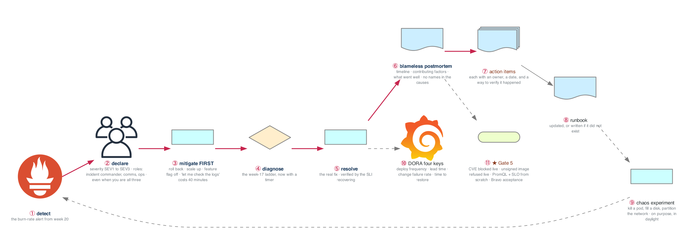

# Figure 21.1 — An incident, from the first alert to the postmortem that changes something

> Week 21 · badges ① to ⑪ · about three and a half minutes at a normal pace. Point at each badge as you say its line. Blue is the path to follow first; orange-red is where something refuses or fails.



Three real incidents you ran and three blameless postmortems you wrote are worth more in a behavioral interview than any README. The blue path is the incident; the loop at the end is what makes the next one shorter.

## What to say, badge by badge

- **Open.** “Tuesday you run three real incidents against your own stack, and by Friday you have three postmortems. This figure is one incident end to end. The order of badges 3 and 4 is the whole lesson.”
- **① detect.** “The alert from week 20 fires because users are hurting, not because a CPU is busy. Time zero is when the alert fired, and the timeline starts there.”
- **② declare.** “Name a severity and take the roles. SEV1 is users cannot do the core thing. One person can be incident commander, communicator, and operator, but saying which hat you are wearing keeps you from skipping the communication.”
- **③ mitigate first.** “Stop the bleeding before you understand the wound. Roll back the deploy, scale up, turn the flag off. 'Let me just check the logs' is the instinct, and it costs forty minutes of user impact. Mitigation is allowed to be ugly.”
- **④ diagnose.** “Now the week-17 ladder: symptom, change, hypothesis, layers, confirm. With a timer running, because the timeline will show how long it took.”
- **⑤ resolve.** “The real fix, and the proof is the SLI recovering, not a feeling. Note the time; time to restore is a DORA number.”
- **⑥ blameless postmortem.** “A timeline with timestamps, the contributing factors, what went well, what was lucky. No names in the causes: a person did something because the system made it the obvious thing to do. Blameless means blameless, or nobody tells the truth next time.”
- **⑦ action items.** “Every action item has three things: an owner, a date, and a way to verify it was done. An action item without those is a wish. This is the sentence interviewers want to hear you say.”
- **⑧ runbook.** “Update the runbook, or write the one that should have existed. The template is in _shared. A runbook is the postmortem's most durable output.”
- **⑨ chaos experiment.** “Kill a pod, fill a disk, partition the network, on purpose, during the day, with the runbook open. Chaos engineering is rehearsing the incident before it chooses the time.”
- **⑩ DORA four keys.** “Deployment frequency, lead time for changes, change failure rate, time to restore. Measure yours for Bravo. They are the numbers an engineering leader uses to describe a team, and now you can describe yourself with them.”
- **⑪ Gate 5.** “Friday: the pipeline blocks a critical CVE live, refuses an unsigned image live, you write a PromQL query and a valid SLO from scratch, and Bravo meets its acceptance criteria. Then the demo video Saturday.”
- **Close.** “Detect, declare, mitigate before you diagnose, fix, write it down without blame, and leave an action item someone can verify. Three of those, written by you, are an interview story bank.”

**Print it:** [`figure-21.1-numbered-spoken.pdf`](figure-21.1-numbered-spoken.pdf) is the two-page version, the figure on page one and this script on page two.

## Use it

- Read the figure before the day plan. Say the script out loud on Friday with the file closed.
- Each badge line is a thirty-second interview answer; the whole script is the three-minute version.
- Regenerate after editing the spec in `_shared/diagrams/week_figures/`:

```bash
python3 ../../_shared/diagrams/generate-week-figures.py --only 21
```
