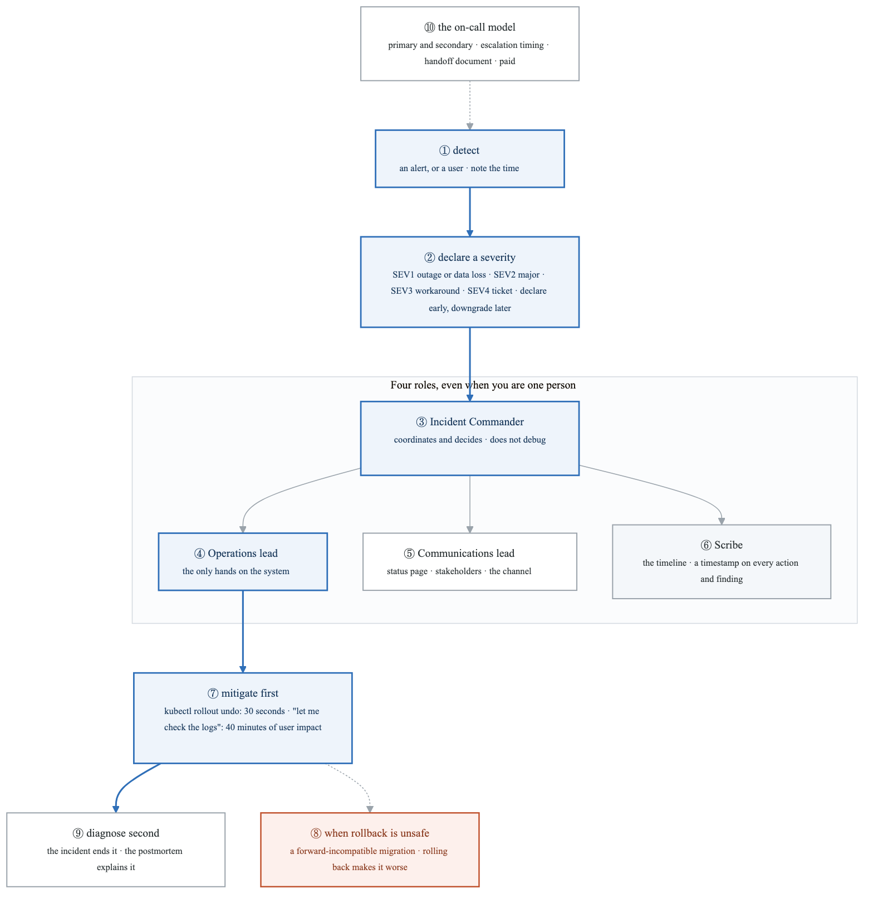
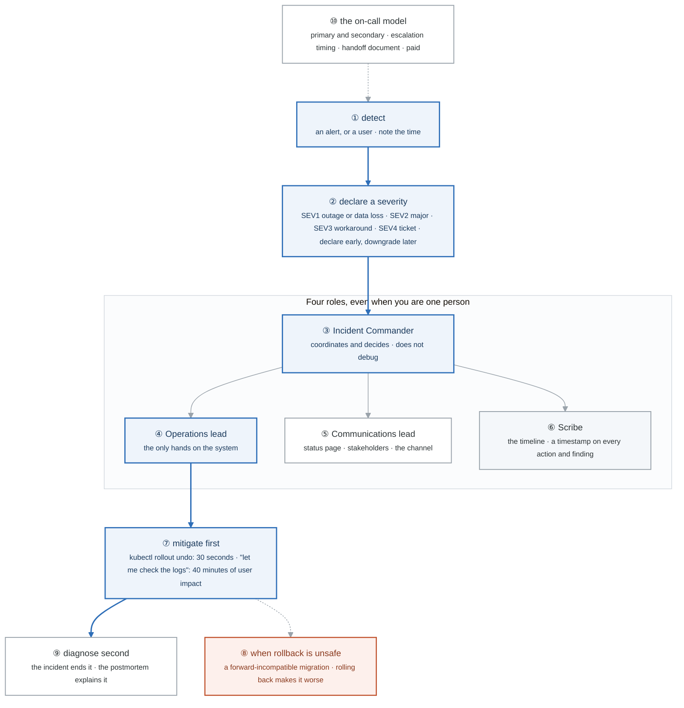
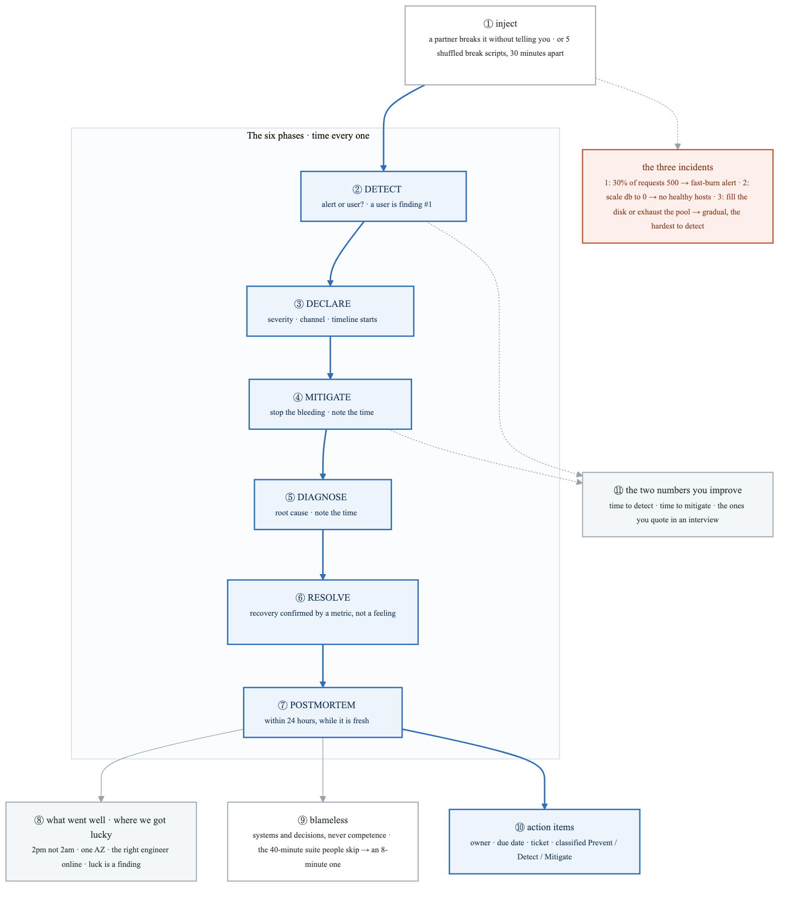
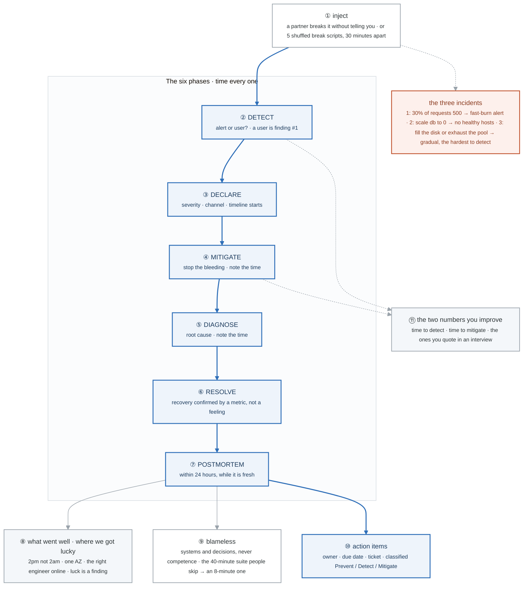
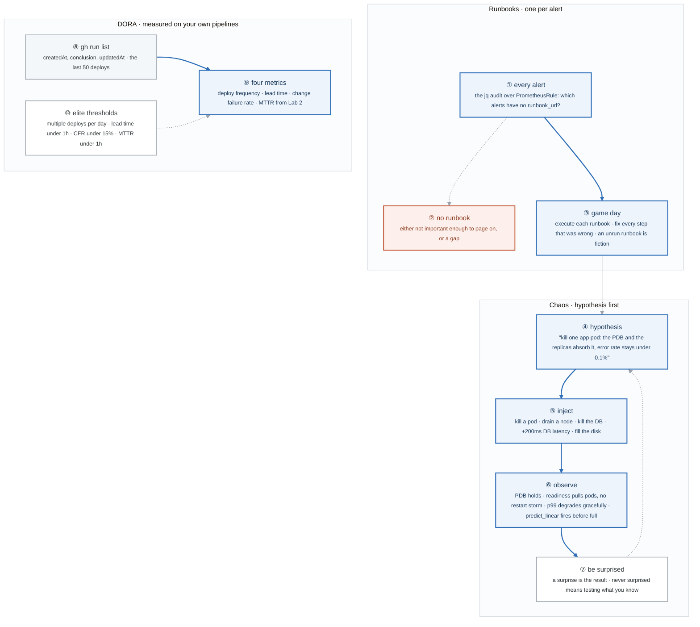
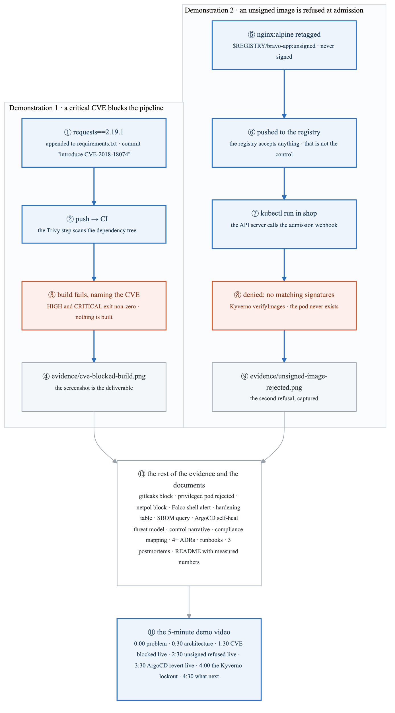
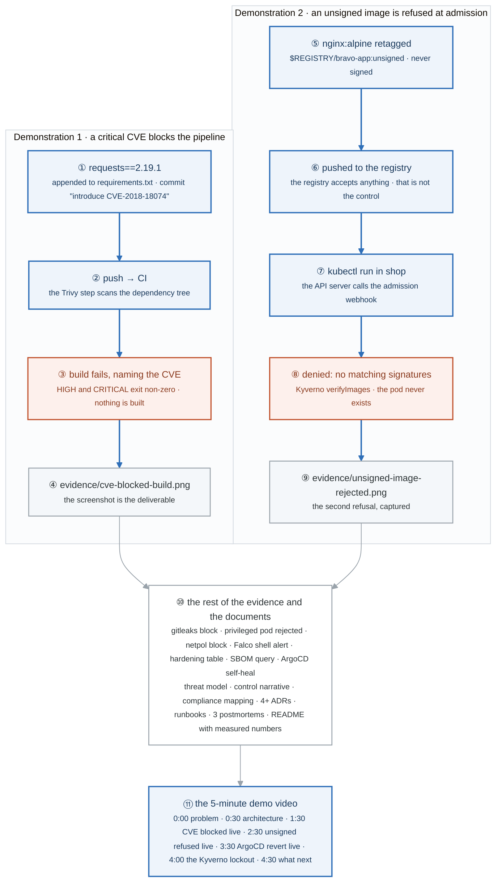

# Week 21 — Lab figures

> One figure per lab, numbered 21.2 to 21.5. Figure 21.1 is the week figure in
> [`../content/FIGURE.md`](../content/FIGURE.md); these four go one level down, to the mechanism each
> lab makes you touch. Same language: gray is structure, **blue is the path to follow first**,
> orange-red is where something refuses, washed boxes are stores. Each badge line is a thirty-second
> interview answer; each whole script is under three minutes.

**The protocol per figure**

1. **Before the lab:** read the figure, say the badges out loud once. You now know what you are about to prove.
2. **During the lab:** every badge has a **Prove it** command. Run it and watch the badge happen. A badge you cannot see happen is one you are taking on faith.
3. **After the lab:** close the file, redraw the figure, say the script. Check against the file. The badge where the order slipped goes in the *Figures redrawn* column of `progress.md`.
4. **Own the numbers.** The *Numbers to own* table is what separates "I have done incident response" from "my time to mitigate across three incidents averaged eleven minutes, and the gradual one was the slowest to detect."
5. **Answer the question.** Each figure ends with the question a senior interviewer asks about it. Answer it cold, in under a minute, before the gate.

---

## Figure 21.2 — Lab 1: the first ten minutes of an incident

> Lab 1 · badges ① to ⑩ · about three minutes.

<!-- figure: generated from the Mermaid below by _shared/diagrams/embed-figures.py — do not edit the image -->


<details>
<summary>Diagram source (Mermaid)</summary>



</details>

### Say it, badge by badge

- **Open.** "The counter-intuitive rule of incident response is that the most senior person must not touch the keyboard. Everything in this figure follows from separating coordination from execution, and from stopping the bleeding before understanding it."
- **① detect.** "An alert or a user told you. Write down the time. Whether it was an alert or a user is the first finding of the postmortem, before anything else is known."
- **② declare a severity.** "SEV1 is a full outage or data loss, all hands and executive comms. SEV2 is major degradation, a dedicated responder. SEV3 has a workaround, business hours. SEV4 is a ticket. Declare early and downgrade: under-declaring wastes the minutes when action is cheapest; over-declaring costs one apologetic message."
- **③ Incident Commander.** "Coordinates and decides, and does not debug. The instinct in a crisis is for the most experienced person to dive into the terminal, and then nobody is tracking who is doing what, nobody is talking to stakeholders, and two people make conflicting changes."
- **④ Operations lead.** "The hands. The only person changing the system, so that every change has one owner and one place in the timeline."
- **⑤ Communications lead.** "Status page, stakeholders, the incident channel. Silence from the responders reads as nobody is working on it."
- **⑥ Scribe.** "A timestamp on every action and finding. The timeline is the raw material of the postmortem and the only defence against memory rewriting what happened."
- **⑦ mitigate first.** "`kubectl rollout undo` takes thirty seconds. 'Let me just check the logs' takes forty minutes of user impact. A clean rollback beats a clever fix; the incident is where you end it, the postmortem is where you understand it."
- **⑧ when rollback is unsafe.** "If you do not understand the failure, a rollback can make it worse: a forward-incompatible migration is the classic. Knowing when rollback is the wrong first move is the nuance that separates a rule from judgment."
- **⑨ diagnose second.** "Root cause comes after the bleeding stops. It is not less important; it is less urgent."
- **⑩ the on-call model.** "Primary and secondary with explicit escalation timing, a handoff document at shift change, follow-the-sun where headcount allows, and compensation. Unpaid on-call quietly becomes 'whoever is most conscientious', and that person burns out."
- **Close.** "Detect, declare, split the roles, mitigate, then diagnose. The IC does not debug. Rollback first unless rollback is the danger. Say it in that order and you have described a function, not a panic."

### Numbers to own

| Number | Where it comes from | Why it matters |
|---|---|---|
| 4 roles | the lab's table | IC · operations · communications · scribe; one person can hold all four, but must know which hat is on |
| 4 severities | SEV1 to SEV4 | outage or data loss · major degradation · workaround exists · no user impact |
| 30 seconds vs 40 minutes | `rollout undo` vs reading logs first | the cost of diagnosing before mitigating |
| 1 exception | a forward-incompatible migration | when rollback is unsafe |
| 2 on-call tiers | primary and secondary | escalation has to be timed and written down |

### Prove it

```bash
kubectl -n shop rollout history deploy/app          # ⑦ is there a revision to go back to?
time kubectl -n shop rollout undo deploy/app         # ⑦ the 30 seconds, measured
kubectl -n shop rollout status deploy/app            # ⑨ confirm before you diagnose
```

### The question a senior interviewer asks

*"Why should the Incident Commander not debug, and when is rollback the wrong first move?"*
Badge ③: nobody coordinating means conflicting changes and silent stakeholders. Badge ⑧: when the failure is a forward-incompatible change, rolling back the code can corrupt what the new version already wrote. Give both; the second is what shows you have been in one.

---

## Figure 21.3 — Lab 2: six phases, timed, and the postmortem that changes something

> Lab 2 · badges ① to ⑪ · about three and a half minutes.

<!-- figure: generated from the Mermaid below by _shared/diagrams/embed-figures.py — do not edit the image -->


<details>
<summary>Diagram source (Mermaid)</summary>



</details>

### Say it, badge by badge

- **Open.** "This is the point of the week: three real incidents, each run through the same six phases with a clock on every one, each ending in a postmortem with action items that have owners. The numbers that come out are the ones you say in interviews."
- **① inject.** "Someone else breaks it, ideally without telling you which of the three. Failing a partner, five break scripts shuffled, run one after a thirty-minute gap so you do not know what is coming."
- **the three incidents.** "A deploy that returns 500 on thirty percent of requests, which the week-20 fast-burn alert should catch. The database scaled to zero, which no-healthy-hosts and readiness should catch. And a full disk or an exhausted connection pool, which gets slow before it fails. The third is the valuable one, because alerting that only catches binary failures is a real finding."
- **② DETECT.** "Note the time you found out, and whether it was an alert or a user. If it was a user, that is finding number one, before you know anything else about the failure."
- **③ DECLARE.** "Severity, a channel, and the timeline starts. From here every action has a timestamp."
- **④ MITIGATE.** "Stop the bleeding and note the time. Rollback, scale, failover, whatever ends the user impact. Time to mitigate is the number that matters most."
- **⑤ DIAGNOSE.** "Root cause, with the time noted. For the gradual incident this is where you discover your dashboards had no saturation panel."
- **⑥ RESOLVE.** "Recovery confirmed by a metric, not a feeling. The error ratio is back under the SLO; the burn alert has cleared. 'It seems fine' is not a phase."
- **⑦ POSTMORTEM.** "Within twenty-four hours, while it is fresh, from the template, every section."
- **⑧ went well, got lucky.** "The two sections people skip. 'What went well' keeps people writing postmortems. 'Where we got lucky' is the most under-used section in the industry: it happened at 2pm, not 2am; only one AZ; the engineer who knew the system was online. Luck is a finding, because the same event could be much worse next time."
- **⑨ blameless.** "Describe systems and decisions, never competence. Not 'Alex deployed without testing' but 'the pipeline allowed a deploy without an integration test, and the suite takes forty minutes, so people skip it'. Blame is an engineering position, not a moral one: it teaches people to hide information, and hidden information makes the next incident worse."
- **⑩ action items.** "Owner, due date, ticket, or it does not happen. And each one classified Prevent, Detect, or Mitigate. If every item is Prevent, you have no plan for the next unknown failure."
- **⑪ the two numbers.** "Time to detect and time to mitigate. They are the two you can actually improve, and the two to quote: 'across three incidents my mean time to mitigate was eleven minutes' is a sentence an interviewer remembers."
- **Close.** "Inject, detect, declare, mitigate, diagnose, resolve, postmortem. Time every phase. Write the luck down, blame the system, give every action an owner. Three times this week, and the numbers go in the README."

### Numbers to own

| Number | Where it comes from | Why it matters |
|---|---|---|
| 6 phases | the lab's protocol | detect · declare · mitigate · diagnose · resolve · postmortem |
| 3 incidents | the lab's table | 30% 500s · db replicas 0 · disk or pool exhaustion |
| 30% | incident 1 | enough error ratio to trip the 14.4× fast-burn alert from week 20 |
| 0 replicas | incident 2 | the no-healthy-hosts path: readiness fails, pods leave rotation |
| 24 hours | the postmortem deadline | written while memory is still accurate |
| 5 scripts, 30 minutes | the solo fallback | shuffled so you do not know which break ran |
| 40 minutes → 8 minutes | the blameless example | the systemic fix for "people skip the tests" |
| 3 things per action item | owner · due date · ticket | without all three the action does not happen |
| 3 classes | Prevent · Detect · Mitigate | all-Prevent means no plan for the unknown |
| 2 numbers to improve | time to detect · time to mitigate | the ones to quote |

### Prove it

```bash
date -u +%FT%TZ                                                        # ② ④ ⑤ the timestamp, every phase
kubectl -n shop scale deploy/db --replicas=0                           # incident 2, injected
curl -s localhost:9090/api/v1/alerts | jq '.data.alerts[] | {name: .labels.alertname, state, since: .activeAt}'   # ② did an alert find it, and when?
```

```promql
job:sli_error_ratio:rate5m < 0.001          # ⑥ resolved means this, not "looks ok"
```

### The question a senior interviewer asks

*"Why is gradual degradation harder to detect than a hard failure, and what does blameless actually mean in engineering terms?"*
The third incident and badge ⑨. A full disk fails slowly, below every binary threshold, until it does not; the finding is that the alerting watched for presence, not trend, which is what `predict_linear` in Lab 3 is for. Blameless is not kindness: blame hides information, and the next incident is built from what was hidden.

---

## Figure 21.4 — Lab 3: runbooks you have run, chaos with a hypothesis, DORA you measured

> Lab 3 · badges ① to ⑩ · about three minutes.

<!-- figure: generated from the Mermaid below by _shared/diagrams/embed-figures.py — do not edit the image -->


<details>
<summary>Diagram source (Mermaid)</summary>



</details>

### Say it, badge by badge

- **Open.** "Three practices that are usually described and rarely done: runbooks that have been executed, chaos that starts with a prediction, and DORA numbers from your own pipeline instead of a slide. Each one produces a sentence with a number in it."
- **① every alert.** "One jq query over every PrometheusRule in the cluster lists the alerts with no `runbook_url`. Run it. That list is either alerts that should not page or documentation you owe."
- **② no runbook.** "An alert without a runbook is either not important enough to wake someone for, or a gap. There is no third option, and the audit forces you to pick."
- **③ game day.** "A runbook that has never been executed is fiction. Run each one as if you were the person woken at 3am who has never seen the system, and fix every step that was wrong. Expect most of them to have one."
- **④ hypothesis.** "Chaos engineering starts with a sentence that can be false: 'if I kill one app pod, the PodDisruptionBudget and the remaining replicas absorb it and the error rate stays under 0.1 percent'. Without the sentence it is just breaking things."
- **⑤ inject.** "Kill a pod. Drain a node. Kill the database. Add two hundred milliseconds to database calls. Fill the disk. Small, in non-production, one at a time."
- **⑥ observe.** "The PDB held or it did not. Readiness pulled pods from rotation with no restart storm, which is the lesson from BF-44. p99 degraded without timeouts cascading. The `predict_linear` alert fired before the disk was full. Each hypothesis has a metric that confirms or kills it."
- **⑦ be surprised.** "If you are never surprised, you are testing things you already know. The surprise is the deliverable; it becomes a fix, and the fix becomes the next hypothesis."
- **⑧ gh run list.** "Fifty runs of the deploy workflow with created and updated timestamps and conclusions. That is enough raw data for three of the four metrics."
- **⑨ four metrics.** "Deployment frequency is commits to main per week. Lead time is commit to running in production. Change failure rate is the share of deploys that needed a rollback or hotfix. Mean time to restore comes from the three incidents in Lab 2."
- **⑩ elite thresholds.** "Multiple deploys a day, lead time under an hour, change failure under fifteen percent, restore under an hour. Not a target; context for what your numbers mean when you put them in the README."
- **Close.** "Audit the alerts, run the runbooks, predict then break, measure the pipeline. 'My lead time is six minutes and my MTTR across three incidents averaged eleven' is a sentence from this lab, and it is the kind interviewers write down."

### Numbers to own

| Number | Where it comes from | Why it matters |
|---|---|---|
| 1 runbook per alert | the lab | the audit query finds the ones without |
| 3am, never seen the system | who the runbook is written for | the test every step has to pass |
| `< 0.1%` | the pod-kill hypothesis | a hypothesis has a threshold or it is not one |
| 5 experiments | the lab's table | kill pod · drain node · kill DB · +200ms · fill disk |
| 200ms | the latency injection | enough to see whether timeouts cascade |
| 4 DORA metrics | the lab's table | frequency · lead time · change failure rate · MTTR |
| 50 runs | `gh run list --limit 50` | the sample for the first three |
| elite: multiple/day · < 1h · < 15% · < 1h | the lab, quoting DORA | context for your own numbers |
| 6 min, 11 min | the lab's example README sentence | the shape of the answer, with your own values |

### Prove it

```bash
kubectl get prometheusrule -A -o json | jq -r '.items[].spec.groups[].rules[] | select(.alert) | select(.annotations.runbook_url == null) | .alert'   # ① ② the audit
kubectl -n shop delete pod -l app=app --field-selector status.phase=Running --wait=false -o name | head -1   # ⑤ kill one pod
gh run list --workflow=deploy.yml --json createdAt,conclusion,updatedAt --limit 50 | jq -r '.[] | [.createdAt, .conclusion, ((.updatedAt|fromdate) - (.createdAt|fromdate))] | @tsv'   # ⑧ lead time per run
```

```promql
sum(rate(http_requests_total{status=~"5.."}[5m])) / sum(rate(http_requests_total[5m])) < 0.001   # ⑥ the hypothesis held
```

### The question a senior interviewer asks

*"What separates chaos engineering from breaking things at random, and which DORA metric would your three incidents move?"*
Badges ④ and ⑦: a falsifiable hypothesis and the willingness to be surprised. Then badge ⑨: the incidents are your MTTR sample, and the postmortem action items are what move change failure rate.

---

## Figure 21.5 — Lab 4: the two demonstrations that are the project

> Lab 4 · badges ① to ⑪ · about three minutes. Two paths, one evidence folder.

<!-- figure: generated from the Mermaid below by _shared/diagrams/embed-figures.py — do not edit the image -->


<details>
<summary>Diagram source (Mermaid)</summary>



</details>

### Say it, badge by badge

- **Open.** "Everything else in Bravo is presentation. These two demonstrations are the project: a vulnerable dependency that cannot reach a build, and an unsigned image that cannot reach a pod. Each is one command, one refusal, one screenshot."
- **① requests==2.19.1.** "Append a version with a known critical CVE, 2018-18074, to requirements and commit it with a message that says what you are doing. The test is honest on purpose."
- **② push → CI.** "The pipeline runs; the Trivy filesystem scan reads the dependency tree. This is the SCA step from week 18, sitting before the build."
- **③ build fails, naming the CVE.** "HIGH and CRITICAL findings exit non-zero. The log names the package, the version, and the CVE. No image is built, so nothing downstream has to catch it."
- **④ the screenshot.** "`evidence/cve-blocked-build.png`. The deliverable is the refusal, captured."
- **⑤ nginx:alpine retagged.** "Pull a public image, tag it as your app with the tag `unsigned`, never sign it. It is a perfectly good image; that is the point."
- **⑥ pushed to the registry.** "The registry accepts it. The registry is not the control, and the demonstration makes that visible."
- **⑦ kubectl run in shop.** "Ask the API server for a pod with that image. The API server calls the admission webhook before anything is persisted."
- **⑧ denied: no matching signatures.** "Kyverno's `verifyImages` looks for a cosign signature from your CI identity and finds none. The pod never exists; there is nothing to clean up."
- **⑨ the screenshot.** "`evidence/unsigned-image-rejected.png`. The second refusal, captured."
- **⑩ the rest.** "Seven more evidence files, each a control that fired: gitleaks, Pod Security, NetworkPolicy, Falco, the hardening table, an SBOM query, ArgoCD reverting a manual change. And the documents: threat model, the threat-to-control-to-evidence narrative from week 17, the compliance mapping, four or more ADRs, a runbook per alert, three postmortems, a README with numbers you measured."
- **⑪ the demo video.** "Five minutes. The problem, the architecture, then three live refusals: the CVE, the unsigned image, the ArgoCD revert. At four minutes, the thing you got wrong: the Kyverno lockout, and what you do differently now. A demo with no mistakes reads as trivial or rehearsed; the lockout story is the most memorable thirty seconds."
- **Close.** "Two refusals, captured. Then seven more controls with evidence, the documents that explain them, and a video that shows the mistake. Gate 5 is the two refusals, live."

### Numbers to own

| Number | Where it comes from | Why it matters |
|---|---|---|
| `CVE-2018-18074` in `requests==2.19.1` | demonstration 1 | the known-bad dependency; name it from memory |
| 2 demonstrations | the lab | the project; everything else is presentation |
| 7 further evidence files | the checklist | gitleaks · PSS · netpol · Falco · hardening · SBOM · self-heal |
| 4+ ADRs | `docs/adr/` | decisions with reasons |
| 3 postmortems | Lab 2 | the incidents, written up |
| 5 minutes | the video | with the mistake at 4:00 |
| 7 timestamps | the video script | 0:00 · 0:30 · 1:30 · 2:30 · 3:30 · 4:00 · 4:30 |

### Prove it

```bash
echo "requests==2.19.1" >> app/requirements.txt && git commit -am "test: introduce CVE-2018-18074" && git push   # ① ② ③ watch CI refuse
docker tag nginx:alpine $REGISTRY/bravo-app:unsigned && docker push $REGISTRY/bravo-app:unsigned                   # ⑤ ⑥
kubectl -n shop run test --image=$REGISTRY/bravo-app:unsigned                                                      # ⑦ ⑧ "no matching signatures"
ls evidence/ | wc -l                                                                                               # ⑩ nine files
```

### The question a senior interviewer asks

*"Walk an unsigned image from push to rejection. Which component verifies what, against which key?"*
Badges ⑥ ⑦ ⑧: the registry stores, the API server asks, Kyverno verifies the cosign signature against the keyless identity of your CI workflow, and the pod is never created. If you say "the registry rejects it", you have placed the control in the wrong box.

---

## Redraw schedule

Week 21 is Gate 5. Redraw these on Friday after break/fix, then cold on the Gate 5 Sunday alongside every figure since week 17, then again on Sunday of week 23. See [`../../FIGURES.md`](../../FIGURES.md). Figure 21.3 is the one to be able to say with your own three incidents' numbers in it.
