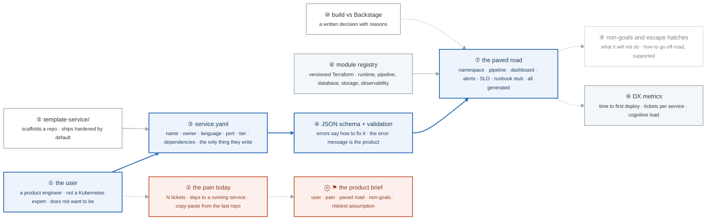

# Week 22 — Platform Engineering Foundations

> **Thesis:** platform engineering is a **product** discipline applied to infrastructure. The concept
> to be able to explain in sixty seconds is the **golden path**: an opinionated, paved, self-service
> route that makes the right thing the easy thing. Most candidates cannot explain it. One who can —
> with a working demo — interviews above their level.

| | |
|---|---|
| **Hours** | 35–45 (incl. ~6h job search) |
| **Deliverable** | Blog post #12 — "Golden paths: why the easy way has to be the right way" |
| **⚑ Charlie** | Product brief, module registry, the `service.yaml` contract |

## The week in one figure

**Figure 22.1 — The golden path, as a product.** Platform engineering is product management applied to infrastructure. The figure reads like a product: a user with a pain, a contract they write, a paved road that does the rest, and the metrics that say whether it worked. Badges are numbered in the order to walk them; the blue path is the one to follow first.

**What to say, badge by badge** · about three and a half minutes at a normal pace. Point at each badge as you say its line.

- **Open.** “Explain a golden path in sixty seconds without saying self-service more than once. This figure is the sixty seconds. It starts with a person and a pain, not with a technology.”
- **① the user.** “A product engineer who wants to ship a feature. They do not know Kubernetes and the platform's job is to keep it that way. Every design decision is tested against this person.”
- **② the pain today.** “Count it: how many tickets to get a service running, how many days, how much copying from the last repository. The brief quantifies the pain so the platform can be measured against it.”
- **③ service.yaml.** “The contract. Name, owner, language, port, tier, dependencies. It is the only file the user writes, and every field exists because something downstream needs it. The charlie project in _reference shows the shape.”
- **④ JSON schema and validation.** “The schema rejects a bad file, and the error says exactly what to change. The error message is the product: a validation that says 'invalid' makes the user ask you, and then it is not a platform.”
- **⑤ template-service.** “A repository scaffold with the Dockerfile, the pipeline, and the health endpoints already correct. Hardened by default, so the easy way is the right way without the user choosing it.”
- **⑥ module registry.** “Versioned Terraform modules for runtime, pipeline, database, storage, and observability. The weeks 10 to 13 modules, now consumed by a controller instead of a person.”
- **⑦ the paved road.** “What the contract turns into: a namespace with quotas, a pipeline, a dashboard, alerts, an SLO, a runbook stub. All of it generated. The user opts out of nothing because nothing is opt-in.”
- **⑧ non-goals and escape hatches.** “The brief says what the platform will not do, and the docs say how to go off the paved road with support rather than in secret. Platforms die when the only way off is to work around them.”
- **⑨ DX metrics.** “Time to first deploy, tickets per service, and the cognitive load the user carries. Measure before and after. A platform that cannot show the number did not move it.”
- **⑩ build versus Backstage.** “A written decision. Backstage is a portal with a learning curve; for one person and three services it is overhead. Say why, in an ADR, so the decision can be revisited when the answer changes.”
- **⑪ the product brief.** “Tuesday's deliverable: user, pain, paved road, non-goals, how you will know it worked, and the riskiest assumption. Everything in weeks 23 and 24 is checked against this page.”
- **Close.** “A person, a pain, one file, a road that makes the right thing the easy thing, and a number that says it worked. That is a golden path, and most candidates cannot explain it.”

---

## Day plan
| Day | Focus | Lab |
|---|---|---|
| Mon | What an IDP is; platform-as-product; cognitive load | Lab 1 |
| Tue | **Write the product brief** — users, pain, paved road, non-goals | Lab 2 |
| Wed | The `service.yaml` contract and its JSON schema | Lab 3 |
| Thu | Terraform module registry; the template repo | Lab 4 |
| Fri | Backstage evaluation + the build/buy decision | Lab 5 |
| Sat | ⚑ Charlie scaffolding; 20 applications | — |
| Sun | Blog post #12; plan week 23 | — |

## Reading map
- `_reference/platform-engineering/content-module-01-platform-engineering-fundamentals.md`
- `_reference/platform-engineering/content-module-02-developer-experience-design.md`
- `_reference/platform-engineering/content-module-03-internal-developer-platforms.md`
- `_reference/platform-engineering/labs-lab-04-golden-paths-software-templates.md`
- `_reference/platform-engineering/labs-lab-07-self-service-infrastructure-workflows.md`
- `_reference/platform-engineering/labs-lab-05-platform-metrics-developer-productivity.md`
- `_reference/devsecops/implementation/08-developer-experience-architecture.md`
- `_reference/kubernetes/04-platform/03-developer-platform-README.md`
- **Case study:** `_reference/case-studies/03-audiowave-platform-engineering.md` (anonymized)

**Free primary sources:** *Team Topologies* (the cognitive-load argument), the CNCF Platforms White
Paper, and platformengineering.org's maturity model.

## Labs
[labs/LABS.md](labs/LABS.md) · [solutions/SOLUTIONS.md](solutions/SOLUTIONS.md)

## Exit criteria
- [ ] Explain a golden path in 60 seconds, without saying "self-service" more than once
- [ ] A written **product brief** for Charlie: user, current pain, paved road, explicit non-goals
- [ ] `service.yaml` contract designed, with a JSON schema and validation that produces **useful**
      error messages
- [ ] A versioned, documented Terraform module registry
- [ ] A `template-service/` repo that scaffolds a new service
- [ ] A written build-vs-Backstage decision, with reasons
