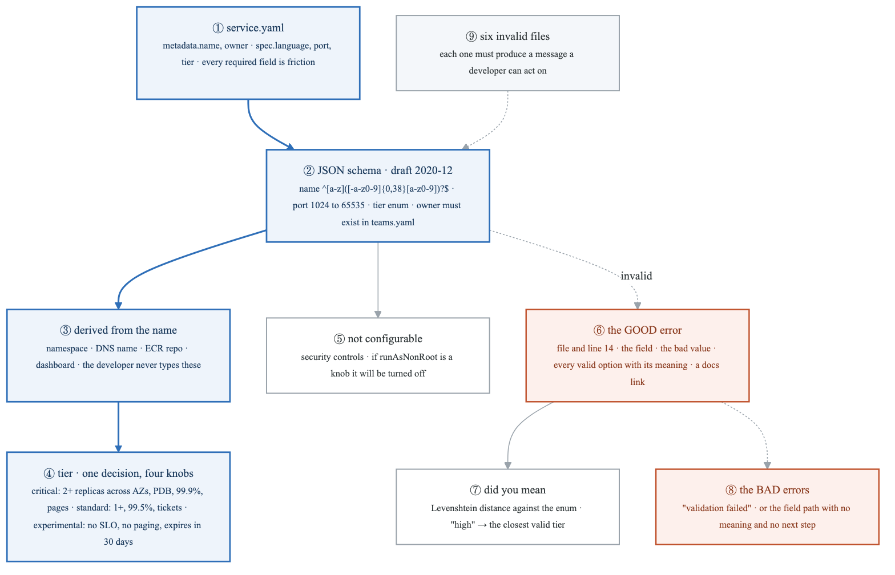
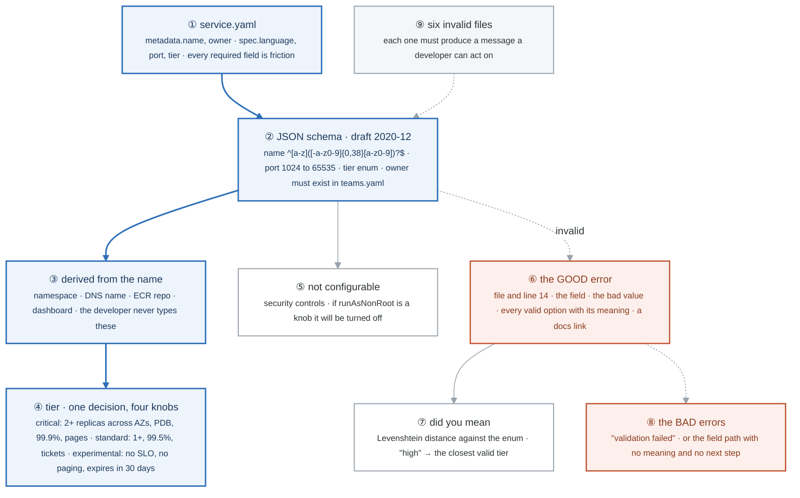
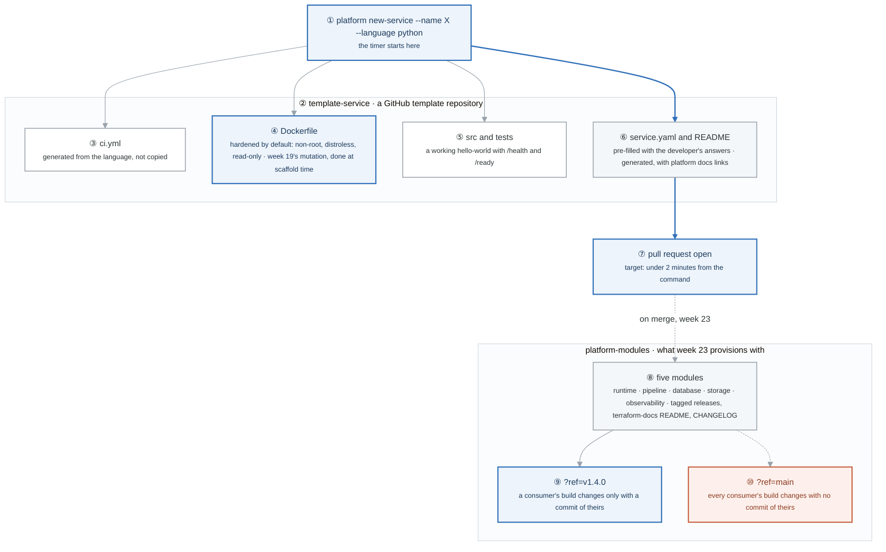

# Week 22 — Lab figures

> One entry per lab, numbered 22.2 to 22.6. Figure 22.1 is the week figure in
> [`../content/FIGURE.md`](../content/FIGURE.md); these go one level down, to the mechanism each
> lab makes you touch. Two of the five labs are product and judgment work rather than a system, and
> say so. Same language: gray is structure, **blue is the path to follow first**, orange-red is where
> something refuses, washed boxes are stores. Each badge line is a thirty-second interview answer;
> each whole script is under three minutes.

**The protocol per figure**

1. **Before the lab:** read the figure, say the badges out loud once. You now know what you are about to prove.
2. **During the lab:** every badge has a **Prove it** command. Run it and watch the badge happen. A badge you cannot see happen is one you are taking on faith.
3. **After the lab:** close the file, redraw the figure, say the script. Check against the file. The badge where the order slipped goes in the *Figures redrawn* column of `progress.md`.
4. **Own the numbers.** The *Numbers to own* table is what separates "I designed a contract" from "the name is a DNS-1123 label of at most 40 characters because it becomes the namespace, the DNS name and the ECR repo."
5. **Answer the question.** Each figure ends with the question a senior interviewer asks about it. Answer it cold, in under a minute, before the gate.

---

## Figure 22.2 — Lab 1: no figure

What an IDP is, the golden path, and platform-as-product are arguments, not mechanisms; the lab's deliverable is a sixty-second spoken explanation that names no tools, and a list of the nine things a developer currently has to know. Say the explanation with a timer instead of drawing it, and keep the list: it is the product requirements for figures 22.4 and 22.5.

---

## Figure 22.3 — Lab 2: no figure

The product brief is a one-page document, and its value is the five questions it answers in order: user, pain, paved road, non-goals, riskiest assumption. Write it, then say the riskiest-assumption section out loud; the numbers in it (3 to 5 days to under 10 minutes, 8 tickets a month to 0, 0 to 80 percent on the golden path in two quarters, 30 percent to 100 percent with observability) are the ones figure 22.4 and week 23 have to deliver.

---

## Figure 22.4 — Lab 3: a service.yaml, validated, derived, and refused well

> Lab 3 · badges ① to ⑨ · about three minutes. This figure reads top-down.

<!-- figure: generated from the Mermaid below by _shared/diagrams/embed-figures.py — do not edit the image -->


<details>
<summary>Diagram source (Mermaid)</summary>



</details>

### Say it, badge by badge

- **Open.** "A platform's API is one YAML file. Everything about the platform's quality is decided by what that file requires, what it derives, and what it says when you get it wrong. Follow the blue path from the file to the four knobs one word sets."
- **① service.yaml.** "Name and owner in metadata; language, port and tier in spec. Five required fields, and every one of them is friction you decided was worth it. Every optional field is a decision you made on the developer's behalf."
- **② JSON schema.** "Draft 2020-12. The name pattern is a DNS-1123 label, because it becomes a namespace and a hostname. Port is an integer between 1024 and 65535. Tier is an enum of three. Owner must exist in teams.yaml, which the schema cannot check, so that is a business rule on top."
- **③ derived.** "From one name you get the namespace, the DNS record, the ECR repository and the dashboard URL. Derive everything you can; a field the developer does not type is a field they cannot get wrong."
- **④ tier.** "Critical means two or more replicas across AZs, a PDB, a 99.9 percent SLO and paging. Standard is one replica, 99.5, tickets. Experimental has no SLO, no paging, and expires after thirty days. One word, four knobs, and the platform can change what the word means in one place."
- **⑤ not configurable.** "Security controls are not in the schema at all. If runAsNonRoot is a knob, it will be turned off at 5pm on a Friday. The absence of a field is a design decision too."
- **⑥ the GOOD error.** "File and line. The field. The value you gave. Every valid option, each with what it means. A docs link. This is the most-read documentation on the platform, because it arrives at the exact moment someone needs it."
- **⑦ did you mean.** "Levenshtein distance from the bad value to each enum member, and suggest the closest. Ten lines of code, and it is the difference between a developer fixing the file and a developer opening a ticket."
- **⑧ the BAD errors.** "'Validation failed' says nothing. A JSON path with the enum list says what, not why or what next. Both are the default output of every validator library, and both are what you ship if you do not decide otherwise."
- **⑨ six invalid files.** "Six ways to be wrong, each committed as a test fixture, each asserting on the message. Error messages are a feature, so they get tests like one."
- **Close.** "Five required fields, everything else derived, one word that sets four knobs, nothing security-relevant exposed, and an error that tells you what to do. That is the whole contract, and it is what the rest of Charlie is generated from."

### Numbers to own

| Number | Where it comes from | Why it matters |
|---|---|---|
| 5 required fields | the schema: name, owner, language, port, tier | each one is justified friction; the lab asks you to defend every one |
| `^[a-z]([-a-z0-9]{0,38}[a-z0-9])?$` | the name pattern | a DNS-1123 label: lowercase, at most 40 characters, no leading or trailing hyphen; it becomes the namespace, hostname and ECR repo |
| `1024` to `65535` | the port range | below 1024 needs root, which the hardened image does not have |
| 3 tiers, 4 knobs each | the tier table | replicas, PDB, SLO, paging bundled behind one word |
| 30 days | experimental tier | auto-expiry; the tier for things that should not accumulate |
| 6 invalid files | task 4 | the test suite for error messages |
| 1 hour on error messages | the lab's claim | returns more than a day on the docs site, because the error is read at the moment of need |

### Prove it

```bash
cat _shared/templates/service.yaml                                   # ① the starting contract
python3 -c 'import json; json.load(open("schema.json"))' && echo valid  # ② the schema parses
./validate services/payments-api/service.yaml                        # ⑥ the GOOD message, with line number
for f in tests/invalid/*.yaml; do ./validate "$f" | head -3; done    # ⑨ six messages, each actionable
```

### The question a senior interviewer asks

*"Why is `tier` a better abstraction than exposing replicas, PDB, SLO and paging individually?"*
Badge ④, then ⑤: one decision instead of four, a meaning the platform can change later in one place, and a vocabulary a product manager can read. The follow-up is "what happens when a team needs something between standard and critical?" The answer is the escape hatch, week 24, not a fourth tier.

---

## Figure 22.5 — Lab 4: from one command to an open pull request

> Lab 4 · badges ① to ⑩ · about three minutes. This figure reads top-down.

<!-- figure: generated from the Mermaid below by _shared/diagrams/embed-figures.py — do not edit the image -->


<details>
<summary>Diagram source (Mermaid)</summary>



</details>

### Say it, badge by badge

- **Open.** "Two repositories make the paved road paved. One is the template a new service is stamped from; the other is the registry of modules the platform provisions with. Follow the blue path from a command to an open pull request, then look at the one line that keeps the registry safe to consume."
- **① the command.** "Name and language. That is all the developer supplies, and the timer starts the moment they press enter. Under two minutes to a pull request is the number the lab asks you to measure."
- **② the template repository.** "A GitHub template, so a new repo is created from it with history reset. Everything inside it is a decision the developer no longer has to make."
- **③ ci.yml.** "Generated from the language, not copied from the last service. Copied CI drifts; generated CI is fixed in one place and every service gets the fix. That argument comes back in week 23."
- **④ Dockerfile.** "Non-root, distroless, read-only root filesystem, by default. A developer who has never heard of runAsNonRoot gets it. This is week 19's Kyverno mutation, moved earlier: make the secure thing the default, not the thing you get rejected for forgetting."
- **⑤ src and tests.** "A hello-world that already answers /health and /ready, because week 4 taught you a service without those cannot be probed, and a test directory so the pipeline has something to run on day one."
- **⑥ service.yaml and README.** "The contract from Lab 3, pre-filled with the two answers the developer gave, and a README generated with the platform docs linked. The developer edits a file that is already valid."
- **⑦ pull request open.** "The script's last act. From here the week 23 controller takes over. Time this from ① and write the number down; it goes in the README's measured results."
- **⑧ five modules.** "Runtime, pipeline, database, storage, observability. Each with documented variables, a terraform-docs README, tagged releases and a changelog. These are the platform's internal API."
- **⑨ ref=v1.4.0.** "A consumer pins a tag. Their build changes only when they change the tag, with a commit of their own that a reviewer sees. That is what makes a module registry safe to depend on."
- **⑩ ref=main.** "Pin a branch and every consumer's build changes the moment anyone merges, with no commit of theirs. Week 11 said the same about Alpha's modules; here it would mean every service on the platform shifts at once."
- **Close.** "Command, template, pull request, under two minutes. Registry, tagged, pinned. The template makes the secure thing the default; the pin makes the platform's own changes reviewable by the people they affect."

### Numbers to own

| Number | Where it comes from | Why it matters |
|---|---|---|
| under 2 minutes | task 4 | command to pull request; measure it, it goes in the README |
| 5 modules | the registry table | runtime, pipeline, database, storage, observability; the lab builds 3 with versioned releases |
| `?ref=v1.4.0` | the module source string | the pin; the tag is the contract |
| 2 endpoints | the hello-world | `/health` and `/ready`; the probes from week 14 have something to hit on day one |
| 3 Dockerfile defaults | the template | non-root, distroless, read-only; shipped, not requested |

### Prove it

```bash
time platform new-service --name hello-api --language python          # ① ⑦ the number
gh repo view org/hello-api --json templateRepository                   # ② created from the template
grep -E 'USER|FROM .*distroless' hello-api/Dockerfile                  # ④ hardened before the first commit
curl -s localhost:8080/ready                                           # ⑤ the hello-world answers
git -C platform-modules tag --list 'v*'                                # ⑧ ⑨ tagged releases to pin
grep -rn 'ref=main' --include='*.tf' . && echo "unpinned consumer"     # ⑩ the thing that must not exist
```

### The question a senior interviewer asks

*"Why must module references be pinned to tags, and how does a hardened template play the same role as an admission controller?"*
Badges ⑨ and ⑩ for the first half: a consumer's build must change only with a commit of theirs. Badge ④ for the second: Kyverno fixes a bad manifest at the door; the template means the bad manifest is never written. Both make the secure thing the default; the template does it earlier and cheaper.

---

## Figure 22.6 — Lab 5: no figure

The Backstage evaluation is a build-or-buy decision with one table and one rule: build it unless the twenty job postings in your target list name Backstage. The artifact is `docs/adr/0001-build-vs-backstage.md`, including the do-nothing option and what would make you revisit; practise saying "I evaluated Backstage and chose not to use it, here is why" in under a minute.

---

## Redraw schedule

Same cadence as the week figure, see [`../../FIGURES.md`](../../FIGURES.md): Friday of this week, Sunday of week 24, and cold at the Gate 6 Sunday in week 26. Lab figures are redrawn **after** the week figure, one at a time, and only the badge order has to be right; the captions are the check, not the test.
