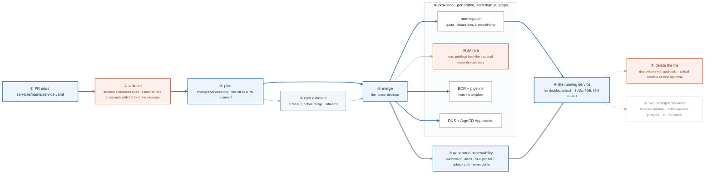

# Week 23 — The Platform Build

> **Thesis:** everything from months 1–5 composes here. Charlie is not a new set of technologies —
> it is the Terraform, CI/CD, GitOps, security gates, and observability you already built, wired
> together behind one contract.

| | |
|---|---|
| **Hours** | 35–45 (incl. ~6h job search) |
| **⚑ Charlie** | PR-driven onboarding working end to end |
| **Break/Fix** | A malformed `service.yaml` — the error message *is* the feature |

## The week in one figure

**Figure 23.1 — One pull request to a running service.** Nothing here is new technology. It is Terraform, CI, GitOps, the security gates, and observability from months 1 to 5, wired together behind one contract. Follow the blue path from a file to a service with zero manual steps. Badges are numbered in the order to walk them; the blue path is the one to follow first.

**What to say, badge by badge** · about three and a half minutes at a normal pace. Point at each badge as you say its line.

- **Open.** “Everything from months 1 to 5 composes here. A developer adds one file and merges; ten minutes later a service is running with a dashboard, an SLO, and a least-privilege role they never wrote. The figure is that ten minutes.”
- **① the pull request.** “One file in services, named for the service. The developer does not touch Terraform, Kubernetes, or IAM. If they have to, the platform has a gap.”
- **② validate.** “Schema first, then business rules: the owner must exist in teams.yaml, the tier must be one of three, a critical tier must declare an SLO. The error names the field and the fix. The break/fix for the week is a malformed file, because the error message is the feature.”
- **③ plan.** “Only the services whose files changed are planned. The diff goes on the PR as a comment, which is what the reviewer reads.”
- **④ cost estimate.** “Infracost turns the plan into dollars per month and posts it next to the diff. A tier that costs four times more is a conversation before merge, not a surprise on the bill.”
- **⑤ merge.** “The one human decision in the flow. Everything after it is a machine following the contract.”
- **⑥ provision.** “A namespace with resource quotas and a default-deny policy. An IRSA role whose permissions are generated from the declared dependencies, so a service that declares one S3 bucket read-write gets exactly that. An ECR repository and a pipeline from the template. A DNS record and an ArgoCD Application that deploys it.”
- **⑦ generated observability.** “A dashboard, alerts, an SLO appropriate to the tier, and a runbook stub with the service's name already in it. The developer does not opt in and cannot opt out. Week 20's lesson, delivered by default.”
- **⑧ the running service.** “The tier decides the shape. Critical means three availability zones, a PodDisruptionBudget, and a 99.9 percent SLO. Experimental means one replica and an auto-expiry so nothing is production without an SLO.”
- **⑨ delete the file.** “Deleting the file deprovisions everything, through the same pipeline, with guardrails: a critical service needs a second approval and the data store is retained. Deprovisioning that is harder than provisioning is how platforms accumulate ghosts.”
- **⑩ two example services.** “hello-api with nothing declared, and orders-api with Postgres, an S3 bucket, and tier critical. Both provisioned through the platform. They are the stranger test's starting point next week.”
- **Close.** “Validate, plan with a price, merge, generate everything, run, and remove cleanly. Zero manual steps between merge and a running service is the exit criterion, and Gate 6 times it.”

---

## Day plan
| Day | Focus | Lab |
|---|---|---|
| Mon | The platform controller: validate → plan → provision | Lab 1 |
| Tue | Generated infrastructure: namespace, IAM, ECR, DNS, ArgoCD app | Lab 2 |
| Wed | Generated observability: dashboard, alerts, SLO, runbook stub | Lab 3 |
| Thu | Generated pipeline + FinOps: cost estimate in the PR | Lab 4 |
| Fri | Deprovisioning, error handling, the two example services | Lab 5 |
| Sat | End-to-end run; 20 applications | — |
| Sun | Review; plan week 24 | — |

## Reading map
- `_reference/platform-engineering/labs-lab-07-self-service-infrastructure-workflows.md`
- `_reference/platform-engineering/labs-lab-08-developer-onboarding-automation.md`
- `_reference/platform-engineering/labs-lab-03-platform-cli-development.md`
- `_reference/platform-engineering/labs-lab-06-policy-as-code-governance.md`
- `_reference/kubernetes/04-platform/03-developer-platform-exercises-02-crossplane-self-service.md`
- `_reference/kubernetes/04-platform/03-developer-platform-exercises-04-platform-guardrails.md`
- `_reference/devsecops/implementation/appendix-new-service-checklist.md`
- `_reference/devsecops/implementation/appendix-cost-analysis.md`

## Labs
[labs/LABS.md](labs/LABS.md) · [solutions/SOLUTIONS.md](solutions/SOLUTIONS.md) ·
Reference: [`../projects/charlie-platform/`](../projects/charlie-platform/)

## Exit criteria
- [ ] Adding `services/<name>/service.yaml` and merging provisions everything
- [ ] **Zero manual steps** between merge and a running service
- [ ] A malformed file fails fast with an error that says exactly how to fix it
- [ ] Every service automatically gets a dashboard, alerts, an SLO, and a runbook stub —
      **the developer does not opt in**
- [ ] A cost estimate appears as a PR comment before merge
- [ ] Deleting the file deprovisions cleanly
- [ ] Two example services exist, both provisioned through the platform
