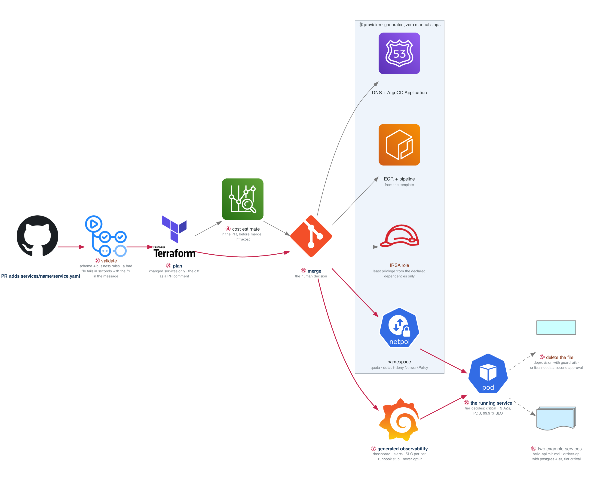

# Figure 23.1 — One pull request to a running service

> Week 23 · badges ① to ⑩ · about three and a half minutes at a normal pace. Point at each badge as you say its line. Blue is the path to follow first; orange-red is where something refuses or fails.



Nothing here is new technology. It is Terraform, CI, GitOps, the security gates, and observability from months 1 to 5, wired together behind one contract. Follow the blue path from a file to a service with zero manual steps.

## What to say, badge by badge

- **Open.** “Everything from months 1 to 5 composes here. A developer adds one file and merges; ten minutes later a service is running with a dashboard, an SLO, and a least-privilege role they never wrote. The figure is that ten minutes.”
- **① the pull request.** “One file in services, named for the service. The developer does not touch Terraform, Kubernetes, or IAM. If they have to, the platform has a gap.”
- **② validate.** “Schema first, then business rules: the owner must exist in teams.yaml, the tier must be one of three, a critical tier must declare an SLO. The error names the field and the fix. The break/fix for the week is a malformed file, because the error message is the feature.”
- **③ plan.** “Only the services whose files changed are planned. The diff goes on the PR as a comment, which is what the reviewer reads.”
- **④ cost estimate.** “Infracost turns the plan into dollars per month and posts it next to the diff. A tier that costs four times more is a conversation before merge, not a surprise on the bill.”
- **⑤ merge.** “The one human decision in the flow. Everything after it is a machine following the contract.”
- **⑥ provision.** “A namespace with resource quotas and a default-deny policy. An IRSA role whose permissions are generated from the declared dependencies, so a service that declares one S3 bucket read-write gets exactly that. An ECR repository and a pipeline from the template. A DNS record and an ArgoCD Application that deploys it.”
- **⑦ generated observability.** “A dashboard, alerts, an SLO appropriate to the tier, and a runbook stub with the service's name already in it. The developer does not opt in and cannot opt out. Week 20's lesson, delivered by default.”
- **⑧ the running service.** “The tier decides the shape. Critical means three availability zones, a PodDisruptionBudget, and a 99.9 percent SLO. Experimental means one replica and an auto-expiry so nothing is production without an SLO.”
- **⑨ delete the file.** “Deleting the file deprovisions everything, through the same pipeline, with guardrails: a critical service needs a second approval and the data store is retained. Deprovisioning that is harder than provisioning is how platforms accumulate ghosts.”
- **⑩ two example services.** “hello-api with nothing declared, and orders-api with Postgres, an S3 bucket, and tier critical. Both provisioned through the platform. They are the stranger test's starting point next week.”
- **Close.** “Validate, plan with a price, merge, generate everything, run, and remove cleanly. Zero manual steps between merge and a running service is the exit criterion, and Gate 6 times it.”

## Use it

- Read the figure before the day plan. Say the script out loud on Friday with the file closed.
- Each badge line is a thirty-second interview answer; the whole script is the three-minute version.
- Regenerate after editing the spec in `_shared/diagrams/week_figures/`:

```bash
python3 ../../_shared/diagrams/generate-week-figures.py --only 23
```
