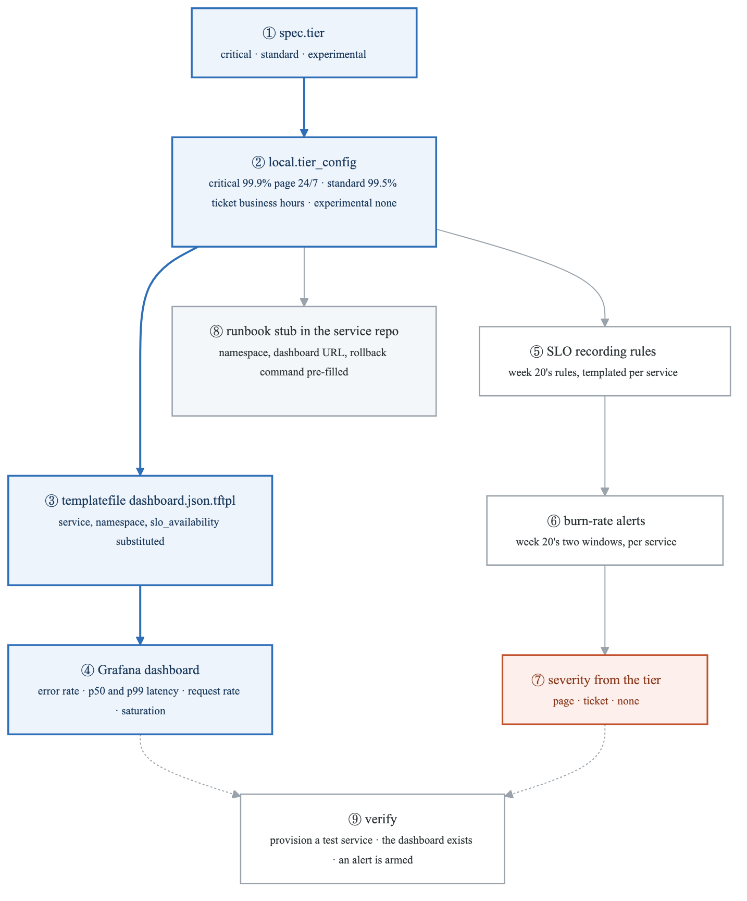
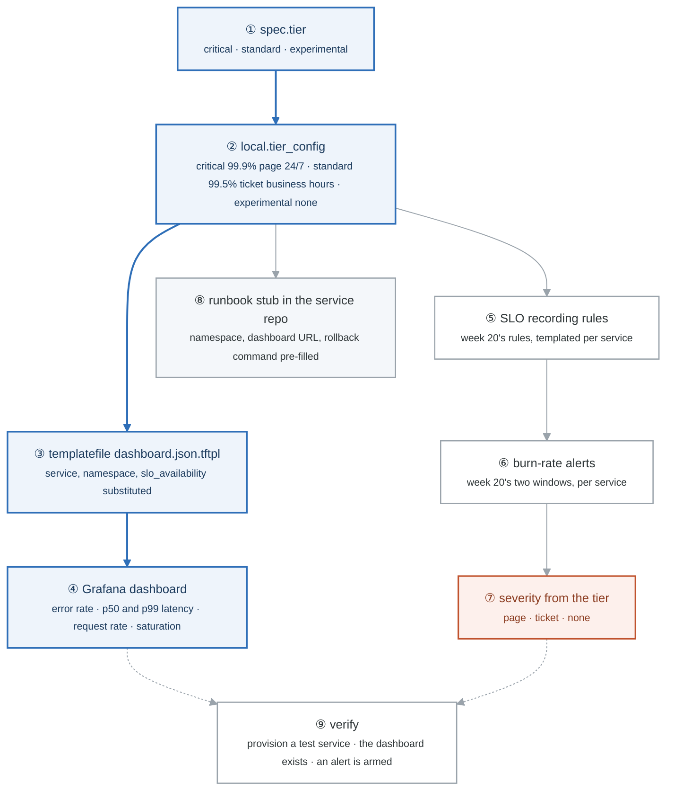
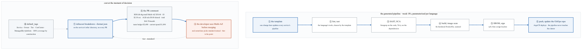
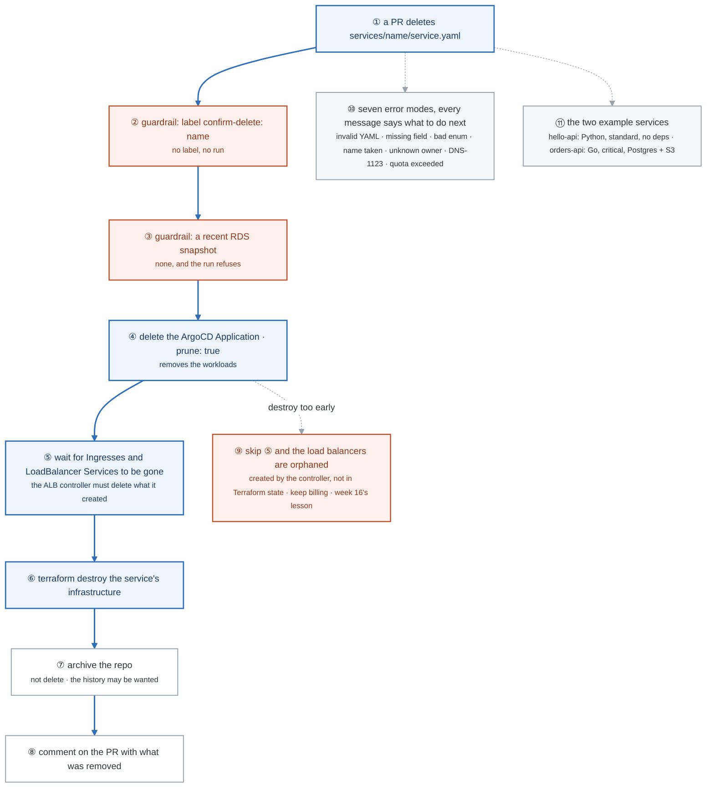

# Week 23 — Lab figures

> One figure per lab, numbered 23.2 to 23.6. Figure 23.1 is the week figure in
> [`../content/FIGURE.md`](../content/FIGURE.md); these five go one level down, to the mechanism each
> lab makes you touch. Same language: gray is structure, **blue is the path to follow first**,
> orange-red is where something refuses, washed boxes are stores. Each badge line is a thirty-second
> interview answer; each whole script is under three minutes.

**The protocol per figure**

1. **Before the lab:** read the figure, say the badges out loud once. You now know what you are about to prove.
2. **During the lab:** every badge has a **Prove it** command. Run it and watch the badge happen. A badge you cannot see happen is one you are taking on faith.
3. **After the lab:** close the file, redraw the figure, say the script. Check against the file. The badge where the order slipped goes in the *Figures redrawn* column of `progress.md`.
4. **Own the numbers.** The *Numbers to own* table is what separates "the platform generates IAM" from "ListBucket on the bucket ARN and the three object actions on the ARN slash star, and a service with no S3 dependency gets no S3 statement at all."
5. **Answer the question.** Each figure ends with the question a senior interviewer asks about it. Answer it cold, in under a minute, before the gate.

---

## Figure 23.2 — Lab 1: the controller flow is already drawn

The eight-step figure in [`LABS.md`](LABS.md#the-flow) is this lab's figure: four steps on the pull request (validate, plan on changed services only, estimate, comment) and four on merge (provision, scaffold, register, report). Redraw that one; the sections below add what the picture does not say.

### Numbers to own

| Number | Where it comes from | Why it matters |
|---|---|---|
| 8 steps | the flow | 4 before merge are read-only and cheap to repeat; 4 after merge change the world |
| 0 changes on a re-run | task 5, idempotency | the same file run twice must plan nothing and create nothing; this is the test that the controller is a reconciler and not a script |
| 3 alternatives | the build-vs-buy table | Actions + Terraform (chosen), Crossplane (CRDs and a reconcile loop), a kubebuilder controller (true reconciliation and status); the ADR names when you would reach for each |
| 1 scope rule | step 2 | plan only the services whose files changed; a platform-wide plan on every PR is how a platform gets slow and then ignored |

### Prove it

```bash
gh pr checks "$PR"                                                     # 1–4 the four PR steps, green
gh pr view "$PR" --comments | grep -A12 'Monthly cost'                 # 3–4 the comment with the estimate
gh run list --workflow provision.yml --limit 3                         # 5–8 the merge-triggered run
terraform -chdir=infra plan -detailed-exitcode; echo "exit $?"         # idempotency: exit 0 means no changes
```

### The question a senior interviewer asks

*"Why GitHub Actions plus Terraform instead of Crossplane or a custom controller, and what do you give up?"*
Explainable end to end, no new runtime to operate, and every step is a log a developer can read. What you give up is a reconciliation loop: nothing notices drift between runs, and status lives in a PR comment rather than an object. Say that trade-off before they ask it.

---

## Figure 23.3 — Lab 2: one contract, nine resources, and the policy nobody wrote by hand

> Lab 2 · badges ① to ⑪ · about three and a half minutes. This figure reads top-down.

```mermaid
%%{init: {'theme':'base','themeVariables':{'fontFamily':'Helvetica, Arial, sans-serif','fontSize':'13px','primaryColor':'#ffffff','primaryTextColor':'#2d3436','primaryBorderColor':'#9aa3ab','lineColor':'#9aa3ab','textColor':'#2d3436','clusterBkg':'#fbfcfd','clusterBorder':'#d4dae0','edgeLabelBackground':'#ffffff','tertiaryColor':'#eef4fb'},'flowchart':{'curve':'basis','padding':14,'nodeSpacing':42,'rankSpacing':58}}}%%
flowchart TB
  classDef default fill:#ffffff,stroke:#9aa3ab,stroke-width:1.3px,color:#2d3436
  classDef n    fill:#ffffff,stroke:#9aa3ab,stroke-width:1.3px,color:#2d3436
  classDef crit fill:#eef4fb,stroke:#2f6fb8,stroke-width:1.8px,color:#1b3a5c
  classDef data fill:#f4f7fa,stroke:#9aa3ab,stroke-width:1.3px,color:#2d3436
  classDef mut  fill:#ffffff,stroke:#cfd6dc,stroke-width:1.1px,color:#7a8288
  classDef warn fill:#fdf0ec,stroke:#c0522d,stroke-width:1.6px,color:#8a3a1e

  subgraph C["① service.yaml · the four fields everything is generated from"]
    direction LR
    NAME["metadata.name"]:::data
    TIER["spec.tier"]:::data
    DEPS["spec.dependencies<br/><small>[{type: s3, access: readwrite}] · [{type: postgres}]</small>"]:::crit
    ROUTE["spec.routing"]:::data
  end
  NS["② namespace + ResourceQuota + LimitRange<br/><small>from name and tier</small>"]:::n
  NP["③ NetworkPolicy<br/><small>default-deny, then only the declared dependencies</small>"]:::n
  SA["④ ServiceAccount + IRSA role<br/><small>the policy is derived from the dependency list</small>"]:::crit
  ECR["⑤ ECR repository + lifecycle policy<br/><small>from name</small>"]:::n
  OIDC["⑥ GitHub OIDC role for CI<br/><small>from name · week 12's trust, generated</small>"]:::n
  RDS["⑦ RDS + Secrets Manager secret<br/><small>only if a postgres dependency is declared</small>"]:::data
  S3["⑧ S3 bucket + scoped policy<br/><small>only if an s3 dependency is declared</small>"]:::data
  R53["⑨ Route 53 record + ACM cert<br/><small>from routing</small>"]:::n
  ARGO["⑩ ArgoCD Application<br/><small>from everything · the last object, so the rest exists first</small>"]:::n
  HAND["⑪ what a human writes at 5pm<br/><small>s3:* on * · works, and grants every bucket in the account</small>"]:::warn

  DEPS ==> SA ==> S3
  NAME --> NS
  TIER --> NS
  DEPS --> NP
  NAME --> ECR
  NAME --> OIDC
  DEPS --> RDS
  ROUTE --> R53
  NS --> ARGO
  SA -.->|"by hand instead"| HAND
  linkStyle 0,1 stroke:#2f6fb8,stroke-width:2px
```

<!-- figure: generated from the Mermaid below by _shared/diagrams/embed-figures.py — do not edit the image -->


<details>
<summary>Diagram source (Mermaid)</summary>



</details>

### Say it, badge by badge

- **Open.** "One file in, nine resources out, and the interesting one is the IAM policy, because it is least-privilege by construction. Follow the blue path from the dependency list to the bucket policy, then look at what a human writes instead."
- **① the four fields.** "Name, tier, dependencies, routing. Every one of the nine resources is a function of some subset of these. Nothing in the output exists that the contract did not imply."
- **② namespace, quota, limits.** "The namespace is the name; the ResourceQuota and LimitRange come from the tier. A critical service gets more room than an experimental one, and neither team asked."
- **③ NetworkPolicy.** "Default deny, then one allowance per declared dependency. A service that declares postgres can reach the database on its port and nothing else. Week 19's DNS trap is handled once, in the generator, not by every team."
- **④ ServiceAccount and IRSA role.** "The pod's AWS identity, week 16's mechanism, and its policy is computed from the dependency list. This is the badge the whole lab is about."
- **⑤ ECR and lifecycle.** "A repository named after the service, with a lifecycle policy so old images expire. Generated from the name alone."
- **⑥ GitHub OIDC role.** "The CI identity from week 12, generated with a trust policy scoped to this service's repository. Nobody copies a trust policy from the last service and forgets to change the sub."
- **⑦ RDS and its secret.** "Only when the dependency list says postgres. The password lands in Secrets Manager; the generator never sees it, which is week 7's manage-master-user-password."
- **⑧ S3 and the scoped policy.** "Only when the list says s3. The generated policy is two statements: the three object actions on the bucket ARN slash star, and ListBucket on the bucket ARN itself, the distinction week 5 drilled. Readwrite gives Put and Delete; read would not."
- **⑨ Route 53 and ACM.** "The hostname and its certificate, from the routing block. Validated by DNS because the record is in the same account."
- **⑩ ArgoCD Application.** "Created last, pointing at the scaffolded repo, so by the time it syncs the namespace, the identity and the dependencies all exist."
- **⑪ what a human writes.** "s3 star on star. It works, it ships, and it grants every bucket in the account to a service that needed one. Generated policies cannot make this mistake, and that is the strongest argument for a platform: it makes the secure thing free. Say that sentence in interviews."
- **Close.** "Four fields, nine resources, one policy that is exactly as wide as the dependency list and no wider. The acceptance tests are the negatives: no s3 dependency means no S3 statement at all, and the NetworkPolicy allows only what was declared."

### Numbers to own

| Number | Where it comes from | Why it matters |
|---|---|---|
| 9 resources | the generation table | namespace stack, NetworkPolicy, IRSA, ECR, OIDC role, RDS, S3, Route 53 + ACM, ArgoCD Application |
| 4 source fields | the same table | name, tier, dependencies, routing; nothing else feeds the generator |
| 2 statements | the generated S3 policy | `GetObject`, `PutObject`, `DeleteObject` on `arn/*`; `ListBucket` on the bucket ARN with no `/*` (week 5) |
| 0 S3 permissions | task 3 | a service with no s3 dependency must get no S3 statement; this is the negative test |
| 1 condition | task 4 | the NetworkPolicy allows exactly the declared dependencies and nothing else |

### Prove it

```bash
terraform -chdir=infra plan -var-file=services/orders-api.tfvars | grep -c '# .* will be created'   # ① → ②–⑩ the count
aws iam get-role-policy --role-name orders-api --policy-name s3 --query PolicyDocument.Statement    # ⑧ two statements, one bucket
aws iam list-role-policies --role-name hello-api                                                     # ⑧ no s3 policy at all
kubectl -n orders-api get networkpolicy -o yaml | grep -A4 egress                                    # ③ only the declared ports
kubectl -n orders-api get sa orders-api -o jsonpath='{.metadata.annotations}'                        # ④ the IRSA role-arn
```

### The question a senior interviewer asks

*"Why is generated IAM least-privilege by construction, and how does that make a platform a security control rather than a convenience?"*
Badge ⑧ against badge ⑪: the policy is a function of the declared dependencies, so it cannot name a bucket the service did not declare, and a human under time pressure writes star. Then the negative test, task 3: the proof is a service that gets nothing because it asked for nothing.

---

## Figure 23.4 — Lab 3: one word becomes a paging decision

> Lab 3 · badges ① to ⑨ · about three minutes.

<!-- figure: generated from the Mermaid below by _shared/diagrams/embed-figures.py — do not edit the image -->


<details>
<summary>Diagram source (Mermaid)</summary>



</details>

### Say it, badge by badge

- **Open.** "A service with no observability is a liability. The platform makes that impossible by generating it, which means it is never the thing skipped at the deadline. Follow the blue path from one word in the contract to a dashboard, then the branch that decides who gets woken up."
- **① spec.tier.** "The developer's one decision, from Lab 3 of week 22. They said critical, standard or experimental. They did not say anything about alerts, and they will get them anyway."
- **② tier_config.** "A local map in the module. Critical is a 99.9 percent SLO, page severity, 24/7. Standard is 99.5, a ticket, business hours. Experimental has none of it. Change the meaning of a tier here and every service follows."
- **③ templatefile.** "The dashboard JSON is a template with three holes: service, namespace and the SLO target. Terraform fills them and creates the Grafana dashboard resource. Nobody clicks through Grafana."
- **④ the dashboard.** "Error rate, p50 and p99 latency, request rate, saturation. The week 20 layout, the one that answers 'is it broken' in five seconds, for every service, identically."
- **⑤ SLO recording rules.** "Week 20's recording rules with the service name substituted. The SLI is the same for every service because every service is the same shape, which is what the paved road bought you."
- **⑥ burn-rate alerts.** "The two-window alerts from week 20, with the error budget set by the tier's SLO. A critical service burns a smaller budget faster, so the same rule pages sooner."
- **⑦ severity.** "Page, ticket or nothing, from the tier. This is the badge where a word in a YAML file becomes a phone ringing at 3am, and the developer who chose critical saw that consequence in the cost comment before they merged."
- **⑧ runbook stub.** "A file in the service repo with the namespace, the dashboard URL and the rollback command already filled in. The on-call engineer opens it from the alert and the first three things they need are there."
- **⑨ verify.** "Provision a test service, confirm the dashboard exists and an alert rule is loaded and armed. Observability you did not test is observability you assume."
- **Close.** "One word, a config map, a template, a dashboard, two rules, a severity and a runbook. Generated means never skipped; the tier means the developer chose the consequence without having to understand it."

### Numbers to own

| Number | Where it comes from | Why it matters |
|---|---|---|
| 99.9% / 99.5% / none | the tier table | the SLO per tier; with week 20's arithmetic that is 43 minutes 12 seconds of budget a month for critical, 3 hours 36 minutes for standard |
| page / ticket / none | the tier table | the severity, and therefore the Alertmanager route, is a consequence of the tier, not a choice |
| 24/7 vs business hours | the tier table | when a human is interrupted; the thing a developer should see before choosing critical |
| 4 dashboard panels | the lab | error rate, p50/p99 latency, request rate, saturation |
| 3 pre-filled runbook fields | task 3 | namespace, dashboard URL, rollback command |

### Prove it

```bash
grep -A6 'tier_config' modules/service-observability/*.tf                  # ② the map
terraform -chdir=infra state show 'module.obs["test-svc"].grafana_dashboard.service' | head   # ③ ④ the resource exists
kubectl -n monitoring get prometheusrule -l service=test-svc -o yaml | grep -c 'alert:'       # ⑤ ⑥ rules loaded
curl -s http://localhost:9090/api/v1/rules | jq '.data.groups[].rules[] | select(.name|test("test-svc")) | .health'   # ⑨ armed
cat test-svc/docs/runbook.md | head -12                                     # ⑧ pre-filled
```

### The question a senior interviewer asks

*"How does one `tier` field become a paging decision, end to end?"*
Badges ① ② ⑥ ⑦: the tier indexes a config map, the map sets the SLO, the SLO sets the burn-rate thresholds, the severity label routes to a pager. The follow-up is "and who decides what critical means?" The platform team, in one place, and the cost comment shows the developer the consequence before merge.

---

## Figure 23.5 — Lab 4: one pipeline for every service, and the cost before the merge

> Lab 4 · badges ① to ⑩ · about three minutes. This figure reads top-down.

```mermaid
%%{init: {'theme':'base','themeVariables':{'fontFamily':'Helvetica, Arial, sans-serif','fontSize':'13px','primaryColor':'#ffffff','primaryTextColor':'#2d3436','primaryBorderColor':'#9aa3ab','lineColor':'#9aa3ab','textColor':'#2d3436','clusterBkg':'#fbfcfd','clusterBorder':'#d4dae0','edgeLabelBackground':'#ffffff','tertiaryColor':'#eef4fb'},'flowchart':{'curve':'basis','padding':14,'nodeSpacing':42,'rankSpacing':58}}}%%
flowchart TB
  classDef default fill:#ffffff,stroke:#9aa3ab,stroke-width:1.3px,color:#2d3436
  classDef n    fill:#ffffff,stroke:#9aa3ab,stroke-width:1.3px,color:#2d3436
  classDef crit fill:#eef4fb,stroke:#2f6fb8,stroke-width:1.8px,color:#1b3a5c
  classDef data fill:#f4f7fa,stroke:#9aa3ab,stroke-width:1.3px,color:#2d3436
  classDef mut  fill:#ffffff,stroke:#cfd6dc,stroke-width:1.1px,color:#7a8288
  classDef warn fill:#fdf0ec,stroke:#c0522d,stroke-width:1.6px,color:#8a3a1e

  subgraph PIPE["the generated pipeline · week 18's, parameterized per language"]
    direction LR
    TPL["① the template<br/><small>one change here updates every service's pipeline</small>"]:::crit
    LT["② lint, test<br/><small>the language's tools, chosen by the template</small>"]:::n
    SEC["③ SAST, SCA<br/><small>Semgrep on the code, Trivy on the dependencies</small>"]:::n
    BLD["④ build, image scan<br/><small>the hardened Dockerfile, scanned</small>"]:::n
    SIGN["⑤ SBOM, sign<br/><small>syft, then cosign keyless</small>"]:::n
    PUSH["⑥ push, update the GitOps repo<br/><small>ArgoCD deploys · the pipeline never touches the cluster</small>"]:::crit
  end
  subgraph COST["cost at the moment of decision"]
    direction LR
    TAGS["⑩ default_tags<br/><small>Service · Owner · Tier · CostCenter · ManagedBy=platform · 100% coverage by construction</small>"]:::data
    IC["⑦ infracost breakdown --format json<br/><small>on the service's infra/ directory, on every PR</small>"]:::crit
    CMT["⑧ the PR comment<br/><small>RDS db.t4g.small Multi-AZ $58.40 · S3 $2.30 est. · ALB rule $0.00 shared · total $60.70/month<br/>team budget $2,400 · current spend $1,890</small>"]:::data
    DEC["⑨ the developer sees Multi-AZ before merging<br/><small>and sometimes picks standard instead · that is the point</small>"]:::warn
  end

  TPL ==> LT ==> SEC ==> BLD ==> SIGN ==> PUSH
  TAGS -.-> IC
  IC ==> CMT ==> DEC
  DEC -.->|"tier: standard"| IC
  linkStyle 0,1,2,3,4,6,7 stroke:#2f6fb8,stroke-width:2px
```

<!-- figure: generated from the Mermaid below by _shared/diagrams/embed-figures.py — do not edit the image -->


<details>
<summary>Diagram source (Mermaid)</summary>



</details>

### Say it, badge by badge

- **Open.** "Two things the platform generates that teams never get right by hand: the pipeline and the cost tags. And one thing it puts in front of the developer at the only moment it changes behaviour: the bill, in the pull request."
- **① the template.** "Week 18's pipeline, with the language as a parameter. One edit to the template and every service's pipeline changes on its next run. That sentence is the entire argument against copy-pasted CI."
- **② lint and test.** "The language's linter and test runner, chosen by the template from the language field. The developer wrote tests into the scaffolded tests directory; this is where they run."
- **③ SAST and SCA.** "Semgrep on the code, Trivy on the dependencies, week 18's gates. The CVE that blocked Bravo blocks here too, for every service, without anyone adding the step."
- **④ build and image scan.** "The hardened Dockerfile from the template, built and scanned. Distroless and non-root were decided at scaffold time, so the scan has little to find."
- **⑤ SBOM and sign.** "Syft for the SBOM, cosign keyless with the CI's OIDC identity, week 18's Lab 3. Kyverno at admission will refuse anything that skipped this, so it cannot be skipped."
- **⑥ push and update GitOps.** "The image goes to the service's ECR repository and the pipeline commits the new digest to the GitOps repo. ArgoCD, week 16, does the deploy. The pipeline never touches the cluster."
- **⑦ infracost.** "On every pull request, a breakdown of the service's infra directory as JSON. It reads the Terraform, prices it, and the next step turns it into a comment."
- **⑧ the comment.** "A table. RDS db.t4g.small Multi-AZ, because the tier is critical, $58.40. S3, $2.30 estimated. The ALB listener rule, shared, $0.00. Total $60.70 a month. Then the team's budget, $2,400, and current spend, $1,890."
- **⑨ the decision.** "A developer choosing critical sees Multi-AZ on the bill before they merge, and sometimes chooses standard. That is FinOps at the right layer: cost as a visible consequence of a choice, at the moment of the choice, not a report nobody reads a month later."
- **⑩ default_tags.** "Service, Owner, Tier, CostCenter from the team, ManagedBy platform. On every resource, from the provider block, so coverage is 100 percent by construction. Manual tagging is always incomplete, incomplete tags are unattributable cost, and unattributable cost is a conversation that stalls."
- **Close.** "One template, every pipeline. One comment, the cost at decision time. One provider block, every tag. The platform is where these become free, and they are the three things that never get done by hand."

### Numbers to own

| Number | Where it comes from | Why it matters |
|---|---|---|
| 10 stages | the pipeline line | lint, test, SAST, SCA, build, image scan, SBOM, sign, push, update GitOps |
| $58.40 | the example comment | RDS db.t4g.small Multi-AZ; the line that makes a developer reconsider `critical` |
| $60.70/month | the example comment | the service's total; S3 $2.30 estimated, ALB rule $0.00 because it is shared |
| $2,400 and $1,890 | the example comment | the team's budget and current spend, so the developer sees the headroom |
| 5 tags | `default_tags` | Service, Owner, Tier, CostCenter, ManagedBy |
| 100% | tag coverage | by construction, from the provider block; the number manual tagging never reaches |

### Prove it

```bash
diff <(yq '.jobs | keys' hello-api/.github/workflows/ci.yml) <(yq '.jobs | keys' orders-api/.github/workflows/ci.yml)   # ① same shape, two languages
gh run view --log "$RUN" | grep -E '^(lint|test|sast|sca|build|scan|sbom|sign|push|gitops)'   # ②–⑥ the ten stages
infracost breakdown --path infra/ --format table                                           # ⑦ the breakdown locally
gh pr view "$PR" --comments | grep -B2 -A8 'Monthly cost'                                  # ⑧ the comment
aws resourcegroupstaggingapi get-resources --tag-filters Key=Service,Values=orders-api --query 'length(ResourceTagMappingList)'   # ⑩ every resource tagged
```

### The question a senior interviewer asks

*"Why is cost in the pull request better FinOps than a monthly cost report?"*
Badges ⑧ and ⑨: the number arrives at the moment of the choice, attached to the choice, and the person who sees it is the one who can change it. A monthly report arrives after the resource exists, to someone who did not create it. Then badge ⑩: the report is only possible at all because every resource is tagged, and that is true only because the platform tags them.

---

## Figure 23.6 — Lab 5: deprovisioning in the right order, and what leaks if you reverse it

> Lab 5 · badges ① to ⑪ · about three and a half minutes. This figure reads top-down.

<!-- figure: generated from the Mermaid below by _shared/diagrams/embed-figures.py — do not edit the image -->


<details>
<summary>Diagram source (Mermaid)</summary>



</details>

### Say it, badge by badge

- **Open.** "Deleting a service must remove everything, including the things Kubernetes created that Terraform never knew about, and it must do it in an order. Follow the blue path, and notice that the two guardrails come before anything is touched."
- **① the deletion PR.** "Removing the file is the request. Same mechanism as creating it: a reviewed change to one file, and the controller does the rest."
- **② the label.** "A confirm-delete label naming the service. Without it the workflow exits before it reads anything. A deletion should take one more deliberate act than a creation."
- **③ the snapshot.** "If the service has an RDS instance with no recent snapshot, refuse. Deprovisioning should be as thoughtful as provisioning, and the database is the one thing you cannot regenerate from the contract."
- **④ delete the ArgoCD Application.** "With prune on, so the workloads it manages are removed, not just the Application object. The pods, the Services, the Ingress all go through here."
- **⑤ wait.** "Until every Ingress and LoadBalancer Service is actually gone. The ALB controller, week 16, created real load balancers for those objects, and it deletes them only when it sees the objects deleted. This badge is a loop with a timeout, and it is the one everyone skips."
- **⑥ terraform destroy.** "Now the infrastructure: the namespace stack, the roles, the bucket, the database. Terraform removes what Terraform created. It never knew about the load balancers, which is why ⑤ had to run first."
- **⑦ archive the repo.** "Archive, do not delete. The history, the runbook and the postmortems may be wanted, and archived is read-only and free."
- **⑧ the comment.** "What was removed, on the PR, so the audit trail lives where the request did."
- **⑨ the orphan.** "Run ⑥ before ⑤ and the controller's load balancers survive: they are not in state, so destroy does not see them, and they keep billing until someone finds them by hand. This is the same orphan week 16 made you find after destroying the cluster."
- **⑩ seven error modes.** "Invalid YAML, missing field, bad enum, name taken, unknown owner, bad name, quota exceeded. Each message says what is wrong and what to do next: the existing owner, the link to add a team, who to ask for quota. A message that only says what is wrong is half a feature."
- **⑪ the two examples.** "hello-api, Python, standard, nothing else: the minimal case. orders-api, Go, critical, Postgres and S3: the full case. Both provisioned entirely through the platform. They are the demo, and the stranger test runs on them."
- **Close.** "Guard, then unwind from the inside out: workloads, then the cloud objects the workloads caused, then the infrastructure, then the repo. The order exists because two different systems created the resources, and only one of them knows about each."

### Numbers to own

| Number | Where it comes from | Why it matters |
|---|---|---|
| 5 teardown steps | the lab's ordered list | ArgoCD prune, wait, destroy, archive, comment |
| 2 guardrails | the lab | the `confirm-delete` label and a recent RDS snapshot; both before step 1 |
| 1 wait condition | step 2 | no Ingress and no LoadBalancer Service remaining; otherwise the ALBs are orphaned |
| 7 error modes | the error-handling table | each with an expected message that says what to do next |
| 2 example services | the lab | hello-api (minimal) and orders-api (full); the demo set |

### Prove it

```bash
gh pr view "$PR" --json labels -q '.labels[].name' | grep confirm-delete              # ② the label is present
aws rds describe-db-snapshots --db-instance-identifier orders-api --query 'DBSnapshots[-1].SnapshotCreateTime'   # ③ recent
argocd app delete orders-api --cascade && kubectl -n orders-api get ingress,svc        # ④ ⑤ wait until empty
aws elbv2 describe-load-balancers --query 'LoadBalancers[?contains(LoadBalancerName, `orders`)].LoadBalancerName'   # ⑨ must be empty before ⑥
terraform -chdir=infra destroy -target='module.service["orders-api"]'                  # ⑥ only now
gh repo archive org/orders-api                                                         # ⑦
```

### The question a senior interviewer asks

*"Why must the ArgoCD Application be deleted and its load balancers gone before `terraform destroy`, and what leaks if you reverse the order?"*
Badges ④ ⑤ ⑥ ⑨: the load balancers were created by the in-cluster controller for Ingress objects, so they are in no Terraform state. Destroy first and the controller that would have deleted them is gone with the cluster resources, and the ALBs bill until someone finds them by name. The order is a consequence of who created what.

---

## Redraw schedule

Same cadence as the week figure, see [`../../FIGURES.md`](../../FIGURES.md): Friday of this week, Sunday of week 25, and cold at the Gate 6 Sunday in week 26. Lab figures are redrawn **after** the week figure, one at a time, and only the badge order has to be right; the captions are the check, not the test.
