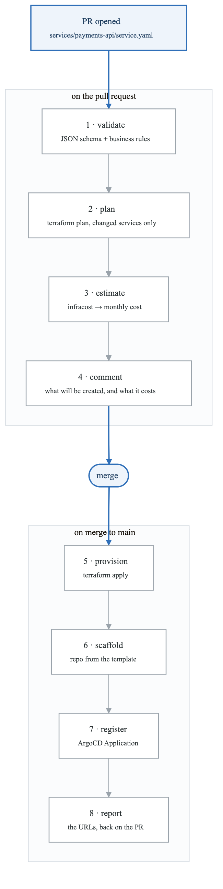
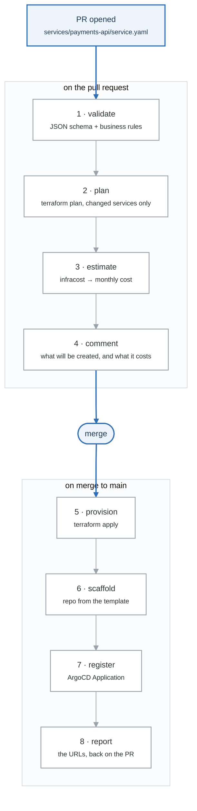

# Week 23 Labs

> **Figures:** one numbered mechanism figure per lab, with the spoken script, the numbers to own and
> the command that proves each badge, in [`FIGURES.md`](FIGURES.md) (23.2 to 23.7). Read a lab's figure
> before you start it; redraw it after.

---

# Lab 1 — The Platform Controller (4h)

## The flow

<!-- figure: generated from the Mermaid below by _shared/diagrams/embed-figures.py — do not edit the image -->


<details>
<summary>Diagram source (Mermaid)</summary>



</details>

## Build vs buy, one more time

| Approach | When |
|---|---|
| **GitHub Actions + Terraform** (this) | Simple, debuggable, no new runtime. **Right for Charlie.** |
| Crossplane | You want Kubernetes CRDs as the API and reconciliation loops for cloud resources |
| A custom controller (kubebuilder) | You need true reconciliation and a rich status |

**Actions + Terraform is the right choice here** — it's explainable end to end, and the whole point
of Charlie is demonstrating that you understand the *pattern*. Mention Crossplane in the ADR as the
alternative and say when you'd reach for it.

## Tasks
1. Write the validation step (Lab 3 of week 22 gives you the validator)
2. Write the plan step, scoped to only the changed services
3. Post a PR comment showing what will be created
4. Write the apply step, gated on merge
5. **Idempotency:** re-run the whole flow on an unchanged file. Nothing should change.

---

# Lab 2 — Generated Infrastructure (3h)

From one `service.yaml`, generate:

| Resource | From |
|---|---|
| Kubernetes namespace + ResourceQuota + LimitRange | `metadata.name`, `spec.tier` |
| NetworkPolicy (default-deny + allowances) | `spec.dependencies` |
| ServiceAccount + IRSA role | `spec.dependencies` → least-privilege policy |
| ECR repository + lifecycle policy | `metadata.name` |
| GitHub OIDC role for the service's CI | `metadata.name` |
| RDS instance + Secrets Manager secret | `dependencies[type=postgres]` |
| S3 bucket + scoped IAM policy | `dependencies[type=s3]` |
| Route 53 record + ACM cert | `spec.routing` |
| ArgoCD Application | everything |

## The least-privilege generation is the interesting part

```hcl
# From: dependencies: [{type: s3, access: readwrite}]
data "aws_iam_policy_document" "s3" {
  statement {
    actions   = ["s3:GetObject", "s3:PutObject", "s3:DeleteObject"]
    resources = ["${aws_s3_bucket.this.arn}/*"]      # THIS bucket only
  }
  statement {
    actions   = ["s3:ListBucket"]
    resources = [aws_s3_bucket.this.arn]              # bucket ARN, no /* (week 5)
  }
}
```

**A human writing this by hand writes `s3:*` on `*` — because it's 5pm and it works.** Generated
policies are least-privilege *by construction*, and that is one of the strongest arguments for a
platform: it makes the secure thing free.

Say that in an interview. It reframes the platform from a convenience to a security control.

## Tasks
1. Generate all nine resources from the contract
2. Verify the generated IAM policy is scoped to exactly the declared dependencies
3. Confirm a service with no `s3` dependency gets **no** S3 permissions
4. Confirm the NetworkPolicy allows only the declared dependencies

---

# Lab 3 — Generated Observability (3h)

**Not optional, not opt-in.** Every provisioned service gets:

- A Grafana dashboard: error rate, p50/p99 latency, request rate, saturation
- Alerts derived from the tier
- SLO recording rules and burn-rate alerts (week 20's config, templated)
- A runbook stub in the service repo, pre-filled with the service's specifics

```hcl
resource "grafana_dashboard" "service" {
  config_json = templatefile("${path.module}/dashboard.json.tftpl", {
    service   = var.name
    namespace = var.name
    slo       = local.tier_config[var.tier].slo_availability
  })
}
```

| Tier | SLO | Alert severity | Paging |
|---|---|---|---|
| `critical` | 99.9% | page | yes, 24/7 |
| `standard` | 99.5% | ticket | business hours |
| `experimental` | none | none | no |

**"A service with no observability is not a service, it's a liability."** Generating it means it is
never skipped under deadline pressure — which is exactly when it is skipped by hand.

## Tasks
1. Template the week-20 dashboard and SLO rules
2. Derive the alert config from `tier`
3. Generate a runbook stub with the service's namespace, dashboard URL, and rollback command
   pre-filled
4. Verify: provision a test service and confirm the dashboard exists and an alert is armed

---

# Lab 4 — Pipeline and FinOps (3h)

## The generated pipeline

Per language, from the template:
```
lint → test → SAST → SCA → build → image scan → SBOM → sign → push → update GitOps repo
```
This is week 18's pipeline, parameterized. **One change to the template updates every service's
pipeline** — which is the entire argument against copy-pasted CI.

## Cost in the PR

```yaml
      - uses: infracost/actions/setup@v3
      - run: |
          infracost breakdown --path infra/ --format json --out-file /tmp/ic.json
          infracost comment github --path /tmp/ic.json \
            --repo "$GITHUB_REPOSITORY" --pull-request "$PR" --behavior update
```

```markdown
Monthly cost estimate for `payments-api`

| Resource | Monthly |
|---|---|
| RDS db.t4g.small (Multi-AZ, tier=critical) | $58.40 |
| S3 bucket | $2.30 (est.) |
| ALB listener rule | $0.00 (shared) |
| **Total** | **$60.70/month** |

Your team's budget: $2,400/month. Current spend: $1,890.
```

**Cost visibility at the moment of decision is worth more than a monthly report nobody reads.** A
developer choosing `tier: critical` sees the Multi-AZ cost *before* merging, and sometimes picks
`standard` — which is the point. Making cost a visible consequence of a choice is FinOps done at the
right layer.

## Tagging

```hcl
default_tags {
  tags = {
    Service     = var.name
    Owner       = var.owner
    Tier        = var.tier
    CostCenter  = local.teams[var.owner].cost_center
    ManagedBy   = "platform"
  }
}
```
Generated tagging means **100% tag coverage by construction**. Manual tagging is always incomplete,
and incomplete tagging means unattributable cost, which means cost conversations stall.

---

# Lab 5 — Deprovisioning, Errors, Examples (3h)

## Deprovisioning

Deleting `services/<name>/service.yaml` must clean up **everything** — including the resources
Kubernetes created, in the right order (week 16's orphan lesson):

```
1. Delete the ArgoCD Application (prune: true)     -- removes the workloads
2. Wait for Ingresses and LoadBalancer Services to be gone
   (otherwise the ALB controller's load balancers are ORPHANED and keep billing)
3. terraform destroy the service's infrastructure
4. Archive the repo (do not delete -- you may want the history)
5. Comment on the PR confirming what was removed
```

**Guardrail:** require a `confirm-delete: <service-name>` label on the PR, and refuse if the RDS
instance has no recent snapshot. Deprovisioning should be as thoughtful as provisioning.

## Error handling — the feature

Test every failure mode:

| Input | Expected |
|---|---|
| Invalid YAML | Parse error with line and column |
| Missing required field | Names the field and what it's for |
| Invalid enum value | Lists valid options **with their meaning**, plus "did you mean" |
| Name already taken | Names the existing owner and links to the service |
| Owner not in `teams.yaml` | Links to how to add a team |
| Name too long / wrong charset | Explains the DNS-1123 constraint |
| Quota exceeded for the team | Shows current usage and who to ask |

**Every message must say what to do next.** A validation error that only says what's wrong is half a
feature.

## The two example services

Both provisioned entirely through the platform:
1. `hello-api` — Python, `tier: standard`, no dependencies. The minimal case.
2. `orders-api` — Go, `tier: critical`, Postgres + S3. The full case.

**These are your demo.** They prove the platform works for both the simple and the realistic case.

## The final acceptance test — this is Gate 6

> **Hand the README to someone who has never seen the repo. Watch them deploy a service. Do not help
> them.**

Write down every place they hesitate. Every hesitation is a bug. Fix all of them.

**This exercise is the entire difference between a repo and a platform**, and it is what lets you
talk about developer experience from experience rather than from a blog post.

---

# Go deeper — The contract's business rules in Rego (2h · ladder: policy as code, rung 4)

Optional inside the week; mandatory for the ladder ([`KUBERNETES-MASTERY.md`](../../../KUBERNETES-MASTERY.md),
the policy-as-code row). Lab 3 gave `service.yaml` a JSON Schema and a validator with good error
messages. This lab adds the part a schema cannot express, and ships it in the same gate.

## 1. Shape is schema, rules are policy

A schema answers "may this field hold this value": types, enums, patterns, required keys. It cannot
answer "does this file make sense": the owner must be a team that exists in `teams.yaml`; a
critical service must be able to survive a node drain; an experimental service, which nobody is
paged for and which expires in thirty days, must not be public; a dependency must be something the
platform actually provisions; a name must not already belong to another service. Those are rules.
They depend on other fields, on other files, and on data outside the document. That is what a
policy engine is for, and the reference implementation now has one:

```
platform/schemas/service.schema.json   shape
policies/contract/contract.rego        rules
policies/contract/contract_test.rego   the rules' own tests
cli/validate.py                        shape first, then the rules, when conftest is installed
```

## 2. Read the rules, then run them

```bash
cd ~/charlie-platform
conftest verify --policy policies/contract --data platform/teams          # 10 tests
conftest test   --policy policies/contract --data platform/teams services/*/service.yaml
```

Three mechanisms in that file to be able to explain:

- **Data.** `--data platform/teams` loads `teams.yaml`, so `data.teams` is the authoritative list
  and `known_teams := {t.name | some t in data.teams}` is a set comprehension over it. The policy
  never hard-codes a team; change the YAML and the rule changes.
- **Cross-field.** `spec.tier == "critical"` and `spec.resources.replicas.min < 2` in the same
  rule body. A schema's `minimum` is one number for every file; a rule's minimum depends on the
  tier.
- **Cross-file.** `--combine` hands every file in as one array of `{path, contents}`, which is the
  only way to check that a name is unique. The uniqueness rule is guarded by `is_array(input)`,
  the single-file rules by `is_object(input)`, so one package serves both modes:

```bash
conftest test --policy policies/contract --data platform/teams --combine services/*/service.yaml
```

Then break one on purpose and read the message:

```bash
cat > /tmp/bad.yaml <<'YAML'
apiVersion: platform.internal/v1
kind: Service
metadata: { name: Orders_API, owner: team-paymnts }
spec:
  language: go
  port: 8080
  tier: experimental
  routing: { public: true }
  dependencies: [{ type: kafka }]
YAML
conftest test --policy policies/contract --data platform/teams /tmp/bad.yaml
```

Four failures, and each one says where, what, the valid options with their meaning, and what to do
next. That is the discipline from Lab 3, kept: a policy message that only says "denied" is half a
feature.

## 3. Wire it where the developer already is

`cli/validate.py` runs the schema check, prints its findings, and only if the shape is clean shells
out to conftest with the same two flags. No conftest on the laptop: it says so and stops after the
shape check, so the validator still works on day one. In CI, `.github/workflows/validate.yml`
installs conftest, runs `conftest verify` so a broken rule fails before any service is judged, and
then runs the validator on the changed files.

Order matters: shape first, rules second. A rule that reads `spec.resources.replicas.min` on a file
where `spec` is a string produces a confusing error; the schema has already refused that file.

## 4. Tasks

1. **Expiry.** The tier description says experimental services auto-expire after 30 days. Make it a
   contract: add `metadata.expires` (a date) to the schema, then a rule that denies an experimental
   service without it, and one that denies an `expires` more than 30 days from today, which Rego
   reaches with `time.now_ns()`. Say in the message what the platform will do on that date.
2. **Budget.** `teams.yaml` carries `budget_monthly_usd`. Give each dependency type a rough monthly
   cost in a `data` file under `platform/catalog/`, and deny a service whose declared dependencies
   would exceed the owning team's budget. The message names the team, the budget, the total, and
   the dependency to drop first.
3. **Warn, then deny.** Ship the budget rule as `warn` and run it against both example services and
   the bad file. Promote it to `deny` only when the two examples pass. That is the rollout discipline
   from week 19, applied to your own platform.
4. **Explain it.** Three minutes, out loud: what the schema refuses, what the policy refuses, and why
   the split exists. Figure 23.7 is the picture.

**From memory, timed:** rules 1 to 5 of `contract.rego` with the file closed, `conftest verify`
green, in under 25 minutes.
