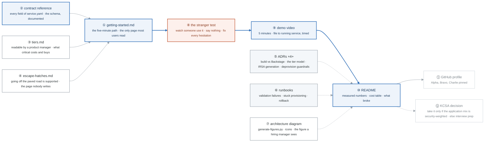

# Week 24 — Charlie Completion and KCSA Prep

> **Thesis:** documentation is the deliverable here as much as the code. A platform nobody can use
> without asking you is not a platform — it is a set of scripts with a good story.

| | |
|---|---|
| **Hours** | 35–45 (incl. ~8h job search — the mix is shifting) |
| **⚑ Deliverable** | Project CHARLIE complete: docs, ADRs, runbooks, demo video |
| **◇ Optional** | KCSA prep (Fri–Sun) if you decided to take it |

## The week in one figure

**Figure 24.1 — The documentation set and the stranger test.** A platform nobody can use without asking you is a set of scripts with a good story. This week the documentation is the deliverable, and one stranger decides whether it worked. Badges are numbered in the order to walk them; the blue path is the one to follow first.

**What to say, badge by badge** · about three minutes at a normal pace. Point at each badge as you say its line.

- **Open.** “Charlie works. This week decides whether anyone but you can tell. The documentation set on the left feeds one page, and that page is tested by a person who has never seen the project while you watch and say nothing.”
- **① getting-started.** “The five-minute path: copy a template, edit six fields, open a PR, watch it run. Most users read this page and nothing else, so it has to be enough by itself.”
- **② contract reference.** “Every field of service.yaml, what it accepts, what it does downstream, and what the error looks like when it is wrong. The schema is the source; this page is the schema with sentences.”
- **③ tiers.** “What experimental, standard, and critical each give you and cost you. Written so a product manager can choose without an engineer in the room.”
- **④ escape hatches.** “How to do the thing the platform does not support, with support. Nobody writes this page, and its absence is why people work around platforms in secret.”
- **⑤ ADRs.** “At least four: why not Backstage, why three tiers, how the IAM role is generated from dependencies, why deprovisioning needs a second approval. The decisions you will be asked about in interviews, written the week you made them.”
- **⑥ runbooks.** “What to do when validation fails, when provisioning sticks, when a rollback is needed. The week-21 template, three times.”
- **⑦ architecture diagram.** “The icon figure from the generator, the same style as the project READMEs. It is the one image a hiring manager looks at before deciding to read.”
- **⑧ the stranger test.** “Wednesday: someone who has never seen the project deploys a service using only the README while you watch. Every time they hesitate, that is a bug in the docs. Fix every one. Say nothing during the test; help afterwards.”
- **⑨ demo video.** “Five minutes, file to running service, with a timer visible. It is the asset that gets watched when a résumé is skimmed.”
- **⑩ README.** “Measured numbers: time to a running service, cost per tier per month, how long deprovisioning takes. A cost table. A section called what broke. Honesty reads as seniority.”
- **⑪ GitHub profile.** “Alpha, Bravo, and Charlie pinned, in that order. Three projects a stranger can run beat any list of skills.”
- **⑫ KCSA decision.** “Take it only if the applications you are sending are genuinely security-weighted. Otherwise the thirty hours buy more as interview preparation, which is next week.”
- **Close.** “Docs feed one page, one stranger tests it, the video proves it in five minutes, and the README carries the numbers. Then pin all three projects, because week 25 is interviews.”

---

## Day plan
| Day | Focus |
|---|---|
| Mon | Getting-started guide + contract reference |
| Tue | ADRs, runbooks, architecture diagram |
| Wed | **The stranger test** — watch someone use it, fix every hesitation |
| Thu | Demo video (5 min); README polish; measured results |
| Fri–Sun | KCSA prep *or* week-25 interview-kit head start |

## The KCSA decision (if you deferred it)

The four exam domains map almost one-to-one onto weeks 18–19, so this is consolidation rather than
new learning — roughly 30 hours.

**Take it if** your application mix by now is genuinely weighted toward security-adjacent roles.
**Skip it if** you're converting on plain DevOps and Cloud Engineer screens — the ~$250 and ~30 hours
buy more as interview preparation, which has a far higher expected value at this point.

Full analysis: [`../../CERTIFICATIONS.md`](../../CERTIFICATIONS.md) §3.

**Materials:**
- The CNCF KCSA exam curriculum document — read the actual curriculum, not a course
- Weeks 18–19 of this curriculum, plus `_reference/devsecops/content-module-*`
- NSA/CISA Kubernetes Hardening Guidance; the CIS Kubernetes Benchmark
- `_reference/kubernetes/03-production/02-security-rbac-*`

## Labs
[labs/LABS.md](labs/LABS.md) · [solutions/SOLUTIONS.md](solutions/SOLUTIONS.md)

## Exit criteria
- [ ] A stranger deploys a service following only the README — **no help**
- [ ] Getting-started guide, contract reference, 4+ ADRs, runbooks
- [ ] Architecture diagram
- [ ] 5-minute demo video published
- [ ] README with **measured** numbers, a cost table, and a "what broke" section
- [ ] All three projects (Alpha, Bravo, Charlie) pinned on your GitHub profile
