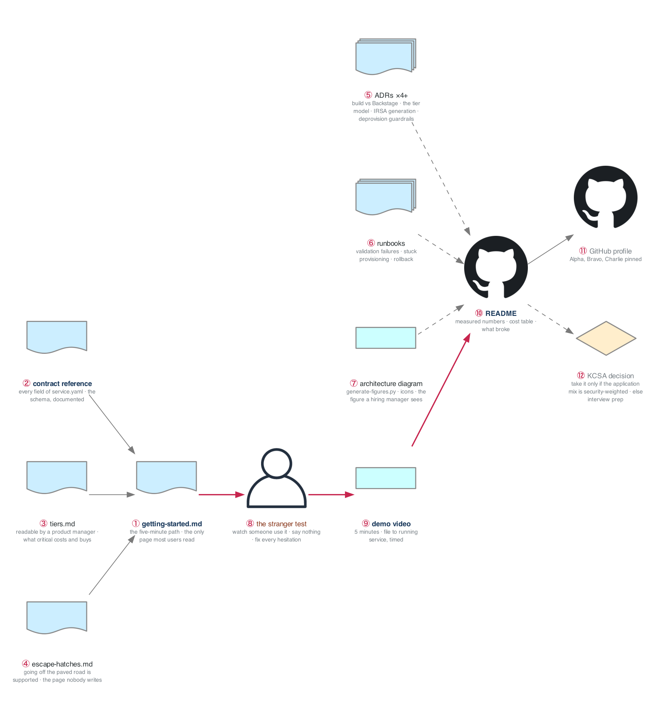

# Week 24 — Charlie Completion and KCSA Prep

> **Thesis:** documentation is the deliverable here as much as the code. A platform nobody can use
> without asking you is not a platform — it is a set of scripts with a good story.

| | |
|---|---|
| **Hours** | 35–45 (incl. ~8h job search — the mix is shifting) |
| **⚑ Deliverable** | Project CHARLIE complete: docs, ADRs, runbooks, demo video |
| **◇ Optional** | KCSA prep (Fri–Sun) if you decided to take it |

## The week in one figure

**Figure 24.1 — The documentation set and the stranger test.** A platform nobody can use without asking you is a set of scripts with a good story. This week the documentation is the deliverable, and one stranger decides whether it worked.

**Say it, badge by badge:** [`content/FIGURE.md`](content/FIGURE.md) — the spoken script for each of the 12 badges, about three minutes. Read the figure before the day plan; say the script on Friday.

---

## Day plan
| Day | Focus |
|---|---|
| Mon | Getting-started guide + contract reference |
| Tue | ADRs, runbooks, architecture diagram |
| Wed | **The stranger test** — watch someone use it, fix every hesitation |
| Thu | Demo video (5 min); README polish; measured results |
| Fri–Sun | KCSA prep *or* week-25 interview-kit head start |

## The KCSA decision (if you deferred it)

The four exam domains map almost one-to-one onto weeks 18–19, so this is consolidation rather than
new learning — roughly 30 hours.

**Take it if** your application mix by now is genuinely weighted toward security-adjacent roles.
**Skip it if** you're converting on plain DevOps and Cloud Engineer screens — the ~$250 and ~30 hours
buy more as interview preparation, which has a far higher expected value at this point.

Full analysis: [`../../CERTIFICATIONS.md`](../../CERTIFICATIONS.md) §3.

**Materials:**
- The CNCF KCSA exam curriculum document — read the actual curriculum, not a course
- Weeks 18–19 of this curriculum, plus `_reference/devsecops/content-module-*`
- NSA/CISA Kubernetes Hardening Guidance; the CIS Kubernetes Benchmark
- `_reference/kubernetes/03-production/02-security-rbac-*`

## Labs
[labs/LABS.md](labs/LABS.md) · [solutions/SOLUTIONS.md](solutions/SOLUTIONS.md)

## Exit criteria
- [ ] A stranger deploys a service following only the README — **no help**
- [ ] Getting-started guide, contract reference, 4+ ADRs, runbooks
- [ ] Architecture diagram
- [ ] 5-minute demo video published
- [ ] README with **measured** numbers, a cost table, and a "what broke" section
- [ ] All three projects (Alpha, Bravo, Charlie) pinned on your GitHub profile
