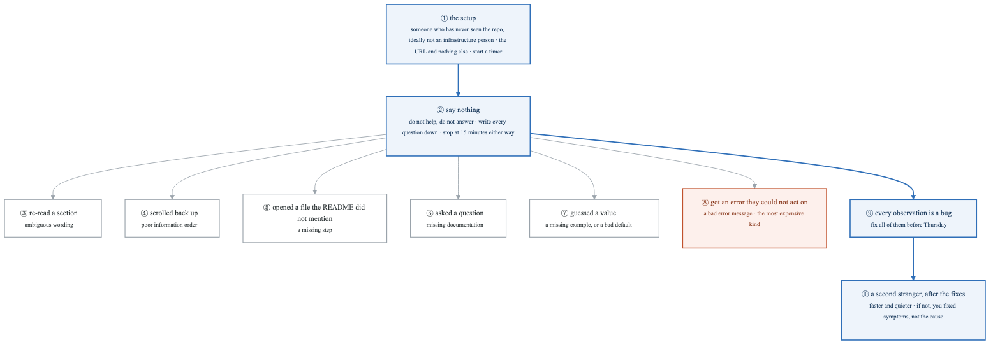
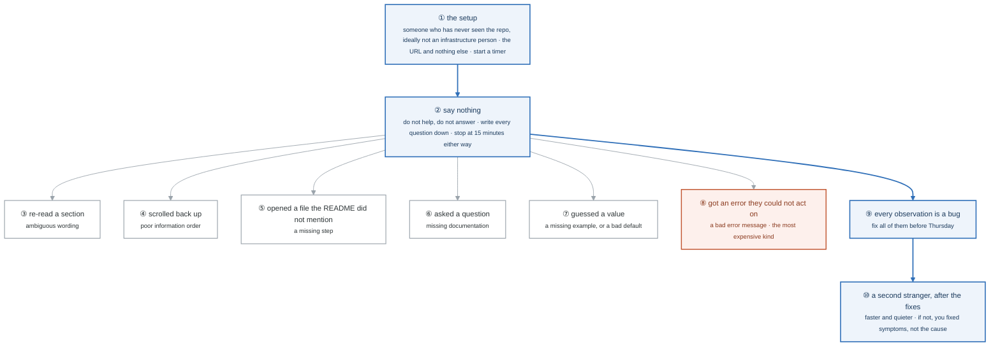

# Week 24 — Lab figures

> One entry per lab, numbered 24.2 to 24.5. Figure 24.1 is the week figure in
> [`../content/FIGURE.md`](../content/FIGURE.md). Three of this week's four labs are writing,
> recording and exam work with no system mechanism, and say so; the stranger test is the one that
> gets a figure, because it is Gate 6 and it has a method. Same language: gray is structure, **blue
> is the path to follow first**, orange-red is where something refuses, washed boxes are stores.

**The protocol per figure**

1. **Before the lab:** read the figure, say the badges out loud once. You now know what you are about to prove.
2. **During the lab:** every badge has a **Prove it** command. Run it and watch the badge happen. A badge you cannot see happen is one you are taking on faith.
3. **After the lab:** close the file, redraw the figure, say the script. Check against the file. The badge where the order slipped goes in the *Figures redrawn* column of `progress.md`.
4. **Own the numbers.** The *Numbers to own* table is what separates "I user-tested the docs" from "two strangers, fifteen minutes each, six observation types, and the second run was quieter."
5. **Answer the question.** Each figure ends with the question a senior interviewer asks about it. Answer it cold, in under a minute, before the gate.

---

## Figure 24.2 — Lab 1: no figure

The documentation set is six documents (getting-started, contract-reference, tiers, escape-hatches, five ADRs, runbooks) and the mechanism is the reader's, not the system's: the getting-started page must be followable with no platform concepts in it, and the escape-hatches page exists so that going off the paved road is visible instead of forbidden. Write them, then hand the getting-started page to figure 24.3; the stranger test is how this lab is graded.

---

## Figure 24.3 — Lab 2: the stranger test, and what each hesitation means

> Lab 2 · Gate 6 · badges ① to ⑩ · about three minutes. This figure reads top-down.

<!-- figure: generated from the Mermaid below by _shared/diagrams/embed-figures.py — do not edit the image -->


<details>
<summary>Diagram source (Mermaid)</summary>



</details>

### Say it, badge by badge

- **Open.** "This is the acceptance test for the whole of Charlie, and it is the thing that lets you talk about developer experience from experience. The protocol is simple and the hard part is badge two: you say nothing."
- **① the setup.** "A developer who is not an infrastructure person, because that is the actual user. They get the repository URL. Nothing else: no walkthrough, no 'start with the README'. Start the timer when they open it."
- **② say nothing.** "Do not help, do not explain, do not answer. Write the questions down; each one is a gap. Stop at fifteen minutes whether or not they finished, because a path that takes longer than that has already failed the brief."
- **③ re-read.** "They read a paragraph twice. The wording is ambiguous. Rewrite it so it reads once."
- **④ scrolled back.** "They went back up to find something. The information is in the wrong order; what they needed should have been where they were."
- **⑤ opened an unmentioned file.** "The README skipped a step and they went looking. Add the step."
- **⑥ asked a question.** "Documentation is missing. The question, verbatim, is the heading of the section you now write."
- **⑦ guessed a value.** "No example, or a bad default. Either show a complete working value or make the default the one they would have guessed."
- **⑧ an error they could not act on.** "The most expensive observation, because it is the only one that stops them cold. Week 22's error-message work is what this tests, and it is the finding most likely to send you back to code rather than docs."
- **⑨ fix everything.** "Each observation is a bug with a known cause, listed on the left. Fix all of them before Thursday. Not the ones you agree with. All of them."
- **⑩ the second stranger.** "A different person, after the fixes. The run should be faster and quieter. If it is not, you fixed what you saw and not what caused it, and you go round again."
- **Close.** "Hand it over, shut up, write it down, fix it all, do it again. Two runs and a list of eleven fixes is the sentence that answers 'how do you know your platform is usable', and almost nobody else in the loop has one."

### Numbers to own

| Number | Where it comes from | Why it matters |
|---|---|---|
| 15 minutes | the protocol | the hard stop; getting-started promised about 8 minutes from merge to URLs, so a quarter hour is already a failure signal |
| 6 observation types | the table | each maps to one cause: wording, order, missing step, missing doc, missing example, bad error |
| 2 runs | "then do it again" | the second run is the control; faster and quieter is the only acceptable result |
| 0 words from you | step 3 | every answer you give is a bug you hid |
| 11 fixes | the week 25 experience answer | the number you will quote; count yours |

### Prove it

```bash
date +%T > stranger-1.log                                      # ① the timer
# ② write each question and hesitation as one line in stranger-1.log, with the timestamp
sort -k2 stranger-1.log | cut -d' ' -f2 | uniq -c              # ③–⑧ the observations, by type
git log --oneline --since=wednesday | wc -l                     # ⑨ the fixes, as commits
diff <(wc -l < stranger-1.log) <(wc -l < stranger-2.log)        # ⑩ fewer lines the second time
```

### The question a senior interviewer asks

*"How do you know your platform is actually usable?"*
Badges ① ② ⑨ ⑩: a stranger, no help, a list, every item fixed, a second stranger measurably quieter. Then one concrete fix from your list, badge ⑧ if you have one, because an error message you rewrote after watching someone fail on it is the most credible developer-experience story there is.

---

## Figure 24.4 — Lab 3: no figure

The demo video is a five-minute script with fixed timestamps, and its load-bearing section is the thirty seconds at 4:00 about what you got wrong; the README is a checklist whose only numbers are the measured results table. Record one take, fill in every row of the table from your own measurements (manual steps 0, services with a dashboard and alerts 100 percent, and the three timings), and link the video at the top.

---

## Figure 24.5 — Lab 4: no figure

KCSA preparation is a domain-to-week map and two practice exams at a target of 80 percent or better, with the exam on the Monday of week 25. There is nothing to draw; if the second practice exam is under 80 by Sunday, move the exam rather than spend week 25 on it.

---

## Redraw schedule

Same cadence as the week figure, see [`../../FIGURES.md`](../../FIGURES.md): Friday of this week, and cold at the Gate 6 Sunday in week 26. Lab figures are redrawn **after** the week figure, and only the badge order has to be right; the captions are the check, not the test.
