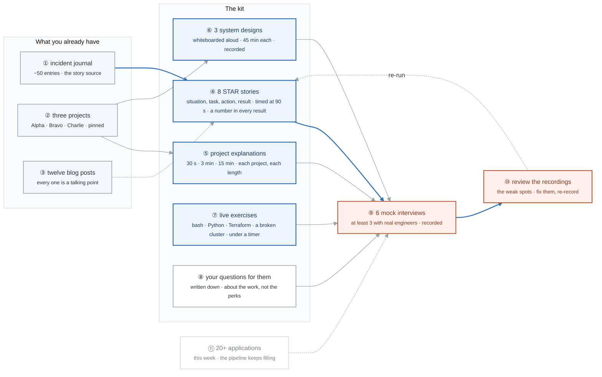

# Week 25 — Interview Conversion

> **The mix inverts this week.** Interviewing becomes the primary activity at ~20 hrs/week. You have
> three shipped projects, 50 incident-journal entries, and 12 blog posts. The work now is turning
> that into offers.

| | |
|---|---|
| **Hours** | 35–45 — **~20 on interviewing**, the rest on continued building |
| **◇ Milestone** | KCSA exam (Monday), if you're taking it |
| **Deliverable** | The full interview kit: 8 STAR stories, 3 system designs, 6 mock interviews |

## The week in one figure

**Figure 25.1 — The interview kit, and where every piece of it comes from.** The mix inverts: interviewing is the primary activity at twenty hours a week. Nothing in the kit is invented this week; every piece is traced back to something you built, broke, or wrote in the previous twenty-four. Badges are numbered in the order to walk them; the blue path is the one to follow first.

**What to say, badge by badge** · about three minutes at a normal pace. Point at each badge as you say its line.

- **Open.** “You have three shipped projects, about fifty incident entries, and twelve blog posts. This week turns them into offers, and the figure shows the conversion: raw material on the left, the kit in the middle, six mock interviews that test it on the right.”
- **① incident journal.** “Fifty entries, each with a symptom, a diagnosis, a fix, and what you would prevent. Every behavioral story in the kit starts as one of these lines.”
- **② three projects.** “Alpha, Bravo, Charlie. Each one is a system design answer you have already built, and each README has measured numbers you can quote.”
- **③ twelve blog posts.** “Each one is a talking point you have already written out. The IRSA post is the answer to the workload identity question; the count-versus-for_each post is the Terraform question.”
- **④ STAR stories.** “Eight of them. Situation, task, action, result, and the result ends with a number. Timed at ninety seconds, because the untimed version is four minutes and loses the room. The template is in _shared.”
- **⑤ project explanations.** “Each project at three lengths: thirty seconds for a screen, three minutes for a hiring manager, fifteen for a deep dive. Write all nine and say them out loud until the thirty-second one is reflexive.”
- **⑥ system designs.** “Three scenarios from the interview bank, whiteboarded out loud for forty-five minutes each, recorded. The point is the narration, not the drawing: tradeoffs stated as you make them.”
- **⑦ live exercises.** “A bash one-liner, a Python function, a Terraform module, a broken cluster, each under a timer with someone watching. The broken cluster is Gate 4 again; the others are weeks 1, 4, and 11.”
- **⑧ your questions.** “Written down in advance, about the work: how deploys happen, what the on-call load is, what broke last quarter. The questions you ask are the last impression and they are graded.”
- **⑨ mock interviews.** “Six, at least three with real engineers, all recorded. Friday and Saturday. The ones with strangers are worth triple; friends are too kind.”
- **⑩ review the recordings.** “Watch them. Note every hesitation, every answer that ran long, every tradeoff you forgot. Fix those specifically and re-record the weak stories. This is the loop that makes week 26 different from week 25.”
- **⑪ applications.** “Twenty or more this week, with follow-ups on every open thread. The kit is useless if the pipeline empties.”
- **Close.** “Stories from the journal, designs from the projects, talking points from the posts, all tested six times on camera. Every piece is traceable to something you built, which is why it will sound true.”

---

## Day plan
| Day | Focus |
|---|---|
| **Mon** | KCSA exam (if taking it). Otherwise start the kit. |
| Tue | **8 STAR stories** from the incident journal and the projects |
| Wed | **System design** — three scenarios, whiteboarded out loud, 45 min each |
| Thu | Live exercise practice: bash, Python, Terraform, broken-cluster debugging |
| Fri | **Mock interviews** ×3 |
| Sat | Mock interviews ×3 (at least 3 of the 6 with real engineers); 20 applications |
| Sun | Review recordings; fix the weak spots; plan week 26 |

## Materials
- **[`../../_shared/interview-bank/`](../_shared/interview-bank/)** — the whole thing, out loud
- `_shared/templates/STAR-story-template.md`
- `_shared/breakfix/` — your 50 incident-journal entries are the story source
- `../../JOB-SEARCH.md` §6 — what each interview stage tests

## Labs
[labs/LABS.md](labs/LABS.md) · [solutions/SOLUTIONS.md](solutions/SOLUTIONS.md)

## Exit criteria
- [ ] 8 STAR stories written and **timed at 90 seconds each**
- [ ] 3 system designs whiteboarded out loud, recorded and reviewed
- [ ] Live exercises practiced under time pressure
- [ ] **6 mock interviews**, at least 3 with real engineers
- [ ] Every project explainable at 30 seconds / 3 minutes / 15 minutes
- [ ] Your questions for them, written down
- [ ] 20+ applications sent this week
