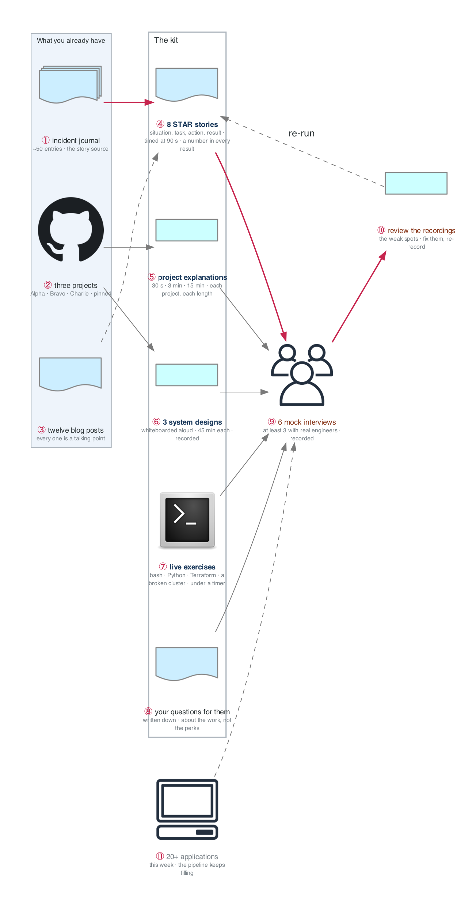

# Week 25 — Interview Conversion

> **The mix inverts this week.** Interviewing becomes the primary activity at ~20 hrs/week. You have
> three shipped projects, 50 incident-journal entries, and 12 blog posts. The work now is turning
> that into offers.

| | |
|---|---|
| **Hours** | 35–45 — **~20 on interviewing**, the rest on continued building |
| **◇ Milestone** | KCSA exam (Monday), if you're taking it |
| **Deliverable** | The full interview kit: 8 STAR stories, 3 system designs, 6 mock interviews |

## The week in one figure

**Figure 25.1 — The interview kit, and where every piece of it comes from.** The mix inverts: interviewing is the primary activity at twenty hours a week. Nothing in the kit is invented this week; every piece is traced back to something you built, broke, or wrote in the previous twenty-four.

**Say it, badge by badge:** [`content/FIGURE.md`](content/FIGURE.md) — the spoken script for each of the 11 badges, about three minutes; [`content/figure-25.1-numbered-spoken.pdf`](content/figure-25.1-numbered-spoken.pdf) is the printable two-page version. Read the figure before the day plan; say the script on Friday.

---

## Day plan
| Day | Focus |
|---|---|
| **Mon** | KCSA exam (if taking it). Otherwise start the kit. |
| Tue | **8 STAR stories** from the incident journal and the projects |
| Wed | **System design** — three scenarios, whiteboarded out loud, 45 min each |
| Thu | Live exercise practice: bash, Python, Terraform, broken-cluster debugging |
| Fri | **Mock interviews** ×3 |
| Sat | Mock interviews ×3 (at least 3 of the 6 with real engineers); 20 applications |
| Sun | Review recordings; fix the weak spots; plan week 26 |

## Materials
- **[`../../_shared/interview-bank/`](../_shared/interview-bank/)** — the whole thing, out loud
- `_shared/templates/STAR-story-template.md`
- `_shared/breakfix/` — your 50 incident-journal entries are the story source
- `../../JOB-SEARCH.md` §6 — what each interview stage tests

## Labs
[labs/LABS.md](labs/LABS.md) · [labs/FIGURES.md](labs/FIGURES.md) (figures 25.2 to 25.5, one per lab) · [solutions/SOLUTIONS.md](solutions/SOLUTIONS.md) · [Kubernetes thread](../KUBERNETES-THREAD.md#week-25)

## Exit criteria
- [ ] 8 STAR stories written and **timed at 90 seconds each**
- [ ] 3 system designs whiteboarded out loud, recorded and reviewed
- [ ] Live exercises practiced under time pressure
- [ ] **6 mock interviews**, at least 3 with real engineers
- [ ] Every project explainable at 30 seconds / 3 minutes / 15 minutes
- [ ] Your questions for them, written down
- [ ] 20+ applications sent this week
