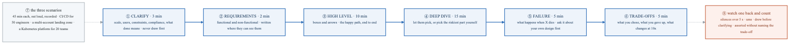

# Week 25 — Lab figures

> One entry per lab, numbered 25.2 to 25.5. Figure 25.1 is the week figure in
> [`../content/FIGURE.md`](../content/FIGURE.md). This week is interview rehearsal, so three of the
> four labs are drills rather than systems and say so; the system-design method is the one with a
> shape, because it is a timed sequence you have to run the same way every time. Same language: gray
> is structure, **blue is the path to follow first**, orange-red is where something refuses.

**The protocol per figure**

1. **Before the lab:** read the figure, say the badges out loud once. You now know what you are about to prove.
2. **During the lab:** every badge has a **Prove it** command. Run it and watch the badge happen. A badge you cannot see happen is one you are taking on faith.
3. **After the lab:** close the file, redraw the figure, say the script. Check against the file. The badge where the order slipped goes in the *Figures redrawn* column of `progress.md`.
4. **Own the numbers.** The *Numbers to own* table is what separates "I practised system design" from "three minutes clarifying before I draw anything, fifteen on the deep dive, and the failure question asked by me before it is asked of me."
5. **Answer the question.** Each figure ends with the question a senior interviewer asks about it. Answer it cold, in under a minute, before the gate.

---

## Figure 25.2 — Lab 1: no figure

The eight STAR stories are a table of prompts mapped to things you actually did, at three depths (30 seconds, 90 seconds, 5 minutes), and the lab's real artifact is the list of nine measured numbers you must be able to say unprompted. Time each story at 90 seconds with a recorder running; for the numbers, the *Numbers to own* tables across every `labs/FIGURES.md` are where they came from.

---

## Figure 25.3 — Lab 2: the six-step design method, with its minute budget

> Lab 2 · badges ① to ⑧ · about two and a half minutes. This figure reads top-down.

```mermaid
%%{init: {'theme':'base','themeVariables':{'fontFamily':'Helvetica, Arial, sans-serif','fontSize':'13px','primaryColor':'#ffffff','primaryTextColor':'#2d3436','primaryBorderColor':'#9aa3ab','lineColor':'#9aa3ab','textColor':'#2d3436','clusterBkg':'#fbfcfd','clusterBorder':'#d4dae0','edgeLabelBackground':'#ffffff','tertiaryColor':'#eef4fb'},'flowchart':{'curve':'basis','padding':14,'nodeSpacing':42,'rankSpacing':58}}}%%
flowchart LR
  classDef default fill:#ffffff,stroke:#9aa3ab,stroke-width:1.3px,color:#2d3436
  classDef n    fill:#ffffff,stroke:#9aa3ab,stroke-width:1.3px,color:#2d3436
  classDef crit fill:#eef4fb,stroke:#2f6fb8,stroke-width:1.8px,color:#1b3a5c
  classDef data fill:#f4f7fa,stroke:#9aa3ab,stroke-width:1.3px,color:#2d3436
  classDef mut  fill:#ffffff,stroke:#cfd6dc,stroke-width:1.1px,color:#7a8288
  classDef warn fill:#fdf0ec,stroke:#c0522d,stroke-width:1.6px,color:#8a3a1e

  SC["⑦ the three scenarios<br/><small>45 min each, out loud, recorded · CI/CD for 50 engineers · a multi-account landing zone · a Kubernetes platform for 20 teams</small>"]:::data
  C1["① CLARIFY · 3 min<br/><small>scale, users, constraints, compliance, what done means · never draw first</small>"]:::crit
  C2["② REQUIREMENTS · 2 min<br/><small>functional and non-functional · written where they can see them</small>"]:::crit
  C3["③ HIGH LEVEL · 10 min<br/><small>boxes and arrows · the happy path, end to end</small>"]:::crit
  C4["④ DEEP DIVE · 15 min<br/><small>let them pick, or pick the riskiest part yourself</small>"]:::crit
  C5["⑤ FAILURE · 5 min<br/><small>what happens when X dies · ask it about your own design first</small>"]:::crit
  C6["⑥ TRADE-OFFS · 5 min<br/><small>what you chose, what you gave up, what changes at 10x</small>"]:::crit
  RV["⑧ watch one back and count<br/><small>silences over 5 s · ums · drew before clarifying · asserted without naming the trade-off</small>"]:::warn

  C1 ==> C2 ==> C3 ==> C4 ==> C5 ==> C6
  SC -.-> C1
  C6 -.-> RV
  linkStyle 0,1,2,3,4 stroke:#2f6fb8,stroke-width:2px
```

<!-- figure: generated from the Mermaid below by _shared/diagrams/embed-figures.py — do not edit the image -->


<details>
<summary>Diagram source (Mermaid)</summary>



</details>

### Say it, badge by badge

- **Open.** "A design interview is forty-five minutes and the most common failure happens in the first thirty seconds: drawing before asking. The method is six steps with a minute budget, and the budget is the point."
- **① CLARIFY, three minutes.** "Scale, users, constraints, compliance, and what done means. You do not touch the whiteboard. The candidate who draws first is designing something nobody asked for, and the interviewer knows it by minute two."
- **② REQUIREMENTS, two minutes.** "Functional and non-functional, written where they can see them. They are the contract for the rest of the hour; when you make a trade-off later you point back at one of these lines."
- **③ HIGH LEVEL, ten minutes.** "Boxes and arrows, the happy path end to end. Nothing clever yet. The purpose is a shared picture the two of you can point at."
- **④ DEEP DIVE, fifteen minutes.** "The longest step. Let them pick the part, or pick the riskiest one yourself before they do. This is where the labs pay: you have built a version of all three scenarios, and you say so."
- **⑤ FAILURE, five minutes.** "What happens when X dies. Ask it about your own design before they ask it of you. The question asked by you is worth more than the same question answered by you."
- **⑥ TRADE-OFFS, five minutes.** "What you chose, what you gave up, what changes at ten times the scale. Say the trade-off out loud: 'I chose X, which costs more but gives Y; if budget were the constraint I would go the other way.' A design with no downsides reads as inexperience."
- **⑦ the three scenarios.** "A CI/CD platform for fifty engineers, a multi-account landing zone, a Kubernetes platform for twenty teams. Forty-five minutes each, out loud, recorded. Your own Alpha, Bravo and Charlie are the backbone of each, and 'here is what I would do differently at that scale' is the frame."
- **⑧ watch one back.** "Count four things: silences over five seconds, the ums, how often you drew before clarifying, and how often you asserted without naming a trade-off. The counts are the fix list for the next run."
- **Close.** "Three, two, ten, fifteen, five, five. Ask before drawing, name the failure before they do, say the trade-off out loud. Run it three times recorded this week; by the mocks on Friday the order should be reflex."

### Numbers to own

| Number | Where it comes from | Why it matters |
|---|---|---|
| 3 · 2 · 10 · 15 · 5 · 5 | the method | the minute budget per step; 40 of the 45 minutes, with 5 of slack |
| 15 minutes | the deep dive | the longest step and the one your labs make you strongest at |
| 3 scenarios × 45 minutes | the lab | CI/CD for 50 engineers, a landing zone, a Kubernetes platform for 20 teams |
| 5 seconds | the review | the silence length you count; longer than that, narrate |
| 10x | step 6 | the scale change you must be able to say something about |
| 0 drawings before clarifying | step 1 | the number-one failure, and the easiest to count on the recording |

### Prove it

```bash
# ① set a 3-minute timer and do not pick up the pen until it rings
# ⑦ record each run
ffmpeg -f avfoundation -i ":0" -t 2700 design-1.m4a                                   # 45 minutes of audio on macOS
# ⑧ count the four things while watching back; log them in progress.md
printf 'design-1: silences>5s=%s ums=%s drew-first=%s no-tradeoff=%s\n' 4 11 1 2 >> progress.md
```

### The question a senior interviewer asks

*"Design a Kubernetes platform for twenty teams."*
Badge ① first, every time: how many services, what compliance, what does a team need on day one, is multi-tenancy a hard requirement. Then the method in order, with Charlie as the backbone of ④ and the Kyverno lockout as your own answer to ⑤. The signal they are listening for is ⑥ said unprompted.

---

## Figure 25.4 — Lab 3: no figure

The live exercises are four timed drills (five bash tasks at 5 minutes, a boto3 script at 30, a Terraform module at 30, and five runs of week 15's `break.sh` at under 15 minutes each) and the skill under test is narration, not the mechanism. The figure for the Kubernetes drill is the diagnostic ladder, [figure 14.5](../../week-14/labs/FIGURES.md#figure-145--lab-4-the-diagnostic-ladder-describe-before-logs), and the loop every drill runs is [figure BF.0](../../_shared/breakfix/FIGURE.md).

---

## Figure 25.5 — Lab 4: no figure

Six mock interviews, at least three with real engineers, all recorded, with a six-item fix list in priority order (silences over five seconds, STAR answers past two minutes, no numbers, no trade-offs, filler, trailing off). The one thing to rehearse until it is easy is the experience question; the answer in the lab is the model, and the numbers in it (under ten minutes, three strangers, eleven fixes, twelve posts) must be your own.

---

## Redraw schedule

Same cadence as the week figure, see [`../../FIGURES.md`](../../FIGURES.md): Friday of this week, and cold at the Gate 6 Sunday in week 26. Lab figures are redrawn **after** the week figure, and only the badge order has to be right; the captions are the check, not the test.
