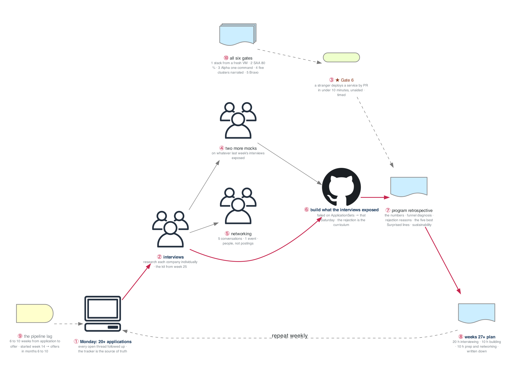

# Figure 26.1 — The weekly cadence that carries months 6 to 10

> Week 26 · badges ① to ⑩ · about three minutes at a normal pace. Point at each badge as you say its line. Blue is the path to follow first; orange-red is where something refuses or fails.



Not the finish line: the point where the pipeline is full and converting. The figure is one week of the cadence you will repeat, plus the sixth gate and the retrospective that writes the plan for weeks 27 and beyond.

## What to say, badge by badge

- **Open.** “This is week 26, and it is also every week after it. Twenty hours interviewing, ten building, ten on prep and people. The figure is the loop, the sixth gate sits beside it, and the retrospective at the end writes the next plan.”
- **① Monday applications.** “Twenty or more, and every open thread followed up. The tracker is the source of truth: company, role, date, source, status. A pipeline you cannot see is a pipeline you cannot diagnose.”
- **② interviews.** “Each one with its own research: what the company runs, what broke publicly, what the team's blog says. The kit from week 25 is the answer bank; the research is what makes the answers land.”
- **③ Gate 6.** “Wednesday, the final attempt: a stranger deploys a service through a pull request in under ten minutes with no help. Timed, recorded. It proves the platform, the docs, and the week-24 stranger test all at once.”
- **④ two more mocks.** “Targeted at whatever last week's real interviews exposed. The mock is cheap practice for the expensive thing.”
- **⑤ networking.** “Five conversations and one event. People refer people; postings are the slowest door. Say what you built in thirty seconds and ask about their work.”
- **⑥ build what the interviews exposed.** “Failed a question on ApplicationSets? That is Saturday's work. Fumbled cost optimization? Add a FinOps dashboard to Charlie. Every rejection is a curriculum, and a candidate still shipping interviews with no desperation in their voice.”
- **⑦ program retrospective.** “Sunday: the numbers, applications and screens and onsites and offers; a funnel diagnosis of where it narrows; rejection reasons; the five best lines from the Surprised column of the journal; and whether the pace is sustainable.”
- **⑧ weeks 27 plus plan.** “Written down: twenty hours interviewing, ten building, ten on preparation and networking. The plan is what turns the end of the program into a cadence instead of a stop.”
- **⑨ the pipeline lag.** “Six to ten weeks from application to offer. Applications started in week 14, so the likely offer window is months six to ten. Knowing the lag is what keeps week 26 from feeling like failure.”
- **⑩ all six gates.** “A stack from a fresh VM, the SAA at eighty percent, Alpha in one command, five clusters narrated, Bravo refusing a CVE and an unsigned image, Charlie in ten minutes. Six proofs, each one a story.”
- **Close.** “Apply, interview, build what they exposed, write down what you learned, repeat. The program ends; the cadence does not, and the cadence is what converts.”

**Print it:** [`figure-26.1-numbered-spoken.pdf`](figure-26.1-numbered-spoken.pdf) is the two-page version, the figure on page one and this script on page two.

## Use it

- Read the figure before the day plan. Say the script out loud on Friday with the file closed.
- Each badge line is a thirty-second interview answer; the whole script is the three-minute version.
- Regenerate after editing the spec in `_shared/diagrams/week_figures/`:

```bash
python3 ../../_shared/diagrams/generate-week-figures.py --only 26
```
