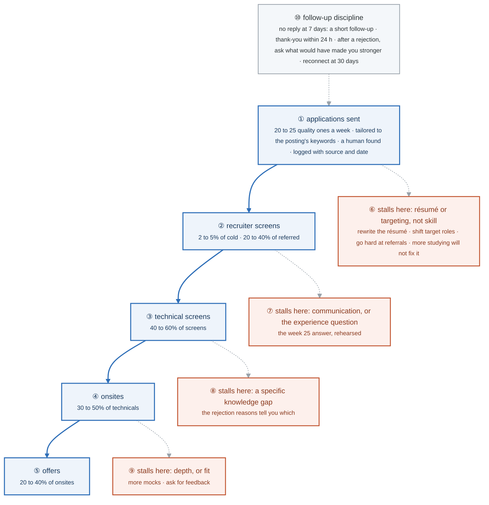

# Week 26 — Activity figures

> One entry per activity, numbered 26.2 to 26.6. Figure 26.1 is the week figure in
> [`../content/FIGURE.md`](../content/FIGURE.md). This week is the job search cadence, so four of
> the five activities are habits rather than systems and say so; the application funnel is the one
> with a shape, because it is a measured pipeline with a diagnosis at every stage. Same language:
> gray is structure, **blue is the path to follow first**, orange-red is where it stalls.

**The protocol per figure**

1. **Before the activity:** read the figure, say the badges out loud once.
2. **During the week:** every badge has a **Prove it** line. The funnel numbers are filled in on Sunday, every week, from the tracker.
3. **After the week:** close the file, redraw the figure, say the script. The badge where the order slipped goes in the *Figures redrawn* column of `progress.md`.
4. **Own the numbers.** The *Numbers to own* table is what separates "I am applying" from "two to five percent of cold applications become screens and twenty to forty percent of referred ones, so the referral hours are the ones that convert."
5. **Answer the question.** The figure ends with the question you will be asked, by yourself, on a Sunday in month seven.

---

## Figure 26.2 — Activity 1: the funnel, and where it stalls

> Activity 1 · badges ① to ⑩ · about three minutes. This figure reads top-down.

<!-- figure: generated from the Mermaid below by _shared/diagrams/embed-figures.py — do not edit the image -->


<details>
<summary>Diagram source (Mermaid)</summary>



</details>

### Say it, badge by badge

- **Open.** "A job search is a pipeline with five stages and a conversion rate at each one. Fill the numbers in every Sunday, and the stage where it stops tells you what to fix. The most common way people waste month seven is reading the wrong stage."
- **① applications.** "Twenty to twenty-five a week, and quality means four things: the résumé tailored to that posting's keywords because ATS matching is literal, a human at the company found and contacted, a cover note that names something specific, and a tracker entry with source and date. Fifteen tailored applications beat a hundred one-click ones."
- **② recruiter screens.** "Two to five percent of cold applications become a screen. Twenty to forty percent of referred ones do. That gap is the whole argument for Friday's networking hours."
- **③ technical screens.** "Forty to sixty percent of screens go on to a technical. The screen is mostly the experience question and whether you can talk."
- **④ onsites.** "Thirty to fifty percent of technicals become an onsite. Here the labs are what gets tested: the broken cluster, the design, the eight stories."
- **⑤ offers.** "Twenty to forty percent of onsites. Multiply the chain and a hundred cold applications is a small number of offers, which is why the numbers at ① and ② matter more than any study hour."
- **⑥ stalls at applications.** "A hundred applications and no screens is a résumé or targeting problem, not a skill problem. Rewrite the résumé, shift the target roles, go hard at referrals. More studying will not fix it, and it is the single most common mistake."
- **⑦ stalls at screens.** "You get screens and no technicals: communication, or the experience question. The answer from week 25, rehearsed until it is a normal sentence."
- **⑧ stalls at technicals.** "Technicals and no onsites: a specific gap, and the rejection reasons name it. This is the one stage where studying is the fix, and only once the reasons say what to study."
- **⑨ stalls at onsites.** "Onsites and no offers: depth, or fit. More mocks, and ask every rejection what would have made you stronger. Some answer, and the answer is worth more than the application."
- **⑩ follow-up.** "No reply at seven days, a short follow-up. A thank-you within twenty-four hours of any interview, naming something specific. After a rejection, ask. Thirty days later, reconnect when a role opens; you are a known quantity now."
- **Close.** "Five stages, four conversion ranges, four diagnoses. Fill it in on Sunday, read the stage where it stops, fix that stage and nothing else. The funnel is the only honest answer to 'how is the search going'."

### Numbers to own

| Number | Where it comes from | Why it matters |
|---|---|---|
| 20 to 25 a week | the weekly hours table | quality applications, 8 hours; the input to the funnel |
| 2 to 5% vs 20 to 40% | applications to screens | cold versus referred; referrals convert 5 to 10 times better, so Friday's 4 hours are the highest-leverage ones |
| 40 to 60% · 30 to 50% · 20 to 40% | the later stages | screens to technicals, technicals to onsites, onsites to offers |
| 15 beats 100 | the quality rule | tailored applications versus one-click ones |
| 7 days · 24 hours · 30 days | follow-up discipline | the follow-up, the thank-you, the reconnect |
| 100 and 0 | the diagnosis rule | a hundred applications with zero screens is upstream, and studying does not fix it |

### Prove it

```bash
# every Sunday, from the tracker, fill the five lines in the lab:
#   applications sent · recruiter screens · technical screens · onsites · offers
# then compute the four ratios and compare each with its range in ② to ⑤
# the first ratio below its range is the stage to fix this week, and the only one
```

### The question you ask yourself on a Sunday in month seven

*"The search has been running six weeks. What do I change?"*
Badges ① to ⑤ give the numbers; ⑥ to ⑨ give the one stage to act on. If the answer you want to give is "study more", check which stage is stalling first; it is almost always ⑥, and ⑥ is never fixed by studying.

---

## Figure 26.3 — Activity 2: no figure

Interview execution is a per-company checklist (45 minutes of preparation, two engineering-blog posts, three questions you could only ask having done it) and a one-hour debrief after every interview. The debrief file is the mechanism: after ten interviews it is your study plan, so keep it in one place and reread it on Sundays.

---

## Figure 26.4 — Activity 3: no figure

Networking is five genuine conversations and one event a week, with a referral asked for only where a real relationship exists and the explicit permission to decline written into the ask. There is nothing to draw; the number that matters is already in figure 26.2, badge ②.

---

## Figure 26.5 — Activity 4: no figure

Keep building is a table of additions ordered by interview value, starting with progressive delivery on Charlie because "how do you deploy" is always followed by "and how do you roll back". Pick the one your interviews exposed; the figure for whatever you add belongs in that project's README, not here.

---

## Figure 26.6 — Activity 5: no figure

The retrospective is `assessment.md` and a written plan for weeks 27 onward. The only rule is that the cadence is written down, because an unwritten search drifts, and drift is what turns a three-month search into a nine-month one.

---

## Redraw schedule

Same cadence as the week figure, see [`../../FIGURES.md`](../../FIGURES.md): Friday of this week, and cold on the Gate 6 Sunday, which is this week's Sunday. From week 27 the funnel figure is redrawn whenever the Sunday numbers are filled in; the stall diagnosis is the part to keep cold.
