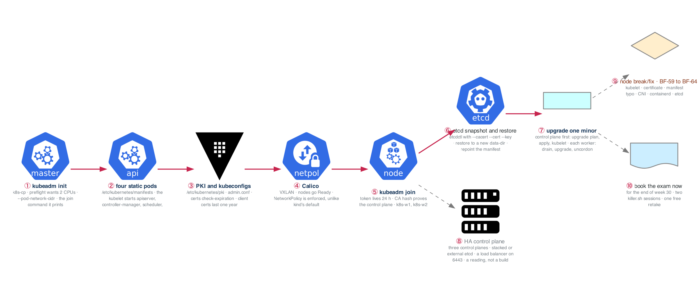

# Week 27 — CKA I: Cluster Architecture, on kubeadm

> **Thesis:** the 25 percent of the exam called "cluster architecture, installation and
> configuration", and the hardest third of the 30 percent called "troubleshooting", live on real
> nodes. kind hides both. This week you build the control plane by hand, read every file it wrote,
> back it up, upgrade it, and break it, on two or three VMs you can SSH into.

| | |
|---|---|
| **Hours** | ~17 of labs, alongside the week-26 cadence (20 h interviewing, 10 h building) |
| **Deliverable** | A kubeadm cluster you have built, restored from an etcd snapshot, and upgraded one minor version, with the incident journal to prove it |
| **Break/Fix** | BF-59 to BF-64, the node set, new this week |
| **◇ Decision** | Monday: **book the exam** for the end of week 30. An unbooked exam slips |

> **Exam facts used in this module are planning estimates.** Two hours, performance-based, roughly 15
> to 20 weighted tasks, pass mark 66 percent, the Kubernetes and Helm docs open in the secure
> browser, two killer.sh sessions and one free retake in the package, the certificate valid two
> years. **Confirm every one of them in the candidate handbook at registration.**

> **The nodes.** `curriculum/_setup/gcp-lab/` creates them: set `kubeadm_nodes = 3` and
> `kubernetes_minor` in `terraform.tfvars`, apply, then `gcloud compute ssh k8s-cp --tunnel-through-iap`
> (workers are `k8s-w1` and `k8s-w2`). They come up with containerd, kubeadm, kubelet and kubectl
> installed and held at `kubernetes_minor`, swap off and the kernel settings done. `kubeadm init` is
> yours. They stop every night with the lab VM; nothing is destroyed. Set `kubernetes_minor` one minor
> **below** the exam's current version, because Thursday upgrades it.

## The week in one figure

**Figure 27.1 — A cluster you built by hand, and what kubeadm wrote.** kind hides the quarter of the exam that lives on real nodes. The blue path is one cluster from kubeadm init to an upgraded worker; every box is a file or a command you can point at on k8s-cp.

**Say it, badge by badge:** [`content/FIGURE.md`](content/FIGURE.md) — the spoken script for each of the 10 badges, about three and a half minutes; [`content/figure-27.1-numbered-spoken.pdf`](content/figure-27.1-numbered-spoken.pdf) is the printable two-page version. Read the figure before the day plan; say the script on Friday.

---

## Day plan
| Day | Focus | Lab |
|---|---|---|
| Mon | **Book the exam.** `kubeadm init`, Calico, two workers join; read what kubeadm wrote | Lab 1 |
| Tue | Certificates and kubeconfigs: expiry, renewal, a user from a CSR, kubelet rotation | Lab 2 |
| Wed | Interviews and applications. No lab | — |
| Thu | etcd: snapshot, restore to a new data directory, prove it | Lab 3 |
| Fri | Upgrade one minor: control plane, then workers; HA as a reading | Lab 4 |
| Sat | Break/Fix on nodes: build the BF-59 to BF-64 set, run it timed (4 h) | Lab 5 |
| Sun | Redraw figures 27.2 to 27.6 cold; journal; plan week 28 | — |

## Reading map
- `_reference/kubernetes/01-foundation/02-kubernetes-architecture-exercises-02-control-plane-deep-dive.md`
- `_reference/kubernetes/01-foundation/02-kubernetes-architecture-exercises-03-node-components.md`
- `_reference/kubernetes/03-production/02-security-rbac-exercises-01-rbac-configuration.md` (the CSR flow)
- `_reference/kubernetes/03-production/02-security-rbac-exercises-05-secrets-encryption.md` (the EncryptionConfiguration you will find on the control plane)
- `_reference/kubernetes/02-core-ops/01-networking-deep-dive-exercises-05-cni-plugins.md`
- **`_reference/kubernetes/resources/troubleshooting-common-issues.md`** again, node section
- Week 14 Lab 1 and figure 14.2 (the control plane you saw on kind); week 17 Lab 4 (the first kubeadm by hand)
- `_shared/breakfix/06-kubernetes.md` (BF-41 to 50) and the new `_shared/breakfix/08-cluster-nodes.md` (BF-59 to 64)
- **Docs you must be able to find fast during the exam:** kubeadm upgrade, "Operating etcd clusters for Kubernetes", "Certificate management with kubeadm", "Manage TLS certificates in a cluster" (the CSR page). Bookmark nothing; the exam browser has no bookmarks. Learn the search terms
- **Drill:** `_shared/drills/kubectl-speed.md`, every day, timed

## Labs
[labs/LABS.md](labs/LABS.md) · [labs/FIGURES.md](labs/FIGURES.md) (figures 27.2 to 27.6, one per lab) · [solutions/SOLUTIONS.md](solutions/SOLUTIONS.md)

## Exit criteria
- [ ] Exam booked for the end of week 30
- [ ] `kubeadm init` + Calico + two joined workers from memory in under 25 minutes
- [ ] Name every file under `/etc/kubernetes/` and `/var/lib/kubelet/` and say what reads it
- [ ] `kubeadm certs check-expiration` explained; one certificate renewed; a user kubeconfig built from a CSR
- [ ] An etcd snapshot taken with the right three certificates, restored to a new data directory, and an object created after the snapshot shown to be gone
- [ ] Control plane and both workers upgraded one minor version with zero workload downtime beyond the drains
- [ ] All six node scenarios diagnosed from a cold start, under 10 minutes each, narrated
