# Week 27 — Lab figures

> One figure per lab, numbered 27.2 to 27.6, and four more for the Go deeper labs and the hard-way
> variant, 27.7 to 27.10. Figure 27.1 is the week figure in
> [`../content/FIGURE.md`](../content/FIGURE.md); these go one level down, to the mechanism each
> lab makes you touch. Same language: gray is structure, **blue is the path to follow first**,
> orange-red is where something refuses, washed boxes are stores. Each badge line is a thirty-second
> interview answer; each whole script is under three minutes.

**The protocol per figure**

1. **Before the lab:** read the figure, say the badges out loud once. You now know what you are about to prove.
2. **During the lab:** every badge has a **Prove it** command. Run it and watch the badge happen. A badge you cannot see happen is one you are taking on faith.
3. **After the lab:** close the file, redraw the figure, say the script. Check against the file. The badge where the order slipped goes in the *Figures redrawn* column of `progress.md`.
4. **Own the numbers.** The *Numbers to own* table is what separates "I know kubeadm" from "every leaf certificate is one year, the CAs are ten, and `upgrade apply` renews the leaves."
5. **Answer the question.** Each figure ends with the question a senior interviewer asks about it. Answer it cold, in under a minute, before the gate.

---

## Figure 27.2 — Lab 1: from a bare VM to three Ready nodes

> Lab 1 · badges ① to ⑨ · about three minutes.

<!-- figure: generated from the Mermaid below by _shared/diagrams/embed-figures.py — do not edit the image -->
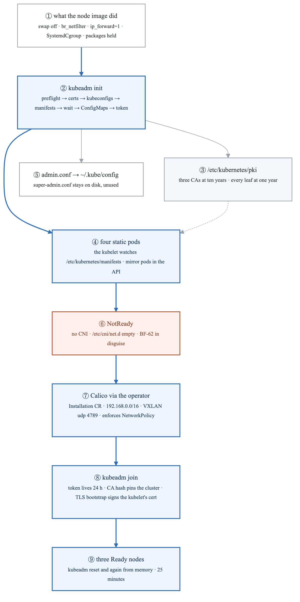

<details>
<summary>Diagram source (Mermaid)</summary>

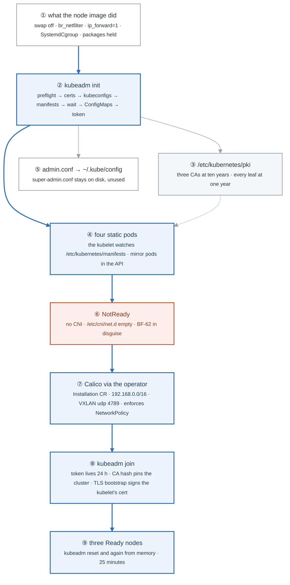

</details>

### Say it, badge by badge

- **Open.** "Week 14 looked at a control plane kind had already built. This is the same four components, built by you, on machines you can SSH into. Follow the blue path from a prepared VM to three Ready nodes, and notice that the orange box in the middle is expected."
- **① what the node image did.** "Swap off, because the kubelet's memory accounting assumes none. The bridge and forwarding sysctls, because pod traffic crosses a bridge. The runtime on the systemd cgroup driver, matching the kubelet. And the three packages held, so an apt upgrade never moves a minor by itself."
- **② kubeadm init.** "Seven phases you can name: preflight, certificates, kubeconfigs, static pod manifests, wait for the API server, upload the config as ConfigMaps, mint a bootstrap token. Every one of them is also a `kubeadm init phase` subcommand you can run alone."
- **③ the PKI.** "Three CAs: the cluster CA, the etcd CA, the front-proxy CA, each good for ten years. Every leaf they sign is good for one. The whole of Lab 2 is in that sentence."
- **④ four static pods.** "etcd, apiserver, controller-manager, scheduler, as YAML files in a directory the kubelet polls. No controller owns them, which is why the API shows a mirror pod you cannot really delete, and why a typo in that directory is an outage."
- **⑤ admin.conf.** "The kubeconfig you copy to use the cluster. Its neighbour super-admin.conf is `system:masters` and stays where it is: break-glass, not daily use."
- **⑥ NotReady.** "The kubelet refuses to call a node Ready until a CNI config exists in `/etc/cni/net.d`. That is correct behaviour, and it is also exactly what BF-62 looks like later, so remember the message."
- **⑦ Calico via the operator.** "One operator manifest and one Installation resource: the pod CIDR that must match what init was told, VXLAN encapsulation on UDP 4789, and a CNI that actually enforces NetworkPolicy, which week 19 showed the kind default does not."
- **⑧ kubeadm join.** "A token valid for a day, a hash of the CA that pins which cluster the worker trusts, and a TLS bootstrap in which the worker's kubelet gets its own client certificate signed. Workers get a kubelet.conf and nothing in their manifests directory."
- **⑨ three Ready nodes.** "Then you reset all three and do it again without the file open. Twenty-five minutes is the target, because the exam will not give you more for a whole task."
- **Close.** "Prepare, init, read the four files, add a network, join. Everything in the 25 percent domain is a file kubeadm wrote, and after today you have read every one of them."

### Numbers to own

| Number | Where it comes from | Why it matters |
|---|---|---|
| 7 init phases | `kubeadm init` output | preflight · certs · kubeconfig · control-plane manifests · wait · upload-config · bootstrap-token; each is a subcommand |
| 3 CAs · 10 years · 1 year | `kubeadm certs check-expiration` | the lifetime split that drives renewal and BF-60 |
| 4 static pods | `/etc/kubernetes/manifests` | etcd · kube-apiserver · kube-controller-manager · kube-scheduler |
| `192.168.0.0/16` | `--pod-network-cidr` and the Installation CR | the two must match or pods get addresses the network cannot route |
| udp `4789` | Calico VXLAN | the inter-node encapsulation port the lab firewall must allow |
| 24 hours | bootstrap token TTL | `kubeadm token create --print-join-command` mints a fresh one |
| 2 CPU · 2 GB | kubeadm's preflight minimum per node | e2-medium clears it with room |
| 25 minutes | the from-memory target | three Ready nodes with the file closed |

### Prove it

```bash
swapon --show; sysctl net.ipv4.ip_forward; grep SystemdCgroup /etc/containerd/config.toml; apt-mark showhold   # ①
sudo kubeadm certs check-expiration                                                                            # ③
sudo crictl ps | grep -E 'etcd|apiserver|controller|scheduler'                                                 # ④
kubectl get nodes; ls /etc/cni/net.d/                                                                          # ⑥ then ⑦
kubeadm token list                                                                                             # ⑧
```

### The question a senior interviewer asks

*"Walk me through what `kubeadm init` actually does, and what you would check if a worker refused to join."*
Badges ② ③ ④ for the first half, ⑧ for the second: the token has expired, the CA hash does not match the cluster, or the worker cannot reach 6443. Naming the TLS bootstrap is what separates an answer from a recitation.

---

## Figure 27.3 — Lab 2: who signed you, and for how long

> Lab 2 · badges ① to ⑧ · about three minutes.

<!-- figure: generated from the Mermaid below by _shared/diagrams/embed-figures.py — do not edit the image -->
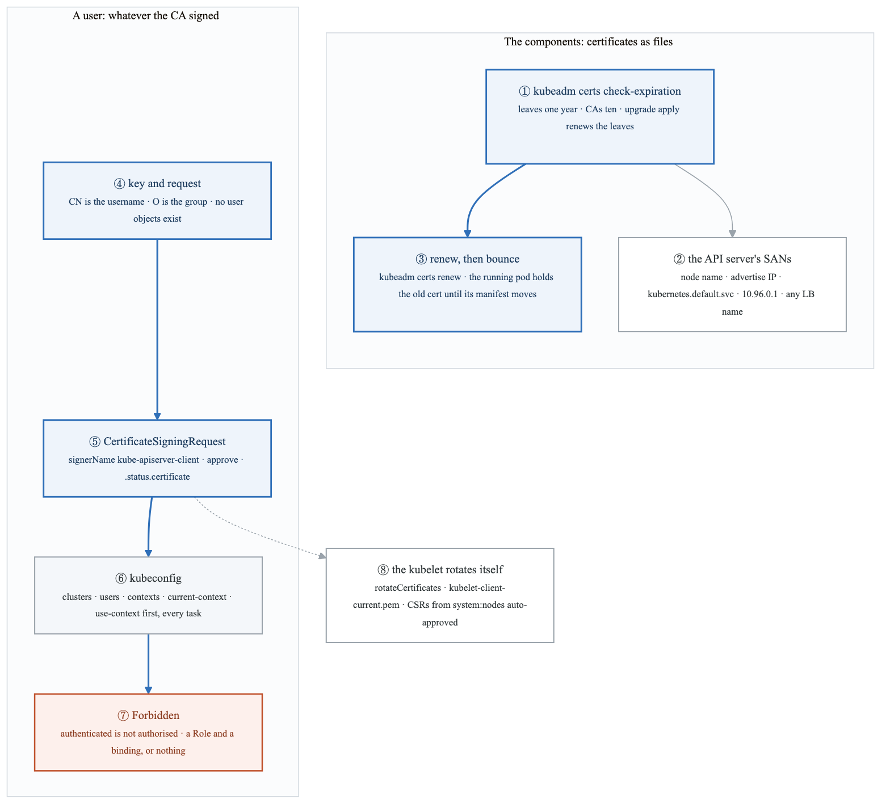

<details>
<summary>Diagram source (Mermaid)</summary>

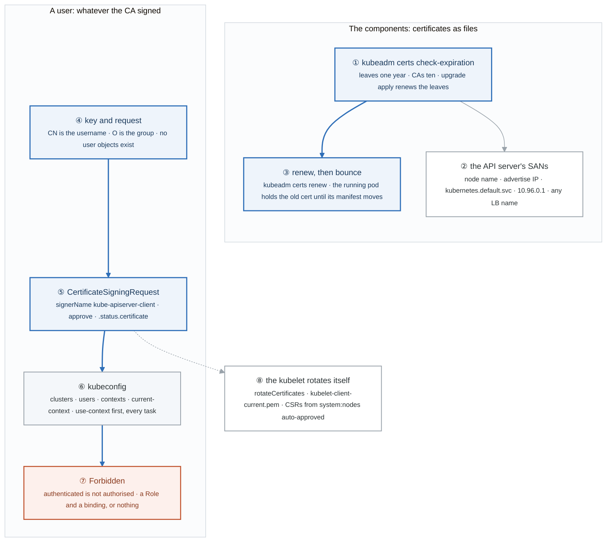

</details>

### Say it, badge by badge

- **Open.** "Kubernetes has no users and no passwords. It has a CA, and identity is whatever that CA signed. The top row is the components, which hold certificates as files. The bottom row is a human, who gets one through the API. The kubelet is the odd one out, and that is badge eight."
- **① check-expiration.** "One table that answers 'when does this cluster stop working'. Leaves at one year, CAs at ten, and a note that `kubeadm upgrade` renews the leaves, which is why clusters upgraded yearly never see this and clusters that are not become BF-60."
- **② the SANs.** "The API server's serving certificate must list every name a client dials. Miss the load balancer name and you get 'certificate is valid for x, not y'. That is why `--control-plane-endpoint` is set on day one."
- **③ renew, then bounce.** "`kubeadm certs renew` rewrites the file. The process in memory still holds the old one until the kubelet restarts the static pod, which it only does when the manifest changes. Move the file out and back; that is the whole trick."
- **④ key and request.** "An OpenSSL key, a request with CN as the username and O as the group. There is nothing Kubernetes-specific yet; this is plain X.509."
- **⑤ CertificateSigningRequest.** "The request wrapped in an object with a signer name, approved by an admin, signed by the controller manager, and the certificate handed back in status. The approval step is the authorisation to exist."
- **⑥ kubeconfig.** "Three lists and one pointer: clusters, users, contexts, and current-context. The exam starts every task with `use-context`, and a task in the wrong context scores zero. Make the first keystroke a reflex."
- **⑦ Forbidden.** "A signed certificate proves who you are and grants nothing. Until a Role and a binding exist, every request is Forbidden. Authentication and authorisation are different gates; say both words."
- **⑧ the kubelet rotates itself.** "`rotateCertificates: true`: the kubelet files its own CSR before expiry and the controller manager approves it because the subject is `system:node:<name>`. That is why worker kubelets outlive the one-year rule and the control-plane components, which use files, do not."
- **Close.** "Files for the components, CSRs for people and kubelets, a kubeconfig to carry it, RBAC to make it mean anything. Every `kubectl` you have ever run was this chain."

### Numbers to own

| Number | Where it comes from | Why it matters |
|---|---|---|
| 1 year · 10 years | kubeadm's leaf and CA validity | the renewal cadence; `upgrade apply` renews leaves |
| 5 names in the API server SAN list | `openssl x509 -text` on `apiserver.crt` | node name · advertise IP · `kubernetes`, `.default`, `.default.svc`, `.svc.cluster.local` · the Service IP · any extra SAN |
| `10.96.0.1` | the first address of the default service CIDR | the in-cluster API address that must be in the SAN list |
| 3 lists · 1 pointer | a kubeconfig | clusters · users · contexts · `current-context` |
| `86400` | `expirationSeconds` on the CSR | a one-day user certificate; the signer may clamp it |
| 0 user objects | the API | identity is the CA's signature; groups are the O field |

### Prove it

```bash
sudo kubeadm certs check-expiration                                                        # ①
sudo openssl x509 -in /etc/kubernetes/pki/apiserver.crt -noout -ext subjectAltName          # ②
sudo crictl ps | grep apiserver                                                             # ③ a new container after the bounce
kubectl get csr jane -o jsonpath='{.status.certificate}' | base64 -d | openssl x509 -noout -subject -dates   # ⑤
kubectl --context=jane auth whoami                                                          # ⑥ ⑦
sudo openssl x509 -in /var/lib/kubelet/pki/kubelet-client-current.pem -noout -subject -dates   # ⑧
```

### The question a senior interviewer asks

*"The cluster's certificates expired overnight. What broke, what did not, and what do you run?"*
Badges ① ③ ⑧. The API server, controller manager, scheduler and etcd stopped authenticating each other; the kubelets probably did not, because they rotate. `kubeadm certs renew all`, bounce the four manifests, re-copy admin.conf. Then say why it happened: no upgrade in over a year.

---

## Figure 27.4 — Lab 3: a snapshot, a new directory, and the object that must disappear

> Lab 3 · badges ① to ⑨ · about three minutes.

<!-- figure: generated from the Mermaid below by _shared/diagrams/embed-figures.py — do not edit the image -->
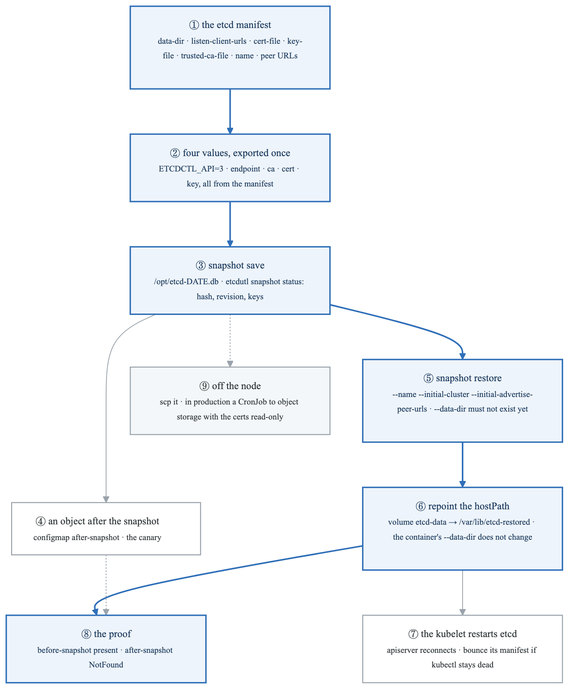

<details>
<summary>Diagram source (Mermaid)</summary>

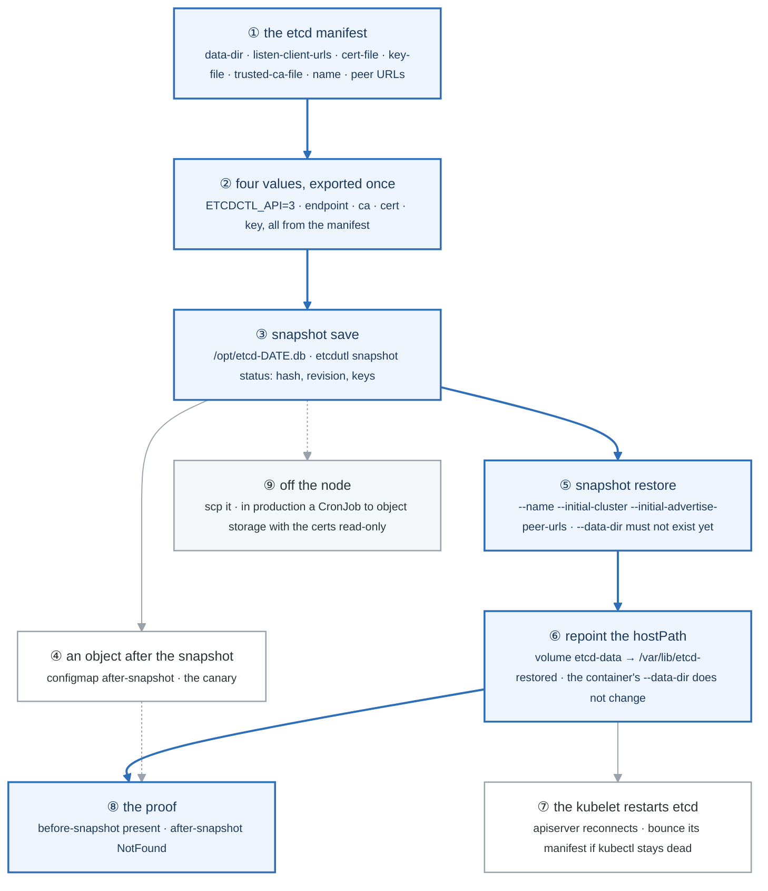

</details>

### Say it, badge by badge

- **Open.** "Everything the cluster knows is one key-value store, and a backup of it is one file. This is the path from the manifest that configures etcd to a restore you can prove worked, and the proof is an object that has to vanish."
- **① the manifest.** "Every value you need is in `/etc/kubernetes/manifests/etcd.yaml`: the data directory, the client URL, the three certificate paths, the member name and peer URL. On the exam, the manifest or `ps aux` is where you find them in under a minute."
- **② four values, exported once.** "API version 3, the endpoint, the CA, the client cert and key. Export them and every `etcdctl` command is short. Forget one and the error is a TLS handshake failure that says nothing useful."
- **③ snapshot save.** "One file. `etcdutl snapshot status` reads back its hash, revision and key count, which is how you know you did not save an empty file."
- **④ the canary.** "Create something after the snapshot. If it survives the restore, you did not restore."
- **⑤ snapshot restore.** "Writes a brand-new data directory, which must not exist yet. Pass the member name and initial cluster so the restored member matches the manifest; a single node usually tolerates skipping them, and 'usually' is not a word for backups."
- **⑥ repoint the hostPath.** "The static pod mounts a host directory into the container at `/var/lib/etcd`. You change the **host** side of that mount. The flag inside the container stays as it was. Saying this correctly is the difference between a restore and a broken etcd."
- **⑦ the kubelet restarts etcd.** "The manifest changed, so the kubelet recreates the pod. The API server loses etcd for a few seconds and reconnects; if `kubectl` is still dead after a minute, bounce the apiserver manifest the same way."
- **⑧ the proof.** "The object from before the snapshot is there. The canary is NotFound. Two commands, and the task is demonstrably done."
- **⑨ off the node.** "A snapshot on the node it backs up is not a backup. Copy it away; in production a CronJob writes it to object storage with the certificates mounted read-only."
- **Close.** "Find four values, save, plant a canary, restore to a new directory, move the mount, prove the canary is gone. Ten minutes from memory is the target, because this task is on every version of the exam."

### Numbers to own

| Number | Where it comes from | Why it matters |
|---|---|---|
| 3 certificate files + 1 endpoint | the etcd manifest | `ca.crt` · `server.crt` · `server.key` · `https://127.0.0.1:2379`; all four or a useless TLS error |
| `2379` · `2380` | etcd client and peer ports | the lab firewall allows them between nodes; the exam may put etcd on another host |
| 1 new directory | `--data-dir` on restore | must not exist; the live `/var/lib/etcd` is never written |
| 2 configmaps | before-snapshot, after-snapshot | the canary pattern that proves a restore |
| 10 minutes | the from-memory target | save, canary, restore, repoint, prove |

### Prove it

```bash
sudo grep -E -- '--(data-dir|listen-client-urls|cert-file|key-file|trusted-ca-file)' /etc/kubernetes/manifests/etcd.yaml   # ①
sudo -E etcdctl endpoint health                                                                                           # ②
sudo etcdutl snapshot status /opt/etcd-*.db -w table                                                                     # ③
sudo ls /var/lib/etcd-restored/member                                                                                    # ⑤
sudo grep -A1 'name: etcd-data' /etc/kubernetes/manifests/etcd.yaml                                                      # ⑥
kubectl get cm before-snapshot after-snapshot                                                                            # ⑧
```

### The question a senior interviewer asks

*"Restore etcd from last night's snapshot on a kubeadm cluster. Talk me through it, including the step people get wrong."*
Badges ⑤ ⑥ ⑦. New data directory, change the hostPath not the flag, let the kubelet restart it, prove with an object. The follow-up is "and on a three-member cluster?": restore the same snapshot on each member with its own name and peer URL, bring them up together.

---

## Figure 27.5 — Lab 4: one minor, control plane first

> Lab 4 · badges ① to ⑩ · about three minutes.

<!-- figure: generated from the Mermaid below by _shared/diagrams/embed-figures.py — do not edit the image -->
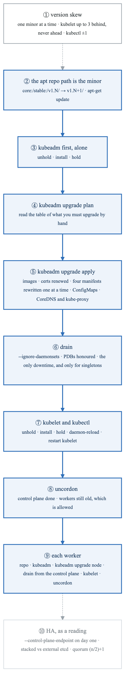

<details>
<summary>Diagram source (Mermaid)</summary>

```mermaid
%%{init: {'theme':'base','themeVariables':{'fontFamily':'Helvetica, Arial, sans-serif','fontSize':'13px','primaryColor':'#ffffff','primaryTextColor':'#2d3436','primaryBorderColor':'#9aa3ab','lineColor':'#9aa3ab','textColor':'#2d3436','clusterBkg':'#fbfcfd','clusterBorder':'#d4dae0','edgeLabelBackground':'#ffffff','tertiaryColor':'#eef4fb'},'flowchart':{'curve':'basis','padding':14,'nodeSpacing':42,'rankSpacing':58}}}%%
flowchart TB
  classDef default fill:#ffffff,stroke:#9aa3ab,stroke-width:1.3px,color:#2d3436
  classDef n    fill:#ffffff,stroke:#9aa3ab,stroke-width:1.3px,color:#2d3436
  classDef crit fill:#eef4fb,stroke:#2f6fb8,stroke-width:1.8px,color:#1b3a5c
  classDef data fill:#f4f7fa,stroke:#9aa3ab,stroke-width:1.3px,color:#2d3436
  classDef mut  fill:#ffffff,stroke:#cfd6dc,stroke-width:1.1px,color:#7a8288
  classDef warn fill:#fdf0ec,stroke:#c0522d,stroke-width:1.6px,color:#8a3a1e

  SKEW["① version skew<br/><small>one minor at a time · kubelet up to 3 behind, never ahead · kubectl ±1</small>"]:::n
  REPO["② the apt repo path is the minor<br/><small>core:/stable:/v1.N/ → v1.N+1/ · apt-get update</small>"]:::crit
  KADM["③ kubeadm first, alone<br/><small>unhold · install · hold</small>"]:::crit
  PLAN["④ kubeadm upgrade plan<br/><small>read the table of what you must upgrade by hand</small>"]:::crit
  APPLY["⑤ kubeadm upgrade apply<br/><small>images · certs renewed · four manifests rewritten one at a time · ConfigMaps · CoreDNS and kube-proxy</small>"]:::crit
  DRAIN["⑥ drain<br/><small>--ignore-daemonsets · PDBs honoured · the only downtime, and only for singletons</small>"]:::crit
  KLET["⑦ kubelet and kubectl<br/><small>unhold · install · hold · daemon-reload · restart kubelet</small>"]:::crit
  UNC["⑧ uncordon<br/><small>control plane done · workers still old, which is allowed</small>"]:::crit
  WRK["⑨ each worker<br/><small>repo · kubeadm · kubeadm upgrade node · drain from the control plane · kubelet · uncordon</small>"]:::crit
  HA["⑩ HA, as a reading<br/><small>--control-plane-endpoint on day one · stacked vs external etcd · quorum (n/2)+1</small>"]:::mut

  REPO ==> KADM ==> PLAN ==> APPLY ==> DRAIN ==> KLET ==> UNC ==> WRK
  SKEW -.-> REPO
  WRK -.-> HA
  linkStyle 0,1,2,3,4,5,6 stroke:#2f6fb8,stroke-width:2px
```

</details>

### Say it, badge by badge

- **Open.** "An upgrade is fourteen commands in a fixed order, and the order is the knowledge. Control plane first, then each worker, one minor at a time. Follow the blue path and count: seven on the control plane, six on a worker."
- **① version skew.** "The API server is the reference. The kubelet may lag it by up to three minors and must never lead it. kubectl is one either way. Breaking the skew is the one thing kubeadm will not stop you doing, because the kubelet is a package, not an API object."
- **② the repo path.** "On Debian-family systems the Kubernetes apt repository is per minor: the version is in the URL. Change the path, update the index, and the next minor's packages exist. Forget this and `apt-get install kubeadm=1.N+1` finds nothing."
- **③ kubeadm first, alone.** "Unhold, install, hold. Only kubeadm. It is the tool that performs the upgrade, so it moves first and nothing else does."
- **④ upgrade plan.** "Read it all. It names the target versions, lists the components it will upgrade, prints a table of the ones you must upgrade by hand, which is the kubelet, and warns about API removals."
- **⑤ upgrade apply.** "Pulls the images, renews every certificate, rewrites the four static pod manifests one at a time so the control plane never fully stops, updates the two ConfigMaps, and re-applies CoreDNS and kube-proxy. The cluster is now at the new version everywhere except the kubelets."
- **⑥ drain.** "Evict the pods, respecting PodDisruptionBudgets, and skip DaemonSets because they would come straight back. A singleton Deployment is the only thing that notices."
- **⑦ kubelet and kubectl.** "Unhold, install, hold, daemon-reload, restart. The node goes NotReady for a few seconds and comes back reporting the new version."
- **⑧ uncordon.** "Schedulable again. The control plane is done, the workers are a minor behind, and the skew policy says that is fine."
- **⑨ each worker.** "The same shape minus `plan` and `apply`: `kubeadm upgrade node` only rewrites the local kubelet configuration from the cluster's ConfigMap. Drain from the control plane, upgrade on the worker, uncordon from the control plane. One worker at a time."
- **⑩ HA, as a reading.** "Three control-plane nodes with stacked etcd, or external etcd on its own machines, and a load balancer in front of 6443 whose name was in the certificate from day one. Quorum is a majority: three tolerate one, five tolerate two, two tolerate none."
- **Close.** "Repo, kubeadm, plan, apply, drain, kubelet, uncordon. Then repo, kubeadm, node, drain, kubelet, uncordon on each worker. Write it on paper in six minutes; the exam task is recall with a timer."

### Numbers to own

| Number | Where it comes from | Why it matters |
|---|---|---|
| 1 minor per upgrade | kubeadm's rule | 1.N to 1.N+2 is two upgrades, never one |
| 3 minors | kubelet skew behind the API server (since 1.28) | an old worker is allowed; a newer one never is |
| ±1 | kubectl skew | upgrade it with the kubelet |
| 7 + 6 | commands on the control plane, then on each worker | the recall target: on paper in 6 minutes |
| 0 | pods on a DaemonSet that drain evicts | `--ignore-daemonsets` exists because they would come straight back |
| `(n/2)+1` | etcd quorum | 3 tolerate 1 · 5 tolerate 2 · 2 tolerate 0 |
| 2 hours | the `--certificate-key` lifetime from `--upload-certs` | re-upload before joining a second control-plane node later |

### Prove it

```bash
grep stable /etc/apt/sources.list.d/kubernetes.list; apt-cache madison kubeadm | head -2   # ②
kubeadm version -o short                                                                     # ③
sudo kubeadm upgrade plan                                                                    # ④
kubectl -n kube-system get cm kubeadm-config -o yaml | grep kubernetesVersion               # ⑤
kubectl get nodes                                                                            # ⑧ one node new, two old; ⑨ all new
kubectl get pdb -A                                                                           # ⑥ what the drain respected
```

### The question a senior interviewer asks

*"Upgrade a kubeadm cluster from 1.N to 1.N+1 with no user-visible downtime. What is the order and where is the risk?"*
Badges ② to ⑨ in order, then the risk: a workload with one replica and no PDB is down during its drain, and a kubelet upgraded ahead of the API server is the one mistake kubeadm will not catch.

---

## Figure 27.6 — Lab 5: six ways a node fails, and the first command for each

> Lab 5 · badges ① to ⑩ · about three minutes. This figure reads top-down.

<!-- figure: generated from the Mermaid below by _shared/diagrams/embed-figures.py — do not edit the image -->
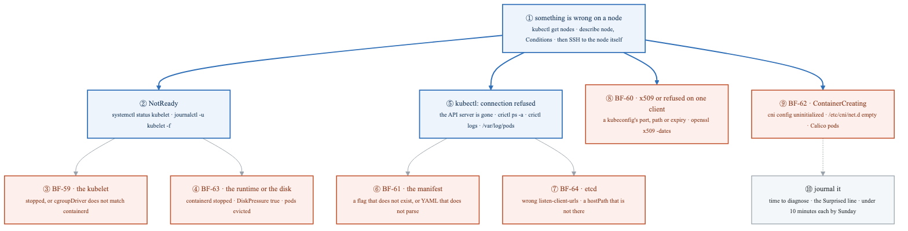

<details>
<summary>Diagram source (Mermaid)</summary>

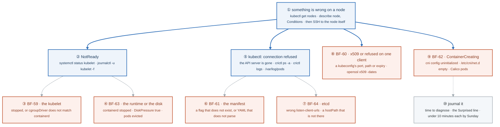

</details>

### Say it, badge by badge

- **Open.** "Gate 4 broke objects. These six break the machines. The first command is still `describe`, but the second is `ssh`, and the tools on the other side are systemctl, journalctl and crictl."
- **① something is wrong on a node.** "`get nodes` tells you which. `describe node` prints Conditions: Ready, DiskPressure, MemoryPressure, PIDPressure. Then you go to the node, because nothing in the API can fix a kubelet."
- **② NotReady.** "`systemctl status kubelet`, then the journal. The kubelet's own log names the cause in the first screen: cannot connect to the runtime, cgroup driver mismatch, certificate rejected."
- **③ BF-59, the kubelet.** "Stopped, or started with a cgroup driver that does not match containerd. The journal line says 'misconfiguration: kubelet cgroup driver cgroupfs is different from docker cgroup driver systemd'. Fix the config, restart."
- **④ BF-63, the runtime or the disk.** "containerd stopped: the kubelet logs 'failed to get runtime status'. Disk full: `DiskPressure=True` and pods evicted. `df -h` and `systemctl start containerd` are the fixes; the diagnosis is the condition."
- **⑤ kubectl refused.** "The API server is not listening. The kubelet is still there, so `crictl ps -a` shows the apiserver container exiting, and `crictl logs` or `/var/log/pods/kube-system_kube-apiserver-*` has the reason."
- **⑥ BF-61, the manifest.** "A flag the binary does not accept, or YAML that does not parse. The kubelet log says 'could not process manifest file' for the parse case; the container log says 'unknown flag' for the other."
- **⑦ BF-64, etcd.** "The apiserver logs 'connection refused' to 2379. etcd's own log says it could not bind the listen address, or could not open the data directory. The hostPath from Lab 3 is a classic."
- **⑧ BF-60, one client.** "Everything works except one component or one user. The kubeconfig's server port, the certificate path, or the certificate's dates. `openssl x509 -dates` on the file the config points at."
- **⑨ BF-62, ContainerCreating.** "Pods schedule and never start. `describe pod` says the network plugin is not ready, CNI config uninitialized. Either the config file is missing from `/etc/cni/net.d` or the Calico pods on that node are not running."
- **⑩ journal it.** "Six scenarios, the minutes each took, and the Surprised line. Sunday you run all six cold and record the total."
- **Close.** "Describe, then SSH. NotReady is the kubelet or what it depends on; refused is the apiserver or what it depends on; one client failing is a certificate; ContainerCreating is the network. Four branches, six scenarios, one week."

### Numbers to own

| Number | Where it comes from | Why it matters |
|---|---|---|
| 4 node conditions | `kubectl describe node` | Ready · DiskPressure · MemoryPressure · PIDPressure; the first screen of every node diagnosis |
| 2 cgroup drivers | kubelet config and containerd config | `systemd` on both, or BF-59 |
| `2379` | etcd client port | `ss -lntp \| grep 2379` is the one-line BF-64 check |
| `/var/log/pods/` | the kubelet's log directory | where a crashed static pod's output lives when `kubectl logs` cannot |
| 6 scenarios · 10 minutes each | the week's target | the node third of the troubleshooting domain |

### Prove it

```bash
kubectl describe node k8s-w1 | grep -A6 Conditions                        # ①
ssh k8s-w1 'sudo journalctl -u kubelet --no-pager | tail -20'             # ② ③ ④
sudo crictl ps -a | grep -E 'apiserver|etcd'; sudo crictl logs $(sudo crictl ps -a -q --name kube-apiserver | head -1) 2>&1 | tail -5   # ⑤ ⑥ ⑦
sudo openssl x509 -in /etc/kubernetes/pki/apiserver.crt -noout -dates    # ⑧
kubectl describe pod <pending> | tail -5; ls /etc/cni/net.d/              # ⑨
```

### The question a senior interviewer asks

*"A node went NotReady at 3 a.m. and the pods on it are gone. What happened and what do you check?"*
Badges ① ② ③ ④. The kubelet stopped reporting, the node controller marked it NotReady after 40 seconds, and after the eviction timeout the pods were rescheduled elsewhere. On the node: kubelet status, containerd status, disk. If you say "restart the node" before you say "read the journal", that is the answer a junior gives.

---

## Figure 27.7 — Go deeper: the kubelet, every ten seconds

> Go deeper lab · badges ① to ⑩ · about three minutes. Rung 3 on kubelet and runtime, and on resources and scale. This figure reads top-down: one config file, and everything it decides.

<!-- figure: generated from the Mermaid below by _shared/diagrams/embed-figures.py — do not edit the image -->
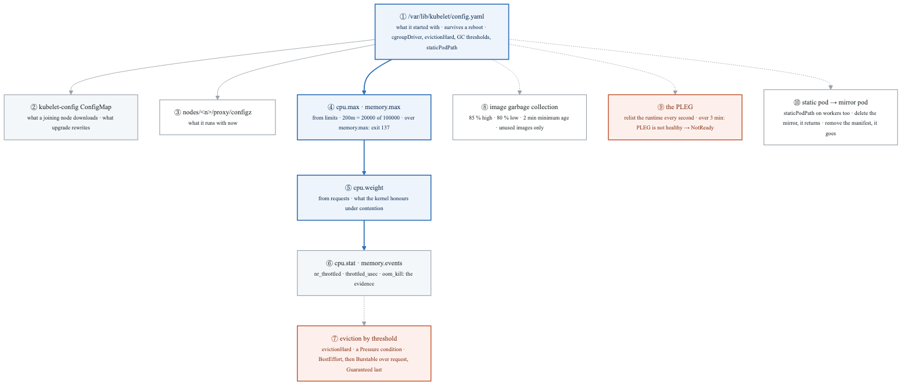

<details>
<summary>Diagram source (Mermaid)</summary>

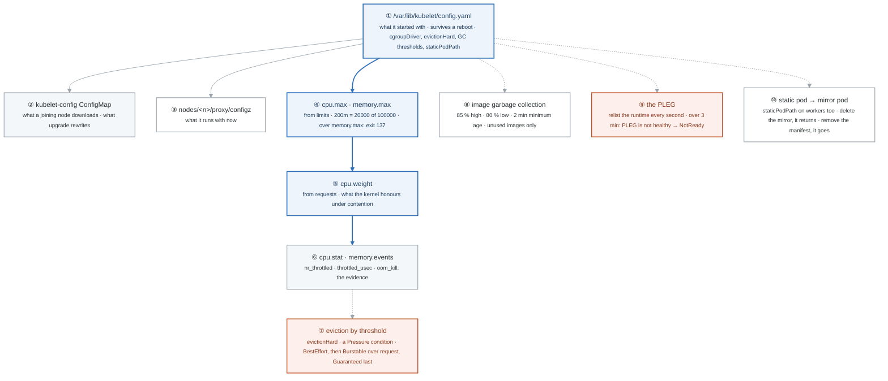

</details>

### Say it, badge by badge

- **Open.** "The kubelet is a loop: watch the API for pods on this node, make the runtime match, report back every ten seconds. Everything it decides lands in a file you can read or a log line you can grep, and this figure is the map of those files."
- **① config.yaml.** "The file the binary read at start. Lab 1 Part 5 listed it; this is where cgroupDriver, evictionHard, the GC thresholds and staticPodPath live, and it is what a reboot restores."
- **② the ConfigMap.** "kubeadm's copy in kube-system. A joining node downloads it; `kubeadm upgrade node` downloads it again. Edit the file on one node and the ConfigMap disagrees until the next upgrade overwrites you."
- **③ configz.** "The live values, through the API server's proxy to the kubelet. The one that tells the truth when the other two disagree."
- **④ cpu.max and memory.max.** "Limits become two files in the pod's slice. 200m is 20000 microseconds of every 100000; cross it and the kernel throttles. 128Mi is 134217728; cross it and the OOM killer sends SIGKILL, exit 137, figure 14.5."
- **⑤ cpu.weight.** "Requests become a weight. It does nothing while the node is idle and decides everything under contention. The scheduler used the same number to pick the node; the kernel uses it to share the CPU."
- **⑥ the counters.** "`cpu.stat` says how often the quota bit; `memory.events` counts OOM kills. When someone says the app is slow with no errors, `nr_throttled` is the first number to read."
- **⑦ eviction.** "Thresholds on memory, disk and PIDs. Cross one and the node sets a Pressure condition and evicts: BestEffort first, then Burstable pods using more than they requested, worst offender first, Guaranteed last. The QoS directory the slice lives in is the order."
- **⑧ image GC.** "Above 85 percent disk, remove images no container references, oldest first, until under 80. It never touches an image in use, which is why a full disk with every image in use is an eviction, not a GC."
- **⑨ the PLEG.** "The pod lifecycle event generator asks the runtime what exists, every second, and diffs. If one relist takes three minutes the kubelet declares itself unhealthy and the node goes NotReady with every pod still running. The evented PLEG replaces the poll with CRI events."
- **⑩ static pod and mirror.** "A manifest in staticPodPath is run by the kubelet with no API server involved; the object you see in the API is a mirror it publishes. Delete the mirror and it comes back; remove the manifest and the container stops. The control plane is four of these."
- **Close.** "One config, three views. Limits are two files, requests are a weight, the counters are the evidence, eviction reads the QoS directory, GC reads the disk, the PLEG reads the runtime, and a static pod is a file. Nothing here needs the API server to be up, which is why the kubelet is the component that can survive everything else."

### Numbers to own

| Number | Where it comes from | Why it matters |
|---|---|---|
| 10 s | `nodeStatusUpdateFrequency` | how often the kubelet posts node status; the node controller marks NotReady after 40 s without it |
| `20000 100000` | `cpu.max` for a 200m limit | quota and period in microseconds; the throttle you can read |
| 134217728 | `memory.max` for 128Mi | over it: SIGKILL, exit 137, `oom_kill` increments |
| 85 % · 80 % · 2 min | image GC defaults | high mark, low mark, minimum age |
| 1 s · 3 min | PLEG relist period and health threshold | a hung runtime becomes NotReady after three minutes |
| 3 QoS directories | `/sys/fs/cgroup/kubepods.slice/` | besteffort, burstable, and Guaranteed at the top level; the eviction order |

### Prove it

```bash
sudo cat /var/lib/kubelet/config.yaml | grep -E 'cgroupDriver|staticPodPath|evictionHard' -A2       # ①
kubectl get --raw "/api/v1/nodes/$(hostname)/proxy/configz" | jq .kubeletconfig.nodeStatusUpdateFrequency   # ③
cat /sys/fs/cgroup/kubepods.slice/kubepods-burstable.slice/kubepods-burstable-pod*/cpu.max             # ④
cat /sys/fs/cgroup/kubepods.slice/kubepods-burstable.slice/kubepods-burstable-pod*/cpu.stat | grep throttled   # ⑥
kubectl get events -A --field-selector reason=Evicted                                               # ⑦
sudo journalctl -u kubelet -o cat | grep -ci pleg                                                    # ⑨
kubectl get pod static-web-$(hostname) -o jsonpath='{.metadata.annotations.kubernetes\.io/config\.mirror}'   # ⑩
```

### The question a senior interviewer asks

*"A pod's CPU limit is 500m and the app is slow, but CPU usage on the node is 20 percent. What is happening?"*
Badges ④ and ⑥. The limit is a quota per 100 ms period; a bursty app spends its 50 ms early and waits out the rest, and `nr_throttled` in `cpu.stat` proves it while the node-level graph shows nothing. The fix is a higher limit or none; the expertise is knowing which file to read.

---

## Figure 27.8 — Go deeper: a CNI plugin in forty lines of bash

> Go deeper lab · badges ① to ⑨ · about three minutes. Rung 4 on the networking datapath. This figure reads top-down.

<!-- figure: generated from the Mermaid below by _shared/diagrams/embed-figures.py — do not edit the image -->
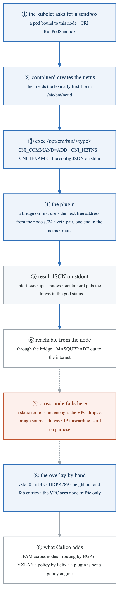

<details>
<summary>Diagram source (Mermaid)</summary>

```mermaid
%%{init: {'theme':'base','themeVariables':{'fontFamily':'Helvetica, Arial, sans-serif','fontSize':'13px','primaryColor':'#ffffff','primaryTextColor':'#2d3436','primaryBorderColor':'#9aa3ab','lineColor':'#9aa3ab','textColor':'#2d3436','clusterBkg':'#fbfcfd','clusterBorder':'#d4dae0','edgeLabelBackground':'#ffffff','tertiaryColor':'#eef4fb'},'flowchart':{'curve':'basis','padding':14,'nodeSpacing':42,'rankSpacing':58}}}%%
flowchart TB
  classDef default fill:#ffffff,stroke:#9aa3ab,stroke-width:1.3px,color:#2d3436
  classDef n    fill:#ffffff,stroke:#9aa3ab,stroke-width:1.3px,color:#2d3436
  classDef crit fill:#eef4fb,stroke:#2f6fb8,stroke-width:1.8px,color:#1b3a5c
  classDef data fill:#f4f7fa,stroke:#9aa3ab,stroke-width:1.3px,color:#2d3436
  classDef mut  fill:#ffffff,stroke:#cfd6dc,stroke-width:1.1px,color:#7a8288
  classDef warn fill:#fdf0ec,stroke:#c0522d,stroke-width:1.6px,color:#8a3a1e

  KL["① the kubelet asks for a sandbox<br/><small>a pod bound to this node · CRI RunPodSandbox</small>"]:::crit
  CT["② containerd creates the netns<br/><small>then reads the lexically first file in /etc/cni/net.d</small>"]:::crit
  EXEC["③ exec /opt/cni/bin/&lt;type&gt;<br/><small>CNI_COMMAND=ADD · CNI_NETNS · CNI_IFNAME · the config JSON on stdin</small>"]:::crit
  PLUG["④ the plugin<br/><small>a bridge on first use · the next free address from the node's /24 · veth pair, one end in the netns · route</small>"]:::crit
  RES["⑤ result JSON on stdout<br/><small>interfaces · ips · routes · containerd puts the address in the pod status</small>"]:::data
  NODE["⑥ reachable from the node<br/><small>through the bridge · MASQUERADE out to the internet</small>"]:::n
  XN["⑦ cross-node fails here<br/><small>a static route is not enough: the VPC drops a foreign source address · IP forwarding is off on purpose</small>"]:::warn
  VX["⑧ the overlay by hand<br/><small>vxlan0 · id 42 · UDP 4789 · neighbour and fdb entries · the VPC sees node traffic only</small>"]:::crit
  CAL["⑨ what Calico adds<br/><small>IPAM across nodes · routing by BGP or VXLAN · policy by Felix · a plugin is not a policy engine</small>"]:::n
  KL ==> CT ==> EXEC ==> PLUG ==> RES ==> NODE
  NODE -.-> XN -.-> VX
  VX --> CAL
  linkStyle 0,1,2,3,4 stroke:#2f6fb8,stroke-width:2px
```

</details>

### Say it, badge by badge

- **Open.** "A network plugin is an executable that the runtime calls with four environment variables and a JSON document, and that answers with a JSON document. Forty lines of bash satisfy the contract. Follow the blue path from a pod being scheduled to a packet leaving the node, then watch where forty lines stop being enough."
- **① the kubelet asks.** "A pod is bound to this node. The kubelet asks containerd through the CRI for a sandbox: a namespace set, a pause container, and a network."
- **② containerd reads the directory.** "It creates the network namespace, then loads the first config file alphabetically from `/etc/cni/net.d`. `00-bashcni.conf` outranks Calico's `10-calico.conflist`; that one filename is how you swap the plugin on one node."
- **③ exec.** "It runs `/opt/cni/bin/bashcni` with `CNI_COMMAND=ADD`, the namespace path, the interface name, and the config on stdin. That is the whole protocol; there is no daemon and no API."
- **④ the plugin.** "A bridge with the gateway address, created on first use. The next free address from the node's range, remembered in a file. A veth pair with one end already in the pod's namespace, addressed, up, with a default route to the bridge."
- **⑤ the result.** "A JSON document naming the interface, the address and the route. containerd reads it and the kubelet writes it into the pod status. `kubectl get pod -o wide` is showing you this document."
- **⑥ reachable.** "From the node, through the bridge; from the pod, out through MASQUERADE as the node's address. Two pods on this node reach each other across the bridge with no further help."
- **⑦ cross-node fails.** "A static route on the other node points at this one, and the ping dies. The reply leaves with a pod source address that is not the VM's, and the cloud drops it unless IP forwarding is on. The lab nodes have it off on purpose, and so does most of production."
- **⑧ the overlay by hand.** "A VXLAN device on each node, id 42, UDP 4789, a neighbour entry and a forwarding entry pointing at the peer. The pod packet travels inside a UDP packet between node addresses; the VPC never sees a pod address. That is what flannel and Calico's VXLAN mode do with a daemon instead of your hands."
- **⑨ what Calico adds.** "Ranges handed to nodes from one datastore, routes advertised so every node knows every range, repair when a node dies, and policy: Felix programs rules on every pod interface. A CNI plugin connects a pod; a policy engine decides what may cross. Week 19 showed what happens when you mistake one for the other."
- **Close.** "Sandbox, directory, exec, plugin, result. That path runs for every pod ever created. The forty lines prove the contract is small; the overlay proves why nobody stops at forty lines; and Calico is the forty lines plus everything a cluster needs when the second node arrives."

### Numbers to own

| Number | Where it comes from | Why it matters |
|---|---|---|
| 4 | the commands a plugin must answer | ADD · DEL · CHECK · VERSION |
| `00-` | the config filename prefix | lexically first wins; how one node swaps plugins without touching Calico |
| 1 | `/24` per node | the simplest IPAM: a file of allocations and a counter |
| 4789 | VXLAN's UDP port | the hole in `lab-allow-k8s-internal` that exists for this |
| 42 | the VXLAN network id in the lab | any number both ends agree on |
| 0 | pod addresses the VPC ever sees under an overlay | the reason the overlay exists |

### Prove it

```bash
ls /etc/cni/net.d/                                                           # ② the first file wins
sudo tail -3 /var/log/bashcni.log                                            # ③ the env the runtime passed
kubectl get pod bashpod -o jsonpath='{.status.podIP}{"\n"}'                 # ⑤ the result, as the API shows it
ping -c1 "$(kubectl get pod bashpod -o jsonpath='{.status.podIP}')"           # ⑥
sudo tcpdump -ni any udp port 4789 -c 4                                      # ⑧ the wrapped packet
```

### The question a senior interviewer asks

*"What does a CNI plugin actually do, and what is the difference between it and a NetworkPolicy implementation?"*
Badges ③ ④ ⑤ for the first half, ⑨ for the second. An executable that wires one namespace and reports an address; a policy engine is a daemon that programs the rules every packet crosses. If you answer "Calico" to both, the follow-up is "and what did the kind default CNI do with your NetworkPolicy in week 19?"

---

## Figure 27.9 — Go deeper: etcd under the cluster

> Go deeper lab · badges ① to ⑩ · about three and a half minutes. Rung 3 on etcd and state.

<!-- figure: generated from the Mermaid below by _shared/diagrams/embed-figures.py — do not edit the image -->


<details>
<summary>Diagram source (Mermaid)</summary>

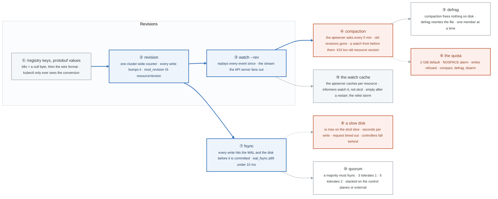

</details>

### Say it, badge by badge

- **Open.** "The API server is validation and admission in front of one key-value store with revisions and watches. Every Kubernetes behaviour you have met that felt arbitrary, resourceVersion, 410 Gone, the cluster that stops taking writes, is etcd showing through. Follow the revisions first, then the disk."
- **① keys and values.** "Objects live under `/registry/<resource>/<namespace>/<name>`, stored in protobuf because it is small and fast to decode. The JSON you see is the server converting on the way out."
- **② revision.** "One counter for the whole store, incremented by every write to any key. A key's `mod_revision` is the `resourceVersion` kubectl shows. That is why it is opaque, monotonic, and why an update with a stale one is refused: the key moved."
- **③ watch.** "A watch from a revision replays every change since it, in order. The API server opens one of these per resource and fans it out to every informer in the cluster."
- **④ compaction.** "The API server asks etcd every five minutes to discard revisions older than a point. A watch that tries to resume from before that point gets `410 Gone`, and the client relists. The error is not a bug; it is history being removed."
- **⑤ defrag.** "Compaction marks space free inside the file; the file does not shrink until defrag rewrites it, and defrag blocks the member. On three members, one at a time."
- **⑥ the quota.** "Two gibibytes by default. Past it, etcd raises NOSPACE and refuses every write, and the cluster is read-only until you compact, defrag and disarm. Three commands; know them cold."
- **⑦ fsync.** "A write is committed when it is in the write-ahead log and on the disk. The fsync histogram is the one etcd number worth alerting on: a 99th percentile over ten milliseconds is a slow disk, over a hundred is an election."
- **⑧ a slow disk.** "Limit the etcd slice to half a megabyte a second and a ConfigMap takes seconds to create, then the API server reports `request timed out`, then controllers fall behind. That is what shared or network-attached storage under etcd looks like from the outside."
- **⑨ the watch cache.** "The API server keeps a cache per resource so a thousand informers do not open a thousand etcd watches. After a control-plane restart the cache is empty, every client relists at once, and that storm is the price of the design, not a fault in your controller."
- **⑩ quorum.** "A write commits when a majority has fsynced. Three members survive one loss; five survive two; two survive none. Stacked etcd shares the control-plane nodes; external etcd separates the two failure domains."
- **Close.** "Keys, revisions, watches, compaction, defrag, quota, fsync, cache, quorum. Nine things, one store, and every one of them has a Kubernetes symptom you have already seen or will see at three in the morning."

### Numbers to own

| Number | Where it comes from | Why it matters |
|---|---|---|
| `k8s` + `\0` | the first bytes of every stored value | protobuf follows; the store is not JSON |
| 5 min | `--etcd-compaction-interval` default on the API server | who compacts, and how often |
| 410 | HTTP status for *too old resource version* | a watch resumed from before compaction or past the cache |
| 2 GiB · 8 GiB | default quota and the recommended ceiling | NOSPACE, and the three commands that clear it |
| 10 ms · 100 ms | fsync p99 thresholds, healthy and election-prone | the one etcd metric to alert on |
| 3 → 1 · 5 → 2 | members → failures tolerated | a majority must fsync; two members tolerate none |

### Prove it

```bash
sudo -E etcdctl get /registry/configmaps/default/rev -w json | jq '.kvs[0].mod_revision'; kubectl get cm rev -o jsonpath='{.metadata.resourceVersion}'   # ② the same number
sudo -E etcdctl endpoint status -w table                                                   # ④ ⑤ revision, db size, db size in use
sudo -E etcdctl alarm list                                                                 # ⑥
curl -s http://127.0.0.1:2381/metrics | grep '^etcd_disk_wal_fsync_duration_seconds_bucket{le="0.016"}'   # ⑦
kubectl get --raw '/api/v1/namespaces/default/configmaps?watch=1&resourceVersion=1&timeoutSeconds=2'      # ⑨ 410
```

### The question a senior interviewer asks

*"The cluster is refusing all writes and reads are fine. What happened and what do you do?"*
Badge ⑥, then ④ and ⑤: the backend quota was hit and the NOSPACE alarm is raised; compact to the current revision, defrag each member in turn, disarm the alarm, then find what wrote the history (events, a controller updating status in a loop). If the answer starts with "restart etcd", the follow-up is "and the alarm?"

---

## Figure 27.10 — Lab 1, the hard way: the certificate and kubeconfig fan-out

> The hard-way variant · badges ① to ⑩ · about three minutes. Rung 3 on lifecycle, and on authn, authz, admission. The subject of a certificate is the identity.

<!-- figure: generated from the Mermaid below by _shared/diagrams/embed-figures.py — do not edit the image -->
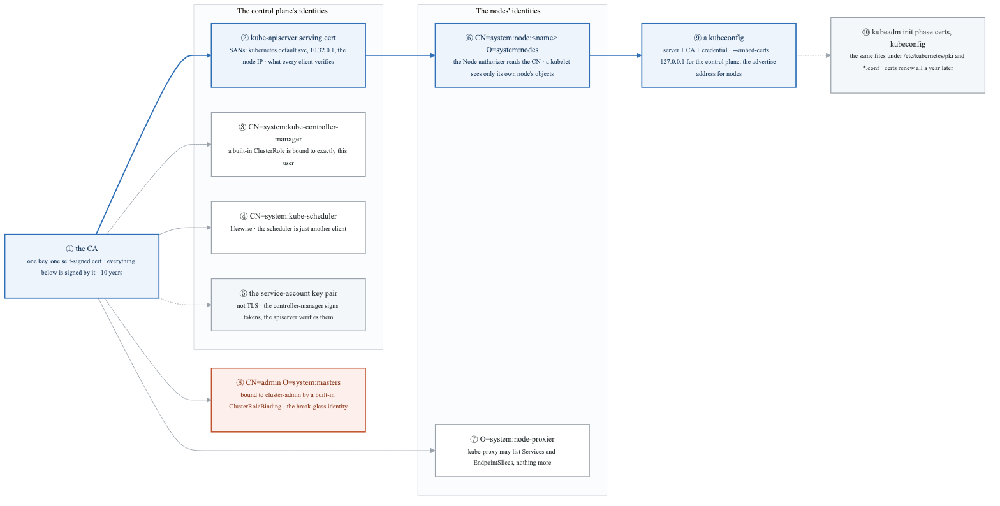

<details>
<summary>Diagram source (Mermaid)</summary>

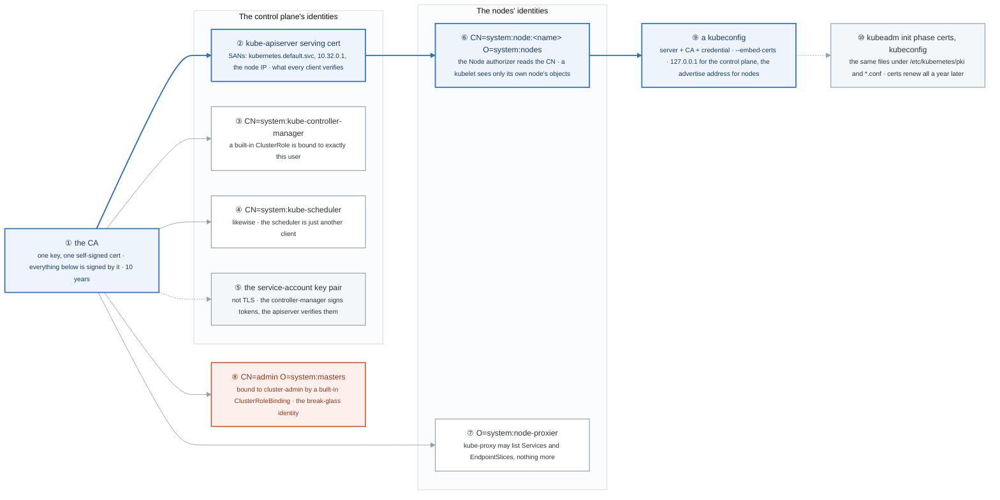

</details>

### Say it, badge by badge

- **Open.** "kubeadm prints eleven certificate lines and four kubeconfig lines in three seconds. This figure is what they mean, learned by typing them once. The sentence to keep: the subject of a certificate is the identity, and RBAC is written against those subjects."
- **① the CA.** "One key and one self-signed certificate, valid ten years. Every other certificate in the cluster is signed by it, and every component trusts the cluster because it trusts this one file."
- **② the API server's serving certificate.** "The one clients verify. Its SANs are every name the server is dialled by: `kubernetes.default.svc`, the first service address, the node address, localhost. A client that dials a name not in the list fails with x509 even though the key is right."
- **③ the controller manager.** "A client certificate whose CN is `system:kube-controller-manager`. A built-in ClusterRole is bound to that exact user, which is why the name is not a choice."
- **④ the scheduler.** "The same pattern. The scheduler is a client of the API server like any other; it is privileged only because a built-in binding names its CN."
- **⑤ the service-account key pair.** "Not a TLS certificate. The controller manager signs ServiceAccount tokens with the private key; the API server verifies them with the public one. kubeadm calls these `sa.key` and `sa.pub`, and a pod's token is worthless outside this pair."
- **⑥ the kubelets.** "CN `system:node:<name>`, O `system:nodes`. The Node authorizer, the first word in `--authorization-mode=Node,RBAC`, reads that CN and lets a kubelet touch only the pods, secrets and nodes that are its own. A stolen kubelet certificate is one node's worth of access, by design."
- **⑦ kube-proxy.** "Group `system:node-proxier`: list Services and EndpointSlices. It programs iptables from a watch and needs nothing else."
- **⑧ admin.** "Group `system:masters`, bound to `cluster-admin` by a binding you cannot remove. kubeadm keeps it in `super-admin.conf` and gives you `admin.conf` with a narrower group instead; the hard way shows you why that split exists."
- **⑨ a kubeconfig.** "Three things: a server to dial, a CA to verify it by, a credential to present. `--embed-certs` inlines the files. The control plane's configs point at `127.0.0.1` because they share the host; the nodes' point at the advertise address."
- **⑩ kubeadm.** "`init phase certs all` and `init phase kubeconfig all` write exactly these files under `/etc/kubernetes/pki` and `/etc/kubernetes/*.conf`, and `certs renew all` rewrites them with new dates a year later. Lab 2 was the renewal; this was the issuance."
- **Close.** "One CA, a serving certificate with the right names, a client certificate per component whose subject RBAC already knows, a key pair for tokens, and a kubeconfig that packages a credential with the server and the CA. kubeadm is a program that does this in order, and now you can read its output."

### Numbers to own

| Number | Where it comes from | Why it matters |
|---|---|---|
| 3653 days | the CA's validity | ten years; the one certificate you do not renew yearly |
| 365 days | every client and serving certificate | why `kubeadm certs check-expiration` exists, Lab 2 |
| `10.32.0.1` | the first service address, in the apiserver's SANs | how a pod verifies `https://kubernetes.default` |
| `Node,RBAC` | `--authorization-mode` | the Node authorizer runs first and reads `system:node:<name>` |
| 3 | things in a kubeconfig | server, CA, credential |
| 11 · 4 | certificates and kubeconfigs kubeadm prints | the lines you can now read |

### Prove it

```bash
openssl x509 -in ~/pki/k8s-w1.crt -noout -subject                                         # ⑥ CN=system:node:k8s-w1, O=system:nodes
openssl x509 -in ~/pki/kube-apiserver.crt -noout -ext subjectAltName                       # ②
kubectl --kubeconfig ~/pki/k8s-w1.kubeconfig get pods -A                                   # ⑥ Forbidden beyond its own node
kubectl --kubeconfig ~/pki/kube-proxy.kubeconfig auth can-i list endpointslices           # ⑦ yes
kubectl --kubeconfig ~/pki/admin.kubeconfig get clusterrolebinding cluster-admin -o yaml | grep system:masters   # ⑧
grep -c 'certificate-authority-data' ~/pki/admin.kubeconfig                                # ⑨ embedded
```

### The question a senior interviewer asks

*"A kubelet's client certificate leaks. What can the attacker do?"*
Badge ⑥. Read that node's pods and the secrets mounted into them, update that node's status, and nothing on any other node, because the Node authorizer scopes by the CN. Then badge ⑩: rotate it with `kubeadm certs renew` or by deleting the node's kubelet PKI and re-bootstrapping. If the answer is "everything", the certificate's subject was never read.

---

## Redraw schedule

Same cadence as the week figure, see [`../../FIGURES.md`](../../FIGURES.md): Friday of this week after break/fix, Sunday of week 29, and cold at the Gate 7 Sunday in week 30. Lab figures are redrawn **after** the week figure, one at a time, and only the badge order has to be right; the captions are the check, not the test. The Go deeper figures 27.7 to 27.10 join the cold redraw only once their labs are done; they are ladder work, not exam work.
