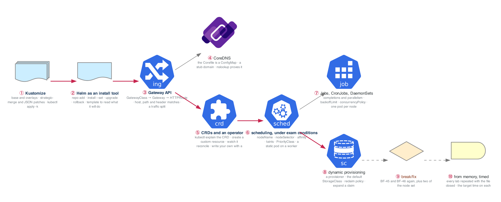

# Week 28 — CKA II: Workloads, Networking, Storage — the Gap-Fill

> **Thesis:** the February 2025 blueprint added the things a Kubernetes user in 2020 could ignore:
> Kustomize, Gateway API, CRDs and operators, dynamic provisioning. Weeks 14 to 16 touched each of
> them sideways. This week does them head-on, on the kubeadm cluster, against the clock, because the
> exam does not ask whether you understand Gateway API; it asks for a working HTTPRoute in six minutes.

| | |
|---|---|
| **Hours** | ~17 of labs, alongside the week-26 cadence (20 h interviewing, 10 h building) |
| **Deliverable** | Every object type in the Workloads, Networking and Storage domains created from memory, timed, on a cluster you built |
| **Break/Fix** | BF-45, BF-46 replayed on real nodes; BF-62, BF-63 from the node set |
| **Weights** | Services and Networking 20 % · Workloads and Scheduling 15 % · Storage 10 %: this week is 45 % of the exam |

> **Exam facts used in this module are planning estimates.** Two hours, performance-based, roughly 15
> to 20 weighted tasks, pass mark 66 percent, the Kubernetes and Helm docs open in the secure
> browser. **Confirm every one of them in the candidate handbook at registration.**

> **The cluster.** Week 27's kubeadm cluster, now at the current minor. If it is gone (nightly stop
> keeps it; `terraform destroy` does not), Lab 1 of week 27 from memory is a 25-minute warm-up, not a
> setback.

## The week in one figure

**Figure 28.1 — Everything the 2025 blueprint added, on your own cluster.** The exam blueprint was revised in 2025 to add Kustomize, Helm, Gateway API, CRDs and operators, and dynamic provisioning. Weeks 14 to 19 touched most of it; this week does each one properly, on the kubeadm cluster, and then again from memory.

**Say it, badge by badge:** [`content/FIGURE.md`](content/FIGURE.md) — the spoken script for each of the 10 badges, about three minutes; [`content/figure-28.1-numbered-spoken.pdf`](content/figure-28.1-numbered-spoken.pdf) is the printable two-page version. Read the figure before the day plan; say the script on Friday.

---

## Day plan
| Day | Focus | Lab |
|---|---|---|
| Mon | Kustomize overlays and patches; Helm as an install tool | Lab 1 |
| Tue | Gateway API end to end; CoreDNS by hand; a Service with no selector | Lab 2 |
| Wed | Interviews and applications. No lab | — |
| Thu | CRDs and an operator; write a CRD with a schema | Lab 3 |
| Fri | Workloads and scheduling under exam conditions: Jobs, DaemonSets, static pods, affinity | Lab 4 |
| Sat | Storage on kubeadm: a provisioner, a default class, Retain; Break/Fix (4 h) | Lab 5 |
| Sun | Redraw 28.2 to 28.6 cold; the week 27 figures again (two weeks out); plan week 29 | — |

## Reading map
- `_reference/kubernetes/01-foundation/03-core-workloads-exercises-04-daemonsets.md`
- `_reference/kubernetes/01-foundation/03-core-workloads-exercises-05-jobs-cronjobs.md`
- `_reference/kubernetes/02-core-ops/01-networking-deep-dive-exercises-03-services-deep-dive.md`
- `_reference/kubernetes/02-core-ops/01-networking-deep-dive-exercises-04-dns-service-discovery.md`
- `_reference/kubernetes/02-core-ops/01-networking-deep-dive-exercises-02-ingress-controllers.md` (then the Gateway API docs, because the reference predates it)
- `_reference/kubernetes/02-core-ops/02-storage-systems-exercises-02-storage-classes.md`
- `_reference/kubernetes/02-core-ops/02-storage-systems-exercises-05-csi-drivers.md`
- Week 15 Labs 2, 3, 6 and figures 15.3, 15.4, 15.7 (scheduling, storage, Helm, as first met); week 14 Lab 2 (Ingress, which Gateway API replaces)
- **Docs you must be able to find fast:** "Gateway API" under Services, Load Balancing, and Networking; "Customizing DNS Service"; "Extend the Kubernetes API with CustomResourceDefinitions"; "Jobs" and "CronJob"; "Assign Pods to Nodes"; "Dynamic Volume Provisioning"; the Kustomize page under "Managing Objects"
- **Drill:** `_shared/drills/kubectl-speed.md`, daily; from today add `kubectl create job`, `cronjob`, `--dry-run=client -o yaml` for every type in this week

## Labs
[labs/LABS.md](labs/LABS.md) · [labs/FIGURES.md](labs/FIGURES.md) (figures 28.2 to 28.9, one per lab plus the Go deeper labs) · [solutions/SOLUTIONS.md](solutions/SOLUTIONS.md) · [Kubernetes thread](../KUBERNETES-THREAD.md#week-28)

## Exit criteria
- [ ] A Kustomize base with dev and prod overlays, a strategic-merge patch and a JSON patch, applied with `-k`, from memory in 8 minutes
- [ ] A Helm chart installed from a repo with `--set`, upgraded, rolled back, and its rendered output read with `template`
- [ ] GatewayClass, Gateway, HTTPRoute with host, path and header matching and a 90/10 split, curl-proven, in 10 minutes
- [ ] CoreDNS Corefile edited and a custom name resolved from a pod
- [ ] A Service with no selector and a hand-written EndpointSlice routing to an address outside the cluster
- [ ] An operator installed with Helm, its CRD read with `kubectl explain`, a custom resource reconciled; your own CRD with a validation schema rejecting a bad object
- [ ] Job, CronJob, DaemonSet, a nodeName pod, nodeSelector, required affinity, a taint with a toleration, a PriorityClass, and a static pod on a worker, each in under 3 minutes
- [ ] A dynamic provisioner installed and made the default class; Retain demonstrated; `allowVolumeExpansion` explained from a rejected resize
