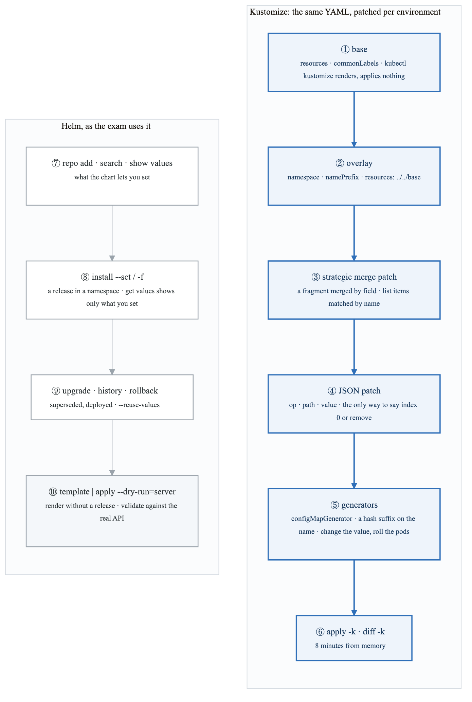
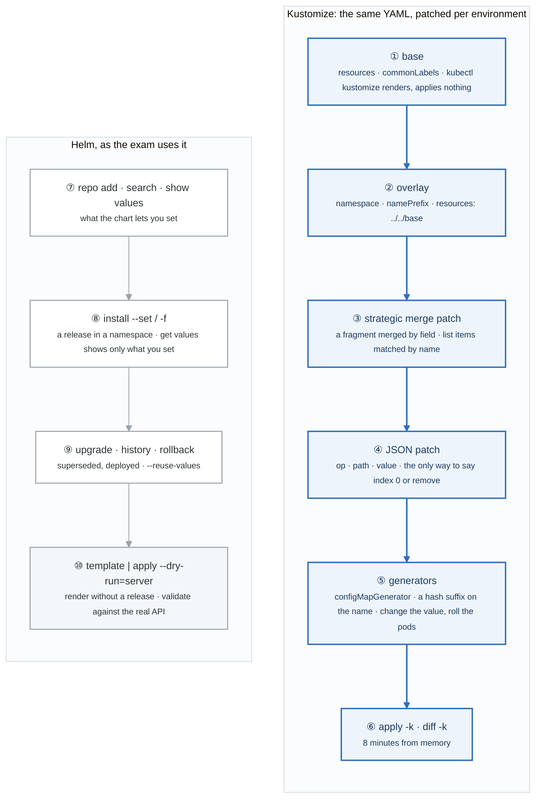
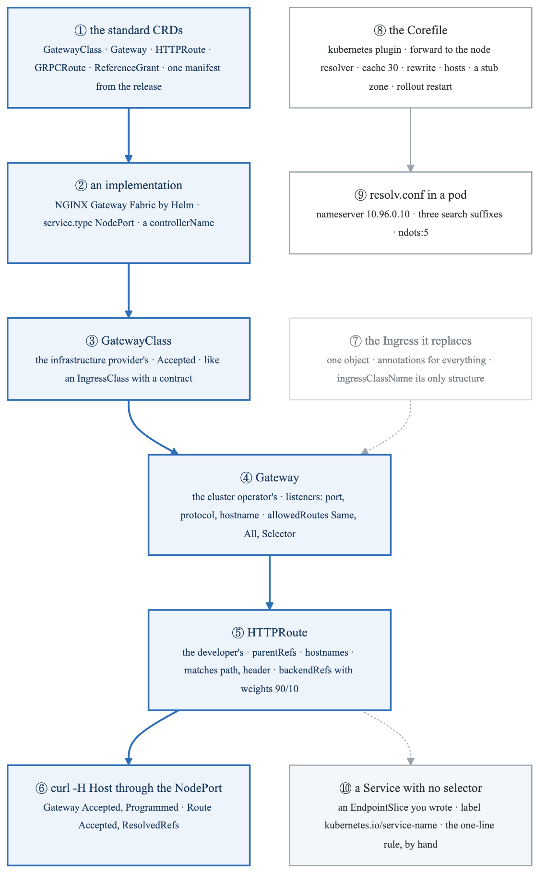
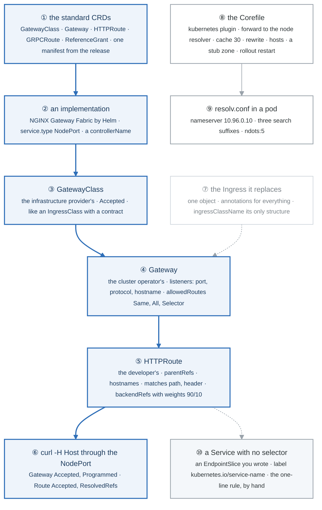
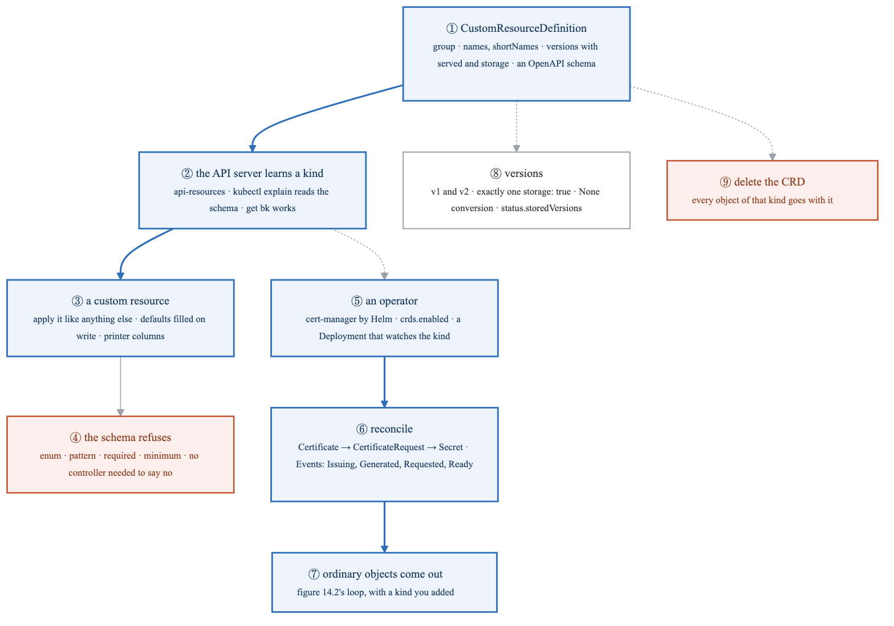
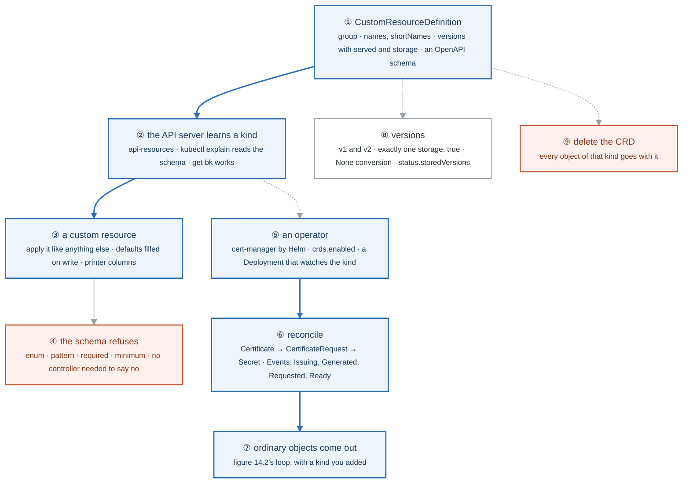
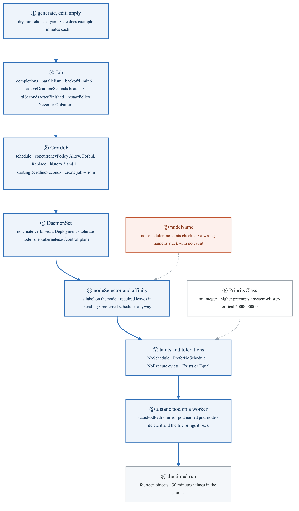
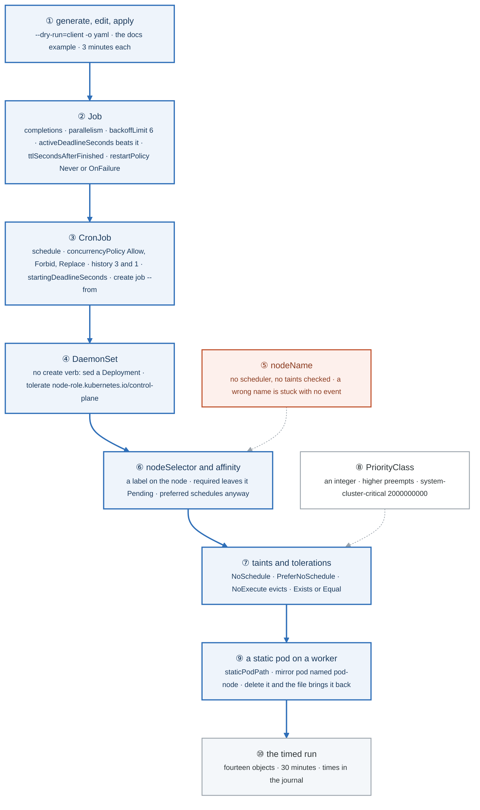
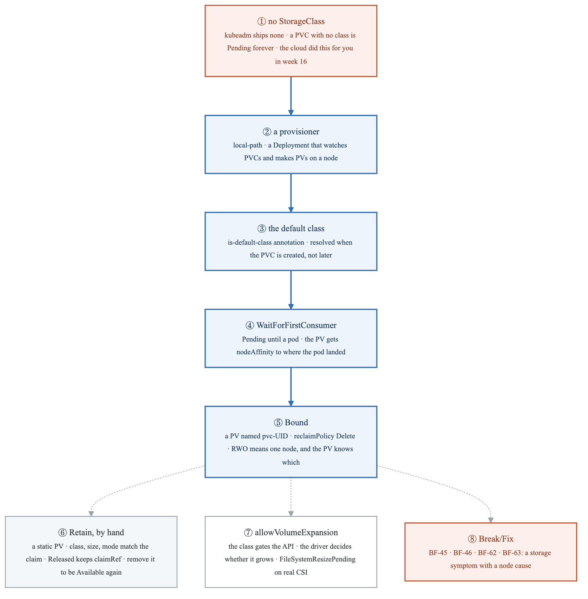
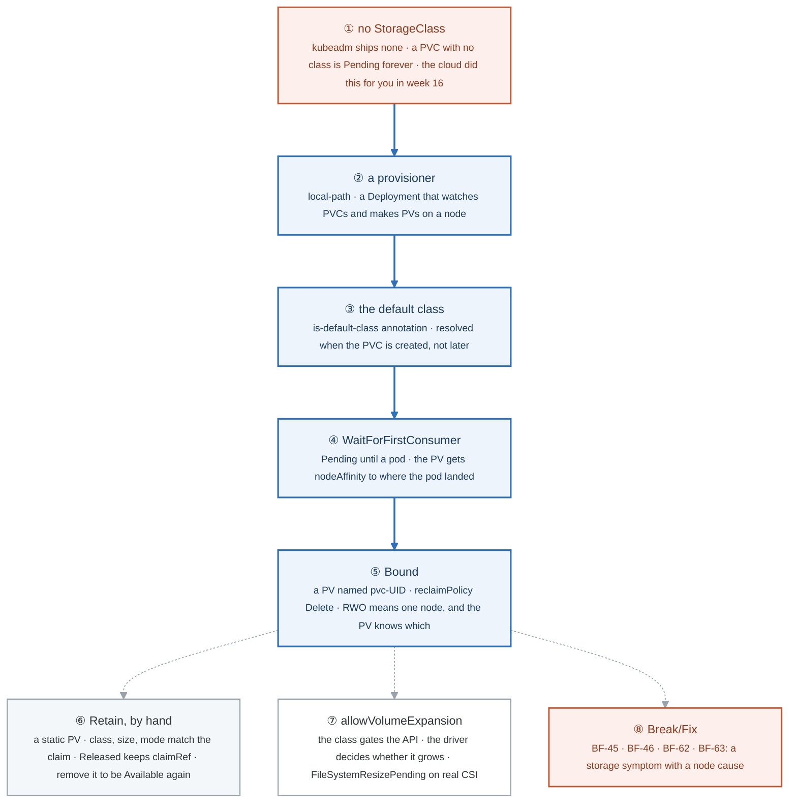

# Week 28 — Lab figures

> One figure per lab, numbered 28.2 to 28.6. Figure 28.1 is the week figure in
> [`../content/FIGURE.md`](../content/FIGURE.md); these five go one level down, to the mechanism each
> lab makes you touch. Same language: gray is structure, **blue is the path to follow first**,
> orange-red is where something refuses, washed boxes are stores. Each badge line is a thirty-second
> interview answer; each whole script is under three minutes.

**The protocol per figure**

1. **Before the lab:** read the figure, say the badges out loud once. You now know what you are about to prove.
2. **During the lab:** every badge has a **Prove it** command. Run it and watch the badge happen. A badge you cannot see happen is one you are taking on faith.
3. **After the lab:** close the file, redraw the figure, say the script. Check against the file. The badge where the order slipped goes in the *Figures redrawn* column of `progress.md`.
4. **Own the numbers.** The *Numbers to own* table is what separates "I know Jobs" from "backoffLimit defaults to six and activeDeadlineSeconds beats it."
5. **Answer the question.** Each figure ends with the question a senior interviewer asks about it. Answer it cold, in under a minute, before the gate.

---

## Figure 28.2 — Lab 1: one base, many overlays, and a chart you did not write

> Lab 1 · badges ① to ⑩ · about three minutes.

<!-- figure: generated from the Mermaid below by _shared/diagrams/embed-figures.py — do not edit the image -->


<details>
<summary>Diagram source (Mermaid)</summary>



</details>

### Say it, badge by badge

- **Open.** "Two tools, two jobs. Kustomize patches YAML you own, per environment, with no templates. Helm installs charts other people wrote. The exam asks for both in the same shape: do it in a few minutes, prove it with kubectl."
- **① base.** "Plain manifests plus a kustomization that lists them. `kubectl kustomize` renders the result to stdout and applies nothing; that is how you check before you commit."
- **② overlay.** "A directory that points at the base and says what differs: a namespace, a name prefix, patches. Dev and prod are two overlays of one base, which is week 11's dev-prod rule in Kubernetes clothing."
- **③ strategic merge patch.** "A fragment of the object. Kubernetes merges it by field name, and list items such as containers by their name key. You write what you want changed; everything else survives."
- **④ JSON patch.** "A list of operations with explicit paths. It is the only way to address a list by index, or to remove something. When the task says remove, or names the first container, this is the one."
- **⑤ generators.** "A ConfigMap or Secret built from literals or files, with a content hash appended to its name. Change the value, the name changes, the Deployment's reference changes, the pods roll. Editing a ConfigMap in place does none of that."
- **⑥ apply and diff.** "`apply -k` an overlay; `diff -k` first when you have time. Eight minutes from memory for the whole structure is the target."
- **⑦ repo, search, show values.** "Add the repository, find the chart and its versions, and read its values before you set any. `show values` is the chart's documentation."
- **⑧ install.** "A release, in a namespace, with `--set` or a values file. `helm get values` prints only what you overrode, which is what a task asks you to verify."
- **⑨ upgrade, history, rollback.** "Every upgrade is a numbered revision. History shows superseded ones and the one deployed. Rollback to a number. `--reuse-values` keeps the last overrides when you only change one."
- **⑩ template.** "Render the chart to YAML with no release, pipe it to a server-side dry run, and you have validated it against the real API without installing anything. Also how you read what a chart would do."
- **Close.** "Base, overlay, two kinds of patch, generators, apply. Repo, install, upgrade, rollback, template. Twelve minutes for both from memory, and nothing in them is typed from scratch."

### Numbers to own

| Number | Where it comes from | Why it matters |
|---|---|---|
| 2 patch kinds | Kustomize | strategic merge by field name; JSON patch by path with `op` |
| 1 hash suffix | `configMapGenerator` | the name changes with the content, so pods roll on a config change |
| 3 overlay fields used daily | `namespace` · `namePrefix` · `resources` | the skeleton of every overlay |
| revision 1 · 2 · 3 | `helm history` | `superseded` versus `deployed`; rollback targets a number |
| 0 releases from `template` | `helm template` | renders without touching the cluster |
| 8 + 4 minutes | the from-memory targets | Kustomize structure; Helm install, upgrade, rollback |

### Prove it

```bash
kubectl kustomize overlays/prod | grep -E 'replicas|image:|name: prod-'                 # ② ③ ④
kubectl -n shop-dev get cm                                                           # ⑤ app-config-<hash>
kubectl diff -k overlays/prod; kubectl apply -k overlays/prod                        # ⑥
helm get values web -n helm-demo; helm history web -n helm-demo                      # ⑧ ⑨
helm template web bitnami/nginx | kubectl apply --dry-run=server -f - | head -3      # ⑩
```

### The question a senior interviewer asks

*"Helm or Kustomize? Defend one."*
Badges ③ ④ versus ⑧ ⑩. Kustomize for YAML you own and want to diff; Helm for software you consume with a versioned, parameterised install and a rollback history. Most real clusters run both: Helm installs the operator, Kustomize patches your workloads. The wrong answer is a tool preference with no mechanism behind it.

---

## Figure 28.3 — Lab 2: three roles, one route, and the names that resolve

> Lab 2 · badges ① to ⑩ · about three and a half minutes.

<!-- figure: generated from the Mermaid below by _shared/diagrams/embed-figures.py — do not edit the image -->


<details>
<summary>Diagram source (Mermaid)</summary>



</details>

### Say it, badge by badge

- **Open.** "Ingress was one object doing three jobs. Gateway API gives each job an owner. Follow the blue path from the CRDs to a curl that proves a 90/10 split, then look at the two side mechanisms: how names resolve, and what a Service is when nobody fills its endpoints."
- **① the standard CRDs.** "Gateway API is not built in. One manifest from the project's release installs the standard channel: GatewayClass, Gateway, HTTPRoute, GRPCRoute, ReferenceGrant. Experimental channel adds more; the exam stays standard."
- **② an implementation.** "The CRDs do nothing until a controller claims them. NGINX Gateway Fabric is one Helm install and a NodePort switch, which matters on three VMs with no load balancer. Any conformant implementation reads the same Routes."
- **③ GatewayClass.** "The provider's object, cluster-scoped, naming a controller. Accepted means the controller is there. It is what IngressClass wanted to be, with a conformance contract."
- **④ Gateway.** "The operator's object: listeners with a port, a protocol, optionally a hostname, and allowedRoutes saying which namespaces may attach. Same, All, or a label selector. That field is the multi-team boundary Ingress never had."
- **⑤ HTTPRoute.** "The developer's object, in their namespace, attached by parentRefs. Hostnames, matches on path and headers, backendRefs with weights. Traffic splitting is a field, not an annotation."
- **⑥ curl through the NodePort.** "The implementation created a Service for the Gateway. Find its NodePort, send a Host header, read v1 and v2. Then the status conditions: Programmed on the Gateway, ResolvedRefs on the Route, which is what you read when it does not work."
- **⑦ the Ingress it replaces.** "Still supported, still on the exam, still one object with annotations. Know both; prefer Gateway when the task lets you."
- **⑧ the Corefile.** "CoreDNS is a ConfigMap. The kubernetes plugin answers for Services and Pods; forward sends the rest to the node's resolver; cache 30. You add rewrite, hosts, or a stub zone for a domain, and restart the Deployment to be sure."
- **⑨ resolv.conf.** "In every pod: the CoreDNS Service IP, three search suffixes, and ndots five. A lookup of a short name tries the suffixes first; a lookup of a public name with fewer than five dots tries them too, which is the ndots tax at scale."
- **⑩ a Service with no selector.** "No selector, no endpoints, until you write an EndpointSlice with the service-name label. Point it at a process outside the cluster and curl it. Then delete it, or set the wrong port, and the week 14 rule, no endpoints versus refused, becomes something you built."
- **Close.** "CRDs, an implementation, class, gateway, route, proof. Corefile and resolv.conf for names. A hand-written EndpointSlice for what a Service really is. Ten minutes for the Gateway path from memory."

### Numbers to own

| Number | Where it comes from | Why it matters |
|---|---|---|
| 3 roles | Gateway API's design | provider owns the class · operator owns the Gateway · developer owns the Route |
| 5 standard kinds | `standard-install.yaml` | GatewayClass · Gateway · HTTPRoute · GRPCRoute · ReferenceGrant |
| `90` / `10` | `backendRefs[].weight` | a canary as a field; proven with 20 curls |
| 4 status reasons | Gateway and Route conditions | Accepted · Programmed · Accepted · ResolvedRefs; the ones to read when curl fails |
| `10.96.0.10` | the CoreDNS Service | the nameserver in every pod |
| `ndots:5` · 3 suffixes | pod `resolv.conf` | up to four extra queries per public lookup |
| `cache 30` | the Corefile | how long a changed Service IP looks wrong from a pod |
| 10 + 4 minutes | the from-memory targets | Gateway path proven; the CoreDNS edit |

### Prove it

```bash
kubectl get crd | grep -c gateway.networking.k8s.io                                   # ① 5 or more
kubectl get gatewayclass                                                               # ③ Accepted True
kubectl -n web get gateway shop -o jsonpath='{.status.conditions[*].type}{"\n"}'       # ⑥ Accepted Programmed
for i in $(seq 20); do curl -s -H 'Host: shop.local' http://localhost:$NP/; done | sort | uniq -c   # ⑤ ⑥
kubectl -n kube-system get cm coredns -o jsonpath='{.data.Corefile}' | head -20       # ⑧
kubectl run -n web dns --rm -it --image=nicolaka/netshoot --restart=Never -- cat /etc/resolv.conf   # ⑨
kubectl -n web get endpointslices -l kubernetes.io/service-name=outside               # ⑩
```

### The question a senior interviewer asks

*"Why does Gateway API exist when Ingress works?"*
Badges ③ ④ ⑤ and ⑦: role separation with a namespace boundary, routing features as typed fields instead of controller annotations, and a conformance contract so a Route means the same thing on every implementation. Then say what did not change: it is still a Service behind it, and endpoints still decide whether anything answers.

---

## Figure 28.4 — Lab 3: teach the API a kind, then give it a controller

> Lab 3 · badges ① to ⑨ · about three minutes.

<!-- figure: generated from the Mermaid below by _shared/diagrams/embed-figures.py — do not edit the image -->


<details>
<summary>Diagram source (Mermaid)</summary>



</details>

### Say it, badge by badge

- **Open.** "A CRD is how Kubernetes grows. The top path is the API side: a definition, a new kind, an object, a refusal. The bottom path is the controller side: something that watches the kind and makes real objects. Operators are the two together."
- **① CustomResourceDefinition.** "A group, names including the plural and short names, a list of versions where exactly one is storage, and an OpenAPI schema. Namespaced or cluster scope. That is the whole object, and the docs page has the skeleton."
- **② the API server learns a kind.** "Apply the CRD and `api-resources` lists it, `explain` documents it from the schema, and `get` with the short name works. No restart, no code. The API server is a generic store that reads its own types."
- **③ a custom resource.** "An object of the new kind, applied like a Deployment. Defaults in the schema are filled in on write, and printer columns make `get` show the fields you chose."
- **④ the schema refuses.** "Enum, pattern, required, minimum and maximum are enforced by the API server on admission. A bad object never lands, and no controller had to exist for that to be true."
- **⑤ an operator.** "cert-manager, installed by Helm with its CRDs. It is a Deployment whose process watches Certificates and Issuers through the API, exactly as the controller manager watches Deployments."
- **⑥ reconcile.** "Create a Certificate and watch the events: the controller makes a CertificateRequest, the issuer signs it, a Secret appears holding the key and certificate. Each step is an ordinary object you can describe."
- **⑦ ordinary objects come out.** "That Secret is what your Gateway listener would reference. The operator pattern ends in built-in objects every time, which is why you can debug it with the tools you already have."
- **⑧ versions.** "Add v2, move storage to it, keep v1 served. Objects stored as v1 are returned as v2 with no conversion unless a webhook converts them. `storedVersions` in status is how the API server remembers what is on disk."
- **⑨ delete the CRD.** "Every object of that kind is deleted with it, in every namespace. Say that out loud before you type it on a cluster that matters."
- **Close.** "Define, learn, create, refuse. Install, watch, reconcile, produce. An operator is a CRD plus a loop, and after today you have read one and written the first half of one."

### Numbers to own

| Number | Where it comes from | Why it matters |
|---|---|---|
| exactly 1 `storage: true` | `spec.versions` | the version on disk; the rest are served through conversion |
| 4 schema constraints used | the Backup CRD | `required` · `enum` · `pattern` · `minimum`/`maximum`, plus a `default` |
| 3 objects in a reconcile | cert-manager | Certificate → CertificateRequest → Secret |
| 2 scopes | `spec.scope` | Namespaced or Cluster; decided at creation, immutable |
| 0 code | the API half | the schema refuses without a controller |
| 8 minutes | the from-memory target | CRD with a required field, an enum, a printer column, one accepted and one refused object |

### Prove it

```bash
kubectl get crd backups.ops.example.com -o jsonpath='{.spec.versions[*].name}{" stored="}{.status.storedVersions}{"\n"}'   # ① ⑧
kubectl api-resources --api-group=ops.example.com; kubectl explain backup.spec | head                                   # ②
kubectl -n web get bk; kubectl -n web get backup nightly -o jsonpath='{.spec.retainDays}{"\n"}'                          # ③
kubectl -n web describe certificate shop-tls | tail -6                                                                  # ⑥
kubectl -n web get secret shop-tls -o jsonpath='{.data.tls\.crt}' | base64 -d | openssl x509 -noout -subject             # ⑦
```

### The question a senior interviewer asks

*"What is an operator, mechanically, and when is a CRD without one still useful?"*
Badges ⑤ ⑥ ⑦ for the first half: a CRD plus a controller that reconciles the custom kind into built-in objects. Badge ④ for the second: a validated, versioned record the API stores and refuses badly, which is enough for configuration other tools read, with no reconciler at all.

---

## Figure 28.5 — Lab 4: fourteen objects, three minutes each

> Lab 4 · badges ① to ⑩ · about three minutes.

<!-- figure: generated from the Mermaid below by _shared/diagrams/embed-figures.py — do not edit the image -->


<details>
<summary>Diagram source (Mermaid)</summary>



</details>

### Say it, badge by badge

- **Open.** "Nothing here is new. Week 15 explained each of these. What is new is the clock: fourteen objects, three minutes each, generated and edited rather than typed. This figure is the order you run them in."
- **① generate, edit, apply.** "`kubectl create` with a client dry run and YAML output gives you a correct skeleton for anything that has a create verb. For the rest, the docs page has an example. Edit, apply, verify. Typing from memory is the slow, error-prone way to look fast."
- **② Job.** "Completions is how many successes, parallelism how many at once, backoffLimit how many failures before giving up, and activeDeadlineSeconds is a wall clock that wins over all of them. Restart policy must be Never or OnFailure. TTL cleans up afterwards."
- **③ CronJob.** "A schedule in five fields and a Job template. Forbid skips a run if the last is still going, Replace kills it. History limits keep three successes and one failure. And `create job --from=cronjob/x` runs one now, which is the exam's favourite."
- **④ DaemonSet.** "One pod per node, no create verb. Generate a Deployment and change three things. Add a toleration for the control-plane taint or it never lands there, which you will notice because the count is one short."
- **⑤ nodeName.** "A field that bypasses the scheduler entirely. No filtering, no taints, no events. A typo in the name leaves the pod Pending forever with nothing in describe, which is why it is orange."
- **⑥ nodeSelector and affinity.** "A label on the node and a matching selector on the pod. Required affinity leaves the pod Pending when nothing matches, and the event says so; preferred schedules anyway. Anti-affinity with three replicas on two nodes is the classic."
- **⑦ taints and tolerations.** "A taint repels pods without a matching toleration. NoSchedule stops new ones, PreferNoSchedule is soft, NoExecute evicts the running ones. Exists tolerates any value; Equal needs the value."
- **⑧ PriorityClass.** "An integer on a class, referenced by name. Higher preempts lower when the scheduler cannot fit it. The system classes sit at two billion so nothing you write outranks them."
- **⑨ a static pod on a worker.** "A manifest in the kubelet's staticPodPath. The mirror pod is named after the node; delete it and the file puts it back. Week 27's control plane runs this way, and the exam asks for it on a worker."
- **⑩ the timed run.** "All fourteen in a row, thirty minutes, times written down. The number trending down across the week is the evidence."
- **Close.** "Generate, Job, CronJob, DaemonSet, placement six ways, static pod. None of it is hard. All of it is timed."

### Numbers to own

| Number | Where it comes from | Why it matters |
|---|---|---|
| `backoffLimit: 6` | the Job default | failed pods before Failed, with exponential delay between |
| `3` / `1` | `successfulJobsHistoryLimit` / `failedJobsHistoryLimit` | finished Jobs a CronJob keeps |
| 5 fields | a cron schedule | minute · hour · day · month · weekday |
| 3 taint effects | `NoSchedule` · `PreferNoSchedule` · `NoExecute` | only the third touches running pods |
| `2000000000` | `system-cluster-critical` | the floor nothing user-defined outranks |
| `0` scheduler involvement | `nodeName` | no filter, no taint check, no event when wrong |
| 14 objects · 30 minutes | the timed run | three minutes each, the exam's pace |

### Prove it

```bash
kubectl create job pi --image=perl:5.34 --dry-run=client -o yaml -- perl -e 'print 1' | head -12   # ①
kubectl get job pi -o jsonpath='{.spec.backoffLimit} {.spec.completions} {.spec.parallelism}{"\n"}'  # ②
kubectl create job --from=cronjob/tick tick-now && kubectl get jobs                                   # ③
kubectl get ds -o wide; kubectl get pods -o wide | grep ds-skel                                       # ④ one per node, cp included
kubectl describe pod n5 | tail -3                                                                      # ⑦ untolerated taint
kubectl get pods | grep static-web                                                                     # ⑨ static-web-k8s-w1
```

### The question a senior interviewer asks

*"A batch job must run exactly five times, at most two at once, and give up after ten minutes no matter what. Write it."*
Badge ②: `completions: 5`, `parallelism: 2`, `activeDeadlineSeconds: 600`, `restartPolicy: OnFailure`. The follow-up is "and nightly?": badge ③, a CronJob with `concurrencyPolicy: Forbid` and that Job as the template.

---

## Figure 28.6 — Lab 5: a cluster with no storage, and what each field decides

> Lab 5 · badges ① to ⑧ · about two and a half minutes.

<!-- figure: generated from the Mermaid below by _shared/diagrams/embed-figures.py — do not edit the image -->


<details>
<summary>Diagram source (Mermaid)</summary>



</details>

### Say it, badge by badge

- **Open.** "On EKS a PVC just worked, because someone installed a CSI driver and made a default class before you arrived. kubeadm gives you nothing, which is the best way to see what each piece does. Follow the blue path from a claim that will never bind to one that does."
- **① no StorageClass.** "`get sc` is empty. A claim with no class and no matching static PV waits forever, and describe says exactly that. This is also what BF-46 looks like when the class name is wrong."
- **② a provisioner.** "A Deployment that watches for claims naming its class and creates PersistentVolumes for them: here, directories on a node. On a cloud it is a CSI driver calling an API. Same contract."
- **③ the default class.** "One annotation on one class. A claim with no class gets it, but only at creation time. The claim from badge one stays Pending; you delete it and create it again."
- **④ WaitForFirstConsumer.** "The claim stays Pending, correctly, until a pod uses it, so the volume is made where the pod is scheduled. The PV comes out with node affinity to that node."
- **⑤ Bound.** "A PV named after the claim's UID, reclaim policy Delete, bound to one claim. ReadWriteOnce means one node, and the PV's affinity says which one, which is why the pod cannot move and the second replica on another node stays Pending."
- **⑥ Retain, by hand.** "A static PV with Retain. Delete the claim and the PV goes Released, still holding the claimRef and the data. Remove the claimRef and it is Available for the next claim. Delete would have taken the data with it."
- **⑦ allowVolumeExpansion.** "A field on the class that gates whether the API accepts a bigger request. Whether the volume actually grows is the driver's business; on EBS you watch a FileSystemResizePending condition, on local-path nothing happens. Read describe either way."
- **⑧ Break/Fix.** "The four scenarios of the week, on real nodes. The last one matters most: containerd stopped on the node that holds your local volume looks like a storage failure and is a node failure."
- **Close.** "No class, a provisioner, a default, wait for the pod, bind. Retain versus Delete, and the one field that gates expansion. Fifteen minutes from memory for the build; the rest is reading describe."

### Numbers to own

| Number | Where it comes from | Why it matters |
|---|---|---|
| 0 StorageClasses | a fresh kubeadm cluster | every claim Pending until you install something |
| 1 annotation | `storageclass.kubernetes.io/is-default-class` | makes a class the default; applied at claim creation only |
| 2 binding modes | `Immediate` · `WaitForFirstConsumer` | bind now, or where the pod lands |
| 2 reclaim policies you use | `Delete` · `Retain` | data goes with the claim, or stays Released |
| 3 match conditions for a static bind | class name · size · access mode | the claim binds the first PV that satisfies all three |
| `pvc-<uid>` | a dynamically provisioned PV's name | how you find the PV behind a claim |
| 15 minutes | the from-memory target | provisioner, default, bound claim, Retain cycle |

### Prove it

```bash
kubectl get sc; kubectl describe pvc orphan | tail -2                                        # ①
kubectl -n local-path-storage get deploy                                                    # ②
kubectl get sc -o jsonpath='{.items[0].metadata.annotations}{"\n"}'                          # ③
kubectl get pvc data; kubectl get pv -o jsonpath='{.items[0].spec.nodeAffinity}{"\n"}'       # ④ ⑤
kubectl get pv keep -o jsonpath='{.status.phase} {.spec.claimRef.name}{"\n"}'                # ⑥
kubectl get sc local-path -o jsonpath='{.allowVolumeExpansion}{"\n"}'                        # ⑦
```

### The question a senior interviewer asks

*"A PVC is Pending. Give me the three reasons in the order you check them."*
Badges ① ③ ④: no class and no default, a class with no provisioner behind it (or the wrong name, BF-46), or WaitForFirstConsumer with no pod yet, which is not a problem. Then the fourth, from the week: the provisioner's node is down, which looks like storage and is BF-63.

---

## Redraw schedule

Same cadence as the week figure, see [`../../FIGURES.md`](../../FIGURES.md): Friday of this week after break/fix, Sunday of week 30 (the Gate 7 Sunday, so this one is cold), and the week 27 figures again this Sunday. Lab figures are redrawn **after** the week figure, one at a time, and only the badge order has to be right; the captions are the check, not the test.
