# Week 28 — Lab figures

> One figure per lab, numbered 28.2 to 28.6, then 28.7 to 28.10 for the four "Go deeper" labs of the
> mastery ladder. Figure 28.1 is the week figure in
> [`../content/FIGURE.md`](../content/FIGURE.md); these go one level down, to the mechanism each
> lab makes you touch. Same language: gray is structure, **blue is the path to follow first**,
> orange-red is where something refuses, washed boxes are stores. Each badge line is a thirty-second
> interview answer; each whole script is under three minutes.

**The protocol per figure**

1. **Before the lab:** read the figure, say the badges out loud once. You now know what you are about to prove.
2. **During the lab:** every badge has a **Prove it** command. Run it and watch the badge happen. A badge you cannot see happen is one you are taking on faith.
3. **After the lab:** close the file, redraw the figure, say the script. Check against the file. The badge where the order slipped goes in the *Figures redrawn* column of `progress.md`.
4. **Own the numbers.** The *Numbers to own* table is what separates "I know Jobs" from "backoffLimit defaults to six and activeDeadlineSeconds beats it."
5. **Answer the question.** Each figure ends with the question a senior interviewer asks about it. Answer it cold, in under a minute, before the gate.

---

## Figure 28.2 — Lab 1: one base, many overlays, and a chart you did not write

> Lab 1 · badges ① to ⑩ · about three minutes.

<!-- figure: generated from the Mermaid below by _shared/diagrams/embed-figures.py — do not edit the image -->


<details>
<summary>Diagram source (Mermaid)</summary>

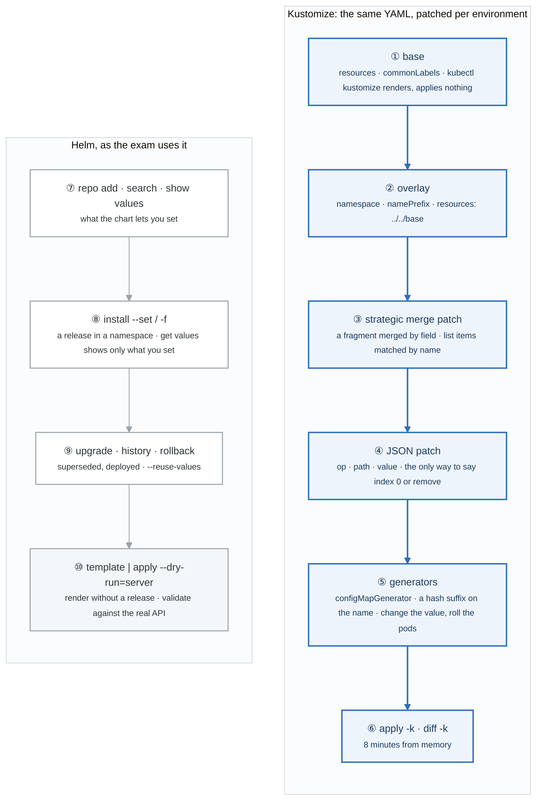

</details>

### Say it, badge by badge

- **Open.** "Two tools, two jobs. Kustomize patches YAML you own, per environment, with no templates. Helm installs charts other people wrote. The exam asks for both in the same shape: do it in a few minutes, prove it with kubectl."
- **① base.** "Plain manifests plus a kustomization that lists them. `kubectl kustomize` renders the result to stdout and applies nothing; that is how you check before you commit."
- **② overlay.** "A directory that points at the base and says what differs: a namespace, a name prefix, patches. Dev and prod are two overlays of one base, which is week 11's dev-prod rule in Kubernetes clothing."
- **③ strategic merge patch.** "A fragment of the object. Kubernetes merges it by field name, and list items such as containers by their name key. You write what you want changed; everything else survives."
- **④ JSON patch.** "A list of operations with explicit paths. It is the only way to address a list by index, or to remove something. When the task says remove, or names the first container, this is the one."
- **⑤ generators.** "A ConfigMap or Secret built from literals or files, with a content hash appended to its name. Change the value, the name changes, the Deployment's reference changes, the pods roll. Editing a ConfigMap in place does none of that."
- **⑥ apply and diff.** "`apply -k` an overlay; `diff -k` first when you have time. Eight minutes from memory for the whole structure is the target."
- **⑦ repo, search, show values.** "Add the repository, find the chart and its versions, and read its values before you set any. `show values` is the chart's documentation."
- **⑧ install.** "A release, in a namespace, with `--set` or a values file. `helm get values` prints only what you overrode, which is what a task asks you to verify."
- **⑨ upgrade, history, rollback.** "Every upgrade is a numbered revision. History shows superseded ones and the one deployed. Rollback to a number. `--reuse-values` keeps the last overrides when you only change one."
- **⑩ template.** "Render the chart to YAML with no release, pipe it to a server-side dry run, and you have validated it against the real API without installing anything. Also how you read what a chart would do."
- **Close.** "Base, overlay, two kinds of patch, generators, apply. Repo, install, upgrade, rollback, template. Twelve minutes for both from memory, and nothing in them is typed from scratch."

### Numbers to own

| Number | Where it comes from | Why it matters |
|---|---|---|
| 2 patch kinds | Kustomize | strategic merge by field name; JSON patch by path with `op` |
| 1 hash suffix | `configMapGenerator` | the name changes with the content, so pods roll on a config change |
| 3 overlay fields used daily | `namespace` · `namePrefix` · `resources` | the skeleton of every overlay |
| revision 1 · 2 · 3 | `helm history` | `superseded` versus `deployed`; rollback targets a number |
| 0 releases from `template` | `helm template` | renders without touching the cluster |
| 8 + 4 minutes | the from-memory targets | Kustomize structure; Helm install, upgrade, rollback |

### Prove it

```bash
kubectl kustomize overlays/prod | grep -E 'replicas|image:|name: prod-'                 # ② ③ ④
kubectl -n shop-dev get cm                                                           # ⑤ app-config-<hash>
kubectl diff -k overlays/prod; kubectl apply -k overlays/prod                        # ⑥
helm get values web -n helm-demo; helm history web -n helm-demo                      # ⑧ ⑨
helm template web bitnami/nginx | kubectl apply --dry-run=server -f - | head -3      # ⑩
```

### The question a senior interviewer asks

*"Helm or Kustomize? Defend one."*
Badges ③ ④ versus ⑧ ⑩. Kustomize for YAML you own and want to diff; Helm for software you consume with a versioned, parameterised install and a rollback history. Most real clusters run both: Helm installs the operator, Kustomize patches your workloads. The wrong answer is a tool preference with no mechanism behind it.

---

## Figure 28.3 — Lab 2: three roles, one route, and the names that resolve

> Lab 2 · badges ① to ⑩ · about three and a half minutes.

<!-- figure: generated from the Mermaid below by _shared/diagrams/embed-figures.py — do not edit the image -->


<details>
<summary>Diagram source (Mermaid)</summary>

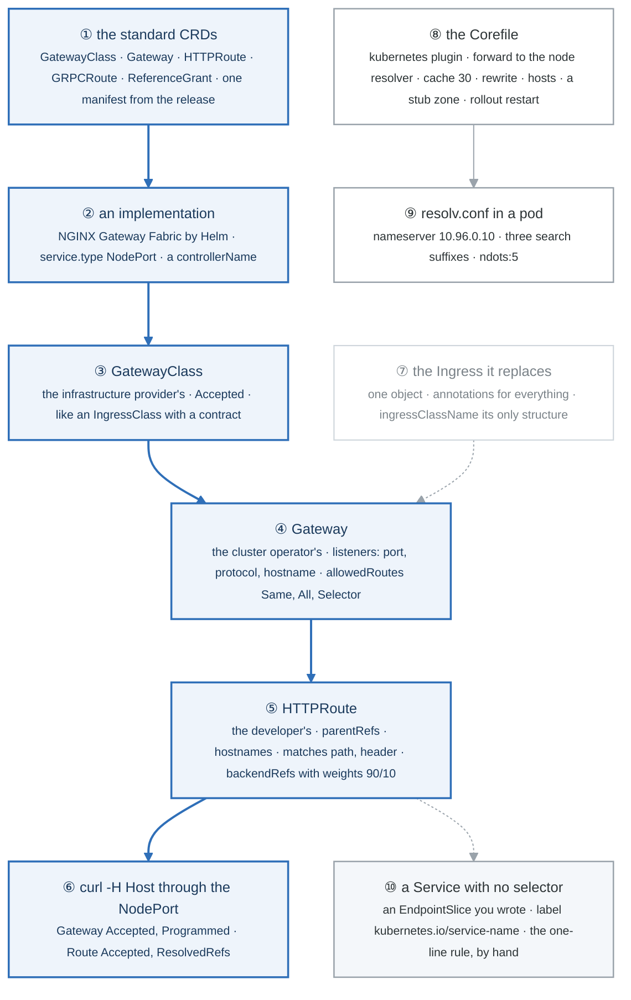

</details>

### Say it, badge by badge

- **Open.** "Ingress was one object doing three jobs. Gateway API gives each job an owner. Follow the blue path from the CRDs to a curl that proves a 90/10 split, then look at the two side mechanisms: how names resolve, and what a Service is when nobody fills its endpoints."
- **① the standard CRDs.** "Gateway API is not built in. One manifest from the project's release installs the standard channel: GatewayClass, Gateway, HTTPRoute, GRPCRoute, ReferenceGrant. Experimental channel adds more; the exam stays standard."
- **② an implementation.** "The CRDs do nothing until a controller claims them. NGINX Gateway Fabric is one Helm install and a NodePort switch, which matters on three VMs with no load balancer. Any conformant implementation reads the same Routes."
- **③ GatewayClass.** "The provider's object, cluster-scoped, naming a controller. Accepted means the controller is there. It is what IngressClass wanted to be, with a conformance contract."
- **④ Gateway.** "The operator's object: listeners with a port, a protocol, optionally a hostname, and allowedRoutes saying which namespaces may attach. Same, All, or a label selector. That field is the multi-team boundary Ingress never had."
- **⑤ HTTPRoute.** "The developer's object, in their namespace, attached by parentRefs. Hostnames, matches on path and headers, backendRefs with weights. Traffic splitting is a field, not an annotation."
- **⑥ curl through the NodePort.** "The implementation created a Service for the Gateway. Find its NodePort, send a Host header, read v1 and v2. Then the status conditions: Programmed on the Gateway, ResolvedRefs on the Route, which is what you read when it does not work."
- **⑦ the Ingress it replaces.** "Still supported, still on the exam, still one object with annotations. Know both; prefer Gateway when the task lets you."
- **⑧ the Corefile.** "CoreDNS is a ConfigMap. The kubernetes plugin answers for Services and Pods; forward sends the rest to the node's resolver; cache 30. You add rewrite, hosts, or a stub zone for a domain, and restart the Deployment to be sure."
- **⑨ resolv.conf.** "In every pod: the CoreDNS Service IP, three search suffixes, and ndots five. A lookup of a short name tries the suffixes first; a lookup of a public name with fewer than five dots tries them too, which is the ndots tax at scale."
- **⑩ a Service with no selector.** "No selector, no endpoints, until you write an EndpointSlice with the service-name label. Point it at a process outside the cluster and curl it. Then delete it, or set the wrong port, and the week 14 rule, no endpoints versus refused, becomes something you built."
- **Close.** "CRDs, an implementation, class, gateway, route, proof. Corefile and resolv.conf for names. A hand-written EndpointSlice for what a Service really is. Ten minutes for the Gateway path from memory."

### Numbers to own

| Number | Where it comes from | Why it matters |
|---|---|---|
| 3 roles | Gateway API's design | provider owns the class · operator owns the Gateway · developer owns the Route |
| 5 standard kinds | `standard-install.yaml` | GatewayClass · Gateway · HTTPRoute · GRPCRoute · ReferenceGrant |
| `90` / `10` | `backendRefs[].weight` | a canary as a field; proven with 20 curls |
| 4 status reasons | Gateway and Route conditions | Accepted · Programmed · Accepted · ResolvedRefs; the ones to read when curl fails |
| `10.96.0.10` | the CoreDNS Service | the nameserver in every pod |
| `ndots:5` · 3 suffixes | pod `resolv.conf` | up to four extra queries per public lookup |
| `cache 30` | the Corefile | how long a changed Service IP looks wrong from a pod |
| 10 + 4 minutes | the from-memory targets | Gateway path proven; the CoreDNS edit |

### Prove it

```bash
kubectl get crd | grep -c gateway.networking.k8s.io                                   # ① 5 or more
kubectl get gatewayclass                                                               # ③ Accepted True
kubectl -n web get gateway shop -o jsonpath='{.status.conditions[*].type}{"\n"}'       # ⑥ Accepted Programmed
for i in $(seq 20); do curl -s -H 'Host: shop.local' http://localhost:$NP/; done | sort | uniq -c   # ⑤ ⑥
kubectl -n kube-system get cm coredns -o jsonpath='{.data.Corefile}' | head -20       # ⑧
kubectl run -n web dns --rm -it --image=nicolaka/netshoot --restart=Never -- cat /etc/resolv.conf   # ⑨
kubectl -n web get endpointslices -l kubernetes.io/service-name=outside               # ⑩
```

### The question a senior interviewer asks

*"Why does Gateway API exist when Ingress works?"*
Badges ③ ④ ⑤ and ⑦: role separation with a namespace boundary, routing features as typed fields instead of controller annotations, and a conformance contract so a Route means the same thing on every implementation. Then say what did not change: it is still a Service behind it, and endpoints still decide whether anything answers.

---

## Figure 28.4 — Lab 3: teach the API a kind, then give it a controller

> Lab 3 · badges ① to ⑨ · about three minutes.

<!-- figure: generated from the Mermaid below by _shared/diagrams/embed-figures.py — do not edit the image -->


<details>
<summary>Diagram source (Mermaid)</summary>

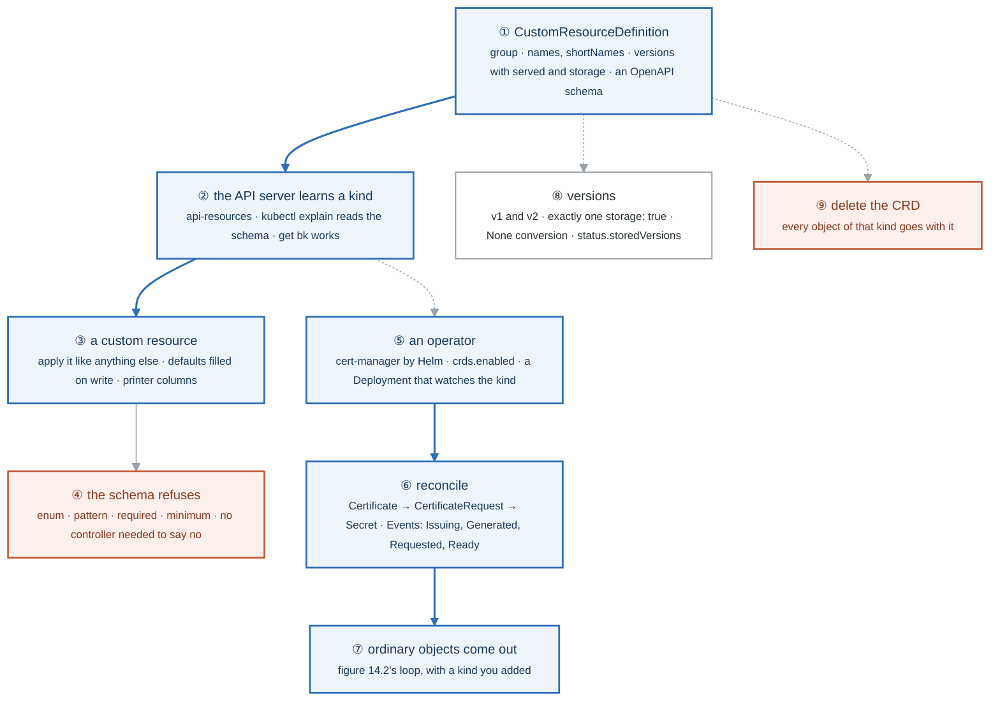

</details>

### Say it, badge by badge

- **Open.** "A CRD is how Kubernetes grows. The top path is the API side: a definition, a new kind, an object, a refusal. The bottom path is the controller side: something that watches the kind and makes real objects. Operators are the two together."
- **① CustomResourceDefinition.** "A group, names including the plural and short names, a list of versions where exactly one is storage, and an OpenAPI schema. Namespaced or cluster scope. That is the whole object, and the docs page has the skeleton."
- **② the API server learns a kind.** "Apply the CRD and `api-resources` lists it, `explain` documents it from the schema, and `get` with the short name works. No restart, no code. The API server is a generic store that reads its own types."
- **③ a custom resource.** "An object of the new kind, applied like a Deployment. Defaults in the schema are filled in on write, and printer columns make `get` show the fields you chose."
- **④ the schema refuses.** "Enum, pattern, required, minimum and maximum are enforced by the API server on admission. A bad object never lands, and no controller had to exist for that to be true."
- **⑤ an operator.** "cert-manager, installed by Helm with its CRDs. It is a Deployment whose process watches Certificates and Issuers through the API, exactly as the controller manager watches Deployments."
- **⑥ reconcile.** "Create a Certificate and watch the events: the controller makes a CertificateRequest, the issuer signs it, a Secret appears holding the key and certificate. Each step is an ordinary object you can describe."
- **⑦ ordinary objects come out.** "That Secret is what your Gateway listener would reference. The operator pattern ends in built-in objects every time, which is why you can debug it with the tools you already have."
- **⑧ versions.** "Add v2, move storage to it, keep v1 served. Objects stored as v1 are returned as v2 with no conversion unless a webhook converts them. `storedVersions` in status is how the API server remembers what is on disk."
- **⑨ delete the CRD.** "Every object of that kind is deleted with it, in every namespace. Say that out loud before you type it on a cluster that matters."
- **Close.** "Define, learn, create, refuse. Install, watch, reconcile, produce. An operator is a CRD plus a loop, and after today you have read one and written the first half of one."

### Numbers to own

| Number | Where it comes from | Why it matters |
|---|---|---|
| exactly 1 `storage: true` | `spec.versions` | the version on disk; the rest are served through conversion |
| 4 schema constraints used | the Backup CRD | `required` · `enum` · `pattern` · `minimum`/`maximum`, plus a `default` |
| 3 objects in a reconcile | cert-manager | Certificate → CertificateRequest → Secret |
| 2 scopes | `spec.scope` | Namespaced or Cluster; decided at creation, immutable |
| 0 code | the API half | the schema refuses without a controller |
| 8 minutes | the from-memory target | CRD with a required field, an enum, a printer column, one accepted and one refused object |

### Prove it

```bash
kubectl get crd backups.ops.example.com -o jsonpath='{.spec.versions[*].name}{" stored="}{.status.storedVersions}{"\n"}'   # ① ⑧
kubectl api-resources --api-group=ops.example.com; kubectl explain backup.spec | head                                   # ②
kubectl -n web get bk; kubectl -n web get backup nightly -o jsonpath='{.spec.retainDays}{"\n"}'                          # ③
kubectl -n web describe certificate shop-tls | tail -6                                                                  # ⑥
kubectl -n web get secret shop-tls -o jsonpath='{.data.tls\.crt}' | base64 -d | openssl x509 -noout -subject             # ⑦
```

### The question a senior interviewer asks

*"What is an operator, mechanically, and when is a CRD without one still useful?"*
Badges ⑤ ⑥ ⑦ for the first half: a CRD plus a controller that reconciles the custom kind into built-in objects. Badge ④ for the second: a validated, versioned record the API stores and refuses badly, which is enough for configuration other tools read, with no reconciler at all.

---

## Figure 28.5 — Lab 4: fourteen objects, three minutes each

> Lab 4 · badges ① to ⑩ · about three minutes.

<!-- figure: generated from the Mermaid below by _shared/diagrams/embed-figures.py — do not edit the image -->


<details>
<summary>Diagram source (Mermaid)</summary>

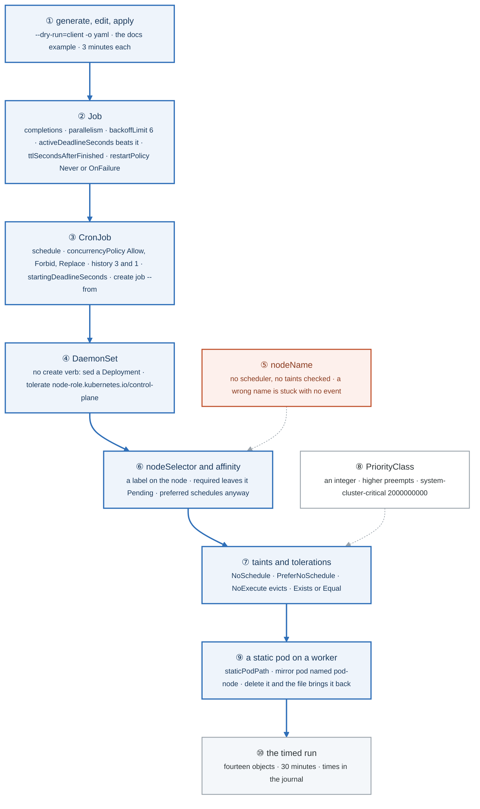

</details>

### Say it, badge by badge

- **Open.** "Nothing here is new. Week 15 explained each of these. What is new is the clock: fourteen objects, three minutes each, generated and edited rather than typed. This figure is the order you run them in."
- **① generate, edit, apply.** "`kubectl create` with a client dry run and YAML output gives you a correct skeleton for anything that has a create verb. For the rest, the docs page has an example. Edit, apply, verify. Typing from memory is the slow, error-prone way to look fast."
- **② Job.** "Completions is how many successes, parallelism how many at once, backoffLimit how many failures before giving up, and activeDeadlineSeconds is a wall clock that wins over all of them. Restart policy must be Never or OnFailure. TTL cleans up afterwards."
- **③ CronJob.** "A schedule in five fields and a Job template. Forbid skips a run if the last is still going, Replace kills it. History limits keep three successes and one failure. And `create job --from=cronjob/x` runs one now, which is the exam's favourite."
- **④ DaemonSet.** "One pod per node, no create verb. Generate a Deployment and change three things. Add a toleration for the control-plane taint or it never lands there, which you will notice because the count is one short."
- **⑤ nodeName.** "A field that bypasses the scheduler entirely. No filtering, no taints, no events. A typo in the name leaves the pod Pending forever with nothing in describe, which is why it is orange."
- **⑥ nodeSelector and affinity.** "A label on the node and a matching selector on the pod. Required affinity leaves the pod Pending when nothing matches, and the event says so; preferred schedules anyway. Anti-affinity with three replicas on two nodes is the classic."
- **⑦ taints and tolerations.** "A taint repels pods without a matching toleration. NoSchedule stops new ones, PreferNoSchedule is soft, NoExecute evicts the running ones. Exists tolerates any value; Equal needs the value."
- **⑧ PriorityClass.** "An integer on a class, referenced by name. Higher preempts lower when the scheduler cannot fit it. The system classes sit at two billion so nothing you write outranks them."
- **⑨ a static pod on a worker.** "A manifest in the kubelet's staticPodPath. The mirror pod is named after the node; delete it and the file puts it back. Week 27's control plane runs this way, and the exam asks for it on a worker."
- **⑩ the timed run.** "All fourteen in a row, thirty minutes, times written down. The number trending down across the week is the evidence."
- **Close.** "Generate, Job, CronJob, DaemonSet, placement six ways, static pod. None of it is hard. All of it is timed."

### Numbers to own

| Number | Where it comes from | Why it matters |
|---|---|---|
| `backoffLimit: 6` | the Job default | failed pods before Failed, with exponential delay between |
| `3` / `1` | `successfulJobsHistoryLimit` / `failedJobsHistoryLimit` | finished Jobs a CronJob keeps |
| 5 fields | a cron schedule | minute · hour · day · month · weekday |
| 3 taint effects | `NoSchedule` · `PreferNoSchedule` · `NoExecute` | only the third touches running pods |
| `2000000000` | `system-cluster-critical` | the floor nothing user-defined outranks |
| `0` scheduler involvement | `nodeName` | no filter, no taint check, no event when wrong |
| 14 objects · 30 minutes | the timed run | three minutes each, the exam's pace |

### Prove it

```bash
kubectl create job pi --image=perl:5.34 --dry-run=client -o yaml -- perl -e 'print 1' | head -12   # ①
kubectl get job pi -o jsonpath='{.spec.backoffLimit} {.spec.completions} {.spec.parallelism}{"\n"}'  # ②
kubectl create job --from=cronjob/tick tick-now && kubectl get jobs                                   # ③
kubectl get ds -o wide; kubectl get pods -o wide | grep ds-skel                                       # ④ one per node, cp included
kubectl describe pod n5 | tail -3                                                                      # ⑦ untolerated taint
kubectl get pods | grep static-web                                                                     # ⑨ static-web-k8s-w1
```

### The question a senior interviewer asks

*"A batch job must run exactly five times, at most two at once, and give up after ten minutes no matter what. Write it."*
Badge ②: `completions: 5`, `parallelism: 2`, `activeDeadlineSeconds: 600`, `restartPolicy: OnFailure`. The follow-up is "and nightly?": badge ③, a CronJob with `concurrencyPolicy: Forbid` and that Job as the template.

---

## Figure 28.6 — Lab 5: a cluster with no storage, and what each field decides

> Lab 5 · badges ① to ⑧ · about two and a half minutes.

<!-- figure: generated from the Mermaid below by _shared/diagrams/embed-figures.py — do not edit the image -->


<details>
<summary>Diagram source (Mermaid)</summary>

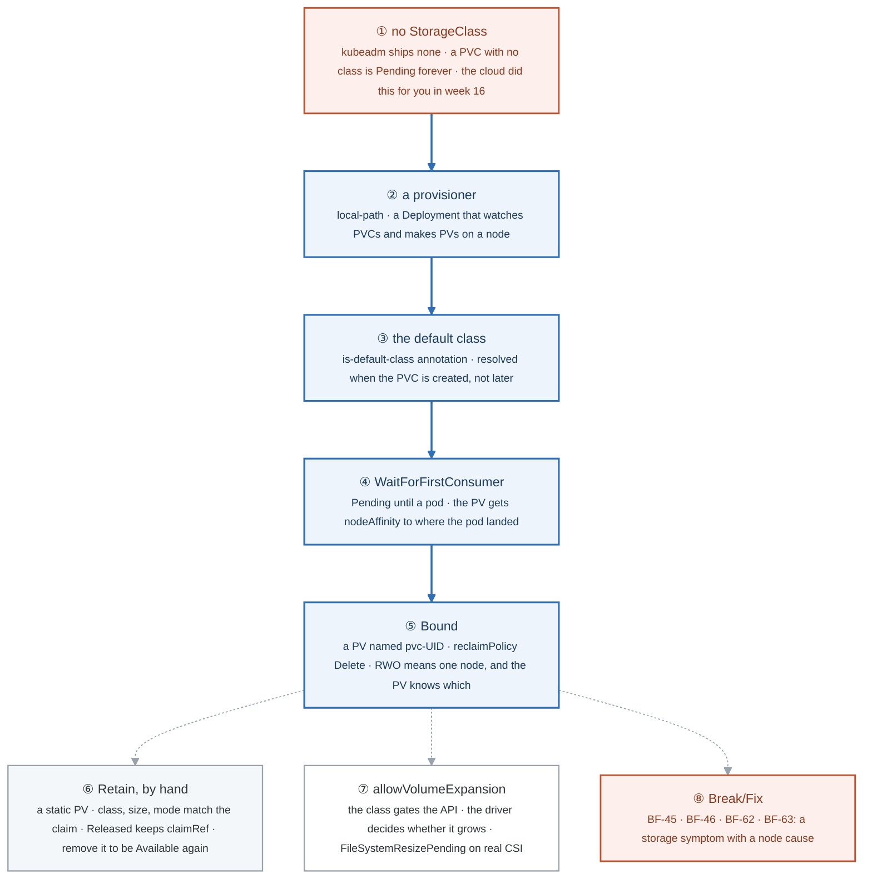

</details>

### Say it, badge by badge

- **Open.** "On EKS a PVC just worked, because someone installed a CSI driver and made a default class before you arrived. kubeadm gives you nothing, which is the best way to see what each piece does. Follow the blue path from a claim that will never bind to one that does."
- **① no StorageClass.** "`get sc` is empty. A claim with no class and no matching static PV waits forever, and describe says exactly that. This is also what BF-46 looks like when the class name is wrong."
- **② a provisioner.** "A Deployment that watches for claims naming its class and creates PersistentVolumes for them: here, directories on a node. On a cloud it is a CSI driver calling an API. Same contract."
- **③ the default class.** "One annotation on one class. A claim with no class gets it, but only at creation time. The claim from badge one stays Pending; you delete it and create it again."
- **④ WaitForFirstConsumer.** "The claim stays Pending, correctly, until a pod uses it, so the volume is made where the pod is scheduled. The PV comes out with node affinity to that node."
- **⑤ Bound.** "A PV named after the claim's UID, reclaim policy Delete, bound to one claim. ReadWriteOnce means one node, and the PV's affinity says which one, which is why the pod cannot move and the second replica on another node stays Pending."
- **⑥ Retain, by hand.** "A static PV with Retain. Delete the claim and the PV goes Released, still holding the claimRef and the data. Remove the claimRef and it is Available for the next claim. Delete would have taken the data with it."
- **⑦ allowVolumeExpansion.** "A field on the class that gates whether the API accepts a bigger request. Whether the volume actually grows is the driver's business; on EBS you watch a FileSystemResizePending condition, on local-path nothing happens. Read describe either way."
- **⑧ Break/Fix.** "The four scenarios of the week, on real nodes. The last one matters most: containerd stopped on the node that holds your local volume looks like a storage failure and is a node failure."
- **Close.** "No class, a provisioner, a default, wait for the pod, bind. Retain versus Delete, and the one field that gates expansion. Fifteen minutes from memory for the build; the rest is reading describe."

### Numbers to own

| Number | Where it comes from | Why it matters |
|---|---|---|
| 0 StorageClasses | a fresh kubeadm cluster | every claim Pending until you install something |
| 1 annotation | `storageclass.kubernetes.io/is-default-class` | makes a class the default; applied at claim creation only |
| 2 binding modes | `Immediate` · `WaitForFirstConsumer` | bind now, or where the pod lands |
| 2 reclaim policies you use | `Delete` · `Retain` | data goes with the claim, or stays Released |
| 3 match conditions for a static bind | class name · size · access mode | the claim binds the first PV that satisfies all three |
| `pvc-<uid>` | a dynamically provisioned PV's name | how you find the PV behind a claim |
| 15 minutes | the from-memory target | provisioner, default, bound claim, Retain cycle |

### Prove it

```bash
kubectl get sc; kubectl describe pvc orphan | tail -2                                        # ①
kubectl -n local-path-storage get deploy                                                    # ②
kubectl get sc -o jsonpath='{.items[0].metadata.annotations}{"\n"}'                          # ③
kubectl get pvc data; kubectl get pv -o jsonpath='{.items[0].spec.nodeAffinity}{"\n"}'       # ④ ⑤
kubectl get pv keep -o jsonpath='{.status.phase} {.spec.claimRef.name}{"\n"}'                # ⑥
kubectl get sc local-path -o jsonpath='{.allowVolumeExpansion}{"\n"}'                        # ⑦
```

### The question a senior interviewer asks

*"A PVC is Pending. Give me the three reasons in the order you check them."*
Badges ① ③ ④: no class and no default, a class with no provisioner behind it (or the wrong name, BF-46), or WaitForFirstConsumer with no pod yet, which is not a problem. Then the fourth, from the week: the provisioner's node is down, which looks like storage and is BF-63.

---

## Figure 28.7 — Go deeper: the controller you wrote, part by part

> Go deeper, controllers · badges ① to ⑪ · about three and a half minutes. This figure reads top-down.

<!-- figure: generated from the Mermaid below by _shared/diagrams/embed-figures.py — do not edit the image -->


<details>
<summary>Diagram source (Mermaid)</summary>

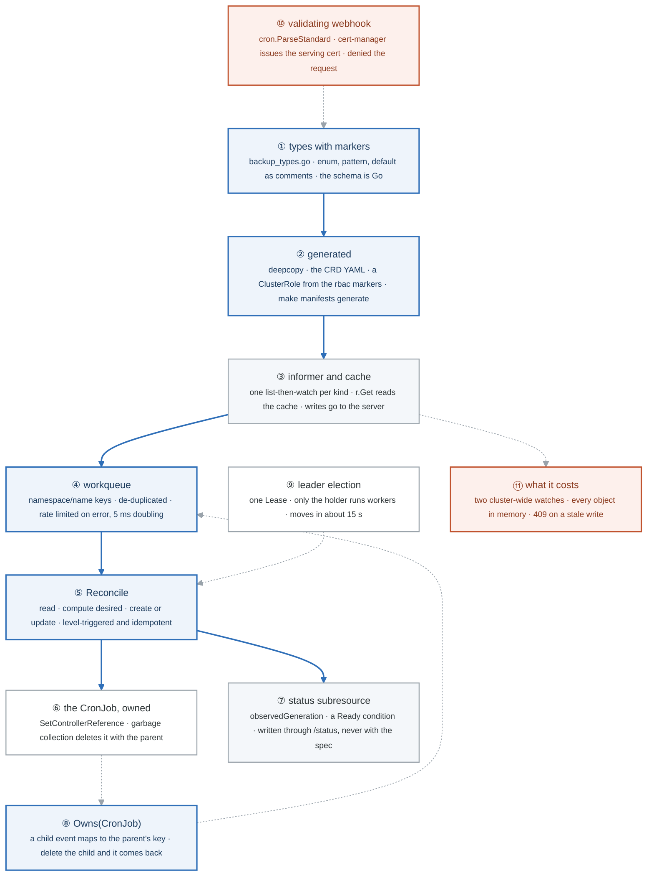

</details>

### Say it, badge by badge

- **Open.** "Lab 3 watched cert-manager reconcile. This is the same loop with your name on it: a kind, a controller, a child it owns, status it reports, a lease so two copies do not fight, and a webhook for what the schema cannot say. Eleven parts, every one of them in every real operator."
- **① types with markers.** "The schema is a Go struct. The enum, the pattern, the default and the printer columns are comments above the fields, and the CRD you wrote by hand in Lab 3 is now generated from them. Change a field, regenerate, the API server learns it."
- **② generated.** "DeepCopy, so the cache can hand you a copy you cannot corrupt. The CRD YAML. A ClusterRole from the rbac markers, which is week 15 Lab 4 applied to a program instead of a person. None of it is typed."
- **③ informer and cache.** "Your reads never hit the API server. The manager opened one list-then-watch per kind and keeps every object in memory; r.Get answers from there. Cheap at steady state, expensive at startup, and the reason a thousand controllers listing pods is a scaling problem."
- **④ workqueue.** "Every watch event becomes a key, namespace slash name, on a queue that de-duplicates. Ten edits while you are busy are one reconcile. An error puts the key back with exponential backoff, five milliseconds doubling, so a bad object cannot hammer the server."
- **⑤ Reconcile.** "Given a key, read the object, compute what should exist, compare with what does, create or update, return. It does not know why it was called, so it reads the current state, not the event. Level-triggered. Run it twice and the second run changes nothing. Idempotent. Those two words are the whole discipline."
- **⑥ the CronJob, owned.** "The child carries an owner reference to the Backup. Delete the Backup and garbage collection deletes the CronJob; your code never handles deletion at all. That is why the not-found branch just returns."
- **⑦ status subresource.** "observedGeneration says which spec you acted on; a Ready condition says how it went. Written through the /status endpoint, which is why a kubectl apply of the spec cannot clobber it and why two writers never fight."
- **⑧ Owns.** "A second watch, on CronJobs, mapped back to the owning Backup. Delete the CronJob by hand and the Backup is reconciled and recreates it. Without Owns you created it once; with Owns you keep it existing, and that is what controller means."
- **⑨ leader election.** "Two replicas, one Lease. The holder runs workers; the other keeps its cache warm and waits. Kill the holder and the Lease moves in about fifteen seconds. kube-system has the same object for the scheduler and the controller-manager."
- **⑩ validating webhook.** "The pattern accepts 'a b c d e'. Code that parses cron does not. The API server calls your HTTPS endpoint during admission; cert-manager issued the certificate it trusts; and a bad schedule is refused before it is stored. The failurePolicy on that configuration is week 19's lockout, now yours to cause."
- **⑪ what it costs.** "Two cluster-wide watches and a copy of every CronJob in the cluster in memory. A controller that watches Pods on five thousand nodes holds every Pod. Scope the cache before you ship, and read the 409 as the concurrency model: no locks, just resourceVersion and a retry."
- **Close.** "Types, generated artefacts, cache, queue, reconcile, owned child, status, Owns, Lease, webhook, cost. pkg/controller/deployment in the Kubernetes source is this exact shape; now you can read it."

### Numbers to own

| Number | Where it comes from | Why it matters |
|---|---|---|
| 1 watch per kind | the manager's informers | reads are free, startup lists are not; the cost of a controller is its watches |
| 5 ms, doubling | the default rate limiter | an erroring key backs off toward about 17 minutes, protecting the API server |
| 1 reconcile for 10 events | the workqueue's de-duplication | why reconcile must read state, not the event |
| 2 endpoints, 2 writers | spec and `/status` | kubectl owns the spec, the controller owns status, nobody clobbers anybody |
| 15 s | the Lease duration by default | how long a failover of the controller takes |
| 409 | the conflict on a stale `resourceVersion` | the whole concurrency model: optimistic, retry on requeue |
| 60 min | the from-memory target for Parts 1 to 3 | scaffold, types, reconcile with status and Owns |

### Prove it

```bash
git diff config/crd config/rbac                                                         # ② what the markers became
kubectl -n web get cronjob backup-nightly -o jsonpath='{.metadata.ownerReferences[0].kind}'   # ⑥ Backup
kubectl -n web get bk nightly -o jsonpath='{.metadata.generation} {.status.observedGeneration}'   # ⑦ equal when reconciled
kubectl -n web delete cronjob backup-nightly && sleep 1 && kubectl -n web get cronjob    # ⑧ back
kubectl -n backup-operator-system get lease -o jsonpath='{.items[0].spec.holderIdentity}'   # ⑨
kubectl get --raw /metrics | grep apiserver_registered_watchers | grep -i cronjob         # ⑪
```

### The question a senior interviewer asks

*"Your controller is called once but the object changed five times. Is that a bug?"*
Badges ④ and ⑤. No: the queue de-duplicated the key, and reconcile reads the current state, so one run converges on all five changes. The follow-up is "then why does it sometimes run with nothing changed?" Resyncs and watch reconnects; which is why it must be idempotent.

---

## Figure 28.8 — Go deeper: the Service datapath, three ways

> Go deeper, networking datapath · badges ① to ⑨ · about three minutes. This figure reads top-down.

<!-- figure: generated from the Mermaid below by _shared/diagrams/embed-figures.py — do not edit the image -->
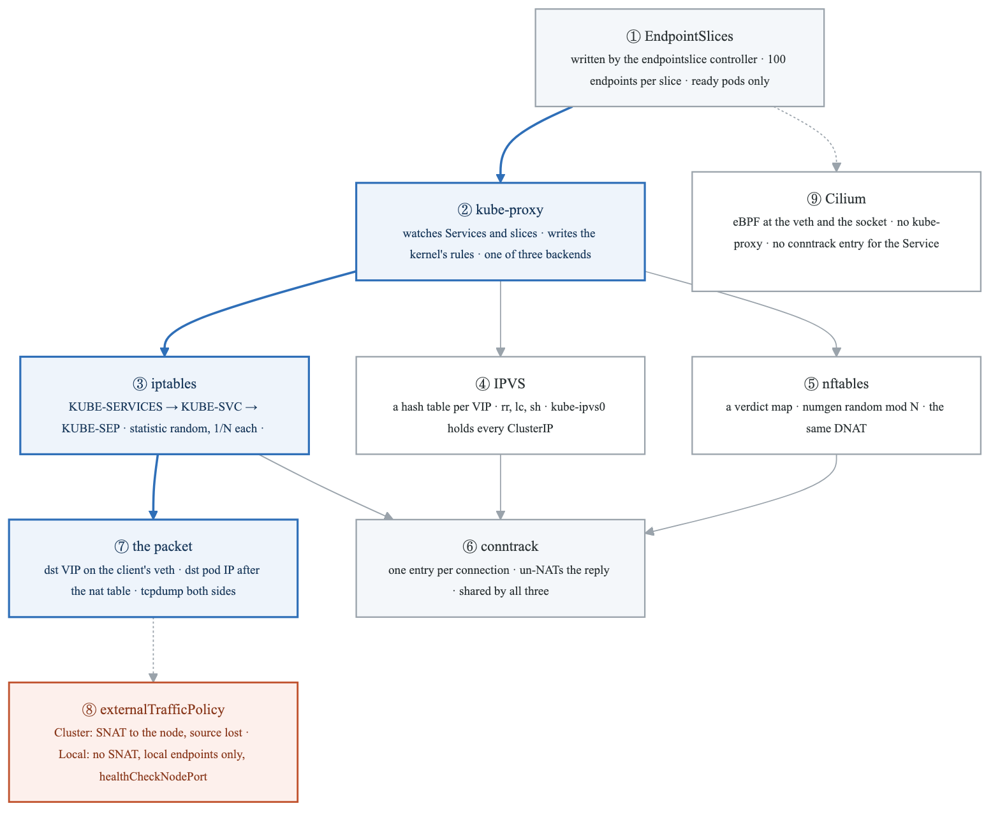

<details>
<summary>Diagram source (Mermaid)</summary>

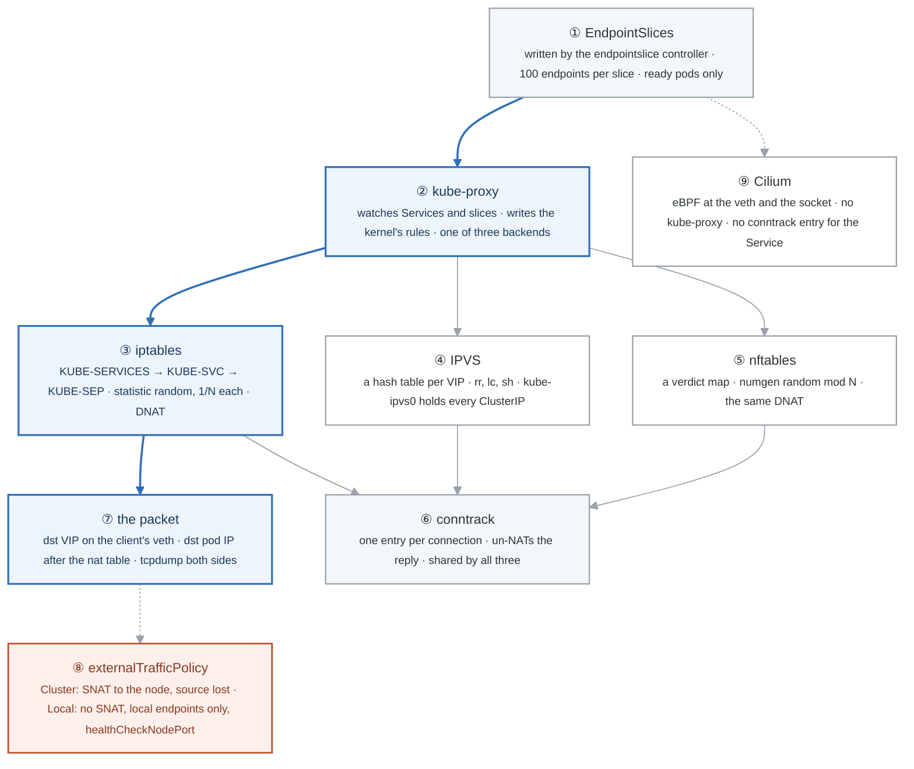

</details>

### Say it, badge by badge

- **Open.** "Week 14 said a Service is a virtual IP that kube-proxy turns into iptables rules. Here are the rules, the packet going through them, the two other kernels mechanisms that can do the same job, and the one that removes kube-proxy entirely."
- **① EndpointSlices.** "kube-proxy never looks at Pods. A controller writes the ready pod addresses for each Service into slices of up to a hundred, so one pod changing rewrites one small object. A Service with no endpoints is an empty slice, and -o yaml tells you why."
- **② kube-proxy.** "A DaemonSet that watches Services and slices and programs the kernel on its node. It owns no packets; it writes rules and leaves. Which rules depends on its mode."
- **③ iptables.** "Three chains per Service. KUBE-SERVICES matches the VIP and port and jumps to KUBE-SVC, which picks an endpoint with a random-probability rule per endpoint, one half then the rest, and jumps to KUBE-SEP, which DNATs to a pod IP. Every packet walks the list; ten thousand Services is a long list."
- **④ IPVS.** "The kernel's load balancer. One hash entry per VIP, real schedulers like round robin and source hash, and a dummy interface that holds every ClusterIP so the kernel accepts them as local. iptables stays for the masquerade decision, matching an ipset instead of a rule per Service."
- **⑤ nftables.** "The backend kube-proxy is moving to. A verdict map looks the destination up in one step and jumps to the Service's chain; a random number modulo N picks the endpoint; the DNAT is unchanged. The hash property of IPVS inside the firewall model of iptables."
- **⑥ conntrack.** "All three only rewrite the first packet's destination. Connection tracking remembers the translation and un-NATs every reply. One entry per connection, visible with conntrack -L, and the same entry whichever mode wrote the rules."
- **⑦ the packet.** "tcpdump on the client's veth shows the VIP as the destination. tcpdump on the node for the pod IP shows the same packet after the nat table. One packet, two addresses, one hook between them. That is the whole of 'virtual'."
- **⑧ externalTrafficPolicy.** "On a NodePort, Cluster mode SNATs the packet to the receiving node so the reply returns the same way, and the pod sees the node's address. Local mode drops the masquerade, keeps the client's address, and only routes to endpoints on that node, so the load balancer needs the health-check port to know which nodes have one."
- **⑨ Cilium.** "eBPF programs on the veth and at the socket layer. A pod's connect() is rewritten to a pod IP before any packet exists, so there is no per-packet NAT and no conntrack entry for the Service. kube-proxy is not installed. The rules are kernel maps, and policy and observability hang off the same hook."
- **Close.** "Slices feed a proxy that writes rules; iptables walks, IPVS hashes, nftables maps; conntrack remembers; the packet changes address once. And Cilium moves the whole thing out of netfilter. Four mechanisms, one sentence each, and you have seen all four."

### Numbers to own

| Number | Where it comes from | Why it matters |
|---|---|---|
| 3 chains | `KUBE-SERVICES` → `KUBE-SVC-*` → `KUBE-SEP-*` | the path every packet to a ClusterIP walks in iptables mode |
| 0.5, then 1.0 | `--probability` per endpoint rule | how N rules give 1/N each: the first takes half, the rest the remainder |
| 1 conntrack entry per connection | `conntrack -L -d $VIP` | the reply path; the same in all three modes |
| 100 | endpoints per EndpointSlice | one pod change rewrites one slice |
| 0 | `KUBE-SVC` rules on a Cilium node | kube-proxy replacement means no netfilter rules for Services |
| 2 addresses | one packet, before and after the nat table | the demonstration that "virtual IP" is a DNAT |
| 15 min | the from-memory target for Part 1 | chains, probability, DNAT, conntrack, both tcpdumps |

### Prove it

```bash
kubectl -n web get endpointslices -l kubernetes.io/service-name=web                     # ①
sudo iptables -t nat -S KUBE-SVC-XXXX | grep -E 'statistic|KUBE-SEP'                     # ③ the probabilities
sudo conntrack -L -d $VIP 2>/dev/null | head -1                                          # ⑥
sudo ipvsadm -Ln | grep -A2 $VIP; ip addr show kube-ipvs0 | grep -c inet                 # ④
sudo nft list table ip kube-proxy | grep -E 'vmap|numgen' | head -3                      # ⑤
sudo tcpdump -ni "$VETH" port 80 -c 2; sudo tcpdump -ni any "host $POD1 and port 80" -c 2   # ⑦
```

### The question a senior interviewer asks

*"A client behind a NodePort sees the node's IP instead of its own. Why, and what does fixing it cost?"*
Badge ⑧. Cluster mode masquerades so the reply comes back through the node that received it. Local mode keeps the source but only serves local endpoints, so balancing is uneven and the load balancer must use the health-check port to skip nodes with none. If you can also say where the SNAT rule is (KUBE-MARK-MASQ, then POSTROUTING), you are at rung three.

---

## Figure 28.9 — Go deeper: five queries for one name

> Go deeper, DNS · badges ① to ⑨ · about three minutes. This figure reads top-down.

<!-- figure: generated from the Mermaid below by _shared/diagrams/embed-figures.py — do not edit the image -->
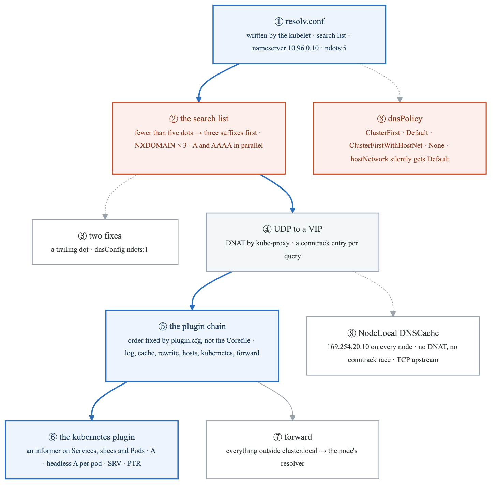

<details>
<summary>Diagram source (Mermaid)</summary>

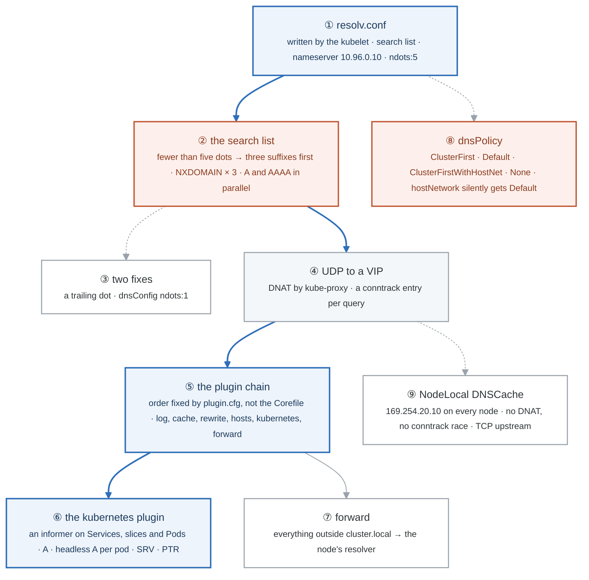

</details>

### Say it, badge by badge

- **Open.** "A pod asks for a name. Between that and an answer are a file the kubelet wrote, a search list that multiplies the question, a DNAT, a chain of plugins in an order you do not control, and a cache that exists because of a kernel race. Follow one lookup of example.com."
- **① resolv.conf.** "The kubelet wrote it: the cluster DNS address, three search suffixes for your namespace, the svc domain and the cluster domain, and ndots five. Every pod with the default policy has this file."
- **② the search list.** "A name with fewer than five dots is tried with each suffix first and as typed last. example.com has one dot, so three NXDOMAINs come back before the real question is asked, and resolvers send A and AAAA together, so that is eight packets for one answer. Ten thousand calls a minute makes this the DNS load."
- **③ two fixes.** "A trailing dot makes the name absolute and skips the list. dnsConfig with ndots one does it for the whole pod and still resolves short Service names. The default of five exists so web.other-ns works without a suffix; most clusters should not pay for it."
- **④ UDP to a VIP.** "The query goes to a ClusterIP, so it is DNATed by whichever kube-proxy mode is running, and conntrack records it. That is the datapath lab, and it is where the five-second stall in badge nine comes from."
- **⑤ the plugin chain.** "The Corefile lists plugins; the order in the file is irrelevant. CoreDNS compiles a fixed order from plugin.cfg: errors and log wrap everything, cache sits before rewrite, hosts, kubernetes and forward. So a cached answer never reaches the plugin that would compute it, which is what cache 300 did to a changed Service IP."
- **⑥ the kubernetes plugin.** "An informer on Services, slices and Pods, answering from its cache: an A record for a Service's VIP, one A per ready pod for a headless Service, an SRV for a named port, a PTR for the reverse zone. The controller pattern again, as a DNS server."
- **⑦ forward.** "Anything outside cluster.local goes to the node's resolver, with recursion requested. The log line's rd,ra flags are that handoff."
- **⑧ dnsPolicy.** "ClusterFirst is the default and the file in badge one. Default means the node's file. None means you write every line. And a hostNetwork pod with the default policy silently behaves as Default and cannot resolve Services; ClusterFirstWithHostNet is the one-line fix, and it is why node agents set it."
- **⑨ NodeLocal DNSCache.** "Two queries from the same source port at the same instant race to insert one conntrack entry; the loser is dropped and the resolver waits five seconds. A CoreDNS on every node at a link-local address takes the DNAT and the race out of the path and talks upstream over TCP. The install is a DaemonSet and a kubelet setting."
- **Close.** "File, search list, DNAT, chain, plugin, forward. Then the policy that chooses the file and the cache that removes the DNAT. One lookup, eight packets, and now you can say why each one exists."

### Numbers to own

| Number | Where it comes from | Why it matters |
|---|---|---|
| `ndots:5` | the kubelet's resolv.conf | fewer than five dots means the search list runs first |
| 3 suffixes · 3 NXDOMAINs | the search list for a one-dot name | the multiplier on every external lookup |
| 8 packets | 4 queries × A and AAAA | what one `example.com` costs without a fix |
| 1 | `dnsConfig` ndots, or a trailing dot | the fix; short Service names still resolve |
| 5 s | the resolver's default timeout | the stall a lost conntrack race produces |
| `169.254.20.10` | NodeLocal DNSCache's link-local address | no DNAT, so no conntrack entry, so no race |
| 15 min | the from-memory target for Parts 1 and 3 | the five queries, both fixes, four record types |

### Prove it

```bash
kubectl -n web exec dns -- cat /etc/resolv.conf                                          # ①
kubectl -n kube-system logs deploy/coredns | grep -c 'example.com.web.svc'               # ② the NXDOMAIN suffix tries
kubectl -n web exec dns1 -- cat /etc/resolv.conf | tail -1                               # ③ ndots:1
sudo conntrack -L -p udp --dport 53 2>/dev/null | head -2                                # ④
kubectl -n web exec dns -- dig +short SRV _http._tcp.web.web.svc.cluster.local           # ⑥
kubectl -n web exec hn -- cat /etc/resolv.conf                                           # ⑧ the node's file
kubectl -n kube-system get ds node-local-dns                                             # ⑨
```

### The question a senior interviewer asks

*"DNS in the cluster randomly takes five seconds. Where do you look?"*
Badges ② ④ ⑨, in that order: is ndots multiplying queries, is the query UDP to a VIP through DNAT, and is a conntrack race dropping the twin. The fix is NodeLocal DNSCache or a lower ndots, and saying the race out loud is what separates "restart CoreDNS" from an answer.

---

## Figure 28.10 — Go deeper: three admission engines, one policy set

> Go deeper · badges ① to ⑧ · about three minutes. Reads top-down: the chain, the three engines, and the comparison.

<!-- figure: generated from the Mermaid below by _shared/diagrams/embed-figures.py — do not edit the image -->
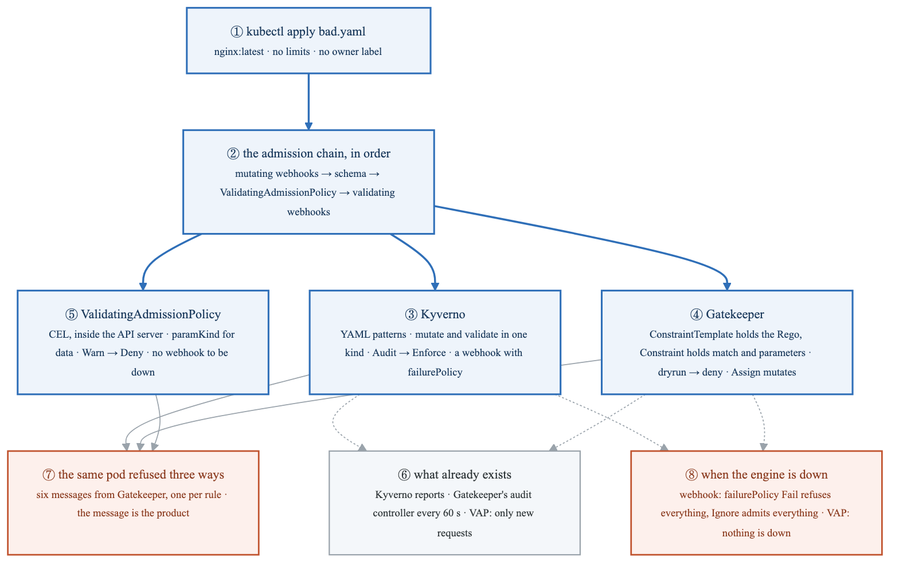

<details>
<summary>Diagram source (Mermaid)</summary>

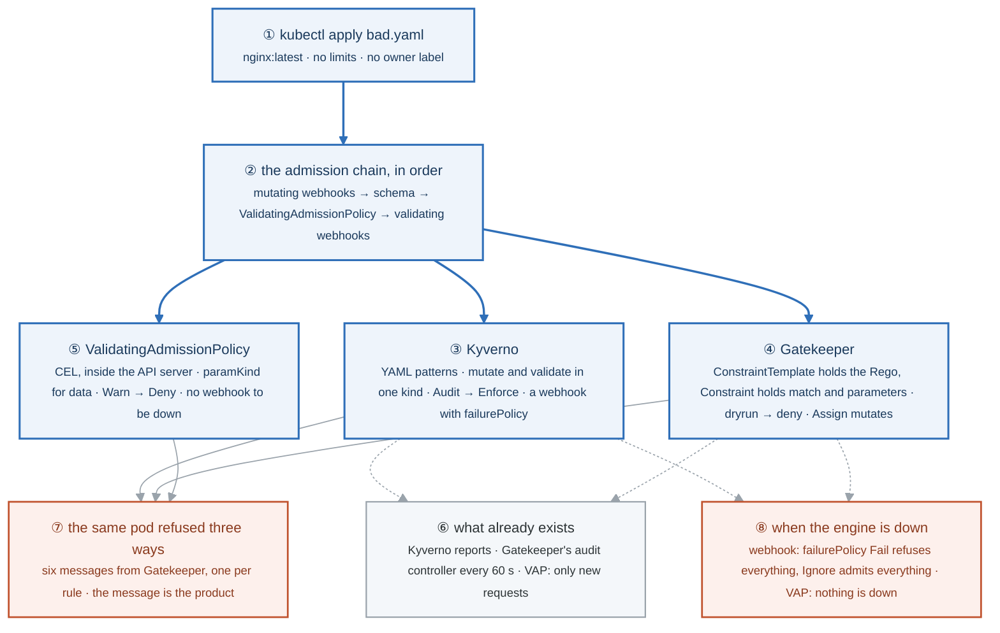

</details>

### Say it, badge by badge

- **Open.** "Week 19 wrote five policies in Kyverno. This figure is the same five in the two other engines a platform team is choosing between, and the comparison that ends the argument: the rules are the policy, the engine is the delivery."
- **① kubectl apply bad.yaml.** "One pod that breaks four rules at once: a latest tag from a foreign registry, no limits, no owner label. Keep it beside a good pod for the whole lab, so every engine is judged on the same two objects."
- **② the admission chain, in order.** "Mutating webhooks first, then schema validation, then ValidatingAdmissionPolicy, then validating webhooks. So a mutation can make a validation pass, and a VAP sees the object after every mutation. Prove it with Gatekeeper's `Assign` adding `runAsNonRoot` before a VAP that requires it."
- **③ Kyverno.** "YAML patterns, mutation and validation in the same object kind, Audit then Enforce, PolicyReports for what already exists. The decision travels through a webhook, so `failurePolicy` is a choice you make."
- **④ Gatekeeper.** "OPA in the cluster. The template holds the Rego and defines a CRD; the constraint is an instance with the match and parameters. `dryrun`, then `deny`. The input is `input.review.object`, the same engine as Lab 1 with a different document. Mutation is a separate CRD family, `Assign`, not Rego."
- **⑤ ValidatingAdmissionPolicy.** "CEL expressions evaluated inside the API server, no webhook. A binding decides where and whether it warns, audits or denies. `paramKind` points at a real object, so the registry allowlist is a ConfigMap a team edits. `parameterNotFoundAction` is the fail-open-or-closed question, asked without a webhook."
- **⑥ what already exists.** "The first thing a platform team wants: a new policy that reports what is already wrong. Kyverno has reports, Gatekeeper has an audit controller on a 60-second loop writing into constraint status. VAP judges only requests that arrive, so a cluster-wide audit needs something else."
- **⑦ the same pod refused three ways.** "Six lines from Gatekeeper, one per violated rule with the constraint's name in brackets; Kyverno names the policy and rule; VAP names the policy and binding. The message is the product: a developer reads it once and fixes the manifest without asking."
- **⑧ when the engine is down.** "A webhook that is unreachable either refuses every write or admits every write; Kyverno defaults one way, Gatekeeper the other. A VAP has nothing to be down; its `failurePolicy` only covers an expression that errors. That is the whole reason VAP exists."
- **Close.** "VAP for anything CEL can say, because it removes a webhook from the failure path. Kyverno or Gatekeeper for mutation, generated resources and audit of what exists. Gatekeeper when the organisation already writes Rego. The same five rules in whichever you pick."

### Numbers to own

| Number | Where it comes from | Why it matters |
|---|---|---|
| 5 policies × 3 engines | the lab | the same rule set delivered three ways; the rules are the policy |
| 4 stages | the admission chain | mutating webhooks → schema → VAP → validating webhooks; a mutation can make a validation pass |
| 60 s | Gatekeeper's audit interval | how long until a new constraint reports what already exists |
| 6 messages | the Gatekeeper refusal of `bad.yaml` | one per violated rule, each naming its constraint |
| 3 validation actions | a VAP binding | `Warn`, `Audit`, `Deny`; the rollout is the order they are listed in |
| 2 fail modes | `failurePolicy` and `parameterNotFoundAction` | fail open or fail closed, chosen on purpose, said out loud |
| 1 engine with no webhook | VAP | nothing to be down; the row that changes the decision |

### Prove it

```bash
kubectl apply -f bad.yaml                                                                 # ① ⑦ the refusal, per engine
kubectl get validatingwebhookconfiguration -o custom-columns='NAME:.metadata.name,FAIL:.webhooks[*].failurePolicy'   # ③ ④ ⑧
kubectl get constraints                                                                   # ④ ⑥ TOTAL-VIOLATIONS
kubectl get k8srequiredlimits require-limits -o jsonpath='{.status.violations}' | jq .   # ⑥ the audit's findings
kubectl get validatingadmissionpolicy require-limits -o jsonpath='{.status.typeChecking}'  # ⑤ the API server checked the CEL
kubectl apply -f good.yaml --dry-run=server -o jsonpath='{.spec.securityContext}'       # ② Assign ran before validation
kubectl api-resources | grep -i mutatingadmissionpolic                                   # ⑤ does this version mutate in CEL
```

### The question a senior interviewer asks

*"Kyverno, Gatekeeper, or ValidatingAdmissionPolicy?"*
Badge ⑧ first, because it is the row that decides: VAP removes a webhook from the failure path. Then ⑥, because audit of what already exists is what the other two still do better. Then the close: the same five rules in whichever you pick, and the engine is the delivery, not the policy. An answer that names a winner without those two rows is a preference, not an assessment.

---

## Redraw schedule

Same cadence as the week figure, see [`../../FIGURES.md`](../../FIGURES.md): Friday of this week after break/fix, Sunday of week 30 (the Gate 7 Sunday, so this one is cold), and the week 27 figures again this Sunday. Lab figures are redrawn **after** the week figure, one at a time, and only the badge order has to be right; the captions are the check, not the test.
