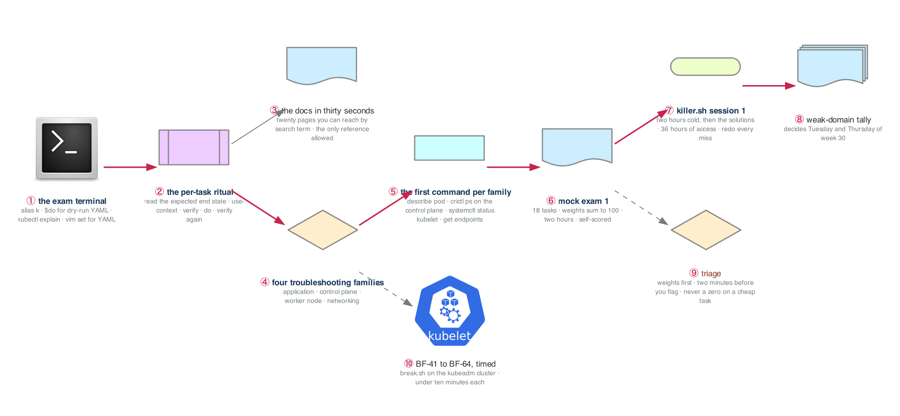

# Week 29 — Troubleshooting and Speed

> **Thesis:** the CKA is a speed test on top of a knowledge test. The knowledge is weeks 14 to 28.
> The speed is this week: a terminal you do not have to think about, a first command for every
> symptom family, and a two-hour mock run twice, once from this repo and once on the simulator the
> exam ships with.

| | |
|---|---|
| **Module** | CKA, week 3 of 4 (weeks 27 to 30). About 17 lab hours this week, alongside the week-26 cadence |
| **Hours** | ~17 on the labs · ~20 interviewing · ~10 building and applications |
| **Deliverable** | Mock exam 1 scored and logged; killer.sh session 1 scored and logged; a weak-domain tally that writes week 30's Tuesday and Thursday |
| **Break/Fix** | Twelve scenarios drawn from BF-41 to BF-64, in four families, timed |
| **Exam facts** | Planning estimates: 2 hours, about 15 to 20 weighted tasks, pass mark 66 %. Confirm in the candidate handbook at registration |

> **Both clusters this week.** The kubeadm nodes in `_setup/gcp-lab/` for anything that touches a
> node; kind for the pure-API drills. The auto-stop puts the nodes to sleep at midnight; start them
> before Lab 2 and run `bash ../_setup/03-teardown.sh` before you close the laptop.

## The week in one figure

**Figure 29.1 — The exam is a speed test, and this is the speed.** The knowledge is weeks 14 to 28. The exam measures how fast you can turn it into objects in a terminal you do not control, with a clock running. The blue path is the week: the terminal, the ritual, the four families of failure, a mock exam, and the first simulator session that tells you what to drill in week 30.

**Say it, badge by badge:** [`content/FIGURE.md`](content/FIGURE.md) — the spoken script for each of the 10 badges, about three and a half minutes; [`content/figure-29.1-numbered-spoken.pdf`](content/figure-29.1-numbered-spoken.pdf) is the printable two-page version. Read the figure before the day plan; say the script on Friday.

---

## Day plan
| Day | Focus | Lab |
|---|---|---|
| Mon | The exam terminal: aliases, imperative generation, docs in thirty seconds, the per-task ritual | Lab 1 (3h) |
| Tue | Troubleshooting on real nodes, timed: four families, three scenarios each | Lab 2 (3h) |
| Wed | Interviews and applications. No labs. | — |
| Thu | **Mock exam 1**, two hours, then scored | Lab 3 (3h) |
| Fri | **killer.sh session 1**: the two hours, then the solutions, then every missed task again | Lab 4 (3h) |
| Sat | Break/Fix: weak domains rebuilt; the triage drill; 15 applications | Lab 5 (4h) |
| Sun | The weak-domain tally that writes week 30; review the week's figures; plan week 30 | — |

## Reading map
- `_shared/drills/kubectl-speed.md` — the four tiers; Lab 1 builds on it, it does not repeat it
- `_reference/kubernetes/01-foundation/02-kubernetes-architecture-exercises-04-kubectl-advanced.md`
- `_reference/kubernetes/troubleshooting/common-issues.md` — the symptom catalogue; read it once, then close it
- `_reference/kubernetes/02-core-ops/01-networking-deep-dive-exercises-04-dns-service-discovery.md`
- `_reference/kubernetes/02-core-ops/01-networking-deep-dive-exercises-05-cni-plugins.md`
- `_shared/breakfix/06-kubernetes.md` (BF-41 to BF-50) and `_shared/breakfix/08-cluster-nodes.md` (BF-59 to BF-64)
- `week-17/labs/FIGURES.md` — figure 17.3, the nine-symptom ladder; this week adds the node and control-plane rungs
- The Kubernetes docs: the twenty pages in Lab 1, each reached by its search term in under thirty seconds

## Labs
[labs/LABS.md](labs/LABS.md) · [labs/MOCK-EXAM-1.md](labs/MOCK-EXAM-1.md) · [labs/FIGURES.md](labs/FIGURES.md) (figures 29.2 to 29.6, one per lab) · [solutions/SOLUTIONS.md](solutions/SOLUTIONS.md) · [solutions/MOCK-EXAM-1-SOLUTIONS.md](solutions/MOCK-EXAM-1-SOLUTIONS.md)

## Exit criteria
- [ ] Tier 4 of the kubectl speed drill written from blank in under 10 minutes, validated with `--dry-run=server`
- [ ] Each of the twenty docs pages reached by search term in under 30 seconds, timed
- [ ] The per-task ritual (context, verify, do, verify, note) run without skipping a step, twelve times in a row
- [ ] Twelve node-level and API-level scenarios diagnosed on the kubeadm cluster, each under 10 minutes, each logged
- [ ] Mock exam 1 completed inside two hours and self-scored; every missed task redone
- [ ] killer.sh session 1 completed inside two hours without notes; every missed task redone from the solutions
- [ ] A weak-domain tally written down, naming the two families week 30 drills
- [ ] The exam booked for Friday or Saturday of week 30 (it should have been booked at the start of week 27; if not, book it today)
