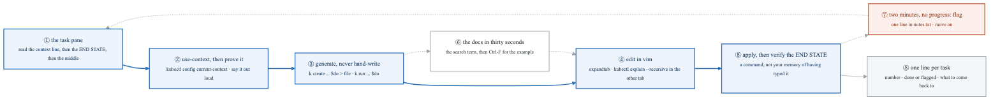
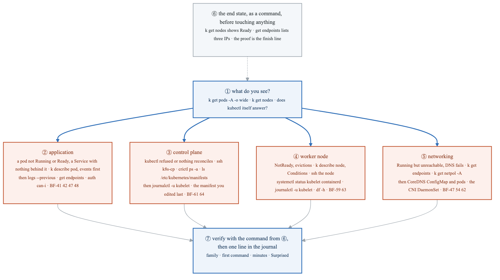
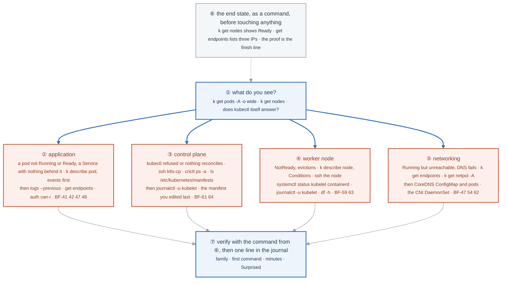
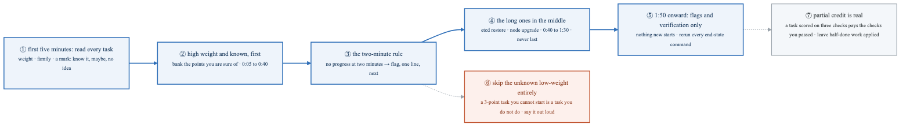

# Week 29 — Lab figures

> One figure per lab, numbered 29.2 to 29.6. Figure 29.1 is the week figure in
> [`../content/FIGURE.md`](../content/FIGURE.md); these go one level down, to the mechanism each lab
> makes you touch. Same language: gray is structure, **blue is the path to follow first**, orange-red
> is where something refuses, washed boxes are stores. Each badge line is a thirty-second interview
> answer; each whole script is under three minutes. Exam facts in this file are planning estimates;
> confirm them in the candidate handbook at registration.

**The protocol per figure**

1. **Before the lab:** read the figure, say the badges out loud once. You now know what you are about to prove.
2. **During the lab:** every badge has a **Prove it** command. Run it and watch the badge happen. A badge you cannot see happen is one you are taking on faith.
3. **After the lab:** close the file, redraw the figure, say the script. Check against the file. The badge where the order slipped goes in the *Figures redrawn* column of `progress.md`.
4. **Own the numbers.** The *Numbers to own* table is what separates "I know Kubernetes" from "two minutes with no progress means flag it, and eighteen tasks times forty seconds of ritual is twelve minutes well spent."
5. **Answer the question.** Each figure ends with the question a senior interviewer asks about it. Answer it cold, in under a minute, before the gate.

---

## Figure 29.2 — Lab 1: the per-task ritual, and why the wrong context scores zero

> Lab 1 · badges ① to ⑧ · about two and a half minutes.

```mermaid
%%{init: {'theme':'base','themeVariables':{'fontFamily':'Helvetica, Arial, sans-serif','fontSize':'13px','primaryColor':'#ffffff','primaryTextColor':'#2d3436','primaryBorderColor':'#9aa3ab','lineColor':'#9aa3ab','textColor':'#2d3436','clusterBkg':'#fbfcfd','clusterBorder':'#d4dae0','edgeLabelBackground':'#ffffff','tertiaryColor':'#eef4fb'},'flowchart':{'curve':'basis','padding':14,'nodeSpacing':42,'rankSpacing':58}}}%%
flowchart LR
  classDef default fill:#ffffff,stroke:#9aa3ab,stroke-width:1.3px,color:#2d3436
  classDef n    fill:#ffffff,stroke:#9aa3ab,stroke-width:1.3px,color:#2d3436
  classDef crit fill:#eef4fb,stroke:#2f6fb8,stroke-width:1.8px,color:#1b3a5c
  classDef data fill:#f4f7fa,stroke:#9aa3ab,stroke-width:1.3px,color:#2d3436
  classDef mut  fill:#ffffff,stroke:#cfd6dc,stroke-width:1.1px,color:#7a8288
  classDef warn fill:#fdf0ec,stroke:#c0522d,stroke-width:1.6px,color:#8a3a1e

  TASK["① the task pane<br/><small>read the context line, then the END STATE, then the middle</small>"]:::crit
  CTX["② use-context, then prove it<br/><small>kubectl config current-context · say it out loud</small>"]:::crit
  GEN["③ generate, never hand-write<br/><small>k create ... $do > file · k run ... $do</small>"]:::crit
  EDIT["④ edit in vim<br/><small>expandtab · kubectl explain --recursive in the other tab</small>"]:::crit
  APPLY["⑤ apply, then verify the END STATE<br/><small>a command, not your memory of having typed it</small>"]:::crit
  DOCS["⑥ the docs in thirty seconds<br/><small>the search term, then Ctrl-F for the example</small>"]:::n
  FLAG["⑦ two minutes, no progress: flag<br/><small>one line in notes.txt · move on</small>"]:::warn
  NOTE["⑧ one line per task<br/><small>number · done or flagged · what to come back to</small>"]:::data

  TASK ==> CTX ==> GEN ==> EDIT ==> APPLY
  GEN -.-> DOCS -.-> EDIT
  APPLY -.-> FLAG -.-> TASK
  APPLY --> NOTE
  linkStyle 0,1,2,3 stroke:#2f6fb8,stroke-width:2px
```

<!-- figure: generated from the Mermaid below by _shared/diagrams/embed-figures.py — do not edit the image -->


<details>
<summary>Diagram source (Mermaid)</summary>



</details>

### Say it, badge by badge

- **Open.** "The exam is one window: a terminal, a docs tab, a task pane. Every task is the same eight moves, and the moves are what you train this week, because the knowledge was weeks 14 to 28."
- **① the task pane.** "Read the context line first. Then read the end state the task describes, and write it down as a command. Only then read the middle. The end state is what is scored, and reading it last is how people fix the wrong thing well."
- **② use-context, then prove it.** "`kubectl config use-context`, then `current-context`, out loud, compared against the pane. A perfect task in the wrong cluster scores zero. Forty seconds of ritual, eighteen times, is twelve minutes; one wrong-context task costs more than that."
- **③ generate, never hand-write.** "Every object starts from an imperative command with `$do` redirected to a file. The generator cannot be wrong about field names, and it cannot put a tab in your YAML."
- **④ edit in vim.** "Add what the generator cannot: a probe, a toleration, a volume. `expandtab` is set, and `kubectl explain --recursive` is open in the other terminal so the field names come from the API, not from memory."
- **⑤ apply, then verify.** "Apply, then run the end-state command you wrote at ①. `get`, `describe`, `curl`, `cat` the answer file. If the command does not show the end state, the task is not done, whatever you remember typing."
- **⑥ the docs.** "Allowed, and slow if you browse. Twenty pages, each reached by one search term, then Ctrl-F for the example. Anything over thirty seconds goes on the Sunday list."
- **⑦ flag.** "Two minutes with no progress and you write one line and move on. Not five. The feeling of being nearly there is exactly the feeling that costs forty minutes."
- **⑧ one line per task.** "Number, done or flagged, what to come back to. The notes are what the last ten minutes read."
- **Close.** "Read the end, prove the context, generate, edit, apply, prove the end. Eight moves, reflex by Friday, so the two hours go on the tasks and not on the terminal."

### Numbers to own

| Number | Where it comes from | Why it matters |
|---|---|---|
| 2 hours, about 15 to 20 tasks | the exam, as a planning estimate | roughly six to eight minutes per task, ritual included |
| 66 % | the pass mark, planning estimate | about a third of the points can be left on the table; the triage drill decides which third |
| 40 seconds | the ritual overhead per task once it is reflex | 18 tasks × 40 s ≈ 12 minutes, the cheapest insurance in the exam |
| 2 minutes | the flag rule | the point where "nearly there" stops being information |
| 30 seconds | the docs budget per lookup | twenty pages, one search term each |
| 12 | Lab 1 Part 2's target, in minutes, for eight generated and edited objects | the pace the exam needs |

### Prove it

```bash
kubectl config current-context                                    # ② out loud, every task
k create deploy web --image=nginx:1.27 $do > web.yaml && head -3 web.yaml   # ③ the generator
grep -P '\t' web.yaml || echo "no tabs"                           # ④ expandtab did its job
k apply -f web.yaml && k get deploy web                            # ⑤ the end state, by command
time (k explain pod.spec.containers.livenessProbe --recursive | head -3)   # ⑥ faster than the docs for field names
```

### The question a senior interviewer asks

*"You have eighteen tasks and two hours. What do you do in the first ninety seconds?"*
Badges ②, ③ and ④: aliases, `$do`, the `.vimrc`, then read every task once. The answer that fails is "start task one".

---

## Figure 29.3 — Lab 2: the four troubleshooting families, and the first command of each

> Lab 2 · badges ① to ⑦ · about three minutes. This figure reads top-down.

<!-- figure: generated from the Mermaid below by _shared/diagrams/embed-figures.py — do not edit the image -->


<details>
<summary>Diagram source (Mermaid)</summary>



</details>

### Say it, badge by badge

- **Open.** "Thirty percent of the exam, and the part kind could not teach. Four families, each with one first command. Which family you are in is decided by what you see before you touch anything."
- **① what do you see.** "Three looks: pods across all namespaces, nodes, and whether `kubectl` itself answers. Those three outputs sort every scenario into one of four families, and the family decides the first command."
- **② application.** "A pod not Running or not Ready, or a Service with nothing behind it. `describe pod` and read the events first, because two of the three classic failures never produced a log. Then `logs --previous`, `get endpoints`, `auth can-i`. Figure 14.5 is the whole ladder."
- **③ control plane.** "`kubectl` refused, or it answers but nothing reconciles: Pending with no events, Deployments that never make pods. SSH to the control plane. `crictl ps -a` shows which static pod is exiting, `ls /etc/kubernetes/manifests` shows the four files, and the one you edited last is the one that is wrong. `journalctl -u kubelet` says why it will not start."
- **④ worker node.** "NotReady, or pods evicted from one node. `describe node` and read the Conditions: memory, disk, PID pressure, or `Kubelet stopped posting node status`. Then on the node: kubelet and containerd status, the kubelet journal, `df -h`. The fix is a service to start or a disk to clear, and `enable` if the task says reboot."
- **⑤ networking.** "Everything Running, nothing reachable. `get endpoints` first, because selector problems look like network problems. Then `get netpol -A`, because a default-deny looks like a dead network. Then CoreDNS, config and pods, then the CNI DaemonSet. Four layers, in that order."
- **⑥ the end state as a command.** "Before any of it: write the task's end state as the command that will prove it. `k get nodes` shows Ready. `get endpoints` lists three IPs. That command is the finish line, and it is what stops you from fixing something adjacent beautifully."
- **⑦ verify and log.** "Run the command from ⑥. Then one line in the journal: family, first command, minutes, and the Surprised line. The minutes trending down across twelve cases is the evidence you are ready."
- **Close.** "Look, sort, first command, ladder, prove. Four families, four first commands, and the end state written down before your hands move. That is thirty percent of the exam in one figure."

### Numbers to own

| Number | Where it comes from | Why it matters |
|---|---|---|
| 30 % | the Troubleshooting domain weight, planning estimate | the largest domain; the one kind cannot teach |
| 4 families | the lab | application · control plane · worker node · networking |
| 12 scenarios | `break.sh` | three per family, drawn from BF-41 to BF-64 |
| 10 minutes | the target per scenario | the exam's pace with the ritual included |
| 4 files | `/etc/kubernetes/manifests` | etcd, apiserver, controller-manager, scheduler: the control-plane family is almost always one of these |
| 2 services | on a worker | kubelet and containerd; most node failures are one of them stopped |

### Prove it

```bash
kubectl get pods -A -o wide | grep -v Running; kubectl get nodes                  # ① the three looks
kubectl -n shop describe pod -l app=web | sed -n '/Events/,$p'                      # ② events before logs
sudo crictl ps -a | grep -E 'apiserver|scheduler|etcd|controller'                   # ③ which static pod is exiting
kubectl describe node k8s-w2 | sed -n '/Conditions/,/Addresses/p'                   # ④ the Conditions block
kubectl -n shop get endpoints api; kubectl get netpol -A                            # ⑤ selector, then policy
```

### The question a senior interviewer asks

*"A node went NotReady at 3 a.m. Walk me through the first five minutes."*
Badge ④, then ⑥: Conditions on the node object, then kubelet and containerd on the node, then the journal, and the end state you are driving toward stated before you start. The follow-up is "and if the kubelet is running but the node is still NotReady?" That is the certificate or the CNI, BF-60 and BF-62.

---

## Figure 29.4 — Lab 3: no figure

The mock exam is the figure. Eighteen tasks, the weights, and the end states are in
[`MOCK-EXAM-1.md`](MOCK-EXAM-1.md); the scoring sheet in
[`../solutions/MOCK-EXAM-1-SOLUTIONS.md`](../solutions/MOCK-EXAM-1-SOLUTIONS.md). What to redraw
instead: figure 29.2 before the mock, figure 29.6 after it, with your own order written on it.

---

## Figure 29.5 — Lab 4: no figure

The simulator has its own interface and its own solutions; drawing it would describe someone else's
product. What to own instead: the three numbers from the session (score, minutes left, tasks missed by
family) in the journal, and the weak-domain tally that writes week 30's Tuesday and Thursday.

---

## Figure 29.6 — Lab 5: the triage order, and the two-minute rule

> Lab 5 · badges ① to ⑦ · about two and a half minutes.

```mermaid
%%{init: {'theme':'base','themeVariables':{'fontFamily':'Helvetica, Arial, sans-serif','fontSize':'13px','primaryColor':'#ffffff','primaryTextColor':'#2d3436','primaryBorderColor':'#9aa3ab','lineColor':'#9aa3ab','textColor':'#2d3436','clusterBkg':'#fbfcfd','clusterBorder':'#d4dae0','edgeLabelBackground':'#ffffff','tertiaryColor':'#eef4fb'},'flowchart':{'curve':'basis','padding':14,'nodeSpacing':42,'rankSpacing':58}}}%%
flowchart LR
  classDef default fill:#ffffff,stroke:#9aa3ab,stroke-width:1.3px,color:#2d3436
  classDef n    fill:#ffffff,stroke:#9aa3ab,stroke-width:1.3px,color:#2d3436
  classDef crit fill:#eef4fb,stroke:#2f6fb8,stroke-width:1.8px,color:#1b3a5c
  classDef data fill:#f4f7fa,stroke:#9aa3ab,stroke-width:1.3px,color:#2d3436
  classDef mut  fill:#ffffff,stroke:#cfd6dc,stroke-width:1.1px,color:#7a8288
  classDef warn fill:#fdf0ec,stroke:#c0522d,stroke-width:1.6px,color:#8a3a1e

  READ["① first five minutes: read every task<br/><small>weight · family · a mark: know it, maybe, no idea</small>"]:::crit
  ORDER["② high weight and known, first<br/><small>bank the points you are sure of · 0:05 to 0:40</small>"]:::crit
  RULE["③ the two-minute rule<br/><small>no progress at two minutes → flag, one line, next</small>"]:::crit
  LONG["④ the long ones in the middle<br/><small>etcd restore · node upgrade · 0:40 to 1:30 · never last</small>"]:::crit
  LAST["⑤ 1:50 onward: flags and verification only<br/><small>nothing new starts · rerun every end-state command</small>"]:::crit
  SKIP["⑥ skip the unknown low-weight entirely<br/><small>a 3-point task you cannot start is a task you do not do · say it out loud</small>"]:::warn
  PART["⑦ partial credit is real<br/><small>a task scored on three checks pays the checks you passed · leave half-done work applied</small>"]:::data

  READ ==> ORDER ==> RULE ==> LONG ==> LAST
  RULE -.-> SKIP
  LAST -.-> PART
  linkStyle 0,1,2,3 stroke:#2f6fb8,stroke-width:2px
```

<!-- figure: generated from the Mermaid below by _shared/diagrams/embed-figures.py — do not edit the image -->


<details>
<summary>Diagram source (Mermaid)</summary>



</details>

### Say it, badge by badge

- **Open.** "Eighteen tasks of unequal weight and one clock. Order is worth more points than most candidates believe, because the long tasks eat twenty minutes each and a flagged task you return to with five minutes left scores nothing."
- **① read every task.** "Five minutes, before any command. Next to each: the weight, the family, and one of three marks: know it, maybe, no idea. The marks are the order."
- **② high weight and known, first.** "Bank the points you are certain of in the first forty minutes. Confidence early also steadies the hands for the rest."
- **③ the two-minute rule.** "Two minutes into a task with no progress, one line in the notes and the next task. Two, not five. The thing that feels like being nearly there is the thing that costs forty minutes."
- **④ the long ones in the middle.** "An etcd restore or a node upgrade takes fifteen to twenty minutes done right. At 1:50 that is a panic; at 0:45 it is a task. They go after the banked points and before the flags."
- **⑤ the last ten minutes.** "From 1:50, nothing new starts. Return to flagged tasks you half-finished, and rerun every end-state command you wrote. Verification is where the last few points come from, not a nineteenth attempt."
- **⑥ skip the unknown low-weight.** "A three-point task you cannot start is a task you do not do. Saying it out loud is the hard part; the pass mark leaves a third of the points on the table by design."
- **⑦ partial credit is real.** "A task scored on three checks pays for the checks you passed. Leave half-done work applied; do not delete it in frustration, and do not undo a working half to try a different whole."
- **Close.** "Read, bank, two minutes, long ones in the middle, verify at the end. The same eighteen tasks score differently in a different order, and the order is a skill you can drill in five minutes a day."

### Numbers to own

| Number | Where it comes from | Why it matters |
|---|---|---|
| 5 minutes | the read-through | the only five minutes with no command in them, and the best spent |
| 0:40 | the end of the banking phase | the sure points are in; the long tasks begin |
| 2 minutes | the flag rule | the cut-off for "no progress" |
| 15 to 20 minutes | an etcd restore or a node upgrade done right | why they cannot be last |
| 1:50 | when nothing new starts | the last ten minutes are flags and verification |
| 34 % | the points the pass mark lets you leave (100 − 66) | permission to skip, in writing |

### Prove it

```bash
# the drill is paper, but the end-state reruns at 1:50 are commands; collect them as you go
cat /opt/answers/notes.txt                                        # ⑤ every flag, every end-state command
grep -c flagged /opt/answers/notes.txt                            # how many returns the last ten minutes must fit
```

### The question a senior interviewer asks

*"You are on call, three alerts fire at once, one is a page. How do you order them?"*
Badges ① and ②: read all three before touching one, then the highest impact you can actually move. The CKA version and the on-call version are the same answer; interviewers ask it to hear whether you have an order at all.

---

## Redraw schedule

Same cadence as the week figure, see [`../../FIGURES.md`](../../FIGURES.md): Friday of this week after the simulator, Sunday of week 30 (the module's last day), and cold before the exam. Lab figures are redrawn **after** the week figure; figures 29.2 and 29.6 are the two to be able to draw on the back of the exam's scratch paper.
