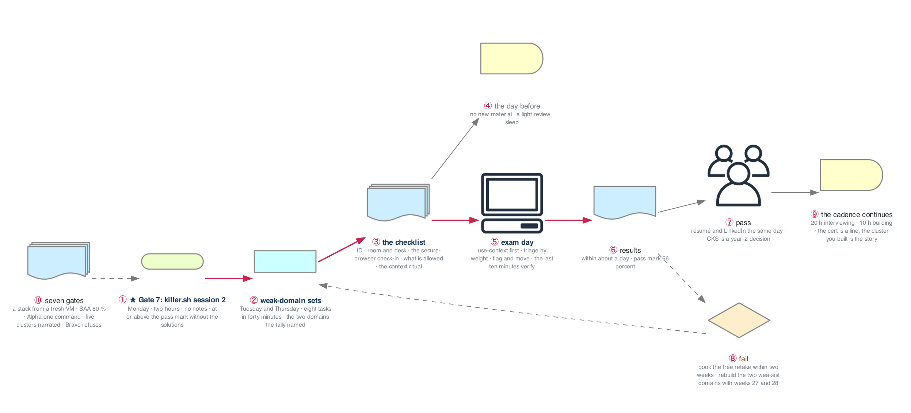

# Week 30 — Exam Week ★ GATE 7

> **Thesis:** nothing new is learned this week. The second simulator session is the gate; the two
> weakest families get three timed sets each; the exam is sat on Friday or Saturday, booked since
> week 27. The rest of the week protects sleep, the desk, and the ritual.

| | |
|---|---|
| **Module** | CKA, week 4 of 4 (weeks 27 to 30). About 15 lab hours this week, alongside the week-26 cadence |
| **Hours** | ~15 on the labs and the exam · ~20 interviewing · ~10 building and applications |
| **★ GATE 7** | The second killer.sh session finished inside two hours, at or above the pass mark, without opening the solutions. Then the exam is sat |
| **Deliverable** | The CKA, or a retake booked within two weeks with the two weakest domains named |
| **Exam facts** | Planning estimates: 2 hours, about 15 to 20 weighted tasks, pass mark 66 %, results within 24 hours, one free retake, certificate valid two years. Confirm in the candidate handbook at registration |

> **The nodes stay up this week** for Tuesday and Thursday; let the auto-stop take them at midnight
> and start them before each set. After the exam, `terraform apply -var kubeadm_nodes=0` in
> `_setup/gcp-lab/` or leave them for week 31's CKS decision.

## The week in one figure

**Figure 30.1 — Exam week: the second simulator session is the gate.** Nothing new is learned this week. The second killer.sh session is Gate 7; two drill days close the weak domains it names; the checklist removes the avoidable ways to fail; then the exam, and the cadence continues either way.

**Say it, badge by badge:** [`content/FIGURE.md`](content/FIGURE.md) — the spoken script for each of the 10 badges, about three minutes; [`content/figure-30.1-numbered-spoken.pdf`](content/figure-30.1-numbered-spoken.pdf) is the printable two-page version. Read the figure before the day plan; say the script on Friday.

---

## Day plan
| Day | Focus | Lab |
|---|---|---|
| Mon | **killer.sh session 2: the Gate 7 attempt.** Two hours, scored, logged; the solutions afterwards | Lab 1 (3h) |
| Tue | Weak family one: three timed sets of eight tasks, forty minutes each | Lab 2 (3h) |
| Wed | Interviews and applications. No labs. | — |
| Thu | Weak family two: three timed sets; then the exam checklist, the desk, the check-in rehearsal | Lab 2, Lab 3 (3h) |
| Fri | **Exam day** (or Saturday). Nothing new the day before. | Lab 4 (3h) |
| Sat | Exam day if Friday was not; otherwise 15 applications and nothing else technical | Lab 4 |
| Sun | Results, the retrospective, résumé and LinkedIn, the CKS decision, the fallback if needed; plan week 31 | Lab 5 (2h) |

## Reading map
- Nothing new. The reading this week is your own: the incident journal entries from weeks 27 to 29, the Numbers-to-own tables of figures 27.2 to 29.6, and `_shared/drills/kubectl-speed.md` Tier 4 once a day
- The candidate handbook and the exam's technical requirements page, read in full on Thursday, not Friday
- `week-29/labs/LABS.md` Lab 1 Part 5 (the ritual) and Lab 5 Part 2 (the triage rules), on Thursday evening
- `ROADMAP.md` §8 for the CKS line, on Sunday

## Labs
[labs/LABS.md](labs/LABS.md) · [labs/MOCK-EXAM-2.md](labs/MOCK-EXAM-2.md) · [labs/FIGURES.md](labs/FIGURES.md) (figures 30.2 to 30.7, one per lab plus the Go deeper labs) · [solutions/SOLUTIONS.md](solutions/SOLUTIONS.md) · [solutions/MOCK-EXAM-2-SOLUTIONS.md](solutions/MOCK-EXAM-2-SOLUTIONS.md) · [Kubernetes thread](../KUBERNETES-THREAD.md#week-30)

## Exit criteria
- [ ] ★ **Gate 7:** killer.sh session 2 completed inside two hours, at or above the pass mark, solutions closed until the timer stopped; score and minutes-left logged
- [ ] Six timed sets from Mock Exam 2 completed, two families, scored; the second attempt at each family faster than the first
- [ ] The exam checklist run once on Thursday as a rehearsal: ID, room, desk, the secure-browser check, the ritual
- [ ] The exam sat
- [ ] Results logged within 24 hours; the retrospective written (what the simulator predicted, what it did not)
- [ ] Pass: résumé, LinkedIn, and the tracker updated the same day. Fail: the free retake booked within two weeks and the two weakest domains named with the week that rebuilds each
- [ ] The CKS decision written down: year 2, per `ROADMAP.md`, unless a target employer's postings say otherwise
- [ ] Back on the week-26 cadence on Monday of week 31
