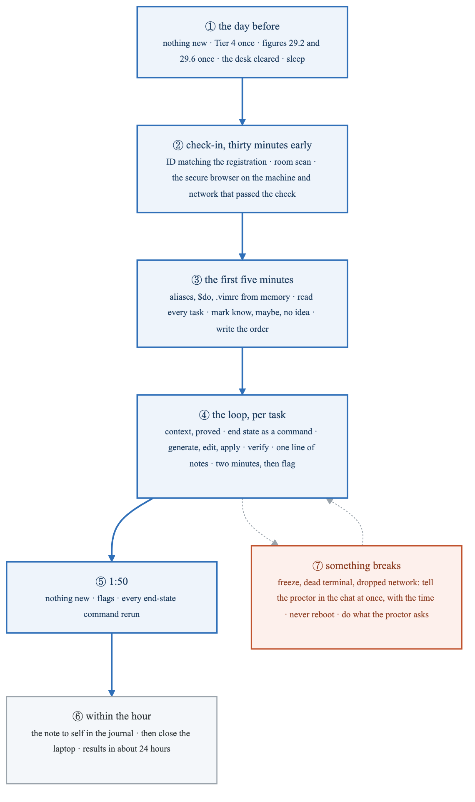
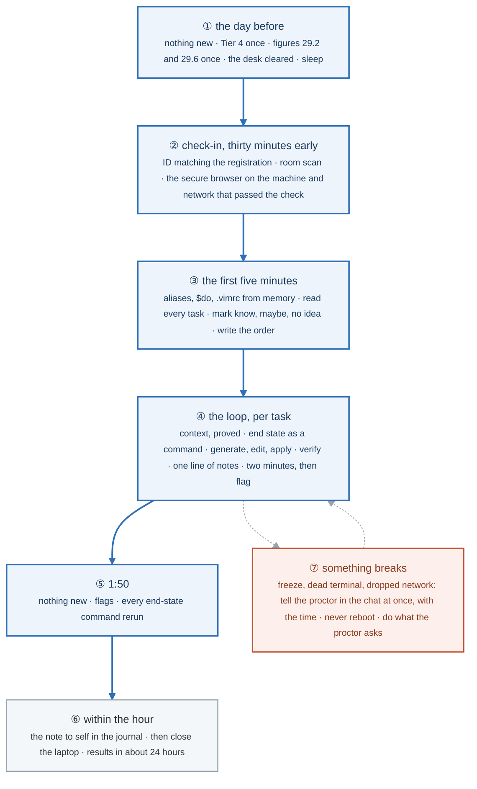
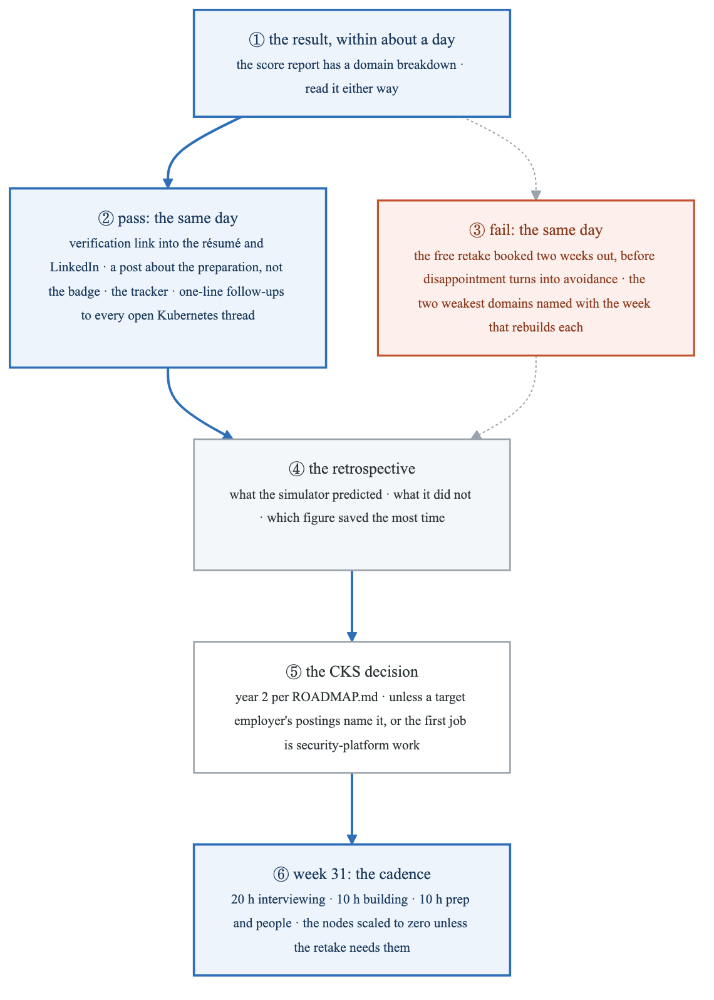
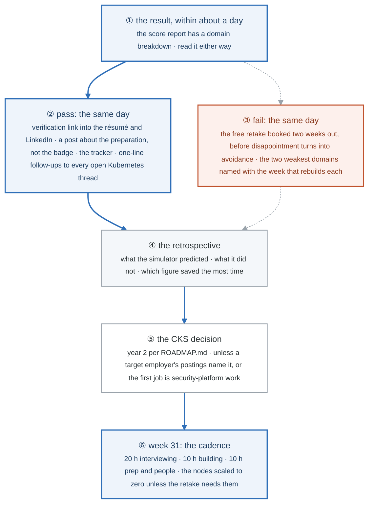
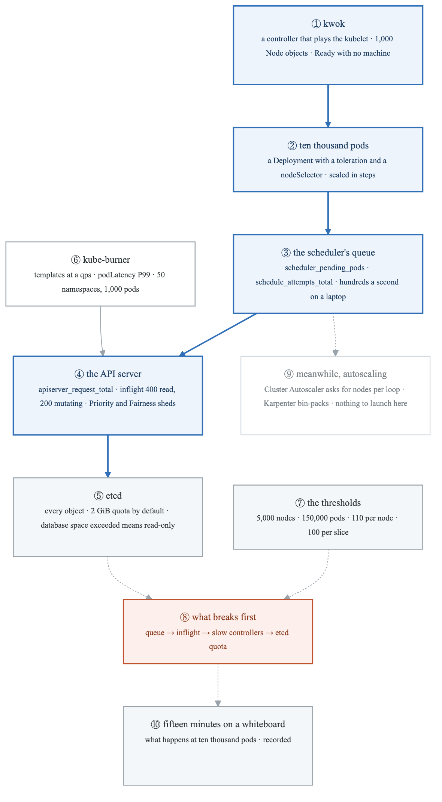
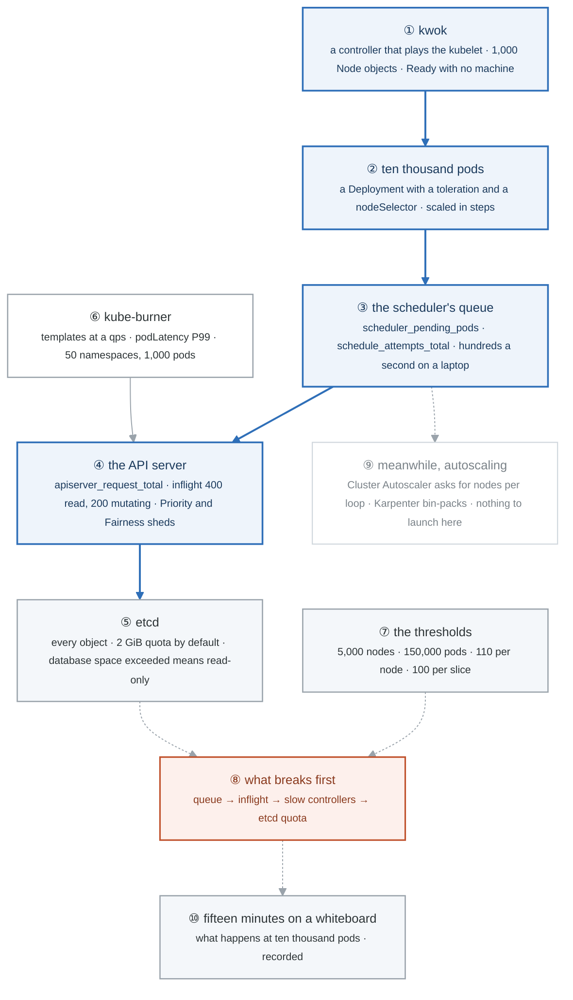

# Week 30 — Lab figures

> One figure per lab, numbered 30.2 to 30.6, then 30.7 for the "Go deeper" scale lab of the mastery
> ladder. Figure 30.1 is the week figure in
> [`../content/FIGURE.md`](../content/FIGURE.md); these go one level down, to the mechanism each lab
> makes you touch. Same language: gray is structure, **blue is the path to follow first**, orange-red
> is where something refuses, washed boxes are stores. Each badge line is a thirty-second interview
> answer; each whole script is under three minutes. Exam facts in this file are planning estimates;
> confirm them in the candidate handbook at registration.

**The protocol per figure**

1. **Before the lab:** read the figure, say the badges out loud once. You now know what you are about to prove.
2. **During the lab:** every badge has a **Prove it** command. Run it and watch the badge happen. A badge you cannot see happen is one you are taking on faith.
3. **After the lab:** close the file, redraw the figure, say the script. Check against the file. The badge where the order slipped goes in the *Figures redrawn* column of `progress.md`.
4. **Own the numbers.** The *Numbers to own* table is what separates "I know Kubernetes" from "thirty minutes early, because check-in eats the thirty minutes and arriving late eats the exam."
5. **Answer the question.** Each figure ends with the question a senior interviewer asks about it. Answer it cold, in under a minute, before the gate.

---

## Figure 30.2 — Lab 1: no figure

The gate attempt is figure 29.6 run under the gate's rules, and the simulator's own interface is not
ours to draw. What to own instead: the three numbers in the scoring sheet in
[`../assessment.md`](../assessment.md) (score, minutes left, misses by family), and the decision
table in [`LABS.md`](LABS.md): near miss sits, wide miss moves the exam a week today.

---

## Figure 30.3 — Lab 2: no figure

The sets are drills on the figures of the week that taught each family: 29.3 for Set A, 27.2 to
27.5 for Set B, 28.2 to 28.6 for Set C. Redraw the relevant one between runs; the third run's time is
the measurement.

---

## Figure 30.4 — Lab 3: exam day, from the day before to the note to self

> Lab 3 and Lab 4 · badges ① to ⑦ · about two and a half minutes. This figure reads top-down.

<!-- figure: generated from the Mermaid below by _shared/diagrams/embed-figures.py — do not edit the image -->


<details>
<summary>Diagram source (Mermaid)</summary>



</details>

### Say it, badge by badge

- **Open.** "Exam day has no technical content. Everything technical was drilled to reflex by Thursday. This figure is the sequence that protects the reflex: the day before, the check-in, the first five minutes, the loop, the last ten, and what to do when the room, not the cluster, breaks."
- **① the day before.** "Nothing new. One run of the speed drill's Tier 4, one read of the two figures that matter, the desk cleared, and sleep. A short night costs more points than a day of study buys, and that is not a motivational line; it is the literature."
- **② check-in.** "Thirty minutes early, because check-in takes the thirty minutes. ID whose name matches the registration exactly, the room scan, the secure browser on the machine and network that passed the check last week. Three of the stories about lost attempts are these three lines."
- **③ the first five minutes.** "The aliases, `$do`, the `.vimrc`, from memory. Then read every task once with its weight, mark each know, maybe, or no idea, and write the order. The clock is running, and these are the best five minutes on it."
- **④ the loop.** "Per task: context proved, end state written as a command, generate, edit, apply, verify, one line of notes. Two minutes with no progress means flag. It is figure 29.2 inside figure 29.6, and it is the only thing you think about for a hundred minutes."
- **⑤ 1:50.** "Nothing new starts. Return to the flags you half-finished, then rerun every end-state command. The last ten minutes are verification, and verification is where the last few points live."
- **⑥ within the hour.** "The note to self, before the result: what felt like the simulator, what did not, the longest task, the slow lookups, any wrong-context moment, one line to Thursday-you. Then the laptop closes. The result comes in about a day, and refreshing does not shorten it."
- **⑦ something breaks.** "A frozen desktop, a dead terminal, a dropped network. Tell the proctor in the chat immediately, with the time. Never reboot, never close the browser; the proctor can pause and restore, and the chat is the record. If the proctor asks for the desk again, show it at once."
- **Close.** "Sleep, arrive early, five minutes to read, the loop, verify at the end, write the note. The exam is two hours of reflex; the day around it is what keeps the reflex available."

### Numbers to own

| Number | Where it comes from | Why it matters |
|---|---|---|
| 30 minutes | arrive before the start time | check-in uses them; arriving at the start time uses the exam |
| 5 minutes | the read-through | the only five minutes without a command, and the best spent |
| 2 minutes | the flag rule | the cut-off for "no progress" |
| 1:50 | when nothing new starts | flags and verification only |
| 1 hour | the window for the note to self | before the result colours the memory |
| ~24 hours | results, planning estimate | nothing to do in it but the cadence |
| 3 | checklist items that cost whole attempts | the system check on the wrong setup, a mismatched ID name, arriving late |

### Prove it

```bash
# Thursday evening, the rehearsal: the only commands on the list
kubectl config current-context                                        # ④ the ritual, out loud, once more
time (kubectl explain pod.spec.containers.livenessProbe --recursive | head -1)   # ③ the docs reflex is intact
cat ~/.vimrc                                                          # ③ typed from memory tomorrow; read it today
```

### The question a senior interviewer asks

*"How do you prepare for something high-stakes where you cannot study your way out of nerves?"*
Badges ①, ③ and ⑤: protect sleep, spend the first minutes reading rather than acting, and keep the last minutes for verification. The CKA is a concrete instance of an answer every interviewer has a version of.

---

## Figure 30.5 — Lab 4: no figure

Exam day is figure 30.4, badges ② to ⑥, lived rather than drawn. What to own instead: the note to
self within the hour, in the journal, in the shape shown in
[`../solutions/SOLUTIONS.md`](../solutions/SOLUTIONS.md).

---

## Figure 30.6 — Lab 5: after the result, both branches

> Lab 5 · badges ① to ⑥ · about two minutes. This figure reads top-down.

<!-- figure: generated from the Mermaid below by _shared/diagrams/embed-figures.py — do not edit the image -->


<details>
<summary>Diagram source (Mermaid)</summary>



</details>

### Say it, badge by badge

- **Open.** "Two branches, and they rejoin within a day. The pass branch is administrative and immediate; the fail branch is a booking and two named domains, also immediate. Both lead to the same retrospective and the same Monday."
- **① the result.** "It arrives in about a day, with a domain breakdown. Read the breakdown on a pass as well as on a fail; the weakest domain on a pass is the first thing an interviewer will find."
- **② pass.** "The same day: the verification link into the résumé and LinkedIn, a post that says what the preparation actually was rather than the badge, the tracker updated, and a one-line follow-up to every open thread that mentions Kubernetes. The certificate is worth most in the week it is new."
- **③ fail.** "The same day: the free retake booked for two weeks out, before the disappointment has time to become avoidance. The two weakest domains from the report, each with the week that rebuilds it: 27 for architecture and node work, 28 for workloads and networking, 29 for speed. It is a date on the calendar, not a verdict."
- **④ the retrospective.** "Three questions in the journal. What did the simulator predict, what did it miss, and which figure saved the most time. The last one decides which figures stay in the monthly redraw and which can rest."
- **⑤ the CKS decision.** "Year two, per the roadmap: it assumes CKA and operating experience, and its hours belong to interviewing now. Two overrides: a target employer's postings naming it, or the first job being security-platform work. Otherwise write 'revisit at month 12' and move on."
- **⑥ week 31.** "Monday is the cadence: twenty hours interviewing, ten building, ten on preparation and people. The kubeadm nodes go to zero unless the retake needs them. The exam, passed or booked, becomes the STAR story about learning something hard on a deadline."
- **Close.** "Result, branch, rejoin, decide, continue. The module ends either way on the same Monday, and that is the design."

### Numbers to own

| Number | Where it comes from | Why it matters |
|---|---|---|
| ~24 hours | results, planning estimate | the branch is chosen within a day |
| 2 weeks | the retake booking distance | long enough to rebuild two domains, short enough to keep the rest warm |
| 1 free retake | the exam package, planning estimate | the fallback is funded; the plan is to not need it |
| 2 years | certificate validity, planning estimate | the renewal date goes in the calendar the day it is passed |
| 2 | domains named on a fail | not three; two rebuilt properly beats three skimmed |
| month 12 | the CKS revisit | written down so the question stops being asked weekly |

### Prove it

```bash
grep -c '^## BF-' progress/incident-journal.md        # ④ how many loops the module added to the story bank
cd curriculum/_setup/gcp-lab && terraform plan -var kubeadm_nodes=0 | tail -3   # ⑥ what week 31 destroys, before it does
```

### The question a senior interviewer asks

*"Tell me about a time you failed at something you had prepared for."*
Badge ③, told as a sequence: the booking the same day, the two domains, the rebuild, the retake. Interviewers ask this to hear whether a setback produced a plan or a pause; the figure is the plan.

---

## Figure 30.7 — Go deeper: the cluster you cannot afford

> Go deeper, resources and scale · badges ① to ⑩ · about three minutes. This figure reads top-down.

<!-- figure: generated from the Mermaid below by _shared/diagrams/embed-figures.py — do not edit the image -->


<details>
<summary>Diagram source (Mermaid)</summary>



</details>

### Say it, badge by badge

- **Open.** "Three nodes taught the objects. The judgement a platform engineer is paid for shows up at a thousand nodes, and you cannot rent that for an afternoon. So fake the nodes, keep the control plane real, and watch where it bends."
- **① kwok.** "A controller in the cluster that watches Nodes and Pods with its annotation and does what a kubelet would: marks the node Ready, moves pods to Running, never starts a container. A thousand Node objects from one template, applied in a loop, in under a minute."
- **② ten thousand pods.** "A Deployment of pause containers that tolerates the fake taint and selects the fake nodes, scaled in steps. Nothing pulls an image, so every second of latency belongs to the control plane."
- **③ the scheduler's queue.** "scheduler_pending_pods is the backlog; schedule_attempts_total over the wall clock is throughput, on the order of hundreds a second here. Filter, score, bind, per pod, from one queue. That is the number you quote when someone asks how fast Kubernetes schedules."
- **④ the API server.** "Every create, patch and watch is a request. The inflight limits, four hundred reads and two hundred mutations by default, are its protection against itself, and Priority and Fairness queues what exceeds them. Watch the inflight gauge sit at the limit and the queue length climb."
- **⑤ etcd.** "Every object, a few kilobytes each, in a database with a two-gibibyte quota by default. Compaction and defragmentation keep it small; past the quota it turns read-only and the cluster stops accepting writes. That is the hard wall."
- **⑥ kube-burner.** "Objects from templates at a rate, with a report: how long pods took to be scheduled and Ready, at P50 and P99. Raise the qps until the API server's queue appears in the metrics; that is load testing a control plane."
- **⑦ the thresholds.** "The published limits: five thousand nodes, a hundred and fifty thousand pods, a hundred and ten per node, a hundred endpoints per slice. Each has a reason, and the reason is the number to know: watch fan-out, list sizes in memory, the kubelet's bookkeeping, the cost of one pod changing."
- **⑧ what breaks first.** "The queue grows but keeps up. Then inflight requests queue and latency climbs. Then controllers that list large kinds fall behind. Then etcd nears its quota. In that order, each with a metric. Say the order and you have explained a real outage you have not had yet."
- **⑨ meanwhile, autoscaling.** "A Cluster Autoscaler would read the same Pending pods and ask the cloud for nodes, a group at a time, every loop. Karpenter would bin-pack them into the fewest, largest instances it can launch in one call. Here there is nothing to launch, which is the point: the data plane is removed so you can see the control plane."
- **⑩ the drill.** "Fifteen minutes, whiteboard, recorded, no notes: what happens at ten thousand pods. Objects, scheduler, watches, slices, capacity, the first three failures in order. Rung three of two topics at once."
- **Close.** "Fake the nodes, load the control plane, read the metrics, know the thresholds, name the order things break. The exam asked whether you can operate a cluster; this is whether you know where it stops."

### Numbers to own

| Number | Where it comes from | Why it matters |
|---|---|---|
| 1,000 nodes · 110 pods each | the kwok node template | the capacity ceiling the lab hits on purpose at 15,000 replicas |
| 400 / 200 | `max-requests-inflight` and its mutating twin, by default | the API server's self-protection; P&F queues above it |
| 2 GiB | etcd's default backend quota | the hard wall; 8 GiB is the recommended maximum |
| 5,000 · 150,000 · 300,000 | nodes, pods, containers per cluster | the published limits, each with a mechanism behind it |
| 100 | endpoints per slice | why one pod changing is cheap |
| P99 | kube-burner's podLatency | the number a load test reports; the median hides the queue |
| 15 min | the whiteboard drill | rung three, recorded |

### Prove it

```bash
kubectl get nodes -l type=kwok --no-headers | awk '{print $2}' | sort | uniq -c           # ① 1000 Ready
kubectl get pods --no-headers | awk '{print $3}' | sort | uniq -c                           # ② Pending draining
curl -sk -H "Authorization: Bearer $(kubectl create token default)" https://localhost:10259/metrics | grep '^scheduler_pending_pods'   # ③
kubectl get --raw /metrics | grep -E '^apiserver_current_inflight_requests'                # ④
docker exec scale-control-plane etcdctl ... endpoint status -w table                      # ⑤ DB SIZE
cat podLatency-summary* | head                                                             # ⑥
kubectl get pods --field-selector status.phase=Pending -o jsonpath='{.items[0].status.conditions[0].message}'   # ⑧ "Too many pods"
```

### The question a senior interviewer asks

*"What is the first thing that breaks when a cluster gets big, and how would you know?"*
Badge ⑧, with the metric for each step. The weak answer is "etcd"; the strong one is the order, and that etcd is last because by then the API server has been queueing for a while and you had three earlier signals.

---

## Redraw schedule

This is the module's last week. Figures 30.4 and 30.6 are read, not redrawn: 30.4 on Thursday evening and on exam morning, 30.6 on the day of the result. From week 31 the module's figures join the monthly rotation in [`../../FIGURES.md`](../../FIGURES.md), with the one that saved the most time (retrospective, badge ④) redrawn first.
